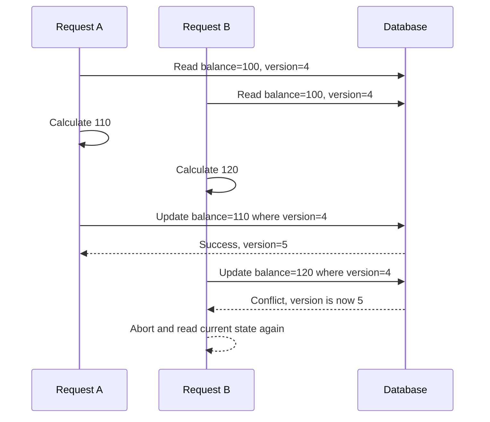

# ABORTED

In gRPC, **ABORTED is status code 10**, typically indicating that an operation was aborted due to a conflict that must be handled at the transaction or business workflow level. A typical scenario is two requests reading the same version of data and then attempting to update it; only one succeeds, while the other detects that the data changed and must re-read before deciding how to proceed.

In **SPRING_GRPC**, ABORTED is especially useful when an application uses optimistic locking, transaction isolation, or concurrency control mechanisms. The client usually needs to retry **the entire read–compute–write cycle** with fresh data, rather than resending only the failed write statement. Retries must be bounded, respect deadlines, and ensure side effects are not duplicated.

## 1. Meaning of ABORTED

ABORTED has the numeric value **10**. This status applies when an RPC fails due to a conflict requiring the caller to restart a higher-level workflow, typically a transaction or read-modify-write cycle.

| Perspective | Meaning |
| --- | --- |
| Client | The operation was aborted due to a conflict; may need to re-read data and recompute |
| Server | Transaction or concurrency check detected a conflict and cannot safely continue |
| gRPC runtime | Terminates the RPC with status ABORTED |
| Business | This update's outcome was not accepted; the caller needs to re-decide based on fresh state |

For example:

- Two users edit the same record concurrently; one saves first, and the other's version is now stale.
- Two workers update an account's balance or status at the same time.
- A transaction is aborted due to a database-level serialization conflict.
- A reservation operation discovers that the resource was already claimed by a competing transaction.
- A read–validate–write sequence becomes invalid because data changed between steps.

ABORTED does not mean the server crashed, the service lost connectivity, or the request has invalid syntax. It describes an operation aborted due to conflict under the API's semantics.

## 2. Why is ABORTED needed in concurrent systems?

Many RPCs follow a read, compute, and write pattern:

1. Read the current state.
2. Check business conditions.
3. Compute the new value.
4. Write the change.

If multiple requests run concurrently, data can change after the read step and before the write step. If the server still writes a value computed from stale data, it can overwrite newer updates or produce incorrect results.

Example of two requests incrementing a balance from 100:



Without conflict detection, request B could write 120 based on the stale balance of 100, losing request A's increment of 10. Optimistic locking detects that the version changed and rejects the stale write.

## 3. Distinguishing ABORTED from nearby statuses

| Status | Meaning | Example |
| --- | --- | --- |
| ABORTED | Transaction/concurrency conflict; must re-run the read-modify-write workflow | Optimistic locking version mismatch |
| FAILED_PRECONDITION | Current state does not satisfy business conditions | Order is unpaid so it cannot ship yet |
| UNAVAILABLE | Service or dependency is temporarily unable to serve | Connection to server/database interrupted |
| ALREADY_EXISTS | Resource to create already exists | Creating a user with an already-used email |
| INVALID_ARGUMENT | Request contains invalid arguments | Malformed ID |
| PERMISSION_DENIED | Caller lacks permission to perform the operation | User may not edit someone else's profile |
| DEADLINE_EXCEEDED | RPC did not finish before the deadline | Server responded after deadline |

### 3.1. ABORTED and FAILED_PRECONDITION

FAILED_PRECONDITION describes a business condition that is currently unmet. The same request may succeed after state advances through the workflow. ABORTED describes a conflict during execution, typically requiring re-reading and re-running the processing cycle.

For example:

- Order is unpaid so ShipOrder is rejected: FAILED_PRECONDITION.
- Two transactions update an order concurrently; one loses the optimistic lock: ABORTED.

### 3.2. ABORTED and UNAVAILABLE

UNAVAILABLE usually suggests the service is temporarily unable to serve; the client can retry the call per policy if safe. ABORTED typically requires the caller to re-run higher-level logic, because the input data used for computation has changed.

For example, resending the exact same UPDATE statement based on an old version will keep failing. The caller must read the new version, re-evaluate the change, and produce a new update.

### 3.3. ABORTED and ALREADY_EXISTS

If CreateReservation fails because the reservation code already exists, ALREADY_EXISTS usually expresses the exact cause. If two transactions compete and one is aborted by the database due to a serialization conflict, ABORTED may fit. Choose the status according to what the client needs to handle, not merely the lowest-level exception type.

## 4. Optimistic locking in Spring Data JPA

Optimistic locking works well when conflicts are infrequent and the application wants to avoid holding long locks. JPA supports a version field via the @Version annotation.

Entity example:

```java
@Entity
@Table(name = "accounts")
public class AccountEntity {
    @Id
    private String id;

    private long balance;

    @Version
    private long version;

    // getters and domain operations
}
```

When updating the entity, JPA uses version to verify the data was not modified by another transaction. If the version no longer matches, the operation may throw OptimisticLockException or a Spring exception such as ObjectOptimisticLockingFailureException, depending on the layer and provider.

A service updating a balance might look like this:

```java
@Service
public class AccountCommandService {
    private final AccountRepository repository;

    public AccountCommandService(AccountRepository repository) {
        this.repository = repository;
    }

    @Transactional
    public Account adjustBalance(String accountId, long delta) {
        AccountEntity account = repository.findById(accountId)
            .orElseThrow(AccountNotFoundException::new);

        account.applyDelta(delta);
        return Account.from(repository.save(account));
    }
}
```

This example assumes the entity has applyDelta to enforce business invariants. Flushing/committing can happen after the method body finishes; thus an optimistic locking exception sometimes appears only when the transaction commits, not necessarily immediately at save.

## 5. Mapping conflicts to ABORTED at the gRPC boundary

To catch errors occurring during commit, the transaction boundary should sit in a Spring service invoked through a proxy. The gRPC endpoint calls the service; when the transactional call returns, the transaction has either completed or a commit exception is thrown out for the endpoint to map.

```java
@GrpcService
public class AccountGrpcEndpoint
        extends AccountServiceGrpc.AccountServiceImplBase {

    private final AccountCommandService commandService;

    public AccountGrpcEndpoint(AccountCommandService commandService) {
        this.commandService = commandService;
    }

    @Override
    public void adjustBalance(
            AdjustBalanceRequest request,
            StreamObserver<AdjustBalanceReply> observer) {
        try {
            Account account = commandService.adjustBalance(
                request.getAccountId(),
                request.getDelta());

            observer.onNext(toReply(account));
            observer.onCompleted();
        } catch (ObjectOptimisticLockingFailureException ex) {
            observer.onError(Status.ABORTED
                .withDescription("Data was modified by another operation")
                .asRuntimeException());
        }
    }
}
```

GrpcService is an example from some Spring gRPC starters; actual annotations and base classes depend on the stack used by your module. The example focuses on the handling boundary: the endpoint catches the error after the transactional service exits, then returns the appropriate status. You can catch a broader abstraction like OptimisticLockingFailureException if supporting multiple repository types, but never map every DataAccessException to ABORTED.

### 5.1. Do not catch a conflict inside the transaction and continue

When an optimistic lock exception occurs, the transaction may already be marked rollback-only. Catching the exception inside the same transaction and continuing to write or returning success can lead to commit failures or inconsistent state.

Let the transaction fail and roll back; handle retries outside the transaction boundary. Each attempt must run in a new transaction and re-read current data.

## 6. Retry at the right level: re-run the entire read-modify-write

For ABORTED, retrying normally does not mean resending the same write with stale data. The caller needs to:

1. Start a new transaction.
2. Re-read the latest data.
3. Re-validate invariants and business conditions.
4. Recompute the change from the fresh state.
5. Attempt to write and commit.
6. If it still conflicts, stop once the retry limit is reached.

Logic example:

```text
repeat up to maxAttempts:
    begin new transaction
    current = read account
    validate current state
    updated = apply requested delta to current
    write updated
    commit
    if optimistic conflict:
        rollback
        backoff with jitter
return ABORTED if attempts exhausted
```

For a request to "add 10 to the balance", re-reading and applying the delta can make sense. For a request to "set balance to 110", automatically reapplying the absolute value can overwrite someone else's update. Client and server must define command intent and merge rules before retrying.

### 6.1. Bounding attempts and respecting deadlines

Do not retry infinitely. Configure:

- Maximum number of attempts.
- Increasing backoff with jitter to reduce the chance that competing requests collide again at the same instant.
- Overall deadline for the entire operation.
- Stopping conditions when the fresh state changes business meaning.
- Metrics for conflict counts and retry success rates.

If the inbound deadline is nearly exhausted, starting another transaction may no longer be worthwhile. Compute the remaining budget before each attempt and return ABORTED when insufficient time remains.

### 6.2. Retrying outside the transactional service

An endpoint or non-@Transactional application facade can re-invoke the transactional bean. Each call through the Spring proxy starts a new transaction:

```java
public Account adjustWithRetry(String accountId, long delta) {
    int maxAttempts = 3;

    for (int attempt = 1; attempt <= maxAttempts; attempt++) {
        try {
            return commandService.adjustBalance(accountId, delta);
        } catch (ObjectOptimisticLockingFailureException ex) {
            if (attempt == maxAttempts) {
                throw ex;
            }
            backoff(attempt);
        }
    }
    throw new IllegalStateException("Unreachable");
}
```

This is a skeleton example; backoff should include bounds and jitter. Do not annotate the loop itself with @Transactional if the goal is an independent transaction per attempt. Also ensure the service call goes through the Spring proxy; self-invocation inside the same bean bypasses transaction advice.

## 7. Not every conflict should be retried

Retrying is only reasonable when the application can read fresh state and recompute an action that still makes sense.

| Scenario | Handling approach |
| --- | --- |
| Version changed when updating a profile | Re-read, merge fields per policy, then retry with bounds |
| Two requests deduct stock concurrently | Re-read stock, re-verify availability before deducting |
| Database serialization failure | May retry the full transaction in a new transaction |
| Two users edit the same field with different values | May ask the user to resolve the conflict rather than overwriting |
| Business condition changed and action is no longer valid | Return the matching domain status, possibly FAILED_PRECONDITION |
| Resource creation collided on unique key | Normally ALREADY_EXISTS; do not retry the same create |

Do not auto-retry if recomputing could alter user intent. For example, two users edit a shipping address simultaneously; the system cannot arbitrarily pick one value and overwrite the other without a merge rule.

## 8. Idempotency and external side effects

Transaction retries can re-execute application code. If code sends emails, publishes events directly, calls a payment provider, or creates a shipment before the transaction commits, a failed attempt may already have produced external side effects. On retry, side effects could be duplicated.

Principles:

- Keep retryable transactions limited to operations that can roll back.
- Use a transactional outbox to write events in the same transaction and publish after commit.
- Use downstream idempotency keys for operations that cannot roll back.
- Never send emails or call external services before the transaction is confirmed unless deduplication exists.
- Define an operation ID to query status when call outcomes are unclear.

For example, update the order status and write an outbox event in the same database transaction. A worker publishes the event only after commit. If the transaction hits ABORTED, both the order change and outbox record roll back; no phantom success event is emitted.

## 9. Conditional updates and database isolation

Besides JPA @Version, you can use conditional updates:

```sql
UPDATE accounts
SET balance = :newBalance,
    version = version + 1
WHERE id = :accountId
  AND version = :expectedVersion;
```

If 1 row is updated, the write succeeded. If 0 rows are updated, either the version no longer matches or the resource does not exist. The application must determine the cause per contract before choosing ABORTED or NOT_FOUND.

At isolation levels such as SERIALIZABLE, the database can abort a transaction to guarantee results equivalent to serial execution. Drivers/providers may surface errors via different exceptions; classify according to the database in use and retry only identified serialization/deadlock conflicts.

Pessimistic locking can reduce some conflicts by locking rows, yet increases contention and deadlock risk. When lock timeouts/deadlocks occur, the status should reflect the error semantics and retry policy; do not mechanically map every lock error to the same status.

## 10. Error details for conflicts

Status code ABORTED may suffice to tell the client to re-run the higher-level workflow. If diagnostics are needed, the server can add structured details, such as google.rpc.ErrorInfo with a stable reason:

```text
grpc-status: ABORTED
grpc-message: Data changed during update

ErrorInfo:
  reason: "OPTIMISTIC_LOCK_CONFLICT"
  domain: "accounts.example"
  metadata:
    resource_type: "Account"
    operation: "AdjustBalance"
```

This is a logical illustration, not standard gRPC headers. In gRPC Java, richer details can be packed into com.google.rpc.Status and converted to an exception via io.grpc.protobuf.StatusProto. Include only necessary metadata, never exposing sensitive data or unauthorized internal values.

If clients do not support details, the status itself must still carry clear enough semantics for general handling. Never force clients to parse grpc-message text to decide on retries.

## 11. How clients handle ABORTED

With a blocking stub, the client can classify the error:

```java
try {
    UpdateProfileReply reply = profileStub.updateProfile(request);
    // Update the UI with the new result.
} catch (StatusRuntimeException ex) {
    if (ex.getStatus().getCode() == Status.Code.ABORTED) {
        // Re-read the profile, merge changes per policy, then retry
        // if the operation is still valid and enough deadline remains.
    } else {
        // Handle other statuses.
    }
}
```

Clients should:

- Re-read the resource or operation state before retrying.
- Never resend a payload computed from an old version.
- Auto-merge only fields with explicit merge rules.
- Bound retry attempts and respect deadlines.
- If a conflict requires user resolution, display the newer version and prompt for resolution.
- Use idempotency keys for operations with side effects.

If the server already performed side effects while the response was lost, the client cannot rely solely on status/transport to tell. The API should provide an operation ID or idempotency key to query the outcome.

## 12. ABORTED in streaming RPCs

In client-streaming or bidirectional streaming, a conflict can occur after the server has already received and processed multiple messages. When the RPC finishes with ABORTED, the client must not assume all earlier messages rolled back.

The contract must specify:

- Is each message an independent transaction, or is the entire stream one logical transaction?
- Which messages were already committed before the conflict occurred?
- From which sequence/cursor can the client resume?
- Can already-committed messages be resent without creating duplicate side effects?
- Does the final status carry an operation ID or checkpoint?

For streams processing independent items, you can return per-item results and use the final status for whole-stream errors. For streams representing an atomic batch, ensure transaction/operation semantics genuinely support rolling back the whole batch before advertising that the entire batch failed.

## 13. Testing ABORTED

Tests must induce real conflicts and verify rollbacks, retries, and side effects:

| Scenario | What to verify |
| --- | --- |
| Two transactions update the same version | One succeeds; the other hits conflict and maps to ABORTED |
| JPA optimistic lock throws only at commit | gRPC endpoint still catches the exception and returns the right status |
| Retrying after conflict | New attempt reads the new state/version |
| Retry attempts exhausted | RPC returns ABORTED, does not loop forever |
| Deadline nearly exhausted | Does not start a new attempt exceeding budget |
| Request with side effects | Outbox/idempotency prevents duplicate events or actions |
| Resource does not exist | NOT_FOUND, not mis-mapped to ABORTED |
| Business precondition not met | FAILED_PRECONDITION |
| Client sends stale version | Server returns conflict per contract |
| Streaming hits conflict mid-stream | Partial commit/checkpoint matches published semantics |

Unit tests can verify exception mapping and retry policies. Integration tests should use a real database or matching container to induce optimistic/serialization conflicts. Concurrency tests should synchronize two transactions at the read point and then let both write, rather than merely mocking exceptions.

## 14. Observability and operations

ABORTED can be a normal part of concurrency control, yet persistently high rates usually point to contention or an unsuitable update design.

Monitor:

- ABORTED rate by service/method.
- Optimistic lock conflicts, serialization failures, and deadlocks by cause group.
- Average attempts before success.
- Retry success rate and retry exhaustion rate.
- Transaction latency, lock waits, and connection pools.
- Frequently conflicting resources/domain aggregates as low-cardinality labels.
- Trace/correlation IDs to link RPCs with transactions and downstream events.

Do not use resource IDs, user IDs, or request IDs as high-cardinality metric labels. Logs can capture conflict type, entity type, allowed version mismatch info, and trace IDs; avoid logging sensitive payloads.

If ABORTED rises after deployment, inspect transaction duration, number of workers hitting the same aggregate, batch size, isolation level, and data partitioning. You can reduce contention by shortening transactions, sharding work, batching updates, or using keyed queues. Simply raising retry counts can worsen load and contention.

## 15. Common design mistakes

| Mistake | Consequence | Better practice |
| --- | --- | --- |
| Retrying the same write with an old version | Repeated conflicts | Re-read and re-run the entire read-modify-write |
| Retrying inside a rollback-only transaction | Subsequent attempt remains in the failed transaction | Retry outside the transaction boundary |
| Mapping all DataAccessException to ABORTED | Masks other database errors | Map only identified conflicts |
| Missing commit-time exceptions | Endpoint may fail to return the right status | Put transaction boundary in a service proxy and catch at caller |
| Unbounded retries | Increases contention and latency | Bound attempts, use backoff, jitter, and deadlines |
| Publishing events before commit | Side effects persist even if transaction rolls back | Transactional outbox or downstream idempotency |
| Auto-merging all changes | Overwrites user intent | Auto-merge only fields with explicit rules; prompt otherwise |
| Treating ABORTED like UNAVAILABLE | Retries at the wrong level | Distinguish call retries from transaction workflow retries |

## 16. ABORTED design checklist

Before publishing a method that updates data, determine:

1. **Which conflicts can occur?** Version mismatch, serialization failure, deadlock, or resource contention.
2. **What is the concurrency control mechanism?** @Version, conditional update, pessimistic lock, or isolation level.
3. **Where do exceptions surface?** Inside method body, flush, or transaction commit.
4. **How does the transaction roll back?** Are errors caught after the transaction completes?
5. **At what level do retries happen?** Full read-modify-write in a new transaction, or asking the client to re-read?
6. **Can intent be safely recomputed?** Distinguish delta commands from absolute value writes.
7. **What are the attempt limits and deadline?** Are backoff/jitter and clear limits configured?
8. **How are side effects protected?** Outbox, idempotency keys, or operation status.
9. **Are streaming partial result semantics clear?** Sequences, cursors, and checkpoints.
10. **Does telemetry highlight contention without leaking data?**

## 17. Takeaways

ABORTED is gRPC status code 10, typically used when an operation is aborted due to a transaction or concurrency control conflict. It differs from FAILED_PRECONDITION (business state unmet), UNAVAILABLE (service temporarily unable to serve), and ALREADY_EXISTS (resource to create already exists).

In Spring gRPC, optimistic locking with @Version or conditional updates helps detect changed data. Let the transaction roll back, catch conflicts outside the transaction boundary, and retry the entire read–validate–compute–write cycle in a fresh transaction when business rules allow. Retries need bounds, backoff, jitter, deadlines, and side-effect protection via outbox/idempotency. Clients must re-read state instead of resending stale data. Designing this way preserves concurrent updates and prevents conflicts from turning into data corruption.

### References

- [gRPC – Status codes](https://grpc.io/docs/guides/status-codes/)
- [gRPC – Error handling](https://grpc.io/docs/guides/error/)
- [Spring Data JPA – Locking](https://docs.spring.io/spring-data/jpa/reference/jpa/locking.html)
- [Jakarta Persistence – Versioning and optimistic locking](https://jakarta.ee/specifications/persistence/)
- [Spring Framework – Transaction management](https://docs.spring.io/spring-framework/reference/data-access/transaction.html)
- [Google API – Error model](https://cloud.google.com/apis/design/errors)
