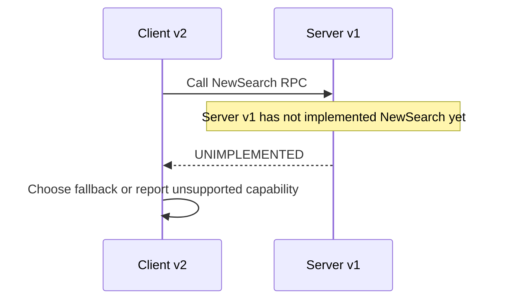

# UNIMPLEMENTED

In gRPC, **UNIMPLEMENTED is status code 12**, indicating that the invoked operation is not implemented or is not supported by the current service. For example, a client uses a new stub to call an RPC just added to the Protobuf contract, while the server is still running an older version without that method. The server may receive the request at the transport layer, yet have no corresponding implementation to execute.

In **SPRING_GRPC**, this status typically relates to service implementation, bean/server registration, method paths, server version capabilities, or a feature not supported in the current deployment. Distinguish an unsupported operation from an invalid request, a nonexistent resource, and a transient infrastructure failure. Clients should normally not automatically retry the same call; instead, fall back or upgrade the server according to the capability contract.

## 1. Meaning of UNIMPLEMENTED

UNIMPLEMENTED has the numeric value **12**. This status applies when the server provides no implementation for the invoked RPC or that operation is not supported in the current service/deployment.

| Perspective | Meaning |
| --- | --- |
| Client | The requested method or capability is not supported by the server |
| Server | No implementation is registered for the operation, or the deployment does not provide it |
| gRPC runtime | Terminates the RPC with status UNIMPLEMENTED |
| Business | The client needs to use another operation, fall back per contract, or call a supporting service/version |

Common scenarios:

- Client calls a new RPC before the server has been upgraded.
- Service implementation extends the generated base class without overriding the required method.
- Method path or service name does not match the contract registered by the server.
- An RPC is defined in Protobuf, yet intentionally omitted in the current deployment.
- Client requests an optional capability not supported by the server.
- Server receives a method name that does not exist in the service descriptor.

UNIMPLEMENTED does not necessarily mean the server process is broken. The server may be running normally while simply not supporting that operation.

## 2. Method paths and dispatching in gRPC

A gRPC RPC is identified by its full method name, typically formatted as:

```text
/fully.qualified.ServiceName/MethodName
```

Example with a service:

```protobuf
syntax = "proto3";

package commerce.catalog.v1;

service CatalogService {
  rpc GetProduct(GetProductRequest) returns (GetProductReply);
}
```

The corresponding method path is:

```text
/commerce.catalog.v1.CatalogService/GetProduct
```

The server runtime uses the service name and method name to dispatch requests to the registered implementation. Any mismatch in package, service name, or method name can prevent the server from finding the right method. Therefore, the fully qualified service name is part of the communication contract between client and server.

Changing the package or service name in Protobuf changes the method path even if request/response messages stay identical. That is a routing- and compatibility-impacting change that must be managed as an API change.

## 3. UNIMPLEMENTED in generated Java services

The Protobuf compiler generates Java messages and gRPC stubs/base classes from service definitions. In gRPC Java, the generated service base class provides a default method for each RPC. If the application does not override a method, the default implementation terminates the call with UNIMPLEMENTED.

Example service generated from a contract:

```protobuf
service CatalogService {
  rpc GetProduct(GetProductRequest) returns (GetProductReply);
  rpc ListProducts(ListProductsRequest) returns (ListProductsReply);
}
```

The generated base class can be used as follows:

```java
public final class CatalogGrpcService
        extends CatalogServiceGrpc.CatalogServiceImplBase {

    @Override
    public void getProduct(
            GetProductRequest request,
            StreamObserver<GetProductReply> responseObserver) {

        GetProductReply reply = catalogService.getProduct(request);
        responseObserver.onNext(reply);
        responseObserver.onCompleted();
    }
}
```

In this example, GetProduct is overridden and therefore has an implementation. If ListProducts is not overridden, the default method in the generated base class returns UNIMPLEMENTED when invoked by a client. This is useful behavior during development because unfinished methods are not faked as successful responses.

Check all RPCs in the service definition:

- Unary RPCs must override the corresponding unary method.
- Server-streaming RPCs must implement multi-message emission and stream completion.
- Client-streaming RPCs must handle the observer/listener and complete the response per contract.
- Bidirectional streaming RPCs must manage two-way lifecycles and cancellation.

Do not override a method only to permanently return UNIMPLEMENTED just to make the class compile if the deployment is advertised as supporting that capability.

## 4. Implementing RPCs in Spring gRPC

In Spring gRPC, the implementation is usually managed as a Spring bean and registered with the gRPC server by the starter. The example below illustrates the service structure:

```java
@GrpcService
public final class CatalogGrpcService
        extends CatalogServiceGrpc.CatalogServiceImplBase {

    private final CatalogApplicationService catalogService;

    public CatalogGrpcService(CatalogApplicationService catalogService) {
        this.catalogService = catalogService;
    }

    @Override
    public void getProduct(
            GetProductRequest request,
            StreamObserver<GetProductReply> observer) {
        try {
            GetProductReply reply =
                catalogService.getProduct(request.getProductId());
            observer.onNext(reply);
            observer.onCompleted();
        } catch (ProductNotFoundException ex) {
            observer.onError(Status.NOT_FOUND
                .withDescription("Product not found")
                .asRuntimeException());
        }
    }
}
```

The @GrpcService annotation is an example from some Spring gRPC starters; exact registration depends on the library used by your application. What matters is ensuring the implementation is discovered, registered on the right server, and extends the right generated service base class.

Common configuration causes:

- Implementation bean is not component-scanned or not registered.
- Implementation mistakenly extends a class generated from an old package/service.
- Server registers a service with a different name from what the client calls.
- Protobuf generated sources were not regenerated after contract changes.
- Multiple implementations register the same service and cause startup conflicts.
- Module containing the implementation is not packaged or missing from the runtime classpath.

Never assume that because a bean exists, the RPC is registered. Integration tests must call through the application's actual gRPC channel to verify dispatching.

## 5. Distinguishing UNIMPLEMENTED from nearby statuses

| Status | Meaning | Example |
| --- | --- | --- |
| UNIMPLEMENTED | Operation is not implemented or not supported | Old server lacks a newly added RPC |
| UNAVAILABLE | Service or dependency is temporarily unable to serve | Server is restarting or connection dropped |
| NOT_FOUND | Method ran, but the requested resource does not exist | GetProduct cannot find the product ID |
| INVALID_ARGUMENT | Request is invalid under the contract | Malformed product ID |
| FAILED_PRECONDITION | Current state prevents the operation | Order is unpaid so it cannot ship yet |
| PERMISSION_DENIED | Caller lacks permission | User is not allowed to invoke an admin operation |
| UNAUTHENTICATED | Caller identity cannot be verified | Missing or expired token |

### 5.1. UNIMPLEMENTED and UNAVAILABLE

UNIMPLEMENTED typically reflects a missing capability or method. UNAVAILABLE reflects a service/dependency currently unable to serve. If an older server is running healthily yet lacks a new RPC, UNIMPLEMENTED fits. If the server supports that RPC yet is restarting or cannot connect to its database, the error usually belongs to UNAVAILABLE or another infrastructure status.

Retrying an UNIMPLEMENTED call against the same server/version rarely helps. For UNAVAILABLE, retrying can make sense if policy permits, with backoff and safe operations.

### 5.2. UNIMPLEMENTED and NOT_FOUND

If GetProduct is implemented but the product ID does not exist, return NOT_FOUND. If the server does not have GetProduct in its registered service, return UNIMPLEMENTED. The two errors belong to different layers: API capability versus business data.

### 5.3. UNIMPLEMENTED and FAILED_PRECONDITION

If an operation is not supported in the deployment or the server has no implementation, UNIMPLEMENTED can fit. If the operation is implemented yet the resource's current state forbids execution, use FAILED_PRECONDITION. A feature disabled by tenant policy may require PERMISSION_DENIED or FAILED_PRECONDITION depending on contract; do not automatically treat every disabled feature flag as UNIMPLEMENTED.

## 6. Version skew between client and server

A common situation is client and server being deployed at different times:

1. Server version A only supports existing RPCs.
2. The contract is extended with a new RPC.
3. Client version B generates stubs from the new contract and starts calling that RPC.
4. Server A lacks the corresponding method and returns UNIMPLEMENTED.



To reduce errors during rollouts:

- Deploy servers capable of handling the new RPC before clients begin calling it.
- Enable the client code path only after the necessary server instances are updated.
- During partial rollouts, use capability negotiation or routing to an appropriate server pool.
- Keep a compatible fallback in the client during the transition window if business rules permit.
- Monitor UNIMPLEMENTED rates by method and server version.

Not every Protobuf change is compatible merely because new fields use new field numbers. Adding a new RPC is normally compatible at the message schema level, yet clients calling the new RPC still require servers with an implementation or explicit behavior when unsupported.

## 7. Capability negotiation and fallbacks

If clients may connect to multiple server versions or deployment types, a capability API helps clients discover supported operations before calling.

Example:

```protobuf
service CapabilityService {
  rpc GetCapabilities(GetCapabilitiesRequest)
      returns (GetCapabilitiesReply);
}

message GetCapabilitiesRequest {}

message GetCapabilitiesReply {
  repeated string supported_features = 1;
  string api_version = 2;
}
```

Clients can check for features like NewSearchV2 or BulkExport before choosing a code path. Capabilities must be stably defined:

- Feature names have clear semantics and do not depend on internal Java classes.
- The server advertises a feature only when its implementation is genuinely ready.
- Capabilities reflect the specific deployment/pool the client is connected to.
- Capability caches need TTLs or versions to avoid holding stale results too long.
- Clients must still handle UNIMPLEMENTED because the server version can change after the check.

Fallbacks should be used only when both operations have equivalent semantics under the contract. Never silently replace a new RPC with an old RPC if data calculation, security, or side effects differ.

## 8. Handling optional capabilities and feature flags

A service may implement a method yet support a feature only under certain configurations. Choose the status according to meaning:

| Scenario | Potentially appropriate representation |
| --- | --- |
| Method has no implementation in the server build | UNIMPLEMENTED |
| Deployment does not provide this operation | UNIMPLEMENTED |
| Method is implemented, but tenant is not granted permission | PERMISSION_DENIED |
| Method is implemented, but resource state does not allow it | FAILED_PRECONDITION |
| Method is supported, but dependency is temporarily unavailable | UNAVAILABLE |
| Optional feature is supported, but currently has no data | OK with empty response or NOT_FOUND per contract |

Feature flags do not dictate status codes on their own. If a flag merely toggles a tenant's entitlement, that may be authorization or policy. If the deployment omits the capability's implementation, UNIMPLEMENTED reflects it more accurately.

Never use UNIMPLEMENTED to dodge internal error handling. If a method is advertised as supported and internal code throws an unexpected exception, classify it appropriately—usually INTERNAL, not UNIMPLEMENTED.

## 9. How clients handle UNIMPLEMENTED

Clients should treat UNIMPLEMENTED as a signal that the capability is unsupported on the current endpoint:

1. Read the status code; do not parse grpc-message.
2. Check capability/API version if provided by the contract.
3. Choose a defined fallback or show that the feature is unavailable.
4. Do not keep retrying the same method against the same server version.
5. If a deployment is mid-rollout, retrying may be attempted once the server pool is confirmed updated, with clear bounds.
6. Log the method and server version to aid investigation.

Blocking stub example:

```java
try {
    SearchReply reply = catalogStub.newSearch(request);
    render(reply);
} catch (StatusRuntimeException ex) {
    if (ex.getStatus().getCode() == Status.Code.UNIMPLEMENTED) {
        // Only use fallback if the contract guarantees both flows are equivalent.
        useLegacySearchIfSupported(request);
    } else {
        // Handle other statuses.
    }
}
```

Never fall back silently if the legacy path skips filters, authorization, consistency, or data required by the new path. Clients must preserve the same security boundaries and business semantics when switching to an alternative path.

## 10. Error details and capability diagnostics

Status code alone usually suffices to tell the client a method is unsupported. If structured diagnostics are needed, the server can attach details such as google.rpc.ErrorInfo with a stable reason:

```text
grpc-status: UNIMPLEMENTED
grpc-message: Operation is not supported

ErrorInfo:
  reason: "METHOD_NOT_SUPPORTED"
  domain: "commerce.catalog"
  metadata:
    service: "commerce.catalog.v1.CatalogService"
    method: "NewSearch"
    api_version: "v1"
```

This is a logical illustration, not standard metadata headers. In gRPC Java, richer details can be packed into com.google.rpc.Status and converted to an exception via io.grpc.protobuf.StatusProto. Send only deployment/version info allowed to be public; never leak class names, stack traces, internal paths, or infrastructure topology.

Do not force clients to parse free-form descriptions. If clients need formal capability discovery, provide a dedicated capability RPC with a versioned schema and stable semantics.

## 11. Testing UNIMPLEMENTED

Tests should verify generated default behavior, service registration, and version compatibility:

| Scenario | What to verify |
| --- | --- |
| Method in generated base class is not overridden | Call finishes with UNIMPLEMENTED |
| Method is overridden and registered in right service | RPC executes successfully |
| Client calls method absent on server | Server returns UNIMPLEMENTED per runtime |
| Service implementation is not registered | Dispatch/status behavior matches server stack |
| New client calls old server | Client receives UNIMPLEMENTED and uses fallback per policy |
| Capability endpoint advertises features | List includes only capabilities actually ready |
| Feature disabled by tenant policy | Status reflects authorization/precondition per contract |
| Method dependency fails | Not mis-mapped to UNIMPLEMENTED |
| Fallback is triggered | Equivalent semantics, authorization, and side effects |
| Partial server rollout | Client does not retry infinitely against unsupported instances |

Integration tests must boot the Spring application context and invoke through a real channel to verify bean/service registration. Unit tests on the application service cannot catch missing gRPC service registration or mismatched method paths.

## 12. Observability and rollout operations

Rising UNIMPLEMENTED rates can indicate version skew, clients hitting the wrong endpoint, unregistered services, or capabilities enabled too early.

Monitor:

- Count/rate of UNIMPLEMENTED by service and method.
- Client versions and server versions.
- Deployment/instance pools receiving requests.
- Fallback rate and fallback outcomes.
- Advertised capabilities versus actual capabilities.
- Start time of errors relative to client/server rollouts.
- Trace/correlation IDs to link calls to deployments.

Do not use user IDs, tokens, or resource IDs as high-cardinality metric labels. Method name, service name, client/server version, and deployment group usually suffice for analysis. Logs must not contain credentials or sensitive payloads.

During a rollout, a brief rate of UNIMPLEMENTED can occur if new clients reach old servers. If the rate persists, inspect rollout order, service registration, generated sources, method paths, and endpoint routing. Never simply raise retry counts, because retrying will not add an implementation to an old server.

## 13. Common design mistakes

| Mistake | Consequence | Better practice |
| --- | --- | --- |
| Not overriding an RPC while advertising the capability | Clients hit UNIMPLEMENTED when using published features | Implement and test every supported RPC |
| Bean exists yet service is not registered on server | Method is not dispatched | Integration test over a real gRPC channel |
| Renaming package/service without rollout coordination | Client/server method paths mismatch | Treat full method name as part of the contract |
| Continuously retrying UNIMPLEMENTED | Adds load without fixing missing implementation | Fall back or upgrade the server |
| Using UNIMPLEMENTED for nonexistent resources | Clients think the API lacks support | Use NOT_FOUND inside implemented methods |
| Using UNIMPLEMENTED for arbitrary runtime errors | Hides bugs and dependency failures | Classify errors by root cause |
| Falling back to a legacy RPC with different semantics | Wrong results or bypassed policies | Fall back only when contract guarantees equivalence |
| Enabling client before server during rollout | Version skew causes widespread errors | Server-first rollout or capability negotiation |
| Assuming disabled reflection means service is missing | Confuses discovery mechanism with dispatch | Test the RPC directly; reflection is a separate capability |

## 14. UNIMPLEMENTED design checklist

Before releasing a gRPC service/client, determine:

1. **Which RPCs are supported?** Does every published method have an implementation?
2. **Are there default methods on the generated base class?** Is any method unintentionally un-overridden?
3. **How is the service registered in Spring?** Do the bean, starter, and server instance pick up the implementation?
4. **Is the full method path stable?** Do package, service name, and method name match across client and server?
5. **How is client/server version skew handled?** Rollout order and compatibility window.
6. **Are capabilities advertised?** Does the server advertise support only once implementation is ready?
7. **Are fallbacks semantically equivalent?** Authorization, data, and side effects must remain intact.
8. **How do clients retry?** Never blindly retry the same method against an unsupported server.
9. **Are error details safe?** Never leak class names, stack traces, or internal topology.
10. **Do tests run through the real gRPC runtime?** Covering default unimplemented, registration, paths, and version skew.

## 15. Takeaways

UNIMPLEMENTED is gRPC status code 12, used when an operation is not implemented or not supported by the current service. It differs from UNAVAILABLE (service temporarily unable to serve), NOT_FOUND (method ran, but resource missing), INVALID_ARGUMENT (invalid request), and FAILED_PRECONDITION (current state prevents operation).

In Spring gRPC, ensure generated service methods are overridden, implementations are registered on the right server, and package/service/method paths match the client. When adding a new RPC, deploy the server before the client or use capability negotiation to manage version skew. Clients should inspect statuses, fall back only when semantics are equivalent, and avoid continuous retries. Integration tests over a real gRPC channel catch registration and dispatch errors that business unit tests miss. Clear capability contracts make rollouts safe and help clients handle unsupported operations properly.

### References

- [gRPC – Status codes](https://grpc.io/docs/guides/status-codes/)
- [gRPC Java – Generated code reference](https://grpc.io/docs/languages/java/generated-code/)
- [gRPC – Service config and method names](https://grpc.io/docs/guides/service-config/)
- [Protocol Buffers – Best practices](https://protobuf.dev/best-practices/dos-donts/)
- [Google API – Compatibility](https://cloud.google.com/apis/design/compatibility)
