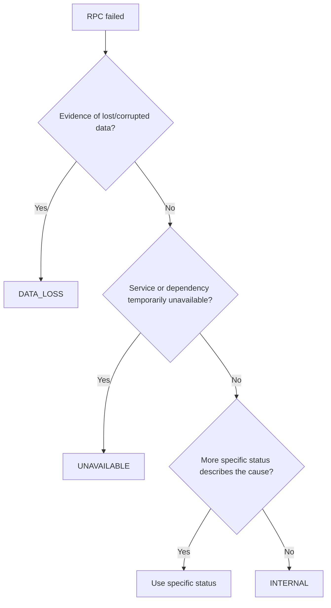

# INTERNAL, UNAVAILABLE, and DATA_LOSS

In gRPC, **INTERNAL, UNAVAILABLE, and DATA_LOSS** are three statuses used to represent critical server-side and infrastructure error categories, yet they lead to very different handling:

- **INTERNAL (13):** an unexpected internal error preventing the server from completing the operation under its contract.
- **UNAVAILABLE (14):** the service or a dependency is currently unable to serve; the condition may be temporary and recoverable.
- **DATA_LOSS (15):** data has been lost or corrupted to a degree unrecoverable by retrying the same operation.

In **SPRING_GRPC**, choosing the right status tells the client whether to stop and report an error, retry in a controlled way, or trigger a data recovery workflow. Never map every exception to the same status just because they all originated on the server. Classify by actual root cause, recoverability, and side effects already executed.

## 1. Meaning and reaction for each status

| Status | Code | Meaning | Usually appropriate reaction |
| --- | ---: | --- | --- |
| INTERNAL | 13 | Unexpected internal error; invariant or server processing failed | Stop automatic retries, log/trace, and investigate |
| UNAVAILABLE | 14 | Service or dependency is temporarily unavailable | May retry with backoff if the operation is safe |
| DATA_LOSS | 15 | Severe data loss or corruption detected | Stop normal retries, preserve evidence, and recover from a trusted source |

These codes are the RPC outcomes received by the client. They do not by themselves expose stack traces, databases, nodes, or internal causes. The server must keep diagnostic details in protected logs/traces, while public responses provide only safe information sufficient for the client to decide next steps.

## 2. INTERNAL: unexpected internal errors

INTERNAL fits when the server encounters an internal error preventing the operation from completing under its contract and no more specific status accurately describes the cause. For example:

- A domain invariant is violated due to a bug or data in an unexpected state.
- The server receives a result from a dependency but cannot convert it per internal contract.
- A required processing branch was implemented incorrectly and throws an unexpected exception.
- A programming or runtime configuration bug prevents the handler from building a valid response.
- The server detects an inconsistent internal state without enough basis to conclude unrecoverable data loss/corruption.

Do not use INTERNAL for every error inside the process. If the server clearly knows the request is invalid, a resource does not exist, the caller lacks permission, or a dependency is temporarily unavailable, use the corresponding specialized status. Specific statuses help clients react more accurately and help telemetry classify root causes better.

### 2.1. INTERNAL is not a prompt for the client to fix the request

Clients usually cannot fix INTERNAL by changing a field or logging in again. Clients should display a generic error, record the correlation ID, and avoid infinite automatic retries. If the server determines the actual root cause is a transient dependency failure, map it to UNAVAILABLE instead of forcing clients to infer it from the message.

### 2.2. Do not expose internal exceptions

Never send stack traces, SQL queries, table names, file paths, internal hostnames, access tokens, or raw exception messages over grpc-message. Those details can expose system internals and sensitive data.

Responses can use a brief description such as "Internal error while processing request" alongside a correlation ID. Server logs should record the original exception with trace ID, method, service version, and sanitized context.

## 3. UNAVAILABLE: service or dependency temporarily unable to serve

UNAVAILABLE fits when the service is currently unable to serve the RPC, typically due to a temporary condition in the server, network, or dependency:

- Server is restarting, draining, or not yet ready for traffic.
- Connectivity to the database, message broker, or downstream service is interrupted.
- Connection pool temporarily fails to lease a connection because the dependency is unavailable.
- Load balancer finds no healthy backend.
- A node or zone encounters an incident preventing requests from being served.
- The system is undergoing failover or leader election.

UNAVAILABLE is often retryable, yet **that does not mean every operation is safe to resend**. Clients must consider idempotency, deadlines, retry policies, and whether the previous attempt already produced side effects.

### 3.1. UNAVAILABLE and DEADLINE_EXCEEDED

UNAVAILABLE states that the service/dependency cannot currently serve. DEADLINE_EXCEEDED states that the RPC did not finish before the caller's deadline. A slow dependency can cause deadline exceeded; an unreachable backend can cause unavailable. Choose the status according to the actual outcome and contract, without mechanically mapping every timeout/connectivity exception to one code.

### 3.2. UNAVAILABLE and RESOURCE_EXHAUSTED

If the service is unavailable because a node is down or a dependency lost connectivity, UNAVAILABLE can fit. If the server rejects because a specific quota, rate limit, or capacity limit reached its threshold, RESOURCE_EXHAUSTED expresses it more clearly. "Overload" must be classified by root cause and API policy.

### 3.3. Unbounded retries can worsen an incident

When a dependency is recovering, thousands of clients retrying at once can create a retry storm. Client and server need exponential backoff, jitter, attempt limits, overall deadlines, and retry throttling. If google.rpc.RetryInfo is present in rich error details, clients can use the wait duration suggested by the server per contract.

## 4. DATA_LOSS: lost or corrupted data

DATA_LOSS fits when the server detects that data has been severely lost or corrupted. This error category must be handled cautiously because retrying the same request usually cannot fix lost or corrupted content.

For example:

- An object's checksum or hash mismatches and no valid copy remains for self-healing.
- A required record or segment is missing from storage.
- Committed data is found unreadable or undecodable due to corruption.
- Replication/restore discovers part of the data has no consistent replica left.
- A snapshot or file is confirmed corrupted with no automatic recovery copy.

Do not use DATA_LOSS merely because a query returns empty or a record does not exist. If the resource never existed, NOT_FOUND fits better. If a dependency is temporarily unreadable while data has not been confirmed lost/corrupted, UNAVAILABLE may fit better. Use DATA_LOSS only when there is evidence that data integrity or availability has been severely compromised.

### 4.1. Distinguishing DATA_LOSS from INTERNAL

INTERNAL describes an unexpected internal processing error. DATA_LOSS emphasizes that data is lost or corrupted. For example:

- A bug causes the server to miscompute a response field while underlying data remains intact: usually INTERNAL.
- Checksums confirm a stored file is corrupted with no valid replica: DATA_LOSS.
- A parser throws an unexpected exception without confirming data corruption: may be INTERNAL; investigate before concluding data loss.

Do not escalate every parse error to DATA_LOSS. Parsers can fail due to invalid client payloads, schema mismatches, or compatibility bugs. Verify the data source, checksums, format/version, and recoverability.

## 5. Decision flow by root cause

A classification workflow can ask these questions in order:



This is a reasoning guide, not an automated classification algorithm. Before choosing a status, inspect the root exception, transaction state, side-effect outcomes, and recoverability. A wrapper exception can hide the real cause; looking only at the outermost class is rarely enough.

## 6. Exception mapping in Spring gRPC

Spring and persistence/network libraries throw many exception types. Map by identified root cause, not merely by a broad superclass:

| Identified scenario/exception | Potentially appropriate status | Notes |
| --- | --- | --- |
| Unexpected exception, bug, or internal invariant | INTERNAL | Log stack trace on server; response exposes no details |
| Database connection refused or dependency temporarily disconnected | UNAVAILABLE | Only when availability is confirmed as the cause |
| Connection pool exhausted due to database unavailability | UNAVAILABLE or appropriate operational status | Distinguish dependency outage from the API's own quota/capacity policy |
| Corruption confirmed by checksum/integrity check | DATA_LOSS | Trigger recovery workflow and alerts |
| Resource does not exist | NOT_FOUND | Do not treat as data loss without evidence of corruption |
| Unique constraint violated | ALREADY_EXISTS | When it is genuinely a resource creation conflict |

Example application service throwing specific domain exceptions:

```java
public Report loadReport(String reportId) {
    try {
        return reportRepository.load(reportId);
    } catch (DataCorruptionDetectedException ex) {
        throw new ReportDataLossException(reportId, ex);
    } catch (TransientDataAccessResourceException ex) {
        throw new ReportStoreUnavailableException(ex);
    }
}
```

Exceptions such as DataCorruptionDetectedException, ReportDataLossException, and ReportStoreUnavailableException are application-defined abstractions. Not every TransientDataAccessResourceException is guaranteed to be UNAVAILABLE; inspect the root cause, database state, and service policy.

At the gRPC boundary, map each type explicitly:

```java
try {
    Report report = reportService.loadReport(request.getReportId());
    observer.onNext(toReply(report));
    observer.onCompleted();
} catch (ReportStoreUnavailableException ex) {
    observer.onError(Status.UNAVAILABLE
        .withDescription("Data store is temporarily unavailable")
        .asRuntimeException());
} catch (ReportDataLossException ex) {
    observer.onError(Status.DATA_LOSS
        .withDescription("Corrupted report data detected")
        .asRuntimeException());
} catch (RuntimeException ex) {
    logUnexpectedFailure(ex);
    observer.onError(Status.INTERNAL
        .withDescription("Internal error while processing report")
        .asRuntimeException());
}
```

This example assumes a logger and service are configured. In production, use a centralized exception mapper/interceptor to ensure every endpoint maps statuses consistently. The final RuntimeException catch is only a safety net for unexpected errors; it does not replace specific exception classification and must never skip logging/tracing.

## 7. Transaction boundaries and uncertain outcomes

An RPC can fail at different points:

- Before starting the transaction.
- While reading data.
- While writing, before commit.
- During commit.
- After commit, before the response reaches the client.

If the connection drops right after the server sends commit, the server may not know for sure whether the database accepted the transaction. The client may likewise see only UNAVAILABLE or a transport error. Never assume every availability failure means the operation did not happen.

For write operations:

- Use idempotency keys or operation IDs so clients can query the outcome.
- Persist operation state in the same transaction as business data whenever possible.
- Use a transactional outbox for events that must be published after commit.
- Design downstream commands with idempotency keys.
- Emit success only after fulfilling published commit semantics.

For INTERNAL and DATA_LOSS, retrying writes can also cause duplicate side effects or worsen data conditions. Clients should use an operation status/reconciliation API when the prior call's result is uncertain.

## 8. Retry policies for UNAVAILABLE

UNAVAILABLE is the most commonly retryable of the three, yet the policy must remain controlled:

1. Retry only idempotent operations or operations with an idempotency key.
2. Set maximum retry attempts and an overall deadline.
3. Use exponential backoff with jitter.
4. Respect server-supplied retry delays if the contract provides google.rpc.RetryInfo.
5. Limit total retries across client/service to avoid multi-layer nested retries.
6. Stop retrying when the deadline expires or the caller cancels.
7. Record attempt counts and final outcomes.

Example gRPC service config retry configuration applicable to an appropriate method:

```json
{
  "methodConfig": [{
    "name": [{
      "service": "commerce.catalog.v1.CatalogService",
      "method": "GetProduct"
    }],
    "retryPolicy": {
      "maxAttempts": 4,
      "initialBackoff": "0.1s",
      "maxBackoff": "2s",
      "backoffMultiplier": 2,
      "retryableStatusCodes": ["UNAVAILABLE"]
    }
  }]
}
```

This is an illustrative example; service config/retry support depends on gRPC Java version, channel configuration, and environment. Do not enable one blanket retry policy across every method. Read RPCs are generally easier to retry than RPCs creating payments, sending emails, or updating state.

### 8.1. Retries are not a circuit breaker

Retries re-attempt an operation after a failure. A circuit breaker temporarily stops calling a failing dependency to protect caller and downstream. A bulkhead bounds how many resources a group of requests may occupy. All three mechanisms can work together, but none replaces the others.

In Spring, you can apply resilience policies around application services/downstream clients. Avoid retrying simultaneously at the gRPC client, gateway, service, and database layers without a shared budget; nested retries can multiply request volume very quickly.

## 9. Never blindly retry INTERNAL and DATA_LOSS

| Status | Automatic retry? | Priority action |
| --- | --- | --- |
| INTERNAL | Usually no | Record trace, classify bug/invariant, investigate and fix |
| UNAVAILABLE | Possible, if operation is safe | Backoff, jitter, deadline, and idempotency |
| DATA_LOSS | Do not blindly retry the same source | Isolate corrupted data, verify replicas/backups, and recover |

An INTERNAL error may be fixed on the server so a later call succeeds, yet retrying immediately along the same code path usually produces the same result. If the real cause is a transient dependency failure, fix the mapping to UNAVAILABLE so clients can apply the right policy.

With DATA_LOSS, retrying the same object or replica may re-read corrupted data, overwrite with bad data, or destroy evidence. Before recovering, preserve the corrupted copy, checksums, versions, replication metadata, and audit trail per operational procedures.

## 10. DATA_LOSS and integrity protection

A reliable storage system must detect corruption before data is consumed as valid. Mechanisms can include:

- Checksums/hashes when writing and reading objects.
- End-to-end integrity checks between client, service, and storage.
- Replication with consistency verification.
- Snapshots/backups with verified restore capability.
- Versioning or append-only logs for critical data.
- Periodic scrubbing to detect corruption in infrequently accessed data.
- Audit records for restore/repair operations.

A checksum mismatch does not always prove unrecoverable data loss. If a healthy replica exists and the system self-heals, the client might never need to see DATA_LOSS; the service can recover internally and return success. Return DATA_LOSS only when the operation cannot proceed due to confirmed data loss/corruption.

### 10.1. Response workflow when DATA_LOSS is detected

An operational workflow can include:

1. Stop or isolate read/write paths at risk of spreading corrupted data.
2. Preserve the corrupted artifact and metadata for investigation.
3. Determine scope: object, record, partition, tenant, or replica.
4. Inspect replicas, snapshots, and backups for integrity.
5. Select a recovery source with matching version/consistency.
6. Restore or repair under an audited procedure.
7. Verify checksums and consistency after recovery.
8. Reopen traffic and monitor for recurring errors.

Clients must not choose backups themselves or overwrite data with an old copy. Data recovery is a decision for an authorized service/operator and requires business consistency checks.

## 11. Error details and diagnostic information

Status codes hold the general semantics; richer error details can supply structured reasons or recovery information:

- google.rpc.ErrorInfo: publicly permitted reason/domain and metadata.
- google.rpc.RetryInfo: suggested wait time for retryable errors.
- google.rpc.ResourceInfo: related resource type/name if the caller is allowed to know.
- google.rpc.DebugInfo: sensitive debug info; should not be sent to untrusted clients.

Logical example for a dependency error:

```text
grpc-status: UNAVAILABLE
grpc-message: Data store temporarily unavailable

RetryInfo:
  retry_delay: 1 second

ErrorInfo:
  reason: "DEPENDENCY_UNAVAILABLE"
  domain: "reports.example"
```

Logical example for confirmed corruption:

```text
grpc-status: DATA_LOSS
grpc-message: Data integrity failure detected

ErrorInfo:
  reason: "DATA_CORRUPTION_DETECTED"
  domain: "storage.example"
  metadata:
    resource_type: "Report"
```

These are illustrative contents, not standard gRPC headers. In gRPC Java, richer details can be packed into com.google.rpc.Status and converted to an exception via io.grpc.protobuf.StatusProto. Never send stack traces, internal paths, database hosts, tokens, or sensitive checksums/raw data to clients.

## 12. Streaming RPCs and mid-stream failures

With server streaming, a client may already have received several messages before the server terminates the stream with an error status. Messages already sent are not automatically retracted.

| Final status | Required interpretation |
| --- | --- |
| INTERNAL | Server hit an internal error; client needs to know how far received messages are usable |
| UNAVAILABLE | Stream was interrupted; client can resume if a cursor/checkpoint exists and the operation is safe |
| DATA_LOSS | Part of the stream data is confirmed lost/corrupted; integrity/recovery workflow is required |

For long-lived streams, the contract should specify sequence numbers, cursors, checkpoints, and partial result semantics. If a client reconnects after UNAVAILABLE, the server must support resume or deduplication to prevent dropped or duplicate messages. On DATA_LOSS, never blindly splice the stream from an arbitrary position without verifying integrity.

For client-streaming or bidirectional streaming, the final status does not necessarily mean all earlier messages rolled back. If each message commits independently, use operation IDs or per-message acknowledgements. If the whole stream is an atomic batch, the implementation must genuinely enforce that transaction semantics before advertising it.

## 13. Testing the three statuses

Tests should verify status mapping, side effects, and client behavior:

| Scenario | What to verify |
| --- | --- |
| Handler throws unexpected exception | Server returns INTERNAL, log has trace, response leaks no stack |
| Internal invariant violated | Not mis-mapped to INVALID_ARGUMENT or DATA_LOSS |
| Database connection temporarily lost | UNAVAILABLE when availability is confirmed as the cause |
| Dependency recovers | Bounded retry can succeed |
| Retries exceed deadline | Client stops and returns final outcome per policy |
| Commit succeeded while response was lost | Operation ID/idempotency allows querying the outcome |
| Checksum mismatch with no valid copy | DATA_LOSS, triggers alerts/recovery path |
| Corruption repaired from valid replica | Service verifies integrity before returning success |
| Resource does not exist | NOT_FOUND, not mis-mapped to DATA_LOSS |
| Stream fails after multiple messages | Partial results/checkpoint follow contract |
| Error details | Client reads reason/retry delay, no secrets exposed |
| Exception mapper | Classified exceptions map deterministically |

Unit tests verify mappers and policies. Integration tests should simulate database/downstream unavailability, transaction failures, and integrity checks. DATA_LOSS tests must verify alerts, isolation, and recovery workflows, not just assert the status code.

## 14. Observability and operations

Track these three statuses separately because they lead to different operational actions:

- **INTERNAL:** rate by service/method, normalized exception class, release version, trace ID, and invariant group.
- **UNAVAILABLE:** dependency health, connection errors, retry attempts, circuit breaker state, queue depth, failover, and recovery time.
- **DATA_LOSS:** integrity check failures, resource type, blast radius, replica/backup health, recovery state, and audit events.

Do not use high-cardinality user IDs, tokens, file IDs, or request IDs as metric labels. Logs/traces can hold correlation IDs and policy-protected resource identifiers. For DATA_LOSS, set high-priority alerts and clear incident procedures; for UNAVAILABLE, watch recovery time and retry amplification; for INTERNAL, correlate errors with code releases and exception sources.

Do not simply count total server errors. A tiny rate of DATA_LOSS can be far more severe than thousands of brief UNAVAILABLE errors. Dashboards and alerts must reflect severity and impact on data/users.

## 15. Common design mistakes

| Mistake | Consequence | Better practice |
| --- | --- | --- |
| Mapping every exception to INTERNAL | Clients cannot distinguish transient errors from data errors | Classify specific root causes |
| Mapping every database error to UNAVAILABLE | Hides constraints, query bugs, or corruption | Check root cause and transaction state |
| Retrying INTERNAL continuously | Repeats bugs and increases load | Disable default retries; investigate server |
| Retrying UNAVAILABLE without bounds | Retry storms hinder dependency recovery | Backoff, jitter, deadlines, retry budgets |
| Retrying an operation after unclear commit | Side effects may execute twice | Idempotency keys/operation status |
| Using DATA_LOSS for every read failure | False alarms and client overreaction | Use only with evidence of lost/corrupted data |
| Returning stack traces or SQL in grpc-message | Leaks internal structure and data | Safe descriptions, details in protected logs |
| Treating a failed stream as rolling back all messages | Clients mishandle partial results | Explicit sequences, checkpoints, and commit semantics |
| Lacking backup/restore verification | Cannot recover reliably when corruption hits | Periodic restore testing and integrity checks |

## 16. Checklist for choosing INTERNAL, UNAVAILABLE, and DATA_LOSS

Before mapping an exception at the gRPC boundary, determine:

1. **Has the root cause been verified?** Or is there only a generic wrapper exception?
2. **Is this an internal bug/invariant?** If yes and no more specific status exists, consider INTERNAL.
3. **Is the service/dependency temporarily unable to serve?** If yes, consider UNAVAILABLE.
4. **Is there evidence of lost/corrupted data that cannot continue to be used?** If yes, consider DATA_LOSS.
5. **Is there a more specialized status?** Such as NOT_FOUND, INVALID_ARGUMENT, RESOURCE_EXHAUSTED, or FAILED_PRECONDITION.
6. **Did the transaction commit?** The operation may have happened even if the response failed.
7. **Is retrying safe?** Define idempotency, deadlines, backoff, and retry budgets.
8. **How are side effects controlled?** Outbox, operation IDs, or downstream idempotency.
9. **Are streaming partial result semantics clear?** Sequences, cursors, checkpoints, and resume.
10. **Is data returned to clients safe?** Never send secrets, stack traces, or internal topology.
11. **Are telemetry and alerts matched to severity?** Especially for DATA_LOSS.
12. **Is there a tested data recovery workflow?** Replicas, backups, restores, and integrity verification.

## 17. Takeaways

INTERNAL (13) represents unexpected internal errors; UNAVAILABLE (14) represents a service or dependency temporarily unable to serve; DATA_LOSS (15) represents severe data loss or corruption. The three statuses are not interchangeable: INTERNAL usually calls for investigation, UNAVAILABLE can be retried under control, and DATA_LOSS requires integrity/recovery workflows rather than blind retries.

In Spring gRPC, create meaningful domain exceptions, map them at a unified boundary, and keep original exceptions in secure logs/traces. Distinguish database availability errors from data errors, consider transaction commits before retrying, protect side effects with idempotency/outboxes, and define semantics for streaming partial results. For DATA_LOSS, verify corruption, isolate the faulty source, and recover from a trusted copy. Clients receive only public-safe statuses and error details; the server retains responsibility for diagnosis and recovery.

### References

- [gRPC – Status codes](https://grpc.io/docs/guides/status-codes/)
- [gRPC – Error handling](https://grpc.io/docs/guides/error/)
- [gRPC – Retry](https://grpc.io/docs/guides/retry/)
- [Google API – Error model](https://cloud.google.com/apis/design/errors)
- [Spring Framework – Data access](https://docs.spring.io/spring-framework/reference/data-access.html)
- [Spring Framework – Transaction management](https://docs.spring.io/spring-framework/reference/data-access/transaction.html)
