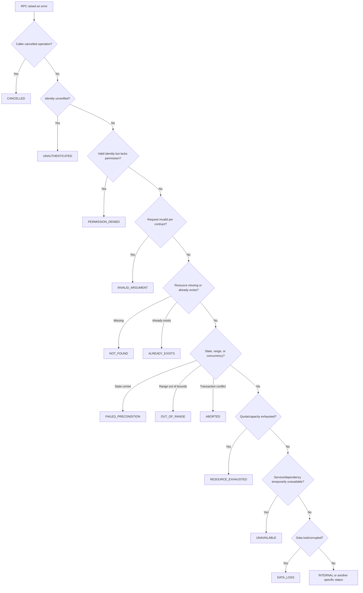

# Choosing Status Codes That Reflect the True Root Cause

In gRPC, a status code is the final outcome of an RPC and part of the contract between server and client. A well-chosen status tells the client whether the request succeeded, was rejected due to data or permissions, cannot execute yet due to current state, failed from resource contention, or hit an infrastructure incident. Status codes also enable retry policies, telemetry, dashboards, and operational workflows to classify errors consistently.

In **SPRING_GRPC**, the status should reflect the cause identified at the application/domain boundary. Never map every exception to INTERNAL, nor choose a status mechanically based on message text or wrapper exception names. Determine what actually happened, whether the operation produced side effects, how the caller can recover, and whether it is safe to retry.

## 1. Principles for choosing a status

Before mapping an error, answer four questions:

1. **Is the request valid under the contract?** If structure or arguments are wrong, this is usually an input error.
2. **Is the caller authenticated and authorized?** Authentication and authorization are two separate decisions.
3. **Do the resource and business state satisfy preconditions?** A resource may not exist, may already exist, may be out of range, or may not be ready for the action.
4. **Is the failure recoverable via retry?** Distinguish conflicts requiring re-reads, temporarily unavailable services, exhausted quotas, internal bugs, and data corruption.

Choose the status code according to the semantics the client must act on, not merely server implementation details. Two different Java exceptions may require the same status if they represent the same cause; conversely, one wrapper exception type can hide multiple causes requiring different statuses.

## 2. Standard status code reference table

gRPC defines 17 standard status codes. The table below summarizes their common usage in APIs:

| Code | Status | When to use |
| ---: | --- | --- |
| 0 | **OK** | RPC completed successfully |
| 1 | **CANCELLED** | Operation was cancelled by the caller or by context |
| 2 | **UNKNOWN** | Error whose specific cause cannot be identified or better mapped |
| 3 | **INVALID_ARGUMENT** | Request contains invalid arguments, regardless of system state |
| 4 | **DEADLINE_EXCEEDED** | RPC did not complete before the deadline |
| 5 | **NOT_FOUND** | Referenced resource does not exist or is intentionally hidden by policy |
| 6 | **ALREADY_EXISTS** | Resource the operation tries to create already exists |
| 7 | **PERMISSION_DENIED** | Caller is identified but lacks permission |
| 8 | **RESOURCE_EXHAUSTED** | Quota or finite resource is exhausted/over limit |
| 9 | **FAILED_PRECONDITION** | Current state does not meet preconditions for the operation |
| 10 | **ABORTED** | Operation aborted due to transaction/concurrency conflict |
| 11 | **OUT_OF_RANGE** | Position, index, or range lies outside the valid domain |
| 12 | **UNIMPLEMENTED** | Operation is not implemented or not supported |
| 13 | **INTERNAL** | Unexpected internal error with no more specific fitting status |
| 14 | **UNAVAILABLE** | Service or dependency is temporarily unable to serve |
| 15 | **DATA_LOSS** | Severe data loss or corruption detected |
| 16 | **UNAUTHENTICATED** | Caller identity could not be verified |

This table is a starting point. Each service contract should further specify edge cases, especially for NOT_FOUND, OUT_OF_RANGE, FAILED_PRECONDITION, ABORTED, and retryable errors.

## 3. Decision tree for choosing a status

You can use the following flow when an RPC fails:



The decision tree is a way to ask questions, not a mandatory fixed order for every service. Some APIs need to check authorization before revealing whether a resource exists. When failure is due to deadline or cancellation, the gRPC runtime may also terminate the call before the handler returns a business status.

## 4. Distinguishing easily confused error groups

### 4.1. INVALID_ARGUMENT, FAILED_PRECONDITION, and OUT_OF_RANGE

All three statuses can appear when a client sends an unusable value, yet their causes differ:

| Status | Question | Example |
| --- | --- | --- |
| **INVALID_ARGUMENT** | Is the value invalid under the contract regardless of system state? | Malformed ID, negative quantity, start timestamp after end |
| **FAILED_PRECONDITION** | Is the request valid while current state blocks the operation? | Order is unpaid so it cannot ship yet |
| **OUT_OF_RANGE** | Is the value type-valid yet outside currently available bounds? | Offset past file size, sequence past bounds |

Example with a file-reading RPC:

- Negative offset: INVALID_ARGUMENT.
- Positive offset greater than current file size: OUT_OF_RANGE.
- File is locked by a business workflow so reading is disallowed: can be FAILED_PRECONDITION, per contract.
- File does not exist: NOT_FOUND.

A valid query with no results normally returns OK with an empty list. Do not use NOT_FOUND or OUT_OF_RANGE solely because a collection is empty if the contract defines that as a valid result.

### 4.2. UNAUTHENTICATED and PERMISSION_DENIED

- **UNAUTHENTICATED:** the server cannot verify who the caller is, e.g., missing, expired, or invalid-signature token.
- **PERMISSION_DENIED:** the server verified identity, yet policy does not permit the caller to perform the action.

A valid token lacking a scope should not return UNAUTHENTICATED, because logging in again will not grant extra permissions. Conversely, an expired token should not return PERMISSION_DENIED, because the client may need to refresh credentials per policy.

### 4.3. NOT_FOUND and ALREADY_EXISTS

- **NOT_FOUND:** the operation references a resource that does not exist.
- **ALREADY_EXISTS:** the operation tries to create a resource whose key/identity is already taken.

Some APIs intentionally return NOT_FOUND for both nonexistent resources and resources the caller is not permitted to see to prevent enumeration. If choosing this approach, apply it consistently and never let messages, timing, or error details leak a difference.

### 4.4. FAILED_PRECONDITION, ABORTED, and UNAVAILABLE

| Status | Cause | What the client usually needs to do |
| --- | --- | --- |
| FAILED_PRECONDITION | Business condition not yet satisfied | Change state/complete prerequisites, then call again |
| ABORTED | Conflict during transaction or concurrent update | Re-read data and re-run the entire read-modify-write |
| UNAVAILABLE | Service/dependency temporarily unable to serve | Retry the call under control if the operation is safe |

This distinction is vital for retries. Resending the exact statement with a stale version after ABORTED will usually keep failing. Retrying UNAVAILABLE can make sense if the request is idempotent. Retrying FAILED_PRECONDITION before state changes usually just repeats the same failure.

### 4.5. RESOURCE_EXHAUSTED and UNAVAILABLE

RESOURCE_EXHAUSTED indicates a specific quota or resource limit was hit, such as a tenant exhausting export quota or a full admission queue. UNAVAILABLE indicates the service/dependency cannot currently serve, such as a disconnected backend or a server undergoing failover.

If a queue/capacity limit is an intentional rejection policy, RESOURCE_EXHAUSTED usually helps clients understand better. If a crashed node or broken dependency prevents the service from operating, UNAVAILABLE usually fits better.

### 4.6. INTERNAL and DATA_LOSS

- **INTERNAL:** unexpected internal processing error, invariant violation, or bug; no evidence of lost/corrupted data.
- **DATA_LOSS:** evidence of lost data or severe corruption.

Do not escalate every parse, query, or storage read error to DATA_LOSS. Verify checksums, versions, replicas, and recoverability. If the error is only a data conversion bug while underlying data remains intact, INTERNAL may fit better.

## 5. Classifying by recoverability

Status codes directly influence client actions. A useful perspective is grouping by recovery type:

| Group | Typical statuses | Action |
| --- | --- | --- |
| Caller fixes request | INVALID_ARGUMENT, OUT_OF_RANGE | Fix arguments or pick a valid range |
| Caller changes identity/permissions | UNAUTHENTICATED, PERMISSION_DENIED | Refresh/login or request permissions; do not loop endlessly |
| Workflow/resource state | NOT_FOUND, ALREADY_EXISTS, FAILED_PRECONDITION | Re-read resource or complete business steps |
| Concurrency | ABORTED | Re-read and re-run transaction/command per policy |
| Capacity/availability | RESOURCE_EXHAUSTED, UNAVAILABLE | Shed load, wait for reset, or retry with backoff |
| Caller/runtime lifecycle | CANCELLED, DEADLINE_EXCEEDED | Stop work or re-evaluate deadlines |
| Server/data integrity | UNKNOWN, INTERNAL, UNIMPLEMENTED, DATA_LOSS | Investigate, contract-defined fallback, or recover data |

Not every status in a group shares identical retry semantics. RESOURCE_EXHAUSTED from a short-term rate limit can be retried after a delay; an exhausted monthly quota cannot. UNIMPLEMENTED is usually not fixed by retrying; the client needs a capability fallback or a newer server.

## 6. Deadlines, cancellation, and status

DEADLINE_EXCEEDED and CANCELLED reflect call lifecycles:

- **DEADLINE_EXCEEDED:** the deadline set by the caller expired before the RPC completed.
- **CANCELLED:** the caller or an associated context cancelled the operation.

Inside the server, propagate cancellation/deadlines to application work whenever possible. Do not continue resource-heavy work after the client cancelled unless the operation has a reason to finish. However, if a transaction has already committed or side effects occurred, cancellation cannot automatically roll back the outcome.

With Spring gRPC, determine the remaining deadline before calling downstream, set matching timeouts, and stop work when the call is cancelled. Do not map every dependency timeout to DEADLINE_EXCEEDED: if a dependency is unreachable or a service is unavailable, UNAVAILABLE may be more accurate. When the RPC's own deadline expires, clients normally observe DEADLINE_EXCEEDED.

## 7. Exception mapping in Spring gRPC

The application/domain layer should throw meaningful business exceptions, while the gRPC boundary translates them into statuses. For example:

```java
public final class GrpcStatusMapper {
    public static StatusRuntimeException toStatus(Throwable error) {
        if (error instanceof ProductNotFoundException) {
            return Status.NOT_FOUND
                .withDescription("Product not found")
                .asRuntimeException();
        }
        if (error instanceof AccessDeniedException) {
            return Status.PERMISSION_DENIED
                .withDescription("Insufficient permission to perform operation")
                .asRuntimeException();
        }
        if (error instanceof InvalidProductRequestException) {
            return Status.INVALID_ARGUMENT
                .withDescription("Invalid request data")
                .asRuntimeException();
        }
        if (error instanceof QuotaExceededException) {
            return Status.RESOURCE_EXHAUSTED
                .withDescription("Quota exhausted")
                .asRuntimeException();
        }
        if (error instanceof TransientCatalogUnavailableException) {
            return Status.UNAVAILABLE
                .withDescription("Catalog service temporarily unavailable")
                .asRuntimeException();
        }

        return Status.INTERNAL
            .withDescription("Internal error while processing request")
            .asRuntimeException();
    }
}
```

The exceptions in this example are application-defined domain/application types. The mapper should be extended per actual contract and distinguish causes clearly. Never map a generic RuntimeException to a business status solely based on its message.

A unary endpoint can use the mapper:

```java
try {
    Product product = catalogService.getProduct(request.getProductId());
    observer.onNext(toReply(product));
    observer.onCompleted();
} catch (Exception ex) {
    StatusRuntimeException statusError = GrpcStatusMapper.toStatus(ex);
    observer.onError(statusError);
}
```

In production, log the original exception with trace/correlation ID before returning the status. Ensure the mapper does not discard the cause, stack trace, or diagnostic context on the server. You can integrate the mapper via an interceptor/advice of your gRPC starter, but verify with tests that every service actually goes through that mechanism.

### 7.1. Do not map blindly by exception class name

A DataAccessException could be a connection outage, constraint violation, query bug, or corruption. An IllegalStateException could be an unmet business state or a programming bug. Inspect the root cause and context:

- Confirmed dependency connection failure: can be UNAVAILABLE.
- Unique constraint due to already-existing resource: can be ALREADY_EXISTS.
- Optimistic lock/serialization conflict: can be ABORTED.
- Unexpected internal invariant violation: can be INTERNAL.
- Checksum confirming unrecoverable corruption: can be DATA_LOSS.

If evidence is insufficient, do not invent a specific cause. Keep an appropriate general status and record the error for investigation.

## 8. Rich error details: status codes and machine-readable info

Status codes describe the error category at a general level. When clients need specific details to recover, you can use Google RPC's richer error model:

| Detail | Purpose |
| --- | --- |
| google.rpc.BadRequest | Indicates field/request violations |
| google.rpc.PreconditionFailure | Describes violated preconditions |
| google.rpc.QuotaFailure | Describes quota violations |
| google.rpc.RetryInfo | Suggests wait time before retrying |
| google.rpc.ErrorInfo | Stable reason/domain and metadata |
| google.rpc.ResourceInfo | Describes related resources if permitted |
| google.rpc.DebugInfo | Debug info; strictly restrict for untrusted clients |

Logical example for validation:

```text
status: INVALID_ARGUMENT
detail:
  type: google.rpc.BadRequest
  field_violations:
    - field: "page_size"
      description: "Must be between 1 and 100"
```

Logical example for rate limiting:

```text
status: RESOURCE_EXHAUSTED
detail:
  type: google.rpc.RetryInfo
  retry_delay: 2 seconds
```

These illustrate detail contents, not standard HTTP headers. In gRPC Java, you can pack com.google.rpc.Status and Protobuf details using Any, then convert to an exception via io.grpc.protobuf.StatusProto. Include only information the client is allowed to know; never send stack traces, tokens, SQL, internal hosts, or other tenants' data.

Clients should rely on the status code and stable detail type/reason rather than parsing grpc-message sentences for control flow. Message phrasing or language can change without breaking the contract.

## 9. Retry policies must follow status and operation semantics

There is no rule that "every server error should be retried". Before retrying, the client needs to know:

- Does the status indicate a transient condition?
- Is the operation read-only, idempotent, or does it have side effects?
- Might the server have already committed before the response was lost?
- Does enough overall deadline remain?
- Is there RetryInfo or a per-method retry policy?
- Could retries cause a retry storm or overload a dependency?

| Status | Usual automatic retry guidance |
| --- | --- |
| INVALID_ARGUMENT | No; fix the request |
| UNAUTHENTICATED | Refresh credentials per policy only, with bounds |
| PERMISSION_DENIED | No; permissions/policy must change |
| NOT_FOUND | Usually no; unless resource is created asynchronously and contract permits waiting |
| ALREADY_EXISTS | Do not repeat create; read resource or handle idempotency |
| FAILED_PRECONDITION | Not while state is unchanged; complete prerequisites |
| ABORTED | Retry the entire transaction/read-modify-write if intent remains valid |
| OUT_OF_RANGE | Adjust range or reload bounds |
| RESOURCE_EXHAUSTED | Wait/reset or shed load; retry only depending on quota/capacity type |
| UNAVAILABLE | May retry with backoff, jitter, deadline, and idempotency |
| DEADLINE_EXCEEDED | Retry only if operation is safe and deadline remains for a new attempt |
| CANCELLED | Do not auto-retry if caller actively cancelled |
| UNIMPLEMENTED | Do not retry the same endpoint/version; fall back or upgrade |
| INTERNAL | Usually do not auto-retry unless known to be transient |
| DATA_LOSS | Do not retry blindly; preserve evidence and recover |
| UNKNOWN | Investigate cause; do not guess retry semantics |

### 9.1. Idempotency and side effects

For operations creating orders, processing payments, sending notifications, or updating state, retries can execute side effects twice if the first attempt committed while the response was lost. Use idempotency keys or operation IDs so the server detects duplicate requests and returns the recorded result.

In Spring, a transactional outbox can write business state and events in the same transaction; a worker publishes events only after commit. For downstream systems lacking shared transactions, enforce downstream idempotency or use a reconciliation workflow. A status code alone never proves an operation did not happen.

### 9.2. Backoff, jitter, and retry budgets

For transient errors such as UNAVAILABLE, use exponential backoff with jitter, maximum attempt counts, and an overall deadline. Jitter prevents many clients from retrying at the exact same instant. Retry budgets cap total traffic generated by retries. Avoid nested retries across client, gateway, service, and database without a shared budget.

## 10. Streaming RPCs and final statuses

In streaming, the server may have sent one or more messages before the stream terminates with an error status. The final status does not automatically retract messages the client already received.

The contract must specify:

- Which messages have been confirmed/committed?
- Does the stream have sequence numbers, cursors, or checkpoints to resume?
- Upon reconnecting, can the client safely resend already-processed messages?
- Does one erroneous message terminate the whole stream or return an error result only for that item?
- Do CANCELLED or DEADLINE_EXCEEDED stop the producer and release resources?

For read streams, UNAVAILABLE can allow resuming from a cursor. For write streams, acknowledgements and idempotency are needed to prevent duplicates. For DATA_LOSS, verify integrity before resuming from a checkpoint. Never assume all messages before an error status rolled back.

## 11. Testing status mapping

Integration tests should invoke through a gRPC client/server to verify actual statuses and details:

| Scenario | Outcome to verify |
| --- | --- |
| Malformed request | INVALID_ARGUMENT, with field details if supported by contract |
| Missing/expired token | UNAUTHENTICATED |
| Valid token lacking permission | PERMISSION_DENIED |
| Resource does not exist | NOT_FOUND |
| Resource already exists on create | ALREADY_EXISTS |
| State does not satisfy action | FAILED_PRECONDITION |
| Two competing transactions | ABORTED per semantics |
| Range exceeds bounds | OUT_OF_RANGE |
| Quota exhausted | RESOURCE_EXHAUSTED with matching retry guidance |
| Service/dependency temporarily lost | UNAVAILABLE |
| Deadline expires or caller cancels | DEADLINE_EXCEEDED/CANCELLED depending on cause |
| Unsupported method | UNIMPLEMENTED |
| Unexpected exception | INTERNAL, no stack trace leaked |
| Checksum confirms corruption | DATA_LOSS and recovery/alert path |

Beyond statuses, tests should verify side effects, transaction rollback/commit, retry counts, deadlines, cancellation, rich details, and log privacy. Unit tests for a mapper do not replace integration tests across the gRPC runtime.

## 12. Observability and operations

Status codes are a critical dimension of telemetry. Record:

- Count/rate of statuses by service and method.
- Normalized reason groups; never use free-form messages as metric labels.
- Client/server versions and deployments when analyzing rollouts.
- Retry attempts, retry successes, retry exhaustion, and deadlines.
- Correlation/trace IDs to connect client, interceptor, application service, and downstream.
- Side-effect/operation IDs when investigating uncertain outcomes.

Avoid high-cardinality user IDs, tokens, resource IDs, or request IDs as metric labels. Logs can contain richer context while filtering out credentials, personal data, and sensitive payloads. DATA_LOSS needs high-severity alerts; UNAVAILABLE needs monitoring of dependency health and retry amplification; INTERNAL needs correlation with exception sources and release versions.

Do not track only total error counts. A rising PERMISSION_DENIED rate may reflect policy changes or clients using wrong scopes; rising OUT_OF_RANGE may mean stale metadata; rising ABORTED may mean contention; rising RESOURCE_EXHAUSTED may mean quota or capacity limits. Grouping by status points investigations in the right direction.

## 13. Common design mistakes

| Mistake | Consequence | Better practice |
| --- | --- | --- |
| Mapping every exception to INTERNAL | Clients do not know how to recover | Classify root causes and use specific statuses |
| Mapping by message text | Wording changes alter semantics | Use domain exceptions and stable reasons |
| Using UNAUTHENTICATED for missing permissions | Clients refresh tokens uselessly | Separate authentication and authorization |
| Using INVALID_ARGUMENT for state conflicts | Clients fix requests in the wrong direction | Separate request validation from preconditions/concurrency |
| Retrying every server status | Retry storms or duplicate side effects | Retry by status, idempotency, and deadline |
| Using UNAVAILABLE for quota policies | Clients retry when they should wait for reset/shed load | Use RESOURCE_EXHAUSTED when quota/capacity is hit |
| Returning stack traces via grpc-message | Leaks internal details | Safe messages, details in protected logs/traces |
| Using DATA_LOSS without verifying corruption | False alarms and unnecessary recovery runs | Check integrity and replicas before concluding |
| Not testing statuses through the gRPC runtime | Mapper works, but interceptor/registration may fail | End-to-end integration tests at the RPC boundary |

## 14. Checklist before publishing a gRPC method

1. **Contract:** are request/response and success semantics clear?
2. **Validation:** are invalid values separated from range/state errors?
3. **Identity:** are UNAUTHENTICATED and PERMISSION_DENIED kept separate?
4. **Resource:** do NOT_FOUND and ALREADY_EXISTS match semantics?
5. **State/concurrency:** are FAILED_PRECONDITION and ABORTED distinguished?
6. **Capacity/availability:** are quota/capacity separated from service outages?
7. **Server/data:** is INTERNAL reserved for unexpected errors; does DATA_LOSS have integrity evidence?
8. **Lifecycle:** are deadlines and cancellation propagated to downstream/workers?
9. **Retry:** which statuses are retryable, with idempotency, backoff, jitter, and retry budgets?
10. **Details:** do error details have stable schemas and leak no sensitive data?
11. **Streaming:** are partial results, checkpoints, resume, and cancellation semantics clear?
12. **Telemetry:** do metrics, traces, audits, and alerts classify by status/reason?
13. **Tests:** are there integration tests for success, business errors, infrastructure errors, and side effects?

## 15. Takeaways

Choosing a status code is a contract decision: the status must state the true cause on which the client can act. INVALID_ARGUMENT is for invalid requests; UNAUTHENTICATED and PERMISSION_DENIED separate identity from permission; NOT_FOUND/ALREADY_EXISTS describe resources; FAILED_PRECONDITION/ABORTED separate state from concurrency; RESOURCE_EXHAUSTED/UNAVAILABLE separate quotas from availability; INTERNAL is for unexpected internal errors; DATA_LOSS is for confirmed data loss/corruption.

In Spring gRPC, define clear domain exceptions, map them at a unified boundary, preserve original causes in secure logs/traces, and provide rich error details when clients need structured actions. Retries must follow status, deadlines, idempotency, and side effects; streaming must define partial results/checkpoints. Testing through the gRPC runtime and monitoring statuses per method keeps contracts stable, helps clients recover properly, and helps operations pinpoint root causes faster.

### References

- [gRPC – Status codes](https://grpc.io/docs/guides/status-codes/)
- [gRPC – Error handling](https://grpc.io/docs/guides/error/)
- [gRPC – Retry](https://grpc.io/docs/guides/retry/)
- [gRPC – Deadlines](https://grpc.io/docs/guides/deadlines/)
- [Google API – Error model](https://cloud.google.com/apis/design/errors)
- [Spring Framework – Data access](https://docs.spring.io/spring-framework/reference/data-access.html)
