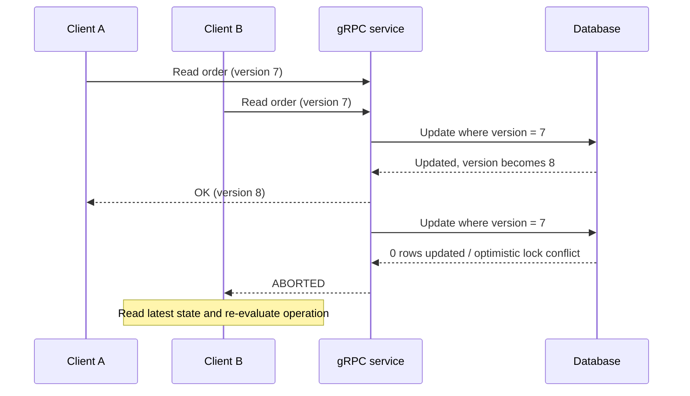

# Concurrency errors and ABORTED

**Chapter:** Error handling  
**Scope:** Spring gRPC (SPRING_GRPC) using Protocol Buffers contracts, generated Java code, and unary or streaming RPCs. This lesson focuses on conflicts when multiple requests modify the same resource concurrently and how to represent that conflict with the gRPC status ABORTED.

## 1. How do concurrency errors occur?

Suppose two employees open the same order at version 7. The first updates the address; the second updates the shipping status. Both read the same initial data. If the server lets both write without checking the version, the later write can overwrite the earlier write's changes (*lost update*).

Optimistic locking detects this situation using a version or a compare-and-set condition. Only one transaction is allowed to write against the read version. The other transaction fails because the data has already changed.



A conflict is not necessarily a bug. In a system with multiple writers, it is a valid result of a consistency-protection mechanism. What matters is that both server and client understand how to recover.

## 2. Why use the gRPC status ABORTED?

`ABORTED` indicates the operation was aborted due to a conflict, typically a concurrency conflict or an aborted transaction. The caller usually needs to **retry at a higher level**, meaning re-reading state or rerunning the entire transaction/workflow, rather than repeating the exact lower-level call.

Distinguishing from related statuses:

| Status | When to use | What the client should do |
| --- | --- | --- |
| `ABORTED` | Concurrency conflict, optimistic lock, or transaction serialization conflict | Re-read data, re-evaluate the operation, and rerun the workflow |
| `FAILED_PRECONDITION` | Current state does not allow the operation until conditions change | Fix business conditions before retrying |
| `ALREADY_EXISTS` | Creating a resource whose identifier already exists | Look up resource or handle duplicate |
| `UNAVAILABLE` | Service/dependency temporarily unavailable | Retry call with backoff if operation is safe |
| `RESOURCE_EXHAUSTED` | Quota or resource limit exceeded | Shed load or wait for quota |
| `DEADLINE_EXCEEDED` | RPC time budget exhausted | Verify outcome if operation has side effects |
| `INTERNAL` | Unexpected internal error | Investigate on the server side |

Examples:

- Two clients update the same order version: `ABORTED`.
- An order has already been delivered and cannot be cancelled under business rules: `FAILED_PRECONDITION`.
- Creating an order with an existing order ID: `ALREADY_EXISTS`.
- The order service cannot reach the datastore due to a temporary outage: may be `UNAVAILABLE`, depending on root cause and contract.

Do not use `ABORTED` for every database error. Only map to it when the cause is confirmed to be a conflict or aborted transaction that can be resolved by rerunning the workflow.

## 3. Detecting concurrency with optimistic locking

With Spring Data JPA, a `@Version` field detects concurrent updates. The ORM generates a conditional update statement based on the version; if another transaction updated it first, the current flush/commit fails.

```java
@Entity
public class Inventory {
    @Id
    private String sku;

    @Version
    private long version;

    private int available;

    public void reserve(int quantity) {
        if (quantity <= 0) {
            throw new IllegalArgumentException("quantity must be positive");
        }
        if (available < quantity) {
            throw new InsufficientStockException();
        }
        available -= quantity;
    }

    public long getVersion() {
        return version;
    }

    public int getAvailable() {
        return available;
    }
}
```

If two transactions both read version 12, both may compute against the same snapshot. On write, the database only allows the first transaction to update the row with version 12 and increment the version. The second transaction no longer satisfies the version condition, so the ORM throws an optimistic locking error.

You can use compare-and-set directly in the repository:

```sql
UPDATE inventory
SET available = available - :quantity,
    version = version + 1
WHERE sku = :sku
  AND version = :expectedVersion
  AND available >= :quantity;
```

If the number of updated rows is 0, determine the cause: SKU does not exist, version changed, or available quantity is insufficient. Do not lump all of them into `ABORTED`; each cause has an appropriate status per the API contract. An extra read query or SQL operation with clearer result classification may be needed.

## 4. Mapping optimistic locking to ABORTED

At the application layer, conflicts can be normalized into a dedicated exception. A gRPC mapper converts that exception into a status:

```java
public class ConcurrentUpdateException extends RuntimeException {
    public ConcurrentUpdateException(String message, Throwable cause) {
        super(message, cause);
    }
}

@Component
public class ConcurrencyStatusMapper {

    public StatusRuntimeException map(ConcurrentUpdateException error) {
        return Status.ABORTED
                .withDescription(
                        "Data has changed; reload and retry the operation")
                .asRuntimeException();
    }
}
```

In Spring, optimistic locking may surface as Spring DAO's `OptimisticLockingFailureException` or a corresponding JPA exception. Only catch exception types identified as optimistic conflicts:

```java
@GrpcService
public class InventoryGrpcService
        extends InventoryServiceGrpc.InventoryServiceImplBase {

    private final InventoryApplicationService applicationService;
    private final ConcurrencyStatusMapper statusMapper;

    public InventoryGrpcService(
            InventoryApplicationService applicationService,
            ConcurrencyStatusMapper statusMapper) {
        this.applicationService = applicationService;
        this.statusMapper = statusMapper;
    }

    @Override
    public void reserve(
            ReserveRequest request,
            StreamObserver<ReserveResponse> responseObserver) {
        try {
            var result = applicationService.reserve(
                    request.getSku(),
                    request.getQuantity(),
                    request.getExpectedVersion());
            responseObserver.onNext(toProto(result));
            responseObserver.onCompleted();
        } catch (ConcurrentUpdateException conflict) {
            responseObserver.onError(statusMapper.map(conflict));
        } catch (OptimisticLockingFailureException conflict) {
            responseObserver.onError(
                    Status.ABORTED
                            .withDescription(
                                    "Data has changed; reload and retry the operation")
                            .asRuntimeException());
        } catch (InsufficientStockException insufficient) {
            responseObserver.onError(
                    Status.FAILED_PRECONDITION
                            .withDescription("Insufficient inventory")
                            .asRuntimeException());
        }
    }
}
```

This is an adapter example. Include a safe fallback for unexpected errors and never let internal exception messages appear in the status description. Do not convert every `DataAccessException` to `ABORTED`: database connection errors, SQL errors, or other constraints have different semantics.

## 5. Version in the API helps clients detect stale writes

For conditional update operations, the protobuf contract can carry the version read by the client:

```proto
message ReserveRequest {
  string sku = 1;
  int32 quantity = 2;
  int64 expected_version = 3;
}

message ReserveResponse {
  string sku = 1;
  int32 remaining = 2;
  int64 new_version = 3;
}
```

The server compares `expected_version` with the current version inside the transaction. If they do not match, it returns `ABORTED`. The version is part of the concurrency contract, telling the server which snapshot the request was built against.

If the client uses a proto3 scalar without presence, the default value 0 cannot distinguish "version not sent" from "sent version 0". Use `optional int64` or an explicit valid-version convention if presence matters. The server must still validate and never trust a client-supplied version as security proof; it is solely a concurrency precondition.

## 6. Retrying at the right level: re-read and recompute

Suppose a client reads inventory at version 12 and wants to reserve 3 items:

1. Client sends `expected_version = 12`.
2. Another client updates inventory to version 13 first.
3. Server returns `ABORTED`.
4. Client re-reads inventory at version 13.
5. Client checks the available quantity and re-evaluates the reservation decision.
6. If the operation is still valid, client sends a new request with `expected_version = 13`.

**Do not automatically resend the exact old request with version 12.** It will keep failing because the snapshot is still stale. More importantly, business conditions may have changed: remaining quantity, price, status, or permissions may differ.

Workflow-level retry:

```java
for (int attempt = 1; attempt <= MAX_ATTEMPTS; attempt++) {
    InventorySnapshot snapshot = blockingStub.getInventory(
            GetInventoryRequest.newBuilder().setSku(sku).build());

    if (snapshot.getAvailable() < quantity) {
        throw new InsufficientStockException();
    }

    ReserveRequest request = ReserveRequest.newBuilder()
            .setSku(sku)
            .setQuantity(quantity)
            .setExpectedVersion(snapshot.getVersion())
            .build();

    try {
        return blockingStub.reserve(request);
    } catch (StatusRuntimeException error) {
        Status.Code code = Status.fromThrowable(error).getCode();
        if (code != Status.Code.ABORTED || attempt == MAX_ATTEMPTS) {
            throw error;
        }
        sleepWithBackoff(attempt);
        // The loop reads a fresh snapshot and recomputes, rather than resending the old request.
    }
}
throw new IllegalStateException("Retry loop ended unexpectedly");
```

The code assumes `MAX_ATTEMPTS` and `sleepWithBackoff` are configured on the client. In real applications, use a scheduler/non-blocking retry if you do not want to block threads; also cap total duration according to the deadline and retry budget.

## 7. Server-side internal retries and transaction boundaries

There are two distinct kinds of retries:

- **Client/workflow retry:** receives `ABORTED`, re-reads state, and re-evaluates business intent. This is appropriate when the request contains the client's `expected_version`.
- **Server-side internal retry:** only appropriate when the server can safely rerun the entire operation from fresh data without violating the client's intent and without repeating side effects outside the transaction.

If the server retries optimistic locking internally, each attempt must use a **new transaction**. Never catch an optimistic lock error inside a transaction already marked rollback-only and keep using that transaction. With Spring, you can place the retry loop outside `TransactionTemplate.execute(...)` so each invocation opens and closes a separate transaction.

Do not auto-retry if:

- The operation already sent an email, called a payment gateway, or published a message outside the transaction.
- The request specifies a version precondition requested by the client that must be respected.
- Re-reading and re-applying could change the business meaning.
- The deadline or retry budget is exhausted.

If coordinating a database and a message broker, consider the transactional outbox pattern or an idempotent workflow; do not arbitrarily place external side effects inside a transaction retry loop.

## 8. Backoff, retry limits, and idempotency

Multiple clients hitting conflicts together can retry simultaneously, increasing load and worsening contention. Use exponential backoff with jitter:

```text
delay = random(0, min(maxDelay, baseDelay * 2^(attempt - 1)))
```

Limits:

- Maximum retry attempts.
- Total retry time must not exceed the caller's deadline.
- Concurrent requests to the same resource.
- Retry rate per client/tenant.

For write operations, distinguish **retry due to conflict** from **retry due to lost response**. Upon receiving `ABORTED`, the client knows the server rejected the transaction due to a contract conflict. Upon receiving `UNAVAILABLE` or `DEADLINE_EXCEEDED`, the outcome may be unknown: the server might have committed before the response was lost. Use an idempotency key to avoid duplicate side effects.

If the client re-reads and builds a new command with a new version, the request has changed. The idempotency policy must specify whether keys apply per attempt or per workflow; do not reuse a key bound to an old payload for a new request with a different payload if the server treats that as an idempotency conflict.

## 9. Testing concurrency conflicts

The most important test does not merely call the mapper; it must create two competing transactions on the same version.

| Test case | Expected |
| --- | --- |
| Two clients read the same version and both update | One succeeds, one receives `ABORTED` |
| Client retries after reading the new version | Operation succeeds if business conditions still hold |
| Client resends the old version | Continues receiving `ABORTED`, does not overwrite newer data |
| Insufficient inventory | `FAILED_PRECONDITION`, not confused with a conflict |
| Resource does not exist | `NOT_FOUND` |
| Database connection temporarily lost | Appropriate dependency status, not disguised as `ABORTED` |
| External side effect outside transaction | Not executed repeatedly on retry |

Mapper unit test:

```java
class ConcurrencyStatusMapperTest {

    private final ConcurrencyStatusMapper mapper =
            new ConcurrencyStatusMapper();

    @Test
    void concurrentUpdateMapsToAborted() {
        var error = mapper.map(
                new ConcurrentUpdateException("version changed", null));

        assertEquals(Status.Code.ABORTED,
                error.getStatus().getCode());
    }
}
```

Integration tests should use a real database or testcontainer with two concurrent transactions. Use a `CountDownLatch`/barrier so both transactions read the version before allowing writes. Afterward, verify:

- Only one transaction succeeds.
- The other transaction encounters a conflict and is translated to `ABORTED`.
- The version increments exactly once.
- The final value suffers no lost update.
- No duplicate side effects occur.

Avoid relying on `Thread.sleep()` to induce race conditions; synchronizing with barriers makes tests reliably repeatable. In-process tests can verify the gRPC status on the client, while persistence-layer concurrency testing requires real transactions/databases.

## 10. Observing concurrency errors in operations

Track these metrics:

- Count of `ABORTED` by RPC method and resource type.
- Conflict rate over total updates.
- Average retry count and retry success rate.
- Retries exhausted by budget or deadline.
- Transaction duration and lock wait time.
- Duplicate side effects prevented by idempotency.

If `ABORTED` spikes suddenly, examine contention on hot records, overly large update batches, long-running transactions, or clients holding snapshots too long. Do not merely raise retry limits; that can increase load without resolving the bottleneck. Consider shortening transaction duration, partitioning data, serializing operations on hot resources, or designing less contentious commands.

## 11. Self-practice

1. Two clients both read version 5 and update an account. Why should one request receive `ABORTED`?
2. An order has already been delivered so it cannot be cancelled. Why is this `FAILED_PRECONDITION` rather than `ABORTED`?
3. A client receives `ABORTED`; describe the steps to re-read, re-check business rules, and send a new request.
4. Why shouldn't you retry an optimistic lock inside the same rollback-only transaction?
5. Design an integration test using two transactions and a barrier to prove that only one update on the same version succeeds.

**Remember:** Use `ABORTED` for concurrency conflicts or aborted transactions. Clients should read the latest state, re-evaluate intent, and retry at the workflow level; do not resend requests with stale versions. Retries must have proper limits, backoff, deadlines, and idempotency to protect data and avoid duplicate side effects.
