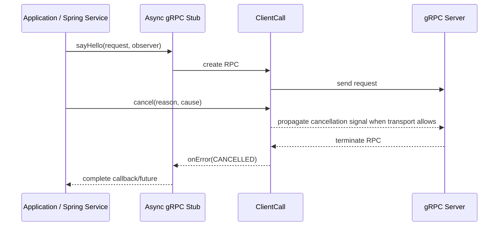

# Client cancelling an RPC

A gRPC client may no longer need the result of an RPC: the user closes the screen, an upstream HTTP request is cancelled, a background task stops, or a data stream no longer has a consumer. In those cases, the client should **cancel the specific running call** to free resources and notify the server that the result is no longer needed.

Cancelling an RPC is an operation scoped to `ClientCall`. It differs from closing a `ManagedChannel`: the channel may be serving many other RPCs and still needs to be reused. This lesson belongs to the **Cancellation** chapter of the **SPRING_GRPC** module, focusing on the client cancellation API, binding cancellation to an async stub, handling race conditions, and verifying that the server receives the cancellation signal.

## 1. Cancellation is scoped to a single call

A client call goes through a generated stub, creates a `ClientCall` on the channel, and communicates with the server. When the caller cancels, the client requests the call to terminate with a cancellation status:



Cancellation is not a rollback. If the server has already written data or completed a side effect before receiving the cancellation signal, the client cannot reverse that solely with `cancel()`. For write operations, you need an idempotency key, status check, or result lookup API when the client does not know whether the server has committed.

| Operation | Impact scope | When to use |
| --- | --- | --- |
| Cancel `ClientCall` | A specific RPC. | The caller no longer needs the result or stream. |
| Deadline expiration | A specific RPC, automatically terminating when timed out. | Limit the maximum duration for a call. |
| `ManagedChannel.shutdown()` | Entire channel: stops accepting new calls and starts an orderly shutdown. | The application or channel owner shuts down. |
| `ManagedChannel.shutdownNow()` | Entire channel and active calls. | Force-stop the channel after a wait period or when an emergency close is needed. |

Do not close the channel just to cancel a single request. If multiple stubs share the channel, closing the channel can disrupt unrelated RPCs.

## 2. Cancelling an async call with `ClientCallStreamObserver`

With an async stub, the appropriate API to obtain call cancellation control is `ClientResponseObserver`. It extends `StreamObserver` and provides the `beforeStart(...)` callback, where gRPC passes the `ClientCallStreamObserver` of the newly created call. From that object, the client calls `cancel(message, cause)`.

Example of a Spring component using `GreeterGrpc.GreeterStub`:

```java
package com.example.client;

import com.example.contract.grpc.GreeterGrpc;
import com.example.contract.grpc.HelloReply;
import com.example.contract.grpc.HelloRequest;
import io.grpc.stub.ClientCallStreamObserver;
import io.grpc.stub.ClientResponseObserver;
import java.util.concurrent.CompletableFuture;
import java.util.concurrent.TimeUnit;
import java.util.concurrent.atomic.AtomicBoolean;
import java.util.concurrent.atomic.AtomicReference;
import org.springframework.stereotype.Component;

@Component
public class CancellableGreetingClient {

    private final GreeterGrpc.GreeterStub stub;

    public CancellableGreetingClient(GreeterGrpc.GreeterStub stub) {
        this.stub = stub;
    }

    public CompletableFuture<HelloReply> sayHello(String name) {
        HelloRequest request = HelloRequest.newBuilder()
                .setName(name)
                .build();

        CompletableFuture<HelloReply> result = new CompletableFuture<>();
        AtomicReference<ClientCallStreamObserver<HelloRequest>> activeCall =
                new AtomicReference<>();
        AtomicReference<HelloReply> response = new AtomicReference<>();
        AtomicBoolean cancellationRequested = new AtomicBoolean();

        // When the caller cancels the future, propagate that request down to the gRPC ClientCall.
        result.whenComplete((value, failure) -> {
            if (result.isCancelled()) {
                cancellationRequested.set(true);
                ClientCallStreamObserver<HelloRequest> call = activeCall.get();
                if (call != null) {
                    call.cancel("Application caller cancelled", null);
                }
            }
        });

        ClientResponseObserver<HelloRequest, HelloReply> observer =
                new ClientResponseObserver<>() {
                    @Override
                    public void beforeStart(
                            ClientCallStreamObserver<HelloRequest> requestStream) {
                        activeCall.set(requestStream);
                        // The future may already have been cancelled before gRPC provided the call handle.
                        if (cancellationRequested.get() || result.isCancelled()) {
                            requestStream.cancel(
                                    "Application caller cancelled", null);
                        }
                    }

                    @Override
                    public void onNext(HelloReply value) {
                        response.set(value);
                    }

                    @Override
                    public void onError(Throwable failure) {
                        result.completeExceptionally(failure);
                    }

                    @Override
                    public void onCompleted() {
                        HelloReply value = response.get();
                        if (value == null) {
                            result.completeExceptionally(
                                    new IllegalStateException("RPC completed without response"));
                        } else {
                            result.complete(value);
                        }
                    }
                };

        try {
            stub.withDeadlineAfter(3, TimeUnit.SECONDS)
                    .sayHello(request, observer);
        } catch (RuntimeException failure) {
            result.completeExceptionally(failure);
        }

        return result;
    }
}
```

The caller uses `CompletableFuture.cancel(...)`; the `whenComplete` hook forwards the cancellation down to `ClientCallStreamObserver.cancel(...)`. `beforeStart(...)` stores the call handle so it can be cancelled later. `cancellationRequested` handles the race when the future is cancelled before the `beforeStart` callback provides the handle: if the call handle arrives later, `beforeStart` sees the flag and cancels immediately.

For a unary RPC, the response arrives via one `onNext`, followed by `onCompleted`. Therefore, the example stores the response in `onNext` and completes the future in `onCompleted`. For a server-streaming RPC with multiple messages, do not use a single `AtomicReference` to keep only the last response if business logic needs to process all messages; process each message individually or emit them through a publisher/queue with backpressure.

The three-second deadline is an additional limit on the RPC. If nobody actively cancels, the deadline still terminates the call when expired. If the caller cancels earlier, the client sends the cancellation immediately without waiting for the deadline to expire.

## 3. Why must cancellation races be handled?

In an asynchronous application, two things can happen almost simultaneously:

- The caller cancels the future immediately after calling `sayHello(...)`.
- gRPC is creating the call and preparing to invoke `beforeStart(...)` to provide the `ClientCallStreamObserver`.

If the code only stores the call handle in `beforeStart` and calls `activeCall.get().cancel(...)` on cancellation, the cancellation may be missed when the handle is not yet ready. The `cancellationRequested` flag in the example ensures both orderings are handled:

| Event order | Result |
| --- | --- |
| `beforeStart` stores the handle first, caller cancels later | The hook retrieves the handle and calls `cancel()`. |
| Caller cancels first, `beforeStart` arrives later | The hook sets the flag; `beforeStart` sees the flag and cancels as soon as it gets the handle. |
| RPC completes before caller cancels | The future has completed normally; `cancel()` returns `false`, and the call is not cancelled again. |
| Server errors before caller cancels | The future completes exceptionally; subsequent cancellation does not change the completed result. |

`CompletableFuture` guarantees only one terminal outcome wins: complete, complete exceptionally, or cancel. Even so, application code must still avoid processing a response after business logic has discarded the result, and must not perform side effects in callbacks if the future has already been cancelled.

## 4. Cancelling client-streaming or bidirectional-streaming

With client-streaming and bidirectional-streaming, the client holds a request observer to send multiple messages. The generated async stub returns a `StreamObserver<Request>`; if you need to cancel the call, the response observer can still implement `ClientResponseObserver<Request, Response>` to receive the call handle in `beforeStart`.

Skeleton example for a bidirectional stream:

```java
ClientResponseObserver<ChatRequest, ChatReply> responseObserver =
        new ClientResponseObserver<>() {
            private ClientCallStreamObserver<ChatRequest> call;

            @Override
            public void beforeStart(
                    ClientCallStreamObserver<ChatRequest> requestStream) {
                this.call = requestStream;
            }

            @Override
            public void onNext(ChatReply reply) {
                handleReply(reply);
            }

            @Override
            public void onError(Throwable failure) {
                handleStreamFailure(failure);
            }

            @Override
            public void onCompleted() {
                handleStreamCompleted();
            }

            void cancelChat() {
                if (call != null) {
                    call.cancel("Chat no longer needed", null);
                }
            }
        };

StreamObserver<ChatRequest> requests = asyncStub.chat(responseObserver);
```

This is an illustrative skeleton placed inside an adapter/client that owns stream management. In production code, the `cancelChat()` method should be exposed through a dedicated handle or stream controller; do not let external code directly access an anonymous observer. When cancelled, both the request-sending side and response-receiving side of the RPC terminate. Calls to `requests.onNext(...)` after cancellation are no longer valid; the producer must stop sending data and release associated resources.

For a server-streaming RPC, the client has no request stream after sending the initial request, but still uses `ClientResponseObserver<Request, Response>` to hold the call handle and cancel the stream if it no longer needs to receive further messages.

## 5. Connecting cancellation to the Spring request lifecycle

A Spring service can return a `CompletableFuture` to a controller or orchestration layer. When an HTTP request is cancelled, times out, or the client disconnects, the component owning the request needs to call `future.cancel(true)` to trigger the gRPC client's cancellation hook. This must be explicitly wired to the HTTP request lifecycle; you should not assume every controller type automatically cancels the future in all situations.

With Spring MVC, you can use `DeferredResult` or an appropriate async response mechanism to monitor timeout/disconnect and call cancel on the future. With WebFlux, binding the publisher's `doOnCancel(...)` to `future.cancel(true)` is a clear way to express cancellation intent. You should verify the actual behavior of the framework, server adapter, and version in use.

Conceptual example with Reactor:

```java
Mono<HelloReply> response = Mono.fromFuture(cancellableClient.sayHello("Lan"))
        .doOnCancel(() -> log.debug("HTTP subscriber cancelled gRPC request"));
```

`Mono.fromFuture(...)` can link subscriber cancellation to the future depending on the corresponding Reactor overload/configuration; if you want explicit control, use the overload accepting a supplier/cancel behavior appropriate for your version or call `future.cancel(true)` inside `doOnCancel`. Do not rely on a simple logging callback to believe the gRPC call was cancelled; test the cancellation path from the HTTP subscriber down to `ClientCall`.

## 6. How cancellation differs from deadline and channel shutdown

| Mechanism | Who initiates it? | What gets terminated | Commonly observed status |
| --- | --- | --- | --- |
| Client cancellation | Caller, application, or subscriber that no longer needs the result. | A single RPC. | Usually `CANCELLED`. |
| Deadline | Deadline set at call time or via a default policy. | A single RPC when time expires. | `DEADLINE_EXCEEDED`. |
| Channel shutdown | Owner of the channel when the application stops. | The channel and ability to create new RPCs; in-flight RPCs are handled per shutdown policy. | May see `CANCELLED`, `UNAVAILABLE`, or another outcome depending on timing/transport. |

`CANCELLED` can also appear when the server or context cancels the RPC, not only when a user clicks a cancel button. Therefore, when handling the status, you need to consider the cancellation source and request lifecycle. Do not retry an RPC just because you received `CANCELLED`; if the caller actively abandoned the request, retrying would go against the caller's intent.

## 7. How does the server receive cancellation?

Client cancellation is propagated over the transport when possible. The server can observe cancellation via gRPC `Context` or `ServerCallStreamObserver`:

```java
@Override
public void watchUpdates(
        WatchRequest request,
        StreamObserver<Update> responseObserver) {

    ServerCallStreamObserver<Update> serverObserver =
            (ServerCallStreamObserver<Update>) responseObserver;

    serverObserver.setOnCancelHandler(() -> {
        stopProducingUpdates(request.getSubscriptionId());
    });

    startProducingUpdates(request, serverObserver);
}
```

This server-side example illustrates reacting to cancellation: the producer must stop, release subscriptions, or cancel background tasks. You should not merely stop sending messages while leaving workers, database cursors, or other resources running.

Cancellation is a best-effort signal. The network may drop, the server may be executing a task that cannot be interrupted immediately, or a side effect may have already completed. Therefore, the server should check the cancellation state at safe points, avoid starting additional work after the request has been cancelled, and ensure cleanup in `finally`/an appropriate lifecycle mechanism.

## 8. Testing client cancellation

A useful test creates an in-process server that holds the RPC without returning a response, then cancels the future on the client and verifies the server receives the cancellation callback. Idea with JUnit 5:

```java
CountDownLatch serverCancelled = new CountDownLatch(1);

Server server = InProcessServerBuilder.forName(serverName)
        .directExecutor()
        .addService(new GreeterGrpc.GreeterImplBase() {
            @Override
            public void sayHello(
                    HelloRequest request,
                    StreamObserver<HelloReply> responseObserver) {
                ServerCallStreamObserver<HelloReply> call =
                        (ServerCallStreamObserver<HelloReply>) responseObserver;
                call.setOnCancelHandler(serverCancelled::countDown);
            }
        })
        .build()
        .start();

CompletableFuture<HelloReply> result = cancellableClient.sayHello("Lan");
assertTrue(result.cancel(true));
assertTrue(serverCancelled.await(2, TimeUnit.SECONDS));
```

This snippet assumes `cancellableClient` uses an in-process channel pointing to `serverName`, and the necessary imports/test fixtures have been declared. The server sends no response so the client waits until cancellation is propagated. Real tests must close the channel and server in `finally`, and use a timeout wide enough for CI.

You should also test:

- Cancelling before `beforeStart` runs to verify race handling.
- Cancelling after the response has completed to verify the future does not change state.
- Server terminating with an error on its own to ensure `onError` completes the future.
- Deadline expiration to distinguish `DEADLINE_EXCEEDED` from active `CANCELLED`.
- A long stream being cancelled to verify the server producer and resources are cleaned up.

In-process tests verify gRPC call logic but do not replace integration tests over TCP/TLS. In real environments, you need to verify HTTP disconnects, proxy timeouts, and cancellation propagation over the network transport.

## 9. Common mistakes

| Symptom | Cause | How to fix |
| --- | --- | --- |
| Closing the channel to cancel one request | Confusing call-level cancellation with channel lifecycle. | Keep `ClientCallStreamObserver` and cancel the specific RPC. |
| `future.cancel(true)` but the server keeps working | Future is not wired to `ClientCall.cancel()`. | Use `ClientResponseObserver.beforeStart` and a cancellation hook. |
| Cancelled too early and the call still runs | Call handle was not yet available when cancellation occurred. | Store a cancellation request flag and check it in `beforeStart`. |
| Sending more messages after cancelling the stream | Producer is unaware of terminal/cancel state. | Stop the producer and do not call the request observer after cancellation. |
| Server does not stop worker when client cancels | Only stopped the response observer without cleaning up background work. | Use `setOnCancelHandler`/Context cancellation to stop the producer and release resources. |
| Retrying after every `CANCELLED` | Not distinguishing caller cancellation from system cancellation. | Check the cancellation source; respect the caller's intent. |
| Assuming cancel rolls back write operations | Confusing cancellation with transaction rollback. | Use an idempotency key and query status when the outcome is uncertain. |

## 10. Hands-on exercises

1. Create an async stub and a `ClientResponseObserver` to obtain `ClientCallStreamObserver` inside `beforeStart`.
2. Wrap a unary RPC with `CompletableFuture`; wire `future.cancel(true)` to `ClientCallStreamObserver.cancel(...)`.
3. Create an in-process server test with `setOnCancelHandler`; cancel the future and verify the server receives the cancellation.
4. Test cancelling before and after `beforeStart` to check the race condition; test cancelling after the future has already completed.
5. Create a bidirectional stream, expose a cancellation handle to the caller, and ensure the producer stops sending messages after the call is cancelled.
6. Connect HTTP request/subscriber cancellation to the gRPC future; verify the server actually stops its work rather than merely stopping responses.

After this lesson, you should be able to distinguish single-RPC cancellation from deadlines and channel shutdown, obtain the call handle via `ClientResponseObserver`, bind cancellation to `CompletableFuture`, handle races when the handle is not yet ready, and test cancellation signals reaching the server. This is the foundation so a Spring gRPC client does not continue consuming resources for requests the caller has abandoned, while keeping other RPCs sharing the same channel safe.
