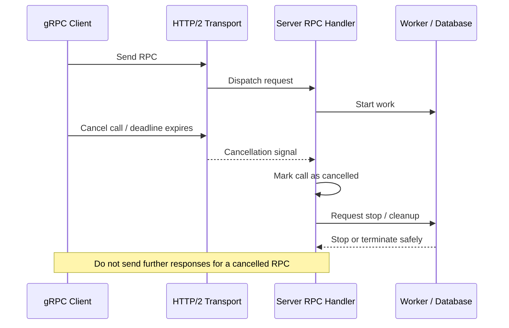

# Server receiving cancellation signals

When a client cancels an RPC or the call's deadline expires, the server needs to know that the caller is no longer waiting for the result. If the server continues querying data, running computations, or emitting messages for a cancelled stream, resources will be wasted on work that no longer has value. **The server receives cancellation signals** to stop stoppable work, release resources, and prevent generating further results for a terminated RPC.

This lesson belongs to the **Cancellation** chapter of the **SPRING_GRPC** module. The module develops gRPC services in the Spring ecosystem from Protocol Buffers contracts and generated Java code, supporting unary/streaming RPCs, metadata, deadlines, statuses, interceptors, TLS, integration testing, and observability. The focus here is handling cancellation on the server side: receiving the signal, propagating it to background work, cleaning up resources, and testing behavior when the client is no longer waiting.

## 1. In what situations does the server receive cancellation?

An RPC can terminate before the server returns a response because:

- The client actively calls `ClientCall.cancel(...)` or cancels `ClientCallStreamObserver`.
- The client-side deadline expires; the client ends the call and notifies the server of cancellation when the transport is still capable of transmitting the signal.
- The client connection or process is lost while the RPC is in flight.
- A server-side context or orchestration layer cancels the work according to application policy.

On the server side, cancellation is a **cooperative** signal. gRPC can mark the call/context as cancelled, but it does not automatically stop every thread, database query, or background task launched by the application. The server must observe that signal and instruct the relevant components to stop.



Cancellation is not a rollback. If the server has already committed data before receiving the signal, client cancellation does not reverse that change. For write operations, you need an idempotency key, transaction boundary, and status lookup API when the client-side outcome is uncertain.

## 2. Observing cancellation with `ServerCallStreamObserver`

In gRPC Java, the server can cast the response observer to `ServerCallStreamObserver` to check call state and register a handler:

```java
@Override
public void watchUpdates(
        WatchRequest request,
        StreamObserver<Update> responseObserver) {

    ServerCallStreamObserver<Update> call =
            (ServerCallStreamObserver<Update>) responseObserver;

    call.setOnCancelHandler(() -> {
        stopSubscription(request.getSubscriptionId());
    });

    startSendingUpdates(request, call);
}
```

`setOnCancelHandler(...)` registers a callback when the call is cancelled from the client/transport side. The handler should execute quickly: set a flag, cancel a task, or close a subscription. Do not run a blocking database operation or wait on another thread directly inside the handler, because cancellation callbacks need to be processed promptly.

`call.isCancelled()` allows checking the current state before continuing to send data or performing a resource-intensive step. However, checking state is only a snapshot: cancellation can occur right after the check. Therefore, in addition to checking `isCancelled()`, the producer must tolerate the observer no longer accepting results and must perform safe cleanup.

For a unary RPC, the server usually sends only one response and then `onCompleted()`. If the work has already been cancelled before producing the response, it should not continue computing just to call `onNext`. For a streaming RPC, you must stop the producer and not emit further messages after the call has ended.

## 3. Stopping background work with a cancellation flag and `Future.cancel(true)`

A service handler can offload blocking work to an `ExecutorService`. When the client cancels the RPC, the server needs to tell the worker to stop. The following example illustrates an asynchronously handled unary RPC:

```java
package com.example.server;

import com.example.contract.grpc.GreeterGrpc;
import com.example.contract.grpc.HelloReply;
import com.example.contract.grpc.HelloRequest;
import io.grpc.Status;
import io.grpc.stub.ServerCallStreamObserver;
import io.grpc.stub.StreamObserver;
import java.util.concurrent.ExecutorService;
import java.util.concurrent.Future;
import java.util.concurrent.atomic.AtomicBoolean;
import java.util.concurrent.atomic.AtomicReference;

public class GreeterService extends GreeterGrpc.GreeterImplBase {

    private final ExecutorService workers;
    private final GreetingService greetings;

    public GreeterService(ExecutorService workers, GreetingService greetings) {
        this.workers = workers;
        this.greetings = greetings;
    }

    @Override
    public void sayHello(
            HelloRequest request,
            StreamObserver<HelloReply> responseObserver) {

        ServerCallStreamObserver<HelloReply> call =
                (ServerCallStreamObserver<HelloReply>) responseObserver;
        AtomicBoolean cancelled = new AtomicBoolean();
        AtomicReference<Future<?>> taskRef = new AtomicReference<>();

        call.setOnCancelHandler(() -> {
            cancelled.set(true);
            Future<?> task = taskRef.get();
            if (task != null) {
                task.cancel(true);
            }
        });

        Future<?> task = workers.submit(() -> {
            try {
                if (cancelled.get() || call.isCancelled()) {
                    return;
                }

                String message = greetings.createGreeting(request.getName());

                if (cancelled.get() || call.isCancelled()
                        || Thread.currentThread().isInterrupted()) {
                    return;
                }

                responseObserver.onNext(HelloReply.newBuilder()
                        .setMessage(message)
                        .build());
                responseObserver.onCompleted();
            } catch (InterruptedException interrupted) {
                Thread.currentThread().interrupt();
            } catch (Exception failure) {
                if (!cancelled.get() && !call.isCancelled()) {
                    responseObserver.onError(Status.INTERNAL
                            .withDescription("Unable to process greeting")
                            .withCause(failure)
                            .asRuntimeException());
                }
            }
        });

        taskRef.set(task);
        // Handle the case where cancellation arrives before taskRef is assigned.
        if (cancelled.get() || call.isCancelled()) {
            task.cancel(true);
        }
    }
}
```

The example assumes `GreetingService.createGreeting(...)` can throw `InterruptedException` and `ExecutorService` is managed by Spring in the server configuration. The two atomic variables solve an important race: the cancellation handler may run before `taskRef` receives the `Future`; after assigning the task, the handler method rechecks the flag and cancels the task if needed.

`Future.cancel(true)` requests an interrupt on the running thread, but **does not guarantee stopping all work**. `createGreeting(...)` and the APIs it calls must cooperate with interrupts or have their own cancellation mechanism. If waiting on JDBC, an HTTP client, or another SDK, use the corresponding query timeout/cancel API. Do not swallow `InterruptedException`; restore the interrupt flag as in the example and finish the work.

The cancellation callback only sets the flag and calls `cancel`, without calling `onNext` or `onError`. That way, the callback and worker do not write concurrently to `StreamObserver`. Sending the response resides in a single worker; when the worker detects cancellation, it exits. Even so, cancellation can race with sending the final response; the transport may discard the result if the call has closed. The server cannot guarantee the client has not received the response solely by a single `isCancelled()` check.

## 4. Using `Context` to propagate cancellation across layers

gRPC Java creates an `io.grpc.Context` for the server-side RPC. This context carries deadline information and cancellation status. Inside the handler, you can obtain the current context:

```java
import io.grpc.Context;

Context rpcContext = Context.current();
```

If the handler invokes synchronous code on the same thread, processing layers can check `rpcContext.isCancelled()` at safe points. When dispatching to another executor, **do not assume `Context.current()` automatically refers to the RPC context on the worker thread**. Capture the context in the handler and pass it into the task, or use `Context.currentContextExecutor(executor)` so the executor attaches the current context to each submitted task.

You can register a listener when the context is cancelled:

```java
Context rpcContext = Context.current();
Context.CancellationListener listener = cancelledContext ->
        cancellationFlag.set(true);

rpcContext.addListener(listener, Runnable::run);
try {
    performWorkWhileNotCancelled(cancellationFlag, rpcContext);
} finally {
    rpcContext.removeListener(listener);
}
```

A `CancellationListener` should do very brief work; here it only sets a flag. If the listener needs to cancel a task, hold the task handle and call `cancel(true)` rather than waiting for the worker inside the callback. Always remove the listener when the work ends so references are not retained longer than the RPC lifecycle.

`Context` is useful when cancellation needs to traverse multiple layers without passing a flag parameter through every function. However, context propagation only delivers state to running code; I/O libraries still need their own APIs to actually cancel a pending query or request.

## 5. Handling cancellation in server-streaming

With server-streaming, a producer may run for a long time and send many messages. The cancellation handler needs to stop the producer, close resources, and prevent new messages:

```java
@Override
public void watchPrices(
        PriceRequest request,
        StreamObserver<PriceUpdate> responseObserver) {

    ServerCallStreamObserver<PriceUpdate> call =
            (ServerCallStreamObserver<PriceUpdate>) responseObserver;
    AtomicBoolean stopped = new AtomicBoolean();
    AtomicReference<Subscription> subscriptionRef = new AtomicReference<>();

    call.setOnCancelHandler(() -> {
        stopped.set(true);
        Subscription current = subscriptionRef.get();
        if (current != null) {
            current.close();
        }
    });

    if (call.isCancelled()) {
        stopped.set(true);
        return;
    }

    Subscription subscription = priceFeed.subscribe(request.getSymbol(), update -> {
        if (!stopped.get() && !call.isCancelled()) {
            responseObserver.onNext(toProto(update));
        }
    });
    subscriptionRef.set(subscription);

    // Cancellation may occur while subscribe is creating the subscription.
    if (stopped.get() || call.isCancelled()) {
        stopped.set(true);
        subscription.close();
    }
}
```

`Subscription` is a handle provided by the application's `priceFeed`. The handler is registered before starting the subscription; if cancellation occurs before the handle is stored, the `stopped` flag is checked again right after the subscription is created and the handle is closed. You must follow the thread-safety contract of `priceFeed` and avoid allowing `onNext` callbacks to run concurrently from multiple threads if the observer is not designed for that.

If the producer can emit data faster than the client receives it, you need flow control/backpressure. Cancellation is the case of terminating the entire stream; it does not replace `isReady()`/`setOnReadyHandler(...)` for pacing when the client is still connected.

## 6. Cancellation, deadlines, and server errors

The server needs to distinguish cancellation from processing errors:

| Situation | Server-side sign | Appropriate action |
| --- | --- | --- |
| Client actively cancels | Call/context transitions to cancelled; cancellation handler is invoked when transport receives the signal. | Stop worker, producer, and clean up. |
| Client deadline expires | Context/call is cancelled when the client-side deadline expires. | Stop remaining work; check deadline before expensive steps. |
| Server detects business error | Server actively calls `onError(Status...)`. | Return a status reflecting the error; do not treat this as client cancellation. |
| Server cancels the call itself | Server ends the call per its own logic. | Clean up resources; the handler for client cancellation is not a mechanism for reporting all termination types. |
| Network drops or client process disappears | Transport may detect the channel no longer exists and cancel the call. | Clean up on the signal when detected; do not assume instant detection. |

Deadlines are propagated over gRPC and the server context can provide the expiration time. You should check the budget before starting an expensive query or before each step in a processing pipeline. Even so, a deadline does not replace the dedicated timeout of a database/HTTP client; an uncooperative blocking library can continue running after the context has been cancelled.

Once the call has been cancelled, do not attempt to send more `onNext` calls or emit a synthetic business error to "notify" the client; the client has already ended the call. If the server encounters an error before cancellation arrives, return the proper status. If cancellation arrives first, prioritize stopping and cleaning up instead of continuing to build a response.

## 7. Cleaning up resources properly

Cancellation needs to be wired to the resources the RPC is holding:

- **Executor task:** keep the `Future` or cancellation token; request termination and do not leak workers.
- **Database:** use a query timeout, `Statement.cancel()`, or the driver's cancellation API when supported; close `ResultSet`, statements, and connections according to ownership.
- **HTTP call to another dependency:** propagate cancellation down to the HTTP client if that API supports it; do not merely stop waiting for the response in the gRPC server.
- **Subscription/message consumer:** unsubscribe and stop emitting events.
- **Stream producer:** stop reading the data source, release buffers, and close files/cursors.

Place cleanup in `finally`, `try-with-resources`, or the appropriate lifecycle callback so it runs whether the work finishes normally, throws an error, or is interrupted. The cancellation handler should be idempotent: invoking cleanup multiple times must not corrupt state or close resources not owned by the RPC.

## 8. Testing server-side cancellation reception

An in-process test can prove that the server receives the cancellation signal. Create a server that holds an RPC open and counts down a latch when `setOnCancelHandler` is invoked:

```java
CountDownLatch cancelled = new CountDownLatch(1);

Server server = InProcessServerBuilder.forName(serverName)
        .directExecutor()
        .addService(new GreeterGrpc.GreeterImplBase() {
            @Override
            public void sayHello(
                    HelloRequest request,
                    StreamObserver<HelloReply> responseObserver) {
                ServerCallStreamObserver<HelloReply> call =
                        (ServerCallStreamObserver<HelloReply>) responseObserver;
                call.setOnCancelHandler(cancelled::countDown);
            }
        })
        .build()
        .start();

ManagedChannel channel = InProcessChannelBuilder.forName(serverName)
        .directExecutor()
        .build();

ClientCallStreamObserver<HelloRequest> callHandle = startCancellableCall(channel);
callHandle.cancel("test cancellation", null);
assertTrue(cancelled.await(2, TimeUnit.SECONDS));
```

The test snippet assumes `startCancellableCall(...)` uses `ClientResponseObserver.beforeStart(...)` to return the call handle. You must declare the corresponding imports/fixtures and close the channel/server in `finally`. `directExecutor()` keeps the test simple; concurrency and worker cancellation tests should use a dedicated executor to observe interrupts, cleanup, and race conditions.

Checks should include:

1. Client cancels before the server returns a response; verify the handler is called.
2. Client deadline expires; verify the server stops work and does not continue futile queries.
3. A running worker receives an interrupt; verify it terminates and releases resources.
4. Cancellation occurs before the task handle is stored; verify the cancellation flag still makes the task stop.
5. Streaming producer is cancelled; verify the subscription closes and no new messages are emitted.
6. Server returns an error on its own before the client cancels; verify server errors are not confused with cancellation.

In-process tests verify gRPC logic but do not replace testing over TCP/TLS, proxies, or ingress. Real networks may detect cancellation later; the server must tolerate a peer disappearing abruptly.

## 9. Common mistakes

| Symptom | Cause | How to fix |
| --- | --- | --- |
| Client cancelled but worker keeps running | Only checking the observer without stopping the background task. | Connect the handler to a flag, `Future.cancel(true)`, or the task's cancellation API. |
| `Future.cancel(true)` does not stop the query | Underlying API does not cooperate with interrupts. | Use the database or HTTP client's query timeout/cancel API. |
| Server sends messages after cancellation | Producer does not check state and is not stopped. | Stop the producer, check call state, and handle races safely. |
| `Context.current()` returns a different context in a worker | Context is not propagated to the executor. | Capture the context and use a context-aware executor or pass a token explicitly. |
| Cancellation handler slows down RPC termination | Handler performs I/O or waits on a blocking task. | Only emit a signal or cancel the task quickly inside the handler. |
| Cleanup running twice causes an error | Callback and `finally` both close a non-idempotent resource. | Define ownership and make cleanup idempotent. |
| Treating cancellation as rollback | Server may have already committed side effects. | Use an idempotency key and check business state. |
| Test only verifies the client future was cancelled | Has not proven the server received it and stopped work. | Use a latch/flag on the server and verify cleanup completes. |

## 10. Hands-on exercises

1. Create a server unary RPC with background work running on an `ExecutorService`; use `ServerCallStreamObserver.setOnCancelHandler(...)` to stop the task when the client cancels.
2. Add a cancellation flag and `Future.cancel(true)`; simulate cancellation before the `Future` is stored to test the race.
3. Create a service depending on a database or HTTP client; verify cancellation actually stops the I/O rather than only interrupting the thread.
4. Use `Context.current()` to observe deadline/cancellation; propagate the context to an executor and check the state inside the worker.
5. Create a server-streaming RPC emitting data continuously; cancel from the client and verify the subscription, producer, and buffers are cleaned up.
6. Write an in-process test verifying the server receives cancellation, alongside an integration test over TCP/TLS to evaluate behavior when the connection is severed.

After this lesson, you should know how the server receives cancellation via `ServerCallStreamObserver` or gRPC `Context`, propagates that signal to workers and I/O APIs, stops producers, and cleans up safely. Cancellation is a cooperative mechanism scoped to a single RPC; handling it properly helps a Spring gRPC server avoid wasting resources and maintain reliability when clients cancel requests or deadlines expire.
