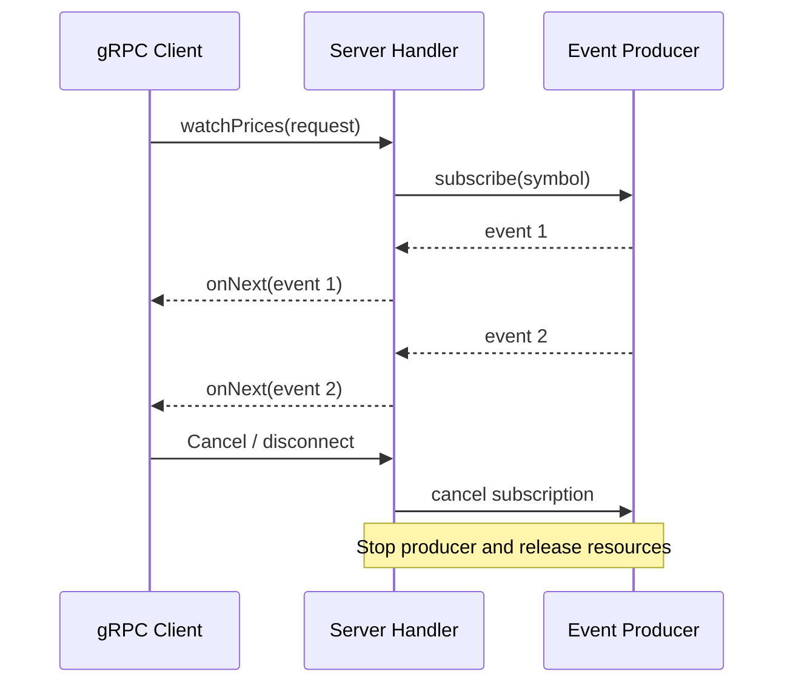

# Cancelling a stream when the client disconnects

A server-streaming RPC can live longer than a typical HTTP request: the server subscribes to an event source, reads data, or runs a producer and sends multiple messages back to the client. If the client closes the screen, actively cancels the call, or loses connectivity, the server needs to stop the producer and release the subscription. Otherwise, work keeps running even though there is no longer a consumer for the data.

**Cancelling a stream when the client disconnects** focuses on the lifecycle of a server-streaming RPC: receiving the call-cancelled signal, stopping the data source, handling races while the subscription is being created, not sending messages after the stream ends, and testing cleanup. This lesson belongs to the **Cancellation** chapter of the **SPRING_GRPC** module, where gRPC services are built with Protocol Buffers, generated Java code, and Spring, covering unary/streaming RPCs, metadata, deadlines, statuses, interceptors, TLS, testing, and observability.

## 1. How does the server detect client disconnection?

There are two common situations:

- **Client intentionally cancels the RPC:** the application calls the cancel API on the client call—for example, the user leaves the screen or the HTTP layer no longer needs the result. With HTTP/2, the client typically sends a stream reset signal.
- **Connection is lost abruptly:** the device shuts down, the network changes, the client process dies, or the TCP connection disappears. The server only knows when the transport detects that the peer is no longer reachable, such as through a write failure or a connection-detection mechanism.

On a gRPC Java server, when a call is cancelled, ServerCallStreamObserver.setOnCancelHandler(...) lets you register a callback. isCancelled() indicates whether the call is already cancelled at check time. Context.current() also provides the RPC's cancellation/deadline status.

**Not every network drop is detected immediately.** With a silently severed connection, the server may only detect it after trying to send data or after a transport/keepalive interval detects that the peer is no longer responding. Therefore, the cancellation handler is the point that receives a signal once gRPC knows the call has ended; it is not an instant sensor for every network failure.

## 2. Why does server-streaming need dedicated cleanup?

A server-streaming handler typically registers a subscription or creates a producer that lives for the duration of the stream:



If the handler merely stops calling onNext() without cancelling the subscription, the producer may still:

- Continuously read from a database or message broker.
- Hold buffers, cursors, file descriptors, or connections.
- Generate messages and discard them because the client is no longer receiving.
- Hold references to the RPC's observer, request, and context, preventing memory from being reclaimed.

Therefore, the server must wire the cancellation signal to the **data producer**, rather than only checking state before each message send.

## 3. Registering the cancellation handler before creating the subscription

The example below uses an application abstraction to illustrate an event source. EventSubscription.cancel() must be a fast, thread-safe, and idempotent cancellation operation; EventSource.subscribe(...) returns a handle so the owner can stop the source.

```java
interface EventSubscription {
    void cancel();
}

interface EventSource {
    EventSubscription subscribe(
            String topic,
            java.util.function.Consumer<PriceEvent> onNext,
            java.util.function.Consumer<Throwable> onError,
            Runnable onComplete);
}
```

Server-streaming handler:

```java
@Override
public void watchPrices(
        PriceRequest request,
        StreamObserver<PriceUpdate> responseObserver) {

    ServerCallStreamObserver<PriceUpdate> call =
            (ServerCallStreamObserver<PriceUpdate>) responseObserver;
    AtomicBoolean stopped = new AtomicBoolean(call.isCancelled());
    AtomicReference<EventSubscription> subscriptionRef =
            new AtomicReference<>();

    Runnable stopSource = () -> {
        stopped.set(true);
        EventSubscription subscription = subscriptionRef.getAndSet(null);
        if (subscription != null) {
            subscription.cancel();
        }
    };

    // Register before subscribing so early cancellation is not missed.
    call.setOnCancelHandler(stopSource);

    if (stopped.get() || call.isCancelled()) {
        stopSource.run();
        return;
    }

    try {
        EventSubscription subscription = eventSource.subscribe(
                request.getSymbol(),
                event -> {
                    if (!stopped.get() && !call.isCancelled()) {
                        responseObserver.onNext(toProto(event));
                    }
                },
                failure -> {
                    stopSource.run();
                    if (!call.isCancelled()) {
                        responseObserver.onError(Status.INTERNAL
                                .withDescription("Price feed encountered an error")
                                .withCause(failure)
                                .asRuntimeException());
                    }
                },
                () -> {
                    stopSource.run();
                    if (!call.isCancelled()) {
                        responseObserver.onCompleted();
                    }
                });

        subscriptionRef.set(subscription);

        // Cancellation may occur while subscribe is creating the handle.
        if (stopped.get() || call.isCancelled()) {
            stopSource.run();
        }
    } catch (RuntimeException failure) {
        stopSource.run();
        if (!call.isCancelled()) {
            responseObserver.onError(Status.INTERNAL
                    .withDescription("Unable to subscribe to price feed")
                    .withCause(failure)
                    .asRuntimeException());
        }
    }
}
```

Key parts:

1. Cast the observer to ServerCallStreamObserver to access server cancellation APIs.
2. Register setOnCancelHandler before creating the subscription.
3. stopSource sets the stop flag and retrieves the subscription via getAndSet(null), so multiple termination paths cannot grab the same handle to cancel simultaneously.
4. After subscribe(...) returns the handle, store it and then recheck stopped/isCancelled(). This handles the case where the client disconnects while the source is being subscribed.
5. When the source completes normally or reports an error, stop the subscription first and only then terminate the observer if the call is still active.

The example assumes EventSource callbacks are serialized or dispatched through a single executor. If the source invokes onNext, onError, and onComplete concurrently from multiple threads, the adapter must serialize callbacks per the gRPC contract. EventSubscription.cancel() should not block for long; if stopping the source can be slow, the cancellation callback should only emit a signal and delegate stopping to a bounded owner/executor.

## 4. Handling the race between disconnect and subscription registration

A common race: the server starts subscribe(...), but the client disconnects before that method returns the handle. The cancellation handler runs, sees subscriptionRef is still null, and has nothing to cancel yet. Then subscribe(...) returns a new subscription. Without rechecking the state, the subscription would live on with no owner to stop it.

In the example, the race is handled in two steps:

- The cancellation callback turns on stopped even when the handle has not been created yet.
- Immediately after subscriptionRef.set(subscription), the handler rechecks stopped and call.isCancelled(). If the call has already ended, stopSource.run() retrieves the newly stored handle and cancels it.

getAndSet(null) ensures retrieving the handle succeeds in only one branch. Even so, the contract of EventSubscription.cancel() should remain idempotent, because the event source might have its own self-termination mechanism running concurrently with cancellation. If subscribe(...) can invoke a terminal callback synchronously before returning the handle, the check after storing the handle also ensures that handle is cancelled.

You should not store the subscription in a field of a Spring singleton service. Multiple clients can open streams concurrently; each RPC must keep its own handle in local variables/a dedicated scoped object, otherwise one client could accidentally cancel another client's stream.

## 5. Using gRPC Context when a stream needs to propagate cancellation across layers

ServerCallStreamObserver is suitable for handling cancellation directly in the handler. If the stream calls multiple internal layers or dispatches work to an executor, you can use Context.current() and Context.CancellationListener to propagate the signal:

```java
Context rpcContext = Context.current();
AtomicBoolean stopped = new AtomicBoolean(rpcContext.isCancelled());

Context.CancellationListener listener = ignored -> stopped.set(true);
rpcContext.addListener(listener, Runnable::run);

workerExecutor.execute(rpcContext.wrap(() -> {
    if (stopped.get() || rpcContext.isCancelled()) {
        return;
    }
    publishNextBatch();
}));

// In the stream's terminal path, after the worker has stopped:
rpcContext.removeListener(listener);
```

Context is not automatically propagated to every thread created by the application. Capture the context in the handler and use rpcContext.wrap(...), fixedContextExecutor(...), or an equivalent context-propagation mechanism. The listener should only set a flag or emit a quick signal; do not block waiting for the worker to stop inside the callback. The removeListener call in the example must run in the stream's actual terminal path, not immediately after submit if the worker still depends on the listener.

When the stream ends normally or with an error, remove the listener with rpcContext.removeListener(listener) and release references. For a worker with a Future, keep the task handle to call cancel(true) when needed, while handling the race if cancellation arrives before the handle is stored. Future.cancel(true) only requests an interrupt; the underlying work must cooperate with interrupts or have its own cancel API.

## 6. Not sending messages after the call ends

Before sending data, the producer should check the stop flag and call.isCancelled(). However, cancellation can occur right after the check; the transport will handle the closed call. The server should not attempt to send additional onError(...) or onCompleted() calls to notify a client that has already disconnected. Terminal callbacks should only be emitted while the call is still active and the server is intentionally ending the stream.

Flow control is a separate concern from cancellation. call.isReady() indicates whether the transport side is currently able to accept more messages; setOnReadyHandler(...) helps the producer resume when the call is ready. If isReady() is false, do not simply drop messages if business logic requires full delivery. Pause the source, use a bounded queue, or use a demand-aware mechanism. If the client has cancelled, stop the entire producer; if the client is still connected but not ready, only pace the rate.

## 7. Disconnect, deadline, and reconnect/resume

Client disconnect and deadline expiration can both cause an RPC to be cancelled on the server, but their business meanings differ:

| Situation | Meaning | Server action |
| --- | --- | --- |
| Client actively cancels | Caller no longer needs the stream. | Cancel subscription and stop producer. |
| Deadline expires | Time for the RPC has run out. | Stop remaining work; do not generate more data. |
| TCP/HTTP/2 connection lost | Peer is no longer reachable; detection timing depends on transport. | Clean up when gRPC detects the call is cancelled; ensure resources do not depend on a single callback. |
| Server ends stream normally | Source has finished data or business logic completed. | Close subscription, remove listener, and call onCompleted() if call is still active. |

If the client needs to keep receiving data after reconnecting, reconnecting creates **a new RPC**. The server cannot resume the cancelled call itself. The streaming contract should include a cursor, sequence number, offset, or resume token so the client can request data from the last processed position. Data may be sent repeatedly around the disconnection point; the client should handle events by sequence/idempotency to avoid applying the same event twice.

Do not assume keepalive solves all disconnect cases. Keepalive helps detect unresponsive connections per transport configuration; choose an appropriate interval/timeout and comply with infrastructure policies. It does not replace cancellation cleanup or per-RPC deadlines.

## 8. Testing that the server stops the stream on client disconnect

An in-process test can prove the cancellation handler is called and the subscription is cancelled:

```java
CountDownLatch subscriptionCancelled = new CountDownLatch(1);
AtomicBoolean sourceStopped = new AtomicBoolean();

EventSource testSource = (topic, onNext, onError, onComplete) -> {
    return () -> {
        sourceStopped.set(true);
        subscriptionCancelled.countDown();
    };
};
```

Pass testSource into the service, start the server with InProcessServerBuilder, create a channel with InProcessChannelBuilder, and invoke the streaming method from an async stub. The client uses ClientResponseObserver.beforeStart(...) to retain ClientCallStreamObserver, and after the server has registered the subscription, calls cancel(...). The test awaits subscriptionCancelled.await(...), then verifies sourceStopped is true. Close the channel and server in finally.

Cases to test:

1. Client cancels after the subscription is created; verify cancel() is called exactly once.
2. Client cancels while subscribe(...) has not yet returned the handle; verify the handle is cancelled right after being stored.
3. Source completes normally; verify the subscription and listener are cleaned up before the terminal callback.
4. Source reports an error; verify cleanup occurs and the server terminates with an appropriate status.
5. Deadline expires; verify the producer stops just like the cancellation path.
6. Client disconnects abruptly over network transport; verify cleanup when the server detects the peer is gone.

In-process tests check call/callback logic but do not fully simulate TCP disconnects, proxies, or ingress. Integration tests over TCP/TLS are needed for real network scenarios and to measure the latency from when the peer disappears until the server detects it. Do not use an overly short test timeout that makes results dependent on CI scheduling.

## 9. Observability and operations

To detect orphaned streams, observe by service/method and logical client:

- Number of active streams and stream duration.
- Number of streams terminated by CANCELLED, DEADLINE_EXCEEDED, OK, or other errors.
- Time from the cancellation signal until the subscription/worker actually stops.
- Number of open subscriptions, cleanup count, and resource-closing errors.
- Number of messages emitted, messages blocked by flow control, and buffer sizes.

Logs should record method, logical client, status, stream ID/correlation ID, and cleanup duration. Do not log tokens, sensitive payloads, or entire metadata. Use metric labels with bounded cardinality; do not use user IDs or a random per-stream ID as a metric label.

If the active stream count does not drop after waves of client disconnects, check whether subscription handles are stored properly, whether listeners are removed prematurely, whether producers actually stop, and whether cleanup is blocking on callbacks.

## 10. Common mistakes

| Symptom | Cause | How to fix |
| --- | --- | --- |
| Client leaves screen but producer keeps running | Didn't register setOnCancelHandler or handler only logs. | Wire cancellation to subscription/worker cancel. |
| Stream leaks when disconnecting during subscribe | Handle wasn't created yet when cancellation callback ran. | Set stop flag and recheck after storing the handle. |
| One client cancels another client's stream | Subscription stored in a shared singleton field. | Keep a separate handle per RPC. |
| Server sends error after peer disconnected | Didn't check call state before terminal callback. | Do not send terminal callbacks after cancellation. |
| Messages lost when isReady() is false | Producer drops messages instead of pausing/backpressuring. | Pause the source temporarily or use a bounded queue. |
| Server detects disconnect slowly | Connection dropped silently, transport hasn't noticed yet. | Configure sensible keepalive and still set resource/stream lifetime limits. |
| Reconnect causes duplicate or lost events | No cursor/sequence/resume contract. | Design a resume token and handle events idempotently. |
| Cancellation callback blocks | Callback closes resources or waits directly on worker. | Callback only emits a signal; owner performs non-blocking cleanup. |

## 11. Hands-on exercises

1. Build a server-streaming RPC emitting prices by symbol; register setOnCancelHandler before subscribing.
2. Create a fake EventSource and verify client cancel causes the subscription to be cancelled exactly once.
3. Simulate cancellation occurring while subscribe is creating the handle; test the race and verify no subscription leaks.
4. Add flow control using isReady()/setOnReadyHandler(...) or a backpressure-capable source; ensure no messages are dropped when the client is temporarily not ready.
5. Add a cursor/sequence number so the client can reconnect and resume after a stream break; test duplicate event handling.
6. Write an in-process test and an integration test over TCP/TLS to distinguish explicit cancel from network disconnect detection.

After this lesson, you should know how the server detects a cancelled call via ServerCallStreamObserver, stops the producer/subscription, handles races when the handle has not been created yet, and cleans up when the stream ends via any path. Client disconnects may be detected late when the network drops silently; designing streams with resource bounds and a resume contract helps a Spring gRPC server operate reliably when clients leave or connections are interrupted.
