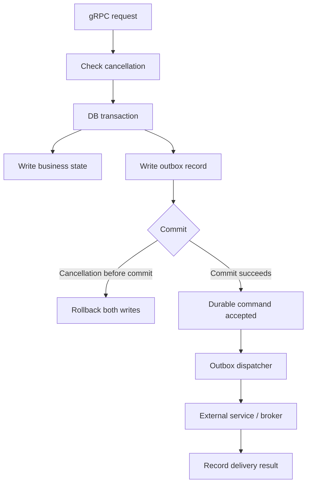

# Not continuing side effects after cancellation

When a client cancels an RPC or the deadline expires, the server may already have received the request and started processing. If the handler continues writing data, sending payment commands, or calling another service after the caller has stopped waiting, the system can create changes whose outcome the client does not know. This is a more dangerous situation than merely sending an extra response: **side effects may have already occurred even though the RPC ended with cancellation**.

The goal of this lesson is to design boundaries so the server stops initiating new side effects when an RPC is cancelled, handles cancellation inside transactions, controls downstream calls, and protects write operations with idempotency. The content belongs to the **Cancellation** chapter of the **SPRING_GRPC** module, where gRPC services are developed in the Spring ecosystem using Protocol Buffers and generated Java code, with unary/streaming RPCs, metadata, deadlines, statuses, interceptors, TLS, integration testing, and observability.

## 1. Cancellation does not automatically undo side effects

gRPC cancellation signals that the caller no longer needs the result of an RPC. It is not a transaction rollback command and cannot guarantee that the server has not made changes yet.

For example, an order-creation RPC might go through these steps:

1. Server receives the request and validates data.
2. Server writes the order to the database.
3. Server sends a stock-reservation command to the inventory service.
4. Client deadline expires before receiving the response.

The client may observe a timeout or cancellation while the order has already been written and stock has already been reserved. If the client retries blindly, the system risks creating two orders or reserving stock twice.

Distinguish the milestones:

| Milestone | Meaning of cancellation |
| --- | --- |
| Before starting side effects | Work can be skipped and the handler can terminate. |
| Inside an uncommitted transaction | Can stop and roll back if code/driver reacts in time. |
| After transaction commit | Changes are durable; cancellation does not undo them automatically. |
| During an external service call | Client can cancel the downstream call, but the other service may have already executed the side effect. |
| After a command is accepted into a durable queue | Work now has an independent owner; RPC disconnect does not automatically cancel an accepted command. |

Therefore, you must identify the **acceptance/commit point** of each operation. Before that point, cancellation can prevent the operation from starting or committing. After that point, the system must treat the outcome as accepted work, with its own status and cancellation/compensation mechanism if business rules allow.

## 2. Checking cancellation before steps with side effects

In the server handler, retrieve the RPC context and check its state before starting work with side effects:

```java
@Override
public void reserveStock(
        ReserveRequest request,
        StreamObserver<ReserveReply> responseObserver) {

    Context rpcContext = Context.current();

    if (rpcContext.isCancelled()) {
        return;
    }

    ReservationResult result = reservationUseCase.reserve(
            toCommand(request),
            rpcContext::isCancelled);

    if (rpcContext.isCancelled()) {
        return;
    }

    responseObserver.onNext(toReply(result));
    responseObserver.onCompleted();
}
```

The example passes a cancellation-checking function into the use case. However, you should not let the application/domain package depend directly on gRPC Context. You can define a small interface in the application layer:

```java
package com.example.reservation.application;

public interface CancellationToken {
    boolean isCancellationRequested();

    default void throwIfCancellationRequested() {
        if (isCancellationRequested()) {
            throw new OperationCancelledException();
        }
    }
}
```

The gRPC adapter converts the context into a token via a method reference:

```java
Context rpcContext = Context.current();
CancellationToken token = rpcContext::isCancelled;

try {
    ReservationResult result =
            reservationUseCase.reserve(toCommand(request), token);

    if (!rpcContext.isCancelled()) {
        responseObserver.onNext(toReply(result));
        responseObserver.onCompleted();
    }
} catch (OperationCancelledException cancelled) {
    // If the call is already closed, do not send additional terminal callbacks.
    if (!rpcContext.isCancelled()) {
        responseObserver.onError(Status.CANCELLED
                .withDescription("Operation has been cancelled")
                .asRuntimeException());
    }
}
```

The token lets business code check cancellation intent without knowing about gRPC. Cancellation is a cooperative signal: the use case needs to check before expensive steps and before commit points. A single check does not lock state; cancellation can still arrive right afterward. Therefore, for transactions, a check at the commit boundary is needed.

## 3. Not committing a transaction if the RPC has been cancelled

For data changes inside a database transaction, cancellation detected before commit can cause the transaction to roll back. An unchecked exception representing a cancelled operation will cause Spring's transaction interceptor to roll back by default:

```java
public final class OperationCancelledException extends RuntimeException {
    public OperationCancelledException() {
        super("Operation cancelled before commit");
    }
}
```

The use case can register a check in the pre-commit callback:

```java
@Service
public class ReservationUseCase {

    private final ReservationRepository repository;

    public ReservationUseCase(ReservationRepository repository) {
        this.repository = repository;
    }

    @Transactional
    public ReservationResult reserve(
            ReserveCommand command,
            CancellationToken cancellation) {

        cancellation.throwIfCancellationRequested();

        TransactionSynchronizationManager.registerSynchronization(
                new TransactionSynchronization() {
                    @Override
                    public void beforeCommit(boolean readOnly) {
                        cancellation.throwIfCancellationRequested();
                    }
                });

        Reservation existing =
                repository.findByIdempotencyKey(command.idempotencyKey())
                        .orElse(null);
        if (existing != null) {
            return ReservationResult.from(existing);
        }

        cancellation.throwIfCancellationRequested();
        Reservation reservation = Reservation.pending(
                command.orderId(), command.sku(), command.quantity(),
                command.idempotencyKey());
        repository.save(reservation);

        cancellation.throwIfCancellationRequested();
        return ReservationResult.from(reservation);
    }
}
```

Spring invokes TransactionSynchronization.beforeCommit(...) before the transaction commits. If the token has signaled cancellation, the unchecked exception fails the commit process and the transaction manager rolls back changes in that transaction. This is an additional safeguard beyond the checks between steps.

Limitations to understand clearly:

- The pre-commit callback only protects the transaction it participates in. Do not place external system calls or non-transactional side effects inside this callback.
- Cancellation can occur right after the final check and while the transaction manager starts committing. You cannot turn a flag read into an atomic lock between client disconnect and database commit.
- JDBC drivers/databases may not stop queries immediately; set a query timeout and use an appropriate cancel API.
- If the operation has already committed, do not tell the client that data is guaranteed unchanged just because the RPC ended with cancellation.

If business rules require a stricter invariant, such as "a cancel command must win if it arrives before a commit command," you must model the state and linearization point in the database: row locking, compare-and-set, or conditional updates so only one state transition is accepted. You cannot achieve that guarantee solely by checking Context in Java.

## 4. Distinguishing database side effects from external side effects

A database transaction can roll back changes within the same transaction. It cannot automatically roll back commands already sent to a payment gateway, email provider, message broker, or another gRPC service.

| Side effect | Can roll back with the DB transaction? | Appropriate design |
| --- | --- | --- |
| Insert/update in the same database transaction | Yes, if not yet committed and the transaction manager/driver behaves properly. | Transaction boundary, check cancellation before commit. |
| Sending an HTTP/gRPC request to another system | No. The external system has its own lifecycle and transaction. | Downstream cancellation, idempotency key, saga/compensation. |
| Publishing an event directly to a broker | Usually not atomic with the DB without an appropriate integration mechanism. | Transactional outbox or broker transaction per architecture. |
| Sending an email or notification | Cannot be reliably recalled once accepted by the provider. | Emit the command only after the commit point; use outbox and delivery status. |
| Writing to file/object storage | Not part of the DB transaction. | Staged upload, status confirmation, separate cleanup/compensation. |

Do not call an external service inside a DB transaction expecting the transaction rollback to undo that call. If the DB rolls back after the payment gateway has accepted the command, the system can fall into an inconsistent state.

## 5. Stopping downstream RPCs when the parent RPC is cancelled

If the server calls another gRPC service, cancellation of the parent RPC should be propagated to the child call. With an async stub, obtain the call handle via ClientResponseObserver.beforeStart(...), then call cancel when the parent context is cancelled:

```java
Context parentContext = Context.current();
AtomicReference<ClientCallStreamObserver<PaymentRequest>> downstreamCall =
        new AtomicReference<>();
AtomicBoolean stopped = new AtomicBoolean(parentContext.isCancelled());

Context.CancellationListener listener = ignored -> {
    stopped.set(true);
    ClientCallStreamObserver<PaymentRequest> call = downstreamCall.get();
    if (call != null) {
        call.cancel("Parent RPC cancelled", null);
    }
};
parentContext.addListener(listener, Runnable::run);

ClientResponseObserver<PaymentRequest, PaymentReply> observer =
        new ClientResponseObserver<>() {
            @Override
            public void beforeStart(
                    ClientCallStreamObserver<PaymentRequest> call) {
                downstreamCall.set(call);
                if (stopped.get() || parentContext.isCancelled()) {
                    call.cancel("Parent RPC already cancelled", null);
                }
            }

            @Override
            public void onNext(PaymentReply reply) {
                handlePaymentReply(reply);
            }

            @Override
            public void onError(Throwable failure) {
                finishParentWithFailure(failure);
            }

            @Override
            public void onCompleted() {
                finishParentSuccessfully();
            }
        };

paymentStub.authorize(paymentRequest, observer);
```

This is an illustrative pattern for a downstream async call; real code must remove the listener in the parent RPC's terminal path, handle executor rejection, and ensure the observer does not emit terminal callbacks after the parent call is cancelled. If cancellation arrives before the downstream call handle is created, the stopped flag is rechecked in beforeStart(...).

Crucial point: downstream cancel only notifies the payment service that the caller is no longer waiting. The payment service may already have received and processed the request. Therefore, payment requests need a stable idempotency key; transaction status must have a query/reconciliation API. Do not treat calling cancel as proof that the transaction was not executed.

## 6. Using idempotency keys for write operations

The client may not receive a response because cancellation occurred after the server committed. When retrying, the client needs to send the same idempotency key so the server recognizes it as the same business intent.

Example Protobuf request:

```protobuf
message ReserveRequest {
  string order_id = 1;
  string sku = 2;
  int32 quantity = 3;
  string idempotency_key = 4;
}
```

The server stores the key alongside the operation result and places a unique constraint in the database. Upon receiving the key again:

1. If the operation has completed, return the stored result.
2. If the operation is in progress, return an in-progress status or let the caller wait per contract.
3. If the key already exists with a different payload, reject because the same key must not represent two different intents.
4. If it does not exist yet, create a new operation inside the transaction.

The idempotency key should be generated at the boundary where the business intent originates and kept unchanged across retries. Do not generate a new random key inside the server on every RPC, as retries will then fail to be recognized as the same operation.

Idempotency does not prevent all side effects; it makes repeating requests safer when implemented properly with a unique constraint and operation state. With external providers, pass the key down to the provider if supported, or maintain a deduplication and reconciliation table on your side.

## 7. Using a transactional outbox to decouple durable commands from the RPC

When a request needs to write data and emit an event/command to an external system, a transactional outbox stores the emission intent in the same transaction as the business data:



If cancellation is detected before commit, both the business row and the outbox row roll back together. Once the transaction commits, the command has been durably accepted. The RPC may be cancelled afterward, yet the dispatcher continues processing because work ownership has transferred to the background workflow.

This is a key boundary: if the API means "register a processing request," a lost response does not mean the request is cancelled. The client can retry using the idempotency key or call a status query API. If business rules require cancelling an already-committed command, define a dedicated cancel operation and a state machine with rules such as PENDING -> CANCELLED, PENDING -> PROCESSING -> COMPLETED; cancellation may no longer be accepted past a certain point. For side effects that have already happened, use compensation rather than pretending to roll back.

An outbox typically provides at-least-once semantics when the dispatcher retries. Consumers must be idempotent/deduplicate by event ID or operation key. An outbox does not by itself provide exactly-once delivery to external systems.

## 8. Not initiating new side effects once cancellation is recorded

In a multi-step flow, checking cancellation between steps prevents starting the next piece of work:

```java
public ReservationResult reserve(
        ReserveCommand command,
        CancellationToken cancellation) {

    cancellation.throwIfCancellationRequested();
    validate(command);

    cancellation.throwIfCancellationRequested();
    StockAvailability stock = inventoryPort.getAvailability(command.sku());

    cancellation.throwIfCancellationRequested();
    if (stock.availableUnits() < command.quantity()) {
        throw new InsufficientStockException();
    }

    cancellation.throwIfCancellationRequested();
    return reservationPort.createPendingReservation(command);
}
```

The example illustrates checking before each step that may generate load or mutate state. However, createPendingReservation(...) still needs to guard its own transaction/commit as in section 3. If inventoryPort calls downstream, the adapter needs to propagate deadline and cancellation to the child call. A token does not replace timeouts for blocking I/O.

Do not scatter checks across every tiny computation line. Place them at meaningful boundaries: before expensive I/O, before downstream calls, before creating durable commands, and before commit. This keeps code readable while limiting new side effects.

## 9. Handling responses and statuses when the call is already cancelled

When the server receives cancellation, the call may already be closed. The handler should not send onNext, onCompleted, or onError afterward. With caller-initiated cancellation, there is typically no response to receive; the client has already closed the call itself.

If the server itself detects an operation cannot continue while the call is still active, it can return an appropriate status. Distinguish carefully:

| State | How to handle |
| --- | --- |
| Context already cancelled | Stop work, clean up; do not send new terminal callbacks. |
| Deadline already expired | Stop remaining work; do not initiate new side effects. |
| Business validation failed before commit | Return an appropriate business status if the call is still open. |
| Transaction rolled back due to cancellation token | Do not report success; if the call is still open, may terminate with CANCELLED. |
| Transaction committed then client disconnected | Cannot undo via cancellation; record the operation as accepted and allow status lookup. |

Do not convert every cancellation into a retry. CANCELLED usually means the caller no longer wants the result; automatic retries can produce unintended side effects. DEADLINE_EXCEEDED also does not prove the operation failed to commit.

## 10. Testing to prove side effects do not continue

Tests should observe business state and side-effect counts, not merely check that the client receives status CANCELLED.

Important cases:

1. **Cancel before transaction:** cancel the client call before the handler starts; verify the repository writes no data.
2. **Cancel inside transaction before commit:** use a latch to pause mid-transaction, cancel the client, release the latch; verify the transaction rolls back and neither business row nor outbox row exists.
3. **Cancel after commit:** let the transaction commit, then cancel before the response reaches the client; verify the operation still exists and the client can query it by idempotency key.
4. **Cancel while downstream is running:** verify the adapter requests cancellation of the downstream call; separately test that downstream may have already committed and needs idempotency/reconciliation.
5. **Retry with the same key:** resend the request after the client receives no response; verify only one operation exists and the same result is returned.
6. **Task/worker cancelled:** verify the worker stops, resources close, and the next step never starts.
7. **Outbox:** cancellation before commit creates no event; cancellation after commit does not delete an accepted event.

With Spring, use integration tests with the appropriate transaction manager and database to verify rollback/commit. With gRPC, an in-process server is useful for controlling call cancellation; tests over TCP/TLS are needed to verify transport and proxies. Use latches/barriers instead of arbitrary sleeps to reproduce races reliably.

## 11. Observing cancellation and side effects

Logs/metrics should help answer: at which stage did cancellation arrive, had the operation committed, which side effects were skipped, and which workers stopped. Useful signals:

- Number of RPCs with CANCELLED or DEADLINE_EXCEEDED, broken down by method.
- Number of operations stopped before commit and operations committed where the caller received no response.
- Number of downstream cancels, time from cancellation until the worker stopped.
- Number of outbox records created, pending, retried, or completed.
- Number of requests with duplicate idempotency keys and deduplication count.

Log operation ID/idempotency key per security policy, method, transaction outcome, and trace ID. Do not log tokens or sensitive payloads. Do not use idempotency keys or user IDs as high-cardinality metric labels.

## 12. Common mistakes

| Mistake | Consequence | How to fix |
| --- | --- | --- |
| Assuming client cancel rolls back the database | Data may already have committed. | Check cancellation before commit and provide idempotency/status lookup. |
| Only checking cancellation at the start of the handler | Cancellation can arrive mid-pipeline. | Check at boundaries before I/O and new side effects, plus a pre-commit guard. |
| Calling an external service inside a DB transaction expecting both to roll back | External side effects are outside the DB transaction. | Use outbox, idempotency, and saga/compensation. |
| Retrying on every CANCELLED | Creates unintended duplicate operations. | Respect cancellation; retry only per business policy. |
| Generating a new idempotency key on every retry | Server treats retries as new operations. | Keep one stable key for the same business intent. |
| Cancelling a downstream call and assuming no side effect occurred | Downstream may already have processed the request. | Query status or deduplicate by key. |
| Using a cancellation listener to invoke transaction rollback from another thread | Transactions are typically bound to a specific thread and transaction context. | Emit a signal; let the worker owning the transaction exit via exception/rollback. |
| Continuing to send responses after the call is closed | Causes callback errors or wasted work. | Check call state and suppress terminal callbacks once cancelled. |

## 13. Hands-on exercises

1. Add a CancellationToken to a reservation use case; check before each step with side effects.
2. Use TransactionSynchronization.beforeCommit(...) to reject commit when the RPC is already cancelled; verify rollback with an integration test.
3. Add an idempotency key and unique constraint; retry the same request after cancellation and verify no duplicate reservation is created.
4. Call a downstream gRPC service asynchronously, wire parent cancellation to the downstream call handle, and test the limits of cancellation when downstream has already committed.
5. Move event emission to a transactional outbox; verify the difference between cancellation before commit and after the command is accepted.
6. Write latch-based tests for cancellation before transaction, during transaction, and after commit.
7. Add metrics for operations stopped before commit, operations committed after caller disconnect, and deduplication counts.

After this lesson, you should be able to distinguish RPC cancellation from business rollback, identify the commit point, prevent new side effects once cancellation is recorded, and protect write operations with idempotency. For work already committed or handed off to external systems, you need durable state, result lookup, and dedicated compensation/cancel commands. Clearly designing that boundary prevents a Spring gRPC server from causing unintended mutations when clients cancel requests or deadlines expire.
