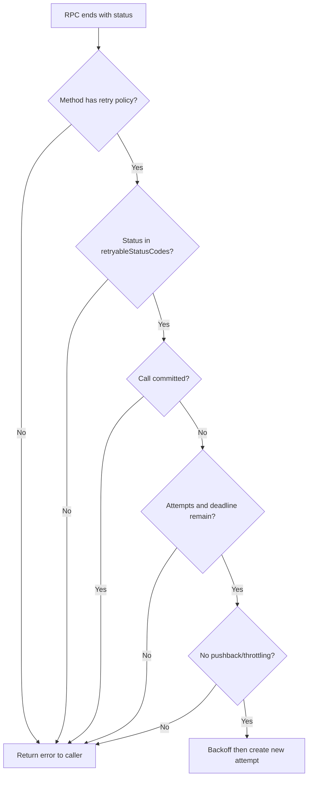

# Retry policy and application conditions

## 1. What does a retry policy decide?

In **Spring gRPC**, a call can fail because a service is temporarily unavailable, resources are overloaded, or the connection is interrupted. A retry policy specifies when the client is allowed to resend an RPC, the maximum number of attempts, and how long to wait between attempts.

A valid policy must simultaneously satisfy multiple conditions:

- The RPC matches the service/method configured for retry.
- The call ends with a status in the retryable list.
- The maximum number of attempts has not been exceeded and deadline budget remains.
- The RPC has not been **committed** according to the gRPC retry mechanism.
- Re-execution is safe according to business semantics, or the server has an idempotency mechanism.

Retry is not a fix for every error. Resending a request with invalid data still fails; resending a write operation without idempotency can cause duplicate side effects.

After this lesson, learners can configure a retry policy on the client channel, analyze the conditions for a call to actually be retried, distinguish automatic retry from application-level retry, and evaluate the limits of retry in streaming RPCs.

## 2. Conditions for a retry attempt to execute

Having a configured retry policy does not mean every error is automatically retried. The runtime must check the following conditions:

| Condition | Question to answer | When not satisfied |
| --- | --- | --- |
| Method match | Does the RPC match the service and method in the service config? | That policy is not applied |
| Retryable status | Is the ending status in `retryableStatusCodes`? | Return the error to the caller |
| Attempt budget | Has `maxAttempts` been reached? | Stop retrying |
| Retry commitment | Has the call been committed? | Do not replay a committed call |
| Deadline | Is there enough time left for the next attempt? | Terminate due to deadline |
| Retry throttling/pushback | Is the runtime or server requesting to throttle/stop retries? | Slow down or stop retrying |
| Replay safety | Is re-execution safe? | Requires idempotency or application-layer handling |

The decision flow can be modeled as:



The diagram illustrates the main conditions. The runtime also enforces details regarding the retry buffer and throttling; the application must still ensure the operation can be safely re-executed.

## 3. Configuring a retry policy by service and method

gRPC uses **service config** on the client to attach a policy to a method. Commonly used fields:

| Field | Meaning |
| --- | --- |
| `maxAttempts` | Maximum total number of attempts, **including the initial attempt** |
| `initialBackoff` | Waiting time before the first retry |
| `maxBackoff` | Upper limit on waiting time |
| `backoffMultiplier` | Factor by which waiting time increases after each failure |
| `retryableStatusCodes` | gRPC statuses that can trigger a retry |

Example policy for the unary RPC `catalog.v1.CatalogService/GetItem`:

```json
{
  "methodConfig": [
    {
      "name": [
        {
          "service": "catalog.v1.CatalogService",
          "method": "GetItem"
        }
      ],
      "retryPolicy": {
        "maxAttempts": 4,
        "initialBackoff": "0.2s",
        "maxBackoff": "2s",
        "backoffMultiplier": 2,
        "retryableStatusCodes": [
          "UNAVAILABLE"
        ]
      }
    }
  ]
}
```

The policy above allows up to four attempts in total. If the server returns `INVALID_ARGUMENT`, the client does not retry under this policy. Add `RESOURCE_EXHAUSTED` only when the system determines that status represents temporary overload and has an appropriate backoff/pushback mechanism; do not retry fixed-quota or payload-size-limit cases.

### 3.1. Attaching service config to a gRPC Java channel

With gRPC Java, you can convert the service config into a `Map` and attach it to `ManagedChannelBuilder`:

```java
import io.grpc.ManagedChannel;
import io.grpc.ManagedChannelBuilder;
import java.util.List;
import java.util.Map;

Map<String, Object> retryPolicy = Map.of(
        "maxAttempts", 4.0,
        "initialBackoff", "0.2s",
        "maxBackoff", "2s",
        "backoffMultiplier", 2.0,
        "retryableStatusCodes", List.of("UNAVAILABLE"));

Map<String, Object> methodConfig = Map.of(
        "name", List.of(Map.of(
                "service", "catalog.v1.CatalogService",
                "method", "GetItem")),
        "retryPolicy", retryPolicy);

Map<String, Object> serviceConfig =
        Map.of("methodConfig", List.of(methodConfig));

ManagedChannel channel = ManagedChannelBuilder
        .forAddress("catalog.internal", 9090)
        .defaultServiceConfig(serviceConfig)
        .build();
```

In a Spring gRPC application, this configuration must be applied to the **client channel** created by the application's factory or client configuration. The exact integration API depends on the Spring gRPC version and how the project manages channels; the policy must still match the exact Protobuf service/method name. Do not put the retry policy on the server and expect the server to resend the RPC on behalf of the client.

A per-method policy helps restrict retries to operations with suitable semantics. Avoid applying the same policy to the entire service if the service contains reads, writes, and non-idempotent commands.

## 4. Backoff, jitter, and retry budget

If many clients retry at the exact same moment as soon as a dependency recovers, they can cause a traffic spike. Retry policies use **exponential backoff** to increase the waiting interval:

[
t_n = \min(t_{initial} \times m^{n-1},\ t_{max})
]

Where (n) is the wait sequence number and (m) is `backoffMultiplier`; the runtime may add jitter so clients do not synchronize their retry timing.

For example, with `initialBackoff = 200 ms`, `backoffMultiplier = 2`, and `maxBackoff = 2 s`, the base wait intervals grow to roughly 200 ms, 400 ms, 800 ms, and then cap at 2 seconds. These are illustrative values; actual timings may vary due to jitter and pushback.

The retry policy must coordinate with the deadline:

- The deadline is the time budget for the entire RPC, not a fresh budget for each attempt.
- If the remaining time is insufficient for the backoff and a useful attempt, the call ends rather than retrying pointlessly.
- Do not increase the deadline indefinitely just to make retries succeed; that can hold requests and resources for too long.
- Monitor total latency, attempt counts, and final status to see whether retries improve reliability or merely prolong failures.

## 5. Retry commitment and retry buffer

An important condition is that **the call has not committed**. gRPC can only replay an RPC automatically when enough request data remains for replay and no signal has been received indicating the server has begun processing the call under the commitment mechanism.

Common situations that cause a call to commit:

- The client receives response headers from the server.
- Sent request data exceeds the retry buffer limit that the runtime can retain for replay.

Once a call has committed, subsequent errors will not cause gRPC to automatically replay the entire RPC. This prevents the client from accidentally re-executing a call that the server may have already processed.

The retry buffer is also a finite resource. If the request payload is large or a stream sends many messages, the data retained for replay may exceed the buffer limit and cause the call to commit earlier. Therefore, do not treat the retry buffer as an unlimited store.

### 5.1. Transparent retry vs. configured retry

| Type | How it works | Who configures it? |
| --- | --- | --- |
| Transparent retry | The runtime may retry in certain situations where it knows the request was not processed by the server | gRPC runtime |
| Configured retry | Retries based on status, attempt limit, and backoff in service config | Client/application owner |

Transparent retry does not replace a retry policy, nor does it provide an exactly-once guarantee. If an operation has side effects, you still need to evaluate duplicate execution risks and idempotency.

## 6. Choosing a status that matches the root cause

A retry policy only operates reliably when the server returns the right status:

| Status | Common condition | How to handle |
| --- | --- | --- |
| `UNAVAILABLE` | Service or dependency is temporarily unavailable | Primary retry candidate, with backoff |
| `RESOURCE_EXHAUSTED` | Temporary overload or quota/resources exhausted | Retry only when the cause is recoverable and the policy allows it |
| `ABORTED` | Concurrency conflict in a transaction | Usually requires retrying the entire business operation after re-reading state |
| `DEADLINE_EXCEEDED` | RPC deadline expired | Retry only if budget remains and the operation is safe |
| `INVALID_ARGUMENT` | Invalid payload | Fix the request, do not retry blindly |
| `FAILED_PRECONDITION` | System state does not meet preconditions | Wait or change the condition before retrying |
| `UNAUTHENTICATED`, `PERMISSION_DENIED` | Invalid credentials or permissions | Fix authentication/authorization |
| `INTERNAL` | Unexpected internal error | Do not include in blanket policies unless transience is confirmed |

The server should use `Status.UNAVAILABLE` for temporary dependency failures, `INVALID_ARGUMENT` for invalid data, and `RESOURCE_EXHAUSTED` for overload/quota situations. Do not return `UNAVAILABLE` just to make the client retry a permanent business error.

If the server supports retry pushback, the client must respect that guidance. A server may instruct the client to wait for a period or stop retrying; do not build a manual retry loop to bypass the server's load-protection decision.

## 7. Business conditions: idempotency and side effects

Retry commitment protects the protocol, but it does not replace **idempotency**. There are cases where the server has already written data or executed side effects, yet the response is lost before the client receives it. The client cannot rely solely on status to know for sure whether the operation ran.

For a write operation, use a stable idempotency key:

1. The client generates a key for one logical operation and keeps the key unchanged across attempts.
2. The server stores the key along with a payload fingerprint and result in a consistent store.
3. If the key is already completed, the server returns the stored result instead of executing again.
4. If the key is still running, the server returns an in-progress status or lets the client continue tracking.
5. If the key matches but the payload differs, reject it with an appropriate error.

Read operations are usually safer to retry, though you still need to consider side effects such as audit logging, billing, or creating snapshots. Enable retries only when the behavior of executing the same request multiple times is well understood.

## 8. Retry policy with streaming RPCs

Automatic retry is not a mechanism for resuming an active stream. For client streaming or bidirectional streaming:

- Before the call commits, gRPC may replay request messages still held in the retry buffer if an eligible error occurs.
- Once response headers are received or the call commits due to buffer limits, automatic retry no longer applies to subsequent errors.
- Bidi streams typically begin exchanging responses early and may send many requests; hence calls often commit early. Do not design around the assumption that the entire stream will be replayed after a network drop.
- Protobuf-level error responses such as `TaskRejected` or `TaskFailed` are business messages, not terminal RPC statuses; they do not trigger the retry policy.

When a committed stream is interrupted, the application typically must open a new RPC and perform **resume**:

1. Attach a stable `request_id` to each command.
2. Use a cursor/sequence to record the last acknowledged message.
3. Resend unacknowledged commands according to the idempotency policy.
4. The server deduplicates processed requests and can return the stored result.
5. The client ignores duplicate events and detects sequence gaps.

Retrying a single command inside a stream is application-layer logic. Do not restart the entire RPC just because one command is rejected if other commands can continue.

## 9. Testing retry application conditions

Tests must prove not only the final outcome, but also the number of attempts and the conditions that stop retries:

| Scenario | Expected result |
| --- | --- |
| Method matches policy, server returns `UNAVAILABLE` then succeeds | Client retries and receives the result |
| Method without a retry policy | Another method's configured retry is not applied |
| Server returns `INVALID_ARGUMENT` | Not retried under a policy containing only `UNAVAILABLE` |
| Server returns `UNAVAILABLE` continuously | Stops upon reaching `maxAttempts` or deadline |
| Deadline expires during backoff | Does not start an attempt past the deadline |
| Call has committed and server returns an error | Do not expect configured retry to replay the call |
| Large request exceeds retry buffer | Verify commitment and retry behavior per runtime/config |
| Write operation is retried | Same idempotency key does not create duplicate side effects |
| Streaming call disconnected after commit | Client opens a new RPC and resumes using cursor |
| Server sends pushback | Client respects the retry or stop guidance |

Use a test server that can control status per attempt, count received requests, and inspect payloads/IDs across attempts. For retry timing, prefer checking intervals within an allowed range rather than exact millisecond assertions due to jitter and scheduler variance.

## 10. Common mistakes

1. **Assuming adding a status to `retryableStatusCodes` is enough.** The call must also be uncommitted, have remaining attempts, and have deadline budget.
2. **Confusing `maxAttempts` with the number of additional retries.** This value includes the initial attempt.
3. **Retrying every method with the same policy.** Write operations and non-idempotent commands can cause duplicate side effects.
4. **Ignoring the retry buffer.** Large requests or long streams can commit before an error occurs.
5. **Using retry instead of reconnect/resume for bidi streams.** A committed stream requires an application-layer recovery protocol.
6. **Treating Protobuf error responses as gRPC status.** Retry policies only evaluate the status that terminates the RPC.
7. **Not bounding deadline and backoff.** Retries can prolong outages and increase load.
8. **Server returning a status that mismatches the root cause.** The client will retry the wrong errors or miss opportunities to recover.

## 11. Practice exercises

For `catalog.v1.CatalogService/GetItem`:

1. Configure `maxAttempts=4`, increasing backoff, and retry only `UNAVAILABLE`.
2. Write a test server that returns `UNAVAILABLE` twice and then succeeds; verify the attempt count.
3. Write a test where `INVALID_ARGUMENT` is not retried and a test where the deadline expires during backoff.
4. Create a write RPC with an idempotency key; simulate the server writing successfully while the response is lost, then verify that retrying does not write twice.
5. For a bidi stream, simulate an error after receiving response headers; implement cursor-based reconnect/resume instead of waiting for automatic retry.

**Completion criteria:** learners can explain and test all retry conditions—method match, status, attempt budget, commitment, deadline, pushback, and business safety—while distinguishing configured retry from streaming RPC resume.

### References

- [gRPC Retry](https://grpc.io/docs/guides/retry/): retry policy, commitment, backoff, and retry limits.
- [gRPC Status Codes](https://grpc.io/docs/guides/status-codes/): meanings of RPC statuses.
- [gRPC Service Config](https://grpc.io/docs/guides/service-config/): client configuration per service and method.
- [gRPC Java ManagedChannelBuilder](https://grpc.github.io/grpc-java/javadoc/io/grpc/ManagedChannelBuilder.html): attaching service config to a channel.
- [Spring gRPC Reference](https://docs.spring.io/spring-grpc/reference/): gRPC client/server integration in Spring.
