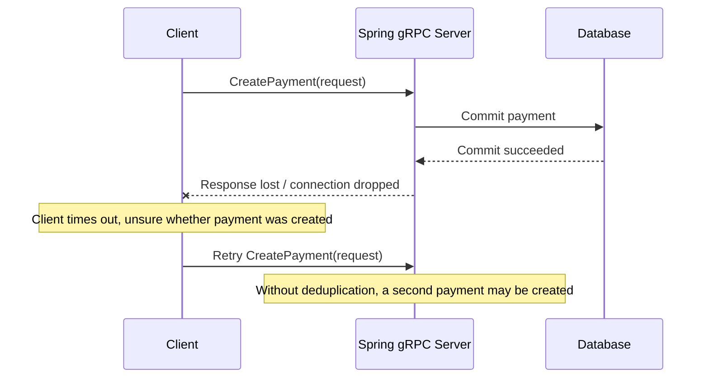
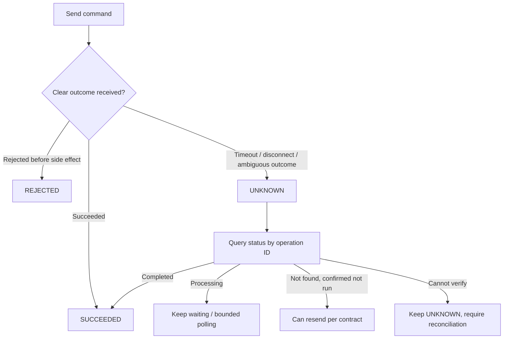

# Do not arbitrarily retry non-idempotent commands

## 1. Why can retrying a command cause duplicate side effects?

In **Spring gRPC**, a command usually asks the server to mutate state: create an order, deduct inventory, transfer funds, issue a ticket, or trigger a workflow. Such operations are not inherently safe to resend.

For example, the client calls `CreatePayment`. The server records the payment, but the response is lost on the way back. The client only sees a timeout or `UNAVAILABLE`. If it resends the command as a new request, the server may charge the customer a second time.

This is an **ambiguous outcome**: the client does not know for certain whether the operation was executed or not. The RPC error status describes the result of the call at the communication layer; it does not always prove the server did not produce side effects.

Principles of this lesson:

- Do not automatically retry a non-idempotent command just because a transient error was received.
- Retry only when it is known for sure that the previous attempt was not executed, or when the command is protected by an idempotency mechanism.
- When the outcome is unclear, query the operation status before deciding to resend.

## 2. Idempotent vs. non-idempotent commands

An **idempotent** operation yields the same business result whether executed once or multiple times with the same identifier/inputs. A **non-idempotent** operation can produce additional side effects on each execution.

| Command | Behavior when resent | Notes |
| --- | --- | --- |
| `GetOrder` | Reads the same state, if there are no side effects | Usually idempotent |
| `SetShippingAddress(order, address)` | Writes the same destination address | Can be idempotent if semantics do not emit duplicate side effects |
| `IncrementInventory(product, 1)` | Increments inventory once more | Non-idempotent |
| `CreateOrder` | May create an additional order | Non-idempotent without deduplication |
| `ChargeCard(amount)` | May charge the card again | Non-idempotent if the provider does not support idempotency |
| `SendEmail` | May send multiple emails | Non-idempotent without deduplication |

The method name alone does not determine idempotency. For instance, `SetStatus` looks idempotent, yet if every call emits an event, sends a notification, or incurs a charge, side effects can still repeat. You must evaluate the full behavior of the command and the dependencies it calls.

## 3. An RPC error does not prove the command did not run

In a unary RPC, the client sends a request and waits for a response. The following situations can occur:



Common statuses in ambiguous outcome situations:

| Status client receives | Can you conclude the server did not execute the command? | Safe handling |
| --- | --- | --- |
| `UNAVAILABLE` | No. The error may have occurred before or after server processing | Query status or use idempotency before resending |
| `DEADLINE_EXCEEDED` | No. The server may have committed while the response arrived late | Do not infer command failure; reconcile |
| `CANCELLED` | No. Cancellation does not roll back committed side effects | Query status if the command was already sent |
| `UNKNOWN` / transport error | Not necessarily | Treat as an undetermined outcome |
| `INVALID_ARGUMENT` | Conclude not executed only if the server guarantees validation occurs before side effects | Fix the input; resending is a modified command |
| `UNAUTHENTICATED` / `PERMISSION_DENIED` | Conclude not executed only if authentication/authorization is checked before side effects | Fix credentials/permissions; do not retry blindly |

Only when the system has reliable evidence that the request never reached processing logic, or the server confirms it was not executed, can the client conclude that the submission caused no side effects. Do not infer this from the status name alone.

## 4. Distinguishing three outcomes on the client

The client should persist command state rather than having only two branches (success/failure):

| State | Meaning | Next action |
| --- | --- | --- |
| `SUCCEEDED` | Received a success result or verified the server executed it | Do not resend |
| `REJECTED` | Server confirmed the command was not executed due to validation/permissions/preconditions | Fix the cause before creating a new command |
| `UNKNOWN` | Request was sent, but the client does not know if the server committed | Query by operation ID; do not blindly retry the command |

Processing flow:



Do not turn every exception into `REJECTED`. A client-side exception usually only indicates the client did not receive a response; it does not prove the server rolled back.

## 5. Do not configure automatic retry for non-idempotent commands

gRPC retry policies apply per service/method on the client channel. Attach policies only to methods whose semantics are safe to retry. For example, you can retry the read operation `GetBalance`, but do not add `CreateTransfer` to the policy without idempotency:

```json
{
  "methodConfig": [
    {
      "name": [
        {
          "service": "wallet.v1.WalletService",
          "method": "GetBalance"
        }
      ],
      "retryPolicy": {
        "maxAttempts": 3,
        "initialBackoff": "0.2s",
        "maxBackoff": "1s",
        "backoffMultiplier": 2,
        "retryableStatusCodes": ["UNAVAILABLE"]
      }
    }
  ]
}
```

`CreateTransfer` has no retry policy entry in this configuration. That eliminates **configured retry** for that method. However, gRPC may still perform transparent retries in very early cases where the runtime knows the request has not been processed by the server application. Transparent retry is not an exactly-once guarantee; business logic must still be designed to be safe against potential duplicate submissions.

In Spring gRPC, the service config must be applied to the client channel managed by the application. Do not apply one shared policy to every method simply because they belong to the same service.

## 6. Query status before resending

For commands with side effects, one way to handle ambiguous outcomes is to assign a stable **operation ID** and provide a status-query RPC:

```proto
syntax = "proto3";

package wallet.v1;

option java_multiple_files = true;
option java_package = "com.example.wallet.v1";

service WalletService {
  rpc CreateTransfer(CreateTransferRequest)
      returns (CreateTransferResponse);
  rpc GetTransferStatus(GetTransferStatusRequest)
      returns (GetTransferStatusResponse);
}

message CreateTransferRequest {
  string operation_id = 1;
  string source_account = 2;
  string destination_account = 3;
  int64 amount_minor = 4;
}

message CreateTransferResponse {
  string transfer_id = 1;
  string status = 2;
}

message GetTransferStatusRequest {
  string operation_id = 1;
}

message GetTransferStatusResponse {
  enum State {
    STATE_UNSPECIFIED = 0;
    NOT_FOUND = 1;
    PROCESSING = 2;
    SUCCEEDED = 3;
    REJECTED = 4;
  }
  State state = 1;
  string transfer_id = 2;
  string reason = 3;
}
```

The client creates `operation_id` once for a transfer intent and saves it with the request. If `CreateTransfer` times out:

1. Call `GetTransferStatus(operation_id)`.
2. If `SUCCEEDED`, display the stored result; do not resend.
3. If `PROCESSING`, wait or poll with bounded backoff.
4. If `REJECTED`, show the reason; executing a new intent requires creating a new command per the contract.
5. If `NOT_FOUND`, resend with the same operation ID only when the server guarantees consistent lookups and that state means the command was not received.

`NOT_FOUND` must be defined carefully. If the query reads from a lagging replica or the record is not yet visible, a temporary not-found result does not prove the previous request did not run. Use an appropriately consistent data source or a reconciliation window before allowing a resend.

## 7. When can a command be retried?

There are three main cases:

| Case | Can resend? | Condition |
| --- | --- | --- |
| Certain the request never reached the server application | Yes | Reliable transport/runtime evidence; still obey deadline and attempt limit |
| Server explicitly rejected before side effects | Do not resend the exact failing request; can submit a corrected request | Fix validation, permissions, or precondition |
| Unclear whether the server executed it or not | Do not retry arbitrarily | Query operation ID or use an idempotency key |
| Command has durable idempotency | Allowed per policy | Same key, same payload fingerprint; server deduplicates atomically |

A non-idempotent command can become safe when the server implements sufficiently strong deduplication. In that case, calls with the same key are no longer independent business operations: they reference the same operation and return the same result.

## 8. Idempotency if the business requires retrying

If the system needs automatic recovery from network errors, add idempotency instead of merely raising `maxAttempts`:

1. The client creates a stable `idempotency_key` or `operation_id` before the first attempt.
2. The server defines the scope, for example `tenant + method + key`.
3. The server computes a fingerprint from the fields affecting the outcome.
4. A unique constraint in the database guarantees only one request becomes the owner.
5. Database side effects and the response are saved in the same transaction.
6. Repeated requests with the same key/fingerprint receive the stored result; same key with a different payload is rejected.
7. Side effects outside the database use downstream idempotency or a transactional outbox.

Never generate a new key on each retry; doing so breaks deduplication. Never delete the record immediately after returning the first response; retention must cover the window during which clients can retry or recover.

## 9. Example client handling an undetermined outcome

The following code illustrates separating communication errors from business outcomes. `operationId` is persisted before calling; when the RPC errors, the client queries status instead of immediately resending the command:

This is a method inside a client component. `stub` and `statusStub` are blocking stubs created from the channel; `TransferOutcome` and `toOutcome()` are application-defined result/helper types.

```java
import io.grpc.Status;
import io.grpc.StatusRuntimeException;
import java.util.concurrent.TimeUnit;
import com.example.wallet.v1.CreateTransferRequest;
import com.example.wallet.v1.GetTransferStatusRequest;
import com.example.wallet.v1.GetTransferStatusResponse;

public TransferOutcome createTransferSafely(
        CreateTransferRequest request) {
    try {
        return toOutcome(stub
                .withDeadlineAfter(2, TimeUnit.SECONDS)
                .createTransfer(request));
    } catch (StatusRuntimeException error) {
        Status.Code code = Status.fromThrowable(error).getCode();

        if (code == Status.Code.INVALID_ARGUMENT
                || code == Status.Code.PERMISSION_DENIED
                || code == Status.Code.UNAUTHENTICATED) {
            return TransferOutcome.rejected(code.name());
        }

        // UNAVAILABLE/DEADLINE_EXCEEDED/CANCELLED can be ambiguous outcomes.
        try {
            GetTransferStatusResponse transferStatus = statusStub
                    .withDeadlineAfter(1, TimeUnit.SECONDS)
                    .getTransferStatus(GetTransferStatusRequest.newBuilder()
                            .setOperationId(request.getOperationId())
                            .build());

            return switch (transferStatus.getState()) {
                case SUCCEEDED -> TransferOutcome.succeeded(
                        transferStatus.getTransferId());
                case PROCESSING -> TransferOutcome.pending(
                        request.getOperationId());
                case REJECTED -> TransferOutcome.rejected(
                        transferStatus.getReason());
                case NOT_FOUND, STATE_UNSPECIFIED ->
                        TransferOutcome.unknown(request.getOperationId());
                default -> TransferOutcome.unknown(request.getOperationId());
            };
        } catch (StatusRuntimeException lookupError) {
            // Failing to look up also does not prove the command did not run.
            return TransferOutcome.unknown(request.getOperationId());
        }
    }
}
```

The example does not automatically resend `CreateTransfer` when the status is unclear. If a retry is needed, a separate step must verify state consistency and resend **the same operation ID** per the server's idempotency contract. In production systems, an uncertain `NOT_FOUND` should not be turned into permission to resend.

## 10. Testing against arbitrary command retries

Tests must prove both the number of business executions and how the client handles ambiguous outcomes:

| Scenario | Assertion |
| --- | --- |
| `CreateTransfer` has no configured retry policy, server returns `UNAVAILABLE` | Client does not run an unintended application retry loop |
| Server commits transfer then response is lost | Client transitions to `UNKNOWN`, queries status |
| Lookup returns `SUCCEEDED` | Client does not resend the command |
| Lookup returns `PROCESSING` | Client continues waiting/polling with bounds |
| Same operation ID is resent per idempotency contract | Only one transfer exists; response is replayed |
| Same operation ID with different amount | Server rejects conflict; does not create a second transfer |
| Request rejected by validation before side effects | Client fixes request or reports error; does not retry original payload |
| Client deadline/cancel after sending request | Does not infer the server rolled back |
| Retry policy applies only to `GetBalance` | Method `CreateTransfer` does not receive configured retry policy |

Tests should count how many times side effects happen in the database/provider, not just how many RPCs were called. One RPC can have multiple attempts yet still produce only one side effect if idempotency is right; conversely, a single client RPC call may already have caused side effects even when the client never received a response.

## 11. Common mistakes

1. **Retrying every `UNAVAILABLE` or `DEADLINE_EXCEEDED`.** The status does not prove the command was not executed.
2. **Creating a new operation ID for every attempt.** The server cannot recognize submissions belonging to the same intent.
3. **Treating timeout as rollback.** Timeout only means the client ran out of waiting time.
4. **Disabling only configured retry and assuming duplicates cannot happen.** Transparent retries and retries at other layers still need to be accounted for.
5. **Querying status from an eventual-consistent source and trusting `NOT_FOUND`.** The record may already exist without being visible yet.
6. **Retrying a command after editing the payload while keeping the same key.** Same key with a different fingerprint must be rejected; a modified operation is a new intent.
7. **Deduplicating only in memory.** Restarts or multiple replicas can execute the same command twice.
8. **Assuming a database transaction protects external side effects.** Downstream idempotency or an outbox is required.

## 12. Practice exercises

For `wallet.v1.WalletService/CreateTransfer`:

1. Do not configure automatic retry for the method before idempotency is in place.
2. Simulate the server writing a transfer successfully while the response is lost; the client must transition to `UNKNOWN`.
3. Add `operation_id` and the `GetTransferStatus` RPC for reconciliation.
4. Test `NOT_FOUND` on a consistent data source and on a lagging replica; determine when resending is permitted.
5. Add an idempotency key with a unique constraint, fingerprint, and transaction; send two concurrent requests with the same key.
6. Simulate a downstream payment provider and protect side effects with a separate key or an outbox.

**Completion criteria:** learners do not retry non-idempotent commands based solely on error status; distinguish failed outcomes from undetermined outcomes; know how to query status and retry only with evidence of non-execution or idempotency protection.

### References

- [gRPC Retry](https://grpc.io/docs/guides/retry/): configured retry, transparent retry, and commitment.
- [gRPC Status Codes](https://grpc.io/docs/guides/status-codes/): meanings of RPC statuses.
- [gRPC Service Config](https://grpc.io/docs/guides/service-config/): configuring retry behavior per method.
- [Spring Transaction Management](https://docs.spring.io/spring-framework/reference/data-access/transaction.html): transactions in Spring applications.
- [Spring gRPC Reference](https://docs.spring.io/spring-grpc/reference/): gRPC client/server integration in Spring.
