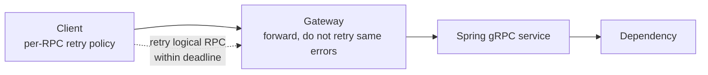
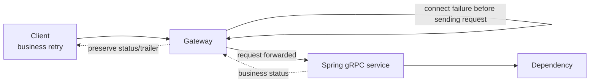

# Retrying at the client or at the gateway

## 1. Two retry locations, two different perspectives

In a **Spring gRPC** system, a request may travel from a client application through an API gateway or reverse proxy before reaching a gRPC service. When upstream temporarily fails, both the client and the gateway may have the ability to retry. If both retry without coordination, a minor glitch can generate far more requests than expected.

**Client-side retry** happens inside the calling application's gRPC channel/stub. The client understands the method being called, the operation's deadline, and the request's business meaning. It can select policies per RPC and combine them with idempotency keys.

**Gateway-side retry** happens at the intermediary layer forwarding requests upstream. The gateway typically sees connections, HTTP/2 streams, statuses/trailers, and upstream health. It can shield clients from certain infrastructure faults, yet it does not always understand the full business side effects of a command.

There is no single location that is always right for every system. Choose the retry owner based on the information available at that layer, request replayability, method semantics, and overall deadline.

## 2. Comparing client retry and gateway retry

| Criterion | Client retry | Gateway retry |
| --- | --- | --- |
| Where it runs | gRPC client channel/stub | Proxy, API gateway, or service mesh |
| Understanding of business method | Usually clearer; knows the RPC and request | May know only route/cluster and metadata |
| Per-RPC policy selection | Can match service/method in service config | Depends on gateway's route/method matching capabilities |
| Upstream visibility | Sees final result through the gateway | Sees each forwarding attempt to upstream |
| Idempotency | Can preserve key across attempts | Can forward key, but cannot create the guarantee itself |
| Deadline | Tied directly to the caller's logical RPC | Must obey timeout/deadline received from downstream |
| Request replay | Stub/runtime manages request retry buffer | Requires replayable request body/stream and proxy support |
| Policy updates | Requires updating client/config or service config | Can be updated centrally at the gateway |
| Main risk | Nested retries with gateway or dependencies | Load amplification, replaying a command already executed upstream |

The client is suitable when retry decisions must account for gRPC status, idempotency, and operation semantics. The gateway is suitable for certain well-defined transport errors, when the gateway can safely replay the request and has appropriate load limits.

## 3. Rules for choosing the retry-owning layer

One logical operation should have **one primary retry layer**. Another layer should only retry a narrow, clearly defined error scope—such as connection errors occurring before the request is sent upstream.

A common division of responsibilities:

- **Client:** owns retries based on gRPC status, method semantics, deadline, and idempotency.
- **Gateway:** retries only very early connection/upstream errors when there is proof the request was not processed, or when the route has a safe replay contract.
- **Service:** does not retry requests coming into itself; when calling dependencies, manages retries for each dependency under its own budget and propagates deadlines.

If the gateway must retry certain upstream errors, the client should use a narrower policy or disable configured retries for the same error scope. If the client owns retries, the gateway typically forwards statuses/trailers accurately and does not replay requests on its own.

### 3.1. Diagram of a single primary retry layer



In this model, the client is responsible for retrying the RPC. The gateway can still load-balance or pick an upstream, but does not add a separate retry loop for the same statuses.

### 3.2. Narrow gateway retry for connection errors before processing



The gateway only retries on the branch where it can confirm the request has not reached the application handler. Once the request has been sent to the service and the outcome is unknown, the gateway must not infer the operation did not occur merely from an upstream connection reset.

## 4. Avoiding retry multiplication

Suppose the client allows at most three total attempts and the gateway also allows three forwarding attempts per client request. In the worst case:

[
3 \times 3 = 9
]

One logical RPC from the client can produce up to nine upstream executions. If the service also retries a dependency three times, dependency calls can grow up to:

[
3_{client} \times 3_{gateway} \times 3_{service} = 27
]

This is an illustrative upper bound when every layer exhausts its attempt budget; actual counts depend on errors, commitment, and whether requests reach the next layer.

| Client attempts | Gateway attempts per request | Max upstream attempts |
| ---: | ---: | ---: |
| 1 | 1 | 1 |
| 3 | 1 | 3 |
| 1 | 3 | 3 |
| 3 | 3 | 9 |
| 3 | 2 | 6 |

Jitter only spreads out retry timing; it does not reduce the maximum number of attempts. To curb amplification, align attempt budgets, deadlines, retry budgets, throttling, and rate limits.

## 5. Client retry in Spring gRPC

With gRPC Java, the retry policy is configured in the client channel's service config. Example retrying only the read method `catalog.v1.CatalogService/GetItem` on `UNAVAILABLE`:

```java
import io.grpc.ManagedChannel;
import io.grpc.ManagedChannelBuilder;
import java.util.List;
import java.util.Map;
import java.util.concurrent.TimeUnit;
import com.example.catalog.v1.CatalogServiceGrpc;
import com.example.catalog.v1.GetItemRequest;
import com.example.catalog.v1.GetItemResponse;

Map<String, Object> retryPolicy = Map.of(
        "maxAttempts", 3.0,
        "initialBackoff", "0.2s",
        "maxBackoff", "1s",
        "backoffMultiplier", 2.0,
        "retryableStatusCodes", List.of("UNAVAILABLE"));

Map<String, Object> methodConfig = Map.of(
        "name", List.of(Map.of(
                "service", "catalog.v1.CatalogService",
                "method", "GetItem")),
        "retryPolicy", retryPolicy);

Map<String, Object> serviceConfig =
        Map.of("methodConfig", List.of(methodConfig));

ManagedChannel channel = ManagedChannelBuilder
        .forAddress("catalog.internal", 9090)
        .enableRetry()
        .defaultServiceConfig(serviceConfig)
        .build();

CatalogServiceGrpc.CatalogServiceBlockingStub stub =
        CatalogServiceGrpc.newBlockingStub(channel);

GetItemRequest request = GetItemRequest.newBuilder()
        .setItemId("item-42")
        .build();

GetItemResponse response = stub
        .withDeadlineAfter(2, TimeUnit.SECONDS)
        .getItem(request);
```

This policy is an example for a read operation. Do not copy it verbatim to `CreateOrder` or `ChargePayment` if those methods lack idempotency. `maxAttempts=3` means three attempts in total, not three additional retries.

In a Spring gRPC application, attach the service config to the channel managed by client configuration/factory before building the channel. If the project uses an existing channel factory, customize the builder at that integration point; do not create a new channel for every RPC.

## 6. Gateway retry must understand gRPC

gRPC runs over HTTP/2, yet the RPC's business status is usually carried in the `grpc-status` trailer, not necessarily corresponding to an HTTP 5xx status. An RPC can have HTTP status 200 while ending with `grpc-status: UNAVAILABLE`.

Therefore, a gateway that retries only on HTTP 5xx may miss gRPC errors that need handling. Conversely, a gateway that treats every HTTP 200 as success without inspecting trailers can hide RPC errors.

When configuring a gateway, verify:

- The gateway supports gRPC/HTTP2 end-to-end and can read gRPC trailers.
- The retry policy can match specific gRPC statuses, not just HTTP statuses.
- The request body is replayable; the gateway retains enough data to resend the same request.
- Limits exist for retry count, per-try timeout, and total route timeout.
- The gateway does not retry a non-idempotent command after the request may have reached upstream, unless an idempotency contract exists.
- The gateway preserves deadlines/timeouts and required metadata when forwarding.

Configuration field names and gRPC retry capabilities depend on the gateway/proxy product. Do not take a generic HTTP retry config and assume it understands `grpc-status`.

## 7. A gateway cannot infer idempotency from HTTP method

A gateway may see the request as an HTTP POST or a gRPC POST to an RPC path. That is not enough to tell whether the operation is idempotent:

- A read RPC may map to POST while having no side effects.
- A write RPC may use HTTP/2 POST and create a transaction.
- A gateway may replay the body successfully at the transport layer while causing duplicate side effects in the service.

For write commands, a stable idempotency key/operation ID is required. The gateway must forward the exact same key across attempts; the server deduplicates by scope and request fingerprint. Without this mechanism, retry only when the gateway has proof the request was never sent to the application handler.

Never let the gateway generate a new idempotency key for each attempt. Doing so makes the server treat every replay as a brand-new operation.

## 8. Deadlines and timeouts across layers

The client's deadline is the budget for the logical RPC. Gateway retries must consume that same budget; do not grant a fresh full timeout to each upstream attempt.

Example:

| Phase | Duration |
| --- | ---: |
| Client sets total deadline | 2,000 ms |
| Gateway receives request and processes route | 100 ms |
| Upstream attempt 1 | 600 ms |
| Backoff at gateway | 200 ms |
| Remaining budget for upstream attempt 2 | approx. 1,100 ms |

Numbers are illustrative only. The gateway must compute remaining timeout, apply a per-try timeout less than or equal to the remaining budget, and stop retrying before the overall deadline expires. Client and gateway should not hold two independent timeouts that allow the gateway to keep processing after the caller has expired.

In gRPC, deadlines are expressed via the `grpc-timeout` metadata representing remaining time. Proxies must honor these semantics and avoid resetting to a longer timeout at each hop. Downstream services must also receive appropriate deadlines/cancellations.

## 9. Choosing the layer by error type

| Error type | Client retry | Gateway retry | Recommendation |
| --- | --- | --- | --- |
| DNS/connect failure before request is sent | Possible | Often suitable if gateway confirms safely | Only one layer should retry the same failure |
| Connection reset after request was sent | Outcome can be ambiguous | Risk of replaying side effects | Query status/idempotency before retrying commands |
| gRPC `UNAVAILABLE` from application | Possible per method policy | Only if gateway understands trailers and route allows | Pick one layer to own retries |
| gRPC `INVALID_ARGUMENT` | No | No | Fix the request |
| gRPC `PERMISSION_DENIED` | No | No | Fix permissions/credentials |
| gRPC `RESOURCE_EXHAUSTED` due to temporary overload | Possible with backoff/pushback | Possible if retry budget exists | Avoid synchronized retries |
| `DEADLINE_EXCEEDED` | Only if semantics allow | Not by default | Server may have already executed side effects |
| Failure of a dependency inside the service | Client lacks details | Gateway usually lacks details too | Service owns dependency retries |

The gateway can be the right place to handle connection errors before the request reaches the service. The client is usually the better place to decide retries based on RPC semantics. Internal dependency errors should be handled by the service calling that dependency because that layer understands the operation's transactions and idempotency.

## 10. A controlled operational policy

When combining client and gateway, document responsibilities explicitly in a policy table:

| Scope | Retry owner | Condition | Limit |
| --- | --- | --- | --- |
| `GetItem` unary | Client | `UNAVAILABLE`, call uncommitted | 3 attempts, 2 s deadline |
| Gateway connect to upstream before sending request | Gateway | Connect failure confirmed before forwarding request | 1 extra retry, within original deadline |
| `CreateOrder` | No automatic retry without idempotency | On ambiguous outcome, query operation ID | Do not replay arbitrarily |
| Service calling database/dependency | Service | Recoverable transient error | Small budget, remaining deadline |
| Committed server/bidi stream | Stream application | Resume via cursor/sequence | Reconnect with backoff and dedup |

These values are examples, not defaults for every system. What matters is that every scope has a single owner, retry conditions, attempt budget, and defined deadline.

## 11. Testing retries at the client and gateway

Tests must observe upstream request counts, not just final client results:

| Scenario | What to verify |
| --- | --- |
| Client retries, gateway does not retry | Upstream receives attempts matching client policy |
| Gateway retries, client sends only once | Gateway does not exceed upstream attempt limit |
| Both policies accidentally enabled | Measure retry multiplication and catch conflicting config |
| HTTP 200 with `grpc-status: UNAVAILABLE` trailer | gRPC-aware gateway classifies status accurately |
| HTTP 503 before gRPC trailers exist | Gateway applies the defined transport policy accurately |
| Reset after request reached upstream | Command is not executed twice; idempotency/reconciliation works |
| Deadline expires during gateway backoff | No upstream attempt occurs after deadline |
| Gateway receives pushback | Does not ignore server stop/wait guidance |
| `INVALID_ARGUMENT` or `PERMISSION_DENIED` | No retry |
| Client cancels while gateway is retrying | Gateway stops next attempt and cancels upstream call if possible |

In tests, include request IDs and attempt numbers in test logs across client, gateway, and server. Compare:

- Logical calls from the client.
- Upstream attempts initiated by the gateway.
- Actual executions of the service handler.
- Committed side effects.

These numbers diverge in cases of connect failure, requests rejected before the handler, or gateway retries after resets. Counting each layer separately helps pinpoint where duplicate requests originate.

## 12. Observability and load protection

Monitor these metrics:

- Logical RPC count and attempt count on the client.
- Upstream request/attempt count on the gateway per route/cluster.
- Retry rate, retry success rate, and per-attempt status.
- Remaining deadline at the start of each attempt.
- Retry budget/throttling, pushback, and gateway retry rejections.
- Deduplicated duplicate count and idempotency conflict count.
- Upstream queue depth, concurrency, and latency.

Do not look solely at the final success rate. A 99.9% success rate can mask the fact that every logical call is generating multiple upstream attempts and driving up cost and load.

When an outage happens, retries must ease load so the system can recover. Concurrency limits, rate limits, circuit breakers, and load shedding remain necessary; retries do not replace these mechanisms.

## 13. Common mistakes

1. **Enabling retries at both client and gateway without calculating the product.** Upstream may receive far more requests than planned.
2. **Assuming the gateway understands every gRPC status via HTTP codes.** It must read gRPC trailers properly.
3. **Retrying commands solely due to a connection reset.** The request may have reached the service and created side effects.
4. **Setting a fresh timeout at the gateway for each attempt.** Total duration can exceed the caller's deadline.
5. **Letting the gateway generate a new key on each replay.** The server cannot deduplicate the same intent.
6. **Using a service-level retry policy for every RPC.** May accidentally retry non-idempotent methods.
7. **Failing to distinguish retries before sending the request from retries after upstream received it.** Safety guarantees differ.
8. **Not measuring attempts at each layer.** Makes retry multiplication hard to detect.
9. **Treating gateway retries as a substitute for in-service retries.** The gateway does not understand transactions or internal dependency states.

## 14. Practice exercises

For `catalog.v1.CatalogService` behind a gateway:

1. Configure the client to retry `GetItem` on `UNAVAILABLE`, up to three attempts.
2. Configure the gateway to retry only a confirmed connect failure occurring before the request is forwarded upstream.
3. Simulate gRPC HTTP 200 with trailer `grpc-status: UNAVAILABLE`; verify gateway/client classify it accurately.
4. Enable retries at both layers simultaneously in a test environment; calculate maximum upstream attempts and observe metrics.
5. Create a non-idempotent `CreateOrder`, simulate a reset after service commit; verify no blind retries occur and status lookup/idempotency prevents duplicate orders.
6. Set a short deadline, introduce backoff at the gateway, and verify the next attempt does not exceed the original deadline.

**Completion criteria:** learners choose the right retry-owning layer per error type, explain retry multiplication, configure client/gateway with clear scopes, preserve deadlines across hops, and protect commands with idempotency or reconciliation.

### References

- [gRPC Retry](https://grpc.io/docs/guides/retry/): client-side retry policy, commitment, backoff, and retry throttling.
- [gRPC Service Config](https://grpc.io/docs/guides/service-config/): configuring retries per service and method.
- [gRPC Deadlines](https://grpc.io/docs/guides/deadlines/): deadlines and propagating time budgets across services.
- [gRPC HTTP/2 Protocol](https://github.com/grpc/grpc/blob/master/doc/PROTOCOL-HTTP2.md): gRPC statuses and trailers over HTTP/2.
- [Spring gRPC Reference](https://docs.spring.io/spring-grpc/reference/): gRPC client/server integration in Spring.
