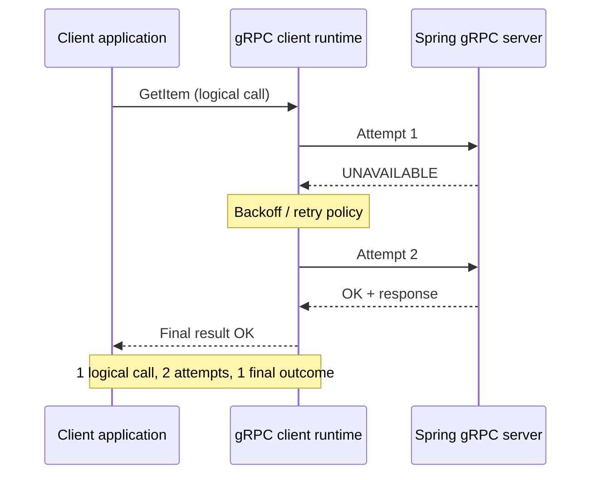

# Observing attempt counts and final outcomes

## 1. Why must both attempts and logical RPCs be observed?

In **Spring gRPC**, a single logical call from the client can generate multiple RPC executions when retries occur. For example, the client calls `GetItem`; on the first attempt the server returns `UNAVAILABLE`, and on the next attempt it succeeds. On the client side, the user sees only one final successful result; on the server side, two requests were received.

If you count only final successful RPCs, the system may look healthy even while generating heavy retries and loading upstream. If you count only server requests, operations teams struggle to tell how many logical client calls completed and how many attempts belonged to the same operation.

Two levels must be observed:

- **Logical call:** an RPC operation initiated by the client application; has one final outcome.
- **Attempt:** a specific execution of a logical call. An attempt can fail, be cancelled, or succeed; multiple attempts can belong to the same logical call.

The goal is to answer: how many logical calls were made, how many attempts each call took, which attempts failed with what statuses, whether retries recovered them, and what final outcome the caller received.

## 2. Observation lifecycle



In the example:

- The client initiates one logical call.
- The server receives two request attempts; the first fails and the second succeeds.
- The client receives one terminal callback with final status `OK`.
- Retry recovered the error, yet still consumed the resources of two executions.

Do not equate final client callbacks with attempt counts. This distinction is the foundation for designing metrics, traces, and logs.

## 3. Distinguishing data on the client and server

| Observation point | What is typically visible? | Limitation |
| --- | --- | --- |
| Client application | One logical call, deadline, and final status | Does not necessarily see individual internal attempts of configured retry |
| gRPC client retry instrumentation | Attempt count, per-attempt duration, and logical call duration if supported by runtime/instrumentation | Depends on version and telemetry integration |
| Standard client interceptor | Lifecycle of the call wrapped by the interceptor, usually one logical call | Should not assume it is re-invoked for every internal substream |
| Server interceptor | Each RPC attempt that reached the server application | Does not see connection failures occurring before the server receives the request |
| Gateway/proxy | Number of forwards to upstream and observed statuses/trailers | May not know whether business side effects committed |

Specifically in gRPC Java, a `ClientInterceptor` wraps the call above the channel's retry machinery. It is suitable for recording logical calls and final outcomes; do not rely on this interceptor alone to count internal attempts. To get attempt-level telemetry, use the gRPC runtime's metrics/instrumentation if available, or manage retries explicitly at the application layer with a dedicated counter.

A server-side interceptor can count RPC attempts that actually reached the handler. However, it cannot see attempts that failed before the request was delivered to the server. Therefore, when comparing client and server metrics, state the measurement scope clearly.

## 4. Minimal metric set

A useful metric set should distinguish logical calls, attempts, and final outcomes:

| Metric | Type | Meaning |
| --- | --- | --- |
| `app.grpc.client.logical_calls.started` | Counter | Logical calls started by the client |
| `app.grpc.client.logical_calls.completed` | Counter | Logical calls completed, tagged with final status |
| `app.grpc.client.logical_call.duration` | Histogram | Duration from start to the final terminal callback |
| `grpc.client.attempt.started` | Counter | Attempts started by the client runtime, if supported by instrumentation |
| `grpc.client.attempt.duration` | Histogram | Duration of each attempt |
| `app.grpc.client.attempts_per_call` | Histogram | Number of attempts per logical call |
| `app.grpc.server.received_calls.started` | Counter | RPC requests/attempts actually received by the server |
| `app.grpc.server.received_call.duration` | Histogram | Processing duration of one server call |
| `app.grpc.client.retry.recovered` | Counter | Logical calls that ultimately succeeded after at least one retry |
| `app.grpc.client.retry.exhausted` | Counter | Logical calls ending in error after exhausting the attempt budget |

Metrics prefixed with `app.grpc` are application-specific conventions in this example. With gRPC OpenTelemetry instrumentation, common names include `grpc.client.attempt.started`, `grpc.client.attempt.duration`, `grpc.client.call.duration`, `grpc.server.call.started`, and `grpc.server.call.duration`. Verify exact names and support level for the runtime/exporter version in use; do not create duplicate metrics alongside standard ones already emitted by instrumentation.

### 4.1. Useful calculations

Assuming instrumentation provides accurate attempt counts per logical call:

[
retryCount = attempts - 1
]

[
recoveryRate =
\frac{logicalCalls_{final=OK,\ attempts>1}}
{logicalCalls_{attempts>1}}
\]

[
attemptAmplification =
\frac{clientAttempts}
{clientLogicalCalls}
\]

Interpretation:

- `retryCount` is the number of additional attempts beyond the initial attempt.
- `recoveryRate` shows the fraction of retried logical calls that ultimately succeeded.
- `attemptAmplification` shows the average number of attempts generated per logical call in that measurement scope.

If you only have server call counts, do not compute `server_calls - client_calls` and call it the exact retry count. Requests may be blocked at a gateway, fail before reaching the server, or be retried separately by the gateway. Name metrics according to their exact scope: `server_received_calls`, `gateway_upstream_attempts`, `client_logical_calls`.

## 5. Observing logical calls on the client via an interceptor

A standard client interceptor is well suited for measuring duration and final status of logical calls. Example using Micrometer `MeterRegistry`:

```java
import io.grpc.CallOptions;
import io.grpc.Channel;
import io.grpc.ClientCall;
import io.grpc.ClientInterceptor;
import io.grpc.ForwardingClientCall;
import io.grpc.ForwardingClientCallListener;
import io.grpc.Metadata;
import io.grpc.MethodDescriptor;
import io.grpc.Status;
import io.micrometer.core.instrument.MeterRegistry;
import io.micrometer.core.instrument.Timer;

public final class LogicalCallMetricsInterceptor
        implements ClientInterceptor {

    private final MeterRegistry registry;

    public LogicalCallMetricsInterceptor(MeterRegistry registry) {
        this.registry = registry;
    }

    @Override
    public <ReqT, RespT> ClientCall<ReqT, RespT> interceptCall(
            MethodDescriptor<ReqT, RespT> method,
            CallOptions callOptions,
            Channel next) {

        String methodName = method.getFullMethodName();
        return new ForwardingClientCall
                .SimpleForwardingClientCall<>(
                        next.newCall(method, callOptions)) {

            @Override
            public void start(
                    Listener<RespT> listener,
                    Metadata headers) {
                Timer.Sample sample = Timer.start(registry);
                registry.counter(
                        "app.grpc.client.logical_calls.started",
                        "method", methodName).increment();

                Listener<RespT> measured =
                        new ForwardingClientCallListener
                                .SimpleForwardingClientCallListener<>(listener) {
                    @Override
                    public void onClose(Status status, Metadata trailers) {
                        String code = status.getCode().name();
                        sample.stop(Timer.builder(
                                        "app.grpc.client.logical_call.duration")
                                .tag("method", methodName)
                                .tag("status", code)
                                .register(registry));
                        registry.counter(
                                "app.grpc.client.logical_calls.completed",
                                "method", methodName,
                                "status", code).increment();
                        super.onClose(status, trailers);
                    }
                };
                super.start(measured, headers);
            }
        };
    }
}
```

This interceptor records one start and one completion for the call it wraps. The status captured in the terminal callback reflects **the final outcome received by the client**, after the retry runtime has finished. If the first attempt was `UNAVAILABLE` and the second was `OK`, the logical call metric records only the final status `OK`.

Do not add an attempt counter to this interceptor and assume it counts internal retries. With configured retry, substreams can be created underneath the call already wrapped by the interceptor.

## 6. Observing incoming requests on the server

A server interceptor can record every call received by the server. When a retry sends a new request to the server, the interceptor sees a separate server call:

```java
import io.grpc.ForwardingServerCall;
import io.grpc.Metadata;
import io.grpc.ServerCall;
import io.grpc.ServerCallHandler;
import io.grpc.ServerInterceptor;
import io.grpc.Status;
import io.micrometer.core.instrument.MeterRegistry;
import io.micrometer.core.instrument.Timer;

public final class ServerCallMetricsInterceptor
        implements ServerInterceptor {

    private final MeterRegistry registry;

    public ServerCallMetricsInterceptor(MeterRegistry registry) {
        this.registry = registry;
    }

    @Override
    public <ReqT, RespT> ServerCall.Listener<ReqT> interceptCall(
            ServerCall<ReqT, RespT> call,
            Metadata headers,
            ServerCallHandler<ReqT, RespT> next) {

        String methodName = call.getMethodDescriptor().getFullMethodName();
        Timer.Sample sample = Timer.start(registry);
        registry.counter(
                "app.grpc.server.received_calls.started",
                "method", methodName).increment();

        ServerCall<ReqT, RespT> measured =
                new ForwardingServerCall
                        .SimpleForwardingServerCall<>(call) {
            @Override
            public void close(Status status, Metadata trailers) {
                String code = status.getCode().name();
                sample.stop(Timer.builder("app.grpc.server.received_call.duration")
                        .tag("method", methodName)
                        .tag("status", code)
                        .register(registry));
                registry.counter(
                        "app.grpc.server.received_calls.completed",
                        "method", methodName,
                        "status", code).increment();
                super.close(status, trailers);
            }
        };

        return next.startCall(measured, headers);
    }
}
```

This counts server calls accepted at the application layer, not the absolute number of attempts made by the client runtime. An attempt that fails before reaching the server will not appear in this metric. A gateway retry can also inflate the server call count even though the client initiated only one logical call.

In Spring gRPC, register the interceptor through the server interceptor mechanism of the version in use. Ensure metrics are recorded once when the call closes; if abnormal terminations happen at the transport layer, add corresponding telemetry at the runtime/proxy so server handler counts are not mistaken for total attempts.

## 7. Attempt-level telemetry from the gRPC runtime

To know the exact internal attempt count of configured retries, you need instrumentation that can observe the retry machinery. Depending on the gRPC Java version and OpenTelemetry integration, metrics may exist for:

- Attempts started.
- Attempt duration.
- Logical call duration.
- Final status and method.

When using attempt-level metrics, distinguish them from metrics recorded directly by client interceptors. Never sum two sources if they measure the same event.

If the runtime does not expose attempt metrics in the current environment:

1. Use a client interceptor to measure logical calls and final statuses.
2. Use a server interceptor to count requests actually reaching the server.
3. Enable gateway/load balancer telemetry if available.
4. Clearly label server call counts as received requests, not every attempt initiated by the client.
5. If exact attempt counts are required, evaluate supported runtime/instrumentation options before writing a custom retry loop.

Do not replace configured retry with a hand-written loop just to get a counter. Doing so can alter gRPC semantics for commitment, backoff, pushback, cancellation, and deadlines.

## 8. Tracing: linking logical calls with attempts

Metrics show aggregate trends; traces help investigate a specific logical call. A useful trace structure:

```text
Client logical RPC span: GetItem
  ├─ Attempt 1 span: UNAVAILABLE, duration=80ms
  └─ Attempt 2 span: OK, duration=35ms
       └─ Server span: GetItem, duration=28ms
```

If runtime instrumentation supports per-attempt spans, use the parent/child or link relationships defined by the instrumentation. Otherwise, do not fabricate fake spans and claim they represent internal attempts; only create spans for retries controlled directly by your application.

Useful attributes:

- RPC service/method.
- Attempt ordinal or previous-attempt count if provided by the runtime.
- Per-attempt status and final logical call status.
- Backoff duration and remaining deadline.
- Upstream target/peer or gateway route.
- Retry reason: retryable status, connection failure, pushback, or policy exhausted.

A logical call that ultimately succeeds should have a final span reflecting `OK`, even if an earlier child attempt failed. Child spans/logs for failed attempts must still preserve the error status for debugging. Never mark the logical call as an overall failure solely because an intermediate attempt failed.

## 9. Structured logs and correlation

A useful log record might contain:

```json
{
  "event": "grpc.logical_call.completed",
  "rpc.method": "catalog.v1.CatalogService/GetItem",
  "grpc.final_status": "OK",
  "grpc.attempt_count": 2,
  "grpc.retry_count": 1,
  "grpc.deadline_ms": 2000,
  "grpc.duration_ms": 318,
  "trace_id": "trace-id",
  "logical_call_id": "call-id"
}
```

A separate attempt log can record:

```json
{
  "event": "grpc.attempt.completed",
  "rpc.method": "catalog.v1.CatalogService/GetItem",
  "attempt": 1,
  "grpc.status": "UNAVAILABLE",
  "grpc.attempt_duration_ms": 80,
  "grpc.retry_delay_ms": 120,
  "trace_id": "trace-id",
  "logical_call_id": "call-id"
}
```

These are illustrative schemas. Record `attempt_count` only if the telemetry source genuinely measures attempt counts; if only server call counts are available, use a name reflecting the true scope. Do not log payloads, access tokens, idempotency keys, or personal data in default logs.

## 10. Metric cardinality and dashboards

Metric labels should have bounded value sets:

- `rpc.service` or `method`.
- `grpc.status`.
- `retry.outcome`: `not_retried`, `recovered`, `exhausted`, `cancelled`.
- `peer.type` or a bounded cluster/route name.

Do not use the following values as metric labels:

- `request_id`, `logical_call_id`, `trace_id`.
- `tenant_id` if cardinality is high.
- User ID, order ID, idempotency key.
- Payloads, error descriptions, or exception messages.

High-cardinality values belong in controlled logs or traces. Putting them into metric labels can explode time-series counts and overload the monitoring backend.

Dashboards should include:

1. Logical calls by method and final status.
2. Attempts per logical call (histogram/p50/p95/p99).
3. Retry recovery rate.
4. Retries exhausted and deadlines exceeded.
5. Attempt duration vs. logical call duration.
6. Server received calls and gateway upstream attempts.
7. Retry amplification per scope.

An important warning signal is when the final success rate remains high while attempts-per-call and upstream load climb rapidly. That indicates retries are masking transient errors at the expense of extra resource consumption.

## 11. Distinguishing attempt status from final status

| Situation | Attempt status | Logical call final status | Meaning |
| --- | --- | --- | --- |
| Immediate success | `OK` | `OK` | No retry needed |
| First fails, second succeeds | `UNAVAILABLE`, then `OK` | `OK` | Recovered via retry |
| All attempts fail | Multiple error statuses | Final status of the call | Retry did not recover |
| Caller cancels during backoff | Prior attempt may have erred | `CANCELLED` | No further attempt started |
| Deadline expires while waiting | Prior attempt may have erred | `DEADLINE_EXCEEDED` | Total budget exhausted |
| Non-retryable status | Error status | Same status | Stopped early |

The client application usually sees only the final status. The server and attempt-level instrumentation can record the status of each execution. When analyzing an incident, view both perspectives side by side.

## 12. Testing attempt-count observation

An integration test can use a mock server: the first two attempts return `UNAVAILABLE`, and the third returns `OK`. Verify all of the following:

- The client receives one successful logical result.
- Runtime attempt metrics (if present) record three attempts.
- The server interceptor records the actual number of server calls received.
- The final logical call metric records only one completion with status `OK`.

Additional scenarios:

| Scenario | Assertion |
| --- | --- |
| Immediate success | 1 logical call, 1 attempt |
| Retry recovery | 1 logical call, multiple attempts, final `OK` |
| Retry exhausts `maxAttempts` | 1 logical call, attempt count does not exceed policy, final error status |
| Non-retryable status | 1 attempt, corresponding final status |
| Deadline expires during backoff | Final `DEADLINE_EXCEEDED`, no attempt after deadline |
| Call is cancelled | Final `CANCELLED`, subsequent timer/attempt stops |
| Request does not reach server | Client/runtime may record attempt; server has no matching call |
| Gateway retry | Gateway upstream attempts increase; client logical call can still be one |
| Retry succeeds after error | Child attempt keeps error, logical call keeps final `OK` |

Do not test by merely counting handler invocations and claiming that covers all attempts. An attempt might fail before reaching the handler; a gateway might issue its own attempts; instrumentation might measure at a different layer.

## 13. Common mistakes

1. **Measuring only final status.** Retries can hide earlier attempt failures while driving up load.
2. **Treating a client interceptor as an attempt counter.** A standard interceptor observes the logical call, not every internal retry substream.
3. **Treating server call counts as absolute attempt counts.** Attempts failing before reaching the server are not counted at the handler.
4. **Conflating attempt status with final status.** A logical call can ultimately succeed after a failed attempt.
5. **Attaching request IDs or tenant IDs as metric labels.** Cardinality grows rapidly.
6. **Fabricating attempt spans when the runtime does not expose attempts.** Traces will misrepresent real behavior.
7. **Observing only the client while ignoring the gateway/server.** Impossible to identify which layer is generating duplicate requests.
8. **Not separating logical calls from server received calls.** Retry multiplication becomes hard to spot.
9. **Logging payloads or credentials for debugging.** Creates data exposure risks unnecessary for retry telemetry.

## 14. Practice exercises

For `catalog.v1.CatalogService/GetItem`:

1. Configure a retry policy with up to three attempts for `UNAVAILABLE`.
2. Create a client interceptor measuring logical call duration and final status.
3. Create a server interceptor counting received server calls and per-call duration.
4. Enable gRPC/OpenTelemetry attempt instrumentation if supported by the runtime version; reconcile against client/server metrics.
5. Simulate first attempt `UNAVAILABLE`, second `OK`; verify one logical call with multiple attempts.
6. Simulate gateway retries and separately count client logical calls, gateway upstream attempts, and server received calls.
7. Build a dashboard for attempts-per-call, recovery rate, retries exhausted, and deadlines exceeded; verify metrics contain no high-cardinality labels.

**Completion criteria:** learners distinguish logical calls, attempts, and final outcomes; know the limits of client/server interceptors; design correlated metrics, traces, and logs; calculate retry amplification; and test both final outcomes and actual attempt counts.

### References

- [gRPC Retry](https://grpc.io/docs/guides/retry/): attempt lifecycle, commitment, and retry policies.
- [gRPC Observability](https://grpc.io/docs/guides/opentelemetry-metrics/): gRPC metrics and client/server observability.
- [gRPC Java ClientInterceptor API](https://grpc.github.io/grpc-java/javadoc/io/grpc/ClientInterceptor.html): client-side interceptors.
- [gRPC Java ServerInterceptor API](https://grpc.github.io/grpc-java/javadoc/io/grpc/ServerInterceptor.html): server-side interceptors.
- [Micrometer](https://docs.micrometer.io/micrometer/reference/): counters, timers, and histograms for Spring applications.
- [Spring gRPC Reference](https://docs.spring.io/spring-grpc/reference/): gRPC client/server integration in Spring.
