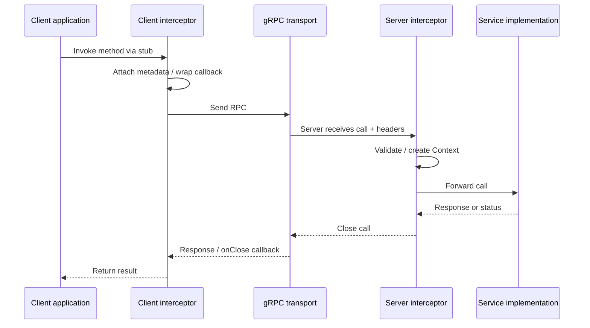

# Client Interceptor and Server Interceptor

In gRPC, an RPC often needs shared cross-cutting processing such as attaching a request ID, propagating trace context, authenticating callers, recording status, or measuring duration. Repeating these steps in every service method and every client call mixes business logic with operational concerns. **Client interceptors** and **server interceptors** provide extension points at the call boundary to perform this processing consistently.

In the **Spring gRPC** ecosystem, interceptors are based on the gRPC Java API. Spring manages configuration and application lifecycle; interceptors intercept calls before the client sends a request or before the server dispatches a request to the implementation. This lesson focuses on both sides, metadata, context, ordering, and testing.

## 1. Where do interceptors run in the RPC lifecycle?

A client interceptor receives method information and `CallOptions`, then creates or wraps a `ClientCall` before the call starts. A server interceptor receives the `ServerCall` along with metadata from the client, then decides how to forward the call to the handler.



| Side | Main API | What can it do? |
| --- | --- | --- |
| Client | `ClientInterceptor` | Attach metadata, wrap `ClientCall`, observe callbacks, record method/status |
| Server | `ServerInterceptor` | Read metadata, reject calls early, create `Context`, wrap `ServerCall` or listener |

Interceptors do not replace service implementations. They should handle cross-cutting policies across many RPCs; specific rules such as pricing, inventory checks, or order updates still belong to application/domain services.

## 2. Client interceptor: attaching metadata to each call

Metadata is gRPC's collection of headers/trailers, typically used for control information such as correlation IDs, trace context, and authentication credentials. Do not use metadata to carry large business payloads; business data belongs in the request message.

Example client interceptor ensuring each call has `x-request-id`:

```java
import io.grpc.CallOptions;
import io.grpc.Channel;
import io.grpc.ClientCall;
import io.grpc.ClientInterceptor;
import io.grpc.ForwardingClientCall;
import io.grpc.Metadata;
import io.grpc.MethodDescriptor;
import java.util.UUID;

public final class RequestIdClientInterceptor implements ClientInterceptor {
    static final Metadata.Key<String> REQUEST_ID =
            Metadata.Key.of("x-request-id", Metadata.ASCII_STRING_MARSHALLER);

    @Override
    public <ReqT, RespT> ClientCall<ReqT, RespT> interceptCall(
            MethodDescriptor<ReqT, RespT> method,
            CallOptions callOptions,
            Channel next) {

        ClientCall<ReqT, RespT> delegate = next.newCall(method, callOptions);
        return new ForwardingClientCall.SimpleForwardingClientCall<>(delegate) {
            @Override
            public void start(Listener<RespT> listener, Metadata headers) {
                if (headers.get(REQUEST_ID) == null) {
                    headers.put(REQUEST_ID, UUID.randomUUID().toString());
                }
                super.start(listener, headers);
            }
        };
    }
}
```

Key points:

- `interceptCall` runs when creating the call; `start` is the point when metadata headers are sent with the call.
- `next.newCall(...)` creates the next call in the chain. The interceptor wraps that call to add behavior and must still invoke the corresponding delegate methods.
- Do not overwrite a request ID already provided by the caller if the contract allows the caller to pass an ID.
- Metadata key names must be lowercase; `ASCII_STRING_MARSHALLER` is used for ASCII string values. For binary data, use a key with the `-bin` suffix and the corresponding binary marshaller.

Generating a random ID in the interceptor works well for per-call correlation. If multiple retries must be treated as the **same business operation**, generate the operation ID at the application layer and pass the same ID across attempts; do not generate a new ID on every attempt and treat them as a single transaction.

## 3. Server interceptor: reading metadata and propagating Context

A server interceptor can read headers before the service method runs. If you need to pass the request ID down to the handler and downstream components, use gRPC `Context` instead of adding a parameter to every RPC.

```java
import io.grpc.Context;
import io.grpc.Contexts;
import io.grpc.Metadata;
import io.grpc.ServerCall;
import io.grpc.ServerCallHandler;
import io.grpc.ServerInterceptor;

public final class RequestContextServerInterceptor
        implements ServerInterceptor {

    static final Metadata.Key<String> REQUEST_ID =
            Metadata.Key.of("x-request-id", Metadata.ASCII_STRING_MARSHALLER);

    public static final Context.Key<String> REQUEST_ID_CONTEXT =
            Context.key("request-id");

    @Override
    public <ReqT, RespT> ServerCall.Listener<ReqT> interceptCall(
            ServerCall<ReqT, RespT> call,
            Metadata headers,
            ServerCallHandler<ReqT, RespT> next) {

        String requestId = headers.get(REQUEST_ID);
        if (requestId == null || requestId.isBlank()) {
            requestId = "generated-" + java.util.UUID.randomUUID();
        }

        Context context = Context.current()
                .withValue(REQUEST_ID_CONTEXT, requestId);
        return Contexts.interceptCall(context, call, headers, next);
    }
}
```

In the service implementation, you can read the current value:

```java
String requestId = RequestContextServerInterceptor.REQUEST_ID_CONTEXT.get();
```

`Contexts.interceptCall` attaches the context to the callback lifecycle of the forwarded call. When the handler is invoked, the context containing the request ID can be accessed without modifying the protobuf request. If the handler offloads work to a separate executor, you must propagate the context explicitly, for example using `Context.current().wrap(runnable)` or an executor wrapped by gRPC Context. Do not assume arbitrary thread pools automatically inherit the context.

In the example, the server generates an ID if the client does not send one. For systems where the request ID must be issued by a trusted gateway, validate and reject missing/invalid metadata with an appropriate status; do not generate a fallback and treat it as a verified identity.

## 4. Authenticating and rejecting calls in a server interceptor

A server interceptor is well suited for applying a common policy before a request enters the service, such as checking a bearer credential or verifying whether the caller is allowed to invoke a group of methods. If the check fails, the interceptor can close the call early:

```java
import io.grpc.Metadata;
import io.grpc.ServerCall;
import io.grpc.ServerCallHandler;
import io.grpc.ServerInterceptor;
import io.grpc.Status;

public final class AuthenticationServerInterceptor
        implements ServerInterceptor {

    static final Metadata.Key<String> AUTHORIZATION =
            Metadata.Key.of("authorization", Metadata.ASCII_STRING_MARSHALLER);

    private final CredentialVerifier verifier;

    public AuthenticationServerInterceptor(CredentialVerifier verifier) {
        this.verifier = verifier;
    }

    @Override
    public <ReqT, RespT> ServerCall.Listener<ReqT> interceptCall(
            ServerCall<ReqT, RespT> call,
            Metadata headers,
            ServerCallHandler<ReqT, RespT> next) {

        String authorization = headers.get(AUTHORIZATION);
        if (!verifier.isValid(authorization)) {
            call.close(Status.UNAUTHENTICATED
                    .withDescription("valid credentials are required"),
                    new Metadata());
            return new ServerCall.Listener<>() {};
        }
        return next.startCall(call, headers);
    }
}
```

`CredentialVerifier` is an application-provided dependency; this example only illustrates where the check takes place. In production:

- Do not log tokens or the entire authorization header.
- Use TLS to protect credentials in transit; an interceptor does not replace TLS.
- `UNAUTHENTICATED` indicates missing or invalid authentication credentials; `PERMISSION_DENIED` is appropriate when the caller is authenticated but lacks permission to perform the action.
- Avoid making blocking calls to a remote authentication service on transport threads. If a lookup is required, use caching/timeout policies or an appropriate async mechanism.
- Fine-grained per-resource authorization may still be needed in the application service, which knows the specific product/order. Interceptors should not replace domain-level permission checks.

## 5. Wrapping calls to record status and duration

Interceptors can also observe when a call finishes. Example server interceptor wrapping `ServerCall` to record the method and status when the call closes:

```java
import io.grpc.ForwardingServerCall;
import io.grpc.Metadata;
import io.grpc.ServerCall;
import io.grpc.ServerCallHandler;
import io.grpc.ServerInterceptor;
import io.grpc.Status;

public final class RpcMetricsServerInterceptor implements ServerInterceptor {
    private final RpcMetrics metrics;

    public RpcMetricsServerInterceptor(RpcMetrics metrics) {
        this.metrics = metrics;
    }

    @Override
    public <ReqT, RespT> ServerCall.Listener<ReqT> interceptCall(
            ServerCall<ReqT, RespT> call,
            Metadata headers,
            ServerCallHandler<ReqT, RespT> next) {

        String method = call.getMethodDescriptor().getFullMethodName();
        long startedAt = System.nanoTime();

        ServerCall<ReqT, RespT> monitored =
                new ForwardingServerCall.SimpleForwardingServerCall<>(call) {
                    @Override
                    public void close(Status status, Metadata trailers) {
                        metrics.record(method, status.getCode(),
                                System.nanoTime() - startedAt);
                        super.close(status, trailers);
                    }
                };
        return next.startCall(monitored, headers);
    }
}
```

Measure time using `System.nanoTime()` because it is a monotonic clock suitable for measuring duration; do not use `currentTimeMillis()` to compute elapsed time. Only record labels with controlled cardinality, such as the full method name and gRPC status. Do not put request ID, user ID, or arbitrary metadata values into metric labels because label cardinality can grow without bound.

For streaming RPCs, `close` typically occurs when the entire call ends, so the measured duration is the lifetime of the stream rather than the processing time of a single message. If you need to measure per-message latency or message count, additionally wrap the appropriate listener/call callbacks and clearly distinguish the metric types.

## 6. Interceptor ordering and chain design principles

An application may use multiple interceptors: tracing, authentication, metrics, logging, and per-method policies. They form a chain; an outer interceptor can call the next interceptor, observe results, and wrap callbacks/calls.

Illustrative ordering mental model:

```text
Client: Trace -> RequestId -> gRPC call
Server: Metrics -> Authentication -> Context -> Service
```

This is only an illustrative order. The actual order depends on how interceptors are registered and the builder/framework API in use; check the documentation for your version and write tests to verify. Order matters: metrics may need to record calls rejected by authentication; context must be established before the handler reads it; authentication must run before the request reaches the domain.

A good interceptor should:

- Have a single clear responsibility and be independently toggleable.
- Call the delegate exactly once on the normal path, except when intentionally rejecting the call.
- Not consume or alter requests/responses outside its documented purpose.
- Not hold mutable state shared across multiple RPCs; interceptors are typically shared concurrently.
- Not perform long blocking work or uncontrolled I/O inside callbacks.
- Not mask the original status when it only intends to log or record metrics.

Avoid putting all logic into a single monolithic interceptor. Authentication, correlation, and metrics have different lifecycles, security requirements, and testing strategies.

## 7. Registering interceptors in a Spring gRPC application

The gRPC Java API provides direct interceptor attachment points on the channel and server builders. Core API example:

```java
ManagedChannel channel = ManagedChannelBuilder
        .forAddress("catalog.internal", 9090)
        .useTransportSecurity()
        .intercept(new RequestIdClientInterceptor())
        .build();
```

For a directly constructed server:

```java
Server server = ServerBuilder.forPort(9090)
        .intercept(new RequestContextServerInterceptor())
        .intercept(new RpcMetricsServerInterceptor(metrics))
        .addService(new CatalogGrpcEndpoint(catalogService))
        .build();
```

In a Spring gRPC application, endpoints and channels are usually auto-configured by the framework. Register client/server interceptors using the extension points or interceptor configuration supported by **the exact Spring gRPC version in your project**. Simply declaring a component class or bean does not guarantee the interceptor is attached to every channel/server. Verify configuration with integration tests: make real RPC calls and assert that metadata/context/status are observed.

If the application maintains multiple channels to different backends, decide which interceptors are global and which apply only to a specific channel. For example, request IDs may be shared across all channels, whereas Catalog credentials should not be automatically attached to a channel calling Payment if the two services have different permission scopes.

## 8. Testing interceptors

You should test behavior through gRPC calls rather than calling `interceptCall` directly, because many bugs lie in metadata propagation, callbacks, and chain ordering.

| Test case | Expected result |
| --- | --- |
| Client does not send request ID | Client interceptor adds an ID according to policy |
| Client already sent request ID | Value is preserved if the interceptor is configured not to overwrite |
| Server receives metadata | Request ID can be read from gRPC Context in the handler |
| Missing/invalid credential | Server returns `UNAUTHENTICATED`, service implementation does not run |
| Valid credential without permission | Authorization policy returns `PERMISSION_DENIED` at the appropriate layer |
| RPC ends with `OK` or error | Metrics record method, status, and duration |
| Streaming cancelled | Call is closed; metrics reflect the termination status, not treating an incomplete stream as success |
| Multiple concurrent RPCs | No request ID/context leakage between calls |

With gRPC Java, you can use an in-process server/channel for interceptor tests without opening real network ports. In Spring tests, start the corresponding server/client configuration to verify that auto-configuration actually registers the interceptors.

## 9. Checklist for choosing the right side

- [ ] Is information added before sending the request? Consider a client interceptor.
- [ ] Do you need to inspect headers, authenticate the caller, or create context before the service runs? Consider a server interceptor.
- [ ] Do you need to measure status/duration for every method? Wrap the call or listener on the appropriate side.
- [ ] Metadata keys are lowercase, use the right ASCII/binary marshaller, and do not carry large payloads.
- [ ] Credentials, tokens, or sensitive data are not logged.
- [ ] Context is propagated explicitly when switching to another executor/thread.
- [ ] Chain order is verified by tests, not just inferred from declaration order.
- [ ] Interceptors are concurrency-safe and do not store per-call state in shared fields.
- [ ] Spring configuration actually registers the interceptor on the intended channel/server.
- [ ] Tests cover successful calls, errors, early rejection, concurrency, and streaming cancellation where applicable.

**Self-check**

**Question 1.** How do a client interceptor and a server interceptor differ?

*Answer:* A client interceptor wraps a call before it is sent and can add metadata or observe callbacks. A server interceptor runs when the server receives a call, and can read headers, reject early, create Context, or wrap the ServerCall/listener.

**Question 2.** Should you put the entire request payload into metadata for a server interceptor to read?

*Answer:* No. Metadata is for control headers/trailers such as request IDs, trace context, and credentials. Business data belongs in the protobuf request message.

**Question 3.** Why is Context needed instead of adding request ID to every service method?

*Answer:* Context lets you share call-scoped information across callbacks within the same RPC without changing every method signature. When switching to a custom thread/executor, you still must propagate the context explicitly.

**Question 4.** When does an authentication interceptor return UNAUTHENTICATED?

*Answer:* When credentials are missing or invalid. If the caller is authenticated but lacks permission to perform the operation, PERMISSION_DENIED is typically used.

**Question 5.** A metrics interceptor records duration in ServerCall.close. For server streaming, what does this duration represent?

*Answer:* The lifetime of the entire stream from when the call starts until it closes, not the latency of an individual message.

Client and server interceptors form the cross-cutting layer at the gRPC boundary. Use client interceptors for pre-send behavior, server interceptors for receiving-side policies and context; keep business logic inside services, propagate metadata carefully, and test chain ordering so both unary and streaming RPCs behave consistently.
