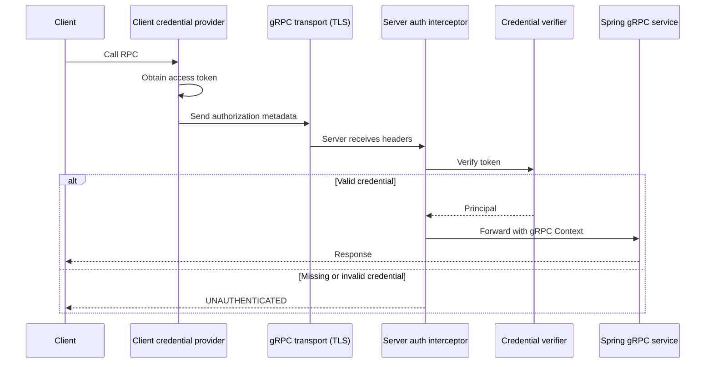

# Metadata Authentication

gRPC metadata carries control information attached to an RPC. A client commonly sends credentials in the `authorization` header so the server can identify the caller before dispatching the request to the service implementation. In Spring gRPC, a **server interceptor** is the right place to read and validate shared metadata; after authentication, the interceptor places the principal into gRPC `Context` so the application service can check permissions on specific resources.

Metadata is only a transport carrier for credentials. It does not validate tokens on its own, does not encrypt data, and does not replace authorization. A proper design validates credentials, protects the transport channel with TLS, distinguishes `UNAUTHENTICATED` from `PERMISSION_DENIED`, and avoids leaking tokens into logs.

## 1. How does authentication metadata flow through an RPC?

A client may send a bearer token:

```text
authorization: Bearer <access-token>
```

The server receives the header in `Metadata` before invoking the service method. Typical flow:



`authorization` is an ASCII metadata key with a lowercase name. Use metadata for tokens or short authentication credentials; request messages still hold business data such as `product_id` or `order_id`.

## 2. Defining the metadata key and principal

Declare a key shared between client and server:

```java
import io.grpc.Metadata;

public final class AuthMetadata {
    private AuthMetadata() {
    }

    public static final Metadata.Key<String> AUTHORIZATION =
            Metadata.Key.of(
                    "authorization",
                    Metadata.ASCII_STRING_MARSHALLER);
}
```

After authentication, the server needs an object representing the caller. Put only the claims needed for authorization into the principal:

```java
package com.myshop.security;

import java.util.Set;

public record AuthenticatedPrincipal(
        String subject,
        String tenantId,
        Set<String> authorities) {
}
```

Do not store the raw access token in the principal or gRPC Context. The token is the credential; the principal is the verified result containing identity and required permissions. If additional claims are needed, retain only the minimum data required for the current request.

## 3. Verifying the token in a server interceptor

Separate token verification from the interceptor behind an abstraction. For example, a verifier accepts the token without the `Bearer ` prefix and returns a principal or throws a credential exception:

```java
public interface CredentialVerifier {
    AuthenticatedPrincipal verify(String accessToken)
            throws InvalidCredentialException;
}
```

The interceptor reads metadata, checks the scheme, and verifies the credential before invoking the handler:

```java
package com.myshop.grpc.security;

import com.myshop.security.AuthenticatedPrincipal;
import com.myshop.security.CredentialVerifier;
import com.myshop.security.InvalidCredentialException;
import io.grpc.Context;
import io.grpc.Contexts;
import io.grpc.Metadata;
import io.grpc.ServerCall;
import io.grpc.ServerCallHandler;
import io.grpc.ServerInterceptor;
import io.grpc.Status;

public final class AuthenticationServerInterceptor
        implements ServerInterceptor {

    public static final Context.Key<AuthenticatedPrincipal> PRINCIPAL =
            Context.key("authenticated-principal");

    private final CredentialVerifier verifier;

    public AuthenticationServerInterceptor(CredentialVerifier verifier) {
        this.verifier = verifier;
    }

    @Override
    public <ReqT, RespT> ServerCall.Listener<ReqT> interceptCall(
            ServerCall<ReqT, RespT> call,
            Metadata headers,
            ServerCallHandler<ReqT, RespT> next) {

        String value = headers.get(AuthMetadata.AUTHORIZATION);
        if (value == null || !value.startsWith("Bearer ")) {
            return reject(call, "authentication credentials are required");
        }

        String token = value.substring("Bearer ".length()).trim();
        if (token.isEmpty()) {
            return reject(call, "authentication credentials are required");
        }

        final AuthenticatedPrincipal principal;
        try {
            principal = verifier.verify(token);
        } catch (InvalidCredentialException ex) {
            return reject(call, "authentication credentials are invalid");
        }

        Context context = Context.current().withValue(PRINCIPAL, principal);
        return Contexts.interceptCall(context, call, headers, next);
    }

    private static <ReqT, RespT> ServerCall.Listener<ReqT> reject(
            ServerCall<ReqT, RespT> call,
            String safeDescription) {
        call.close(Status.UNAUTHENTICATED
                .withDescription(safeDescription), new Metadata());
        return new ServerCall.Listener<>() {};
    }
}
```

Key points:

- Missing headers, wrong schemes, or empty tokens are rejected before the service runs.
- The verifier is only invoked after basic format validation.
- `Contexts.interceptCall` binds the authenticated principal to the RPC's callback lifecycle.
- The client receives only a generic error description; do not return details such as expired token, invalid signature, or nonexistent user if that information could aid account enumeration.

`CredentialVerifier` is a component the application must implement using an appropriate verification library. For JWTs, the verifier must check the signature using an allowed algorithm, issuer, audience, expiration (`exp`), `nbf` (not-before) if present, and key rotation. Never simply decode the payload and trust its claims. If using opaque tokens, the verifier needs introspection/caching with clear timeouts; avoid blocking calls to a remote auth service on transport threads.

Only treat invalid or expired tokens as credential errors. If the verifier cannot reach the key store or the introspection service fails, that is an infrastructure failure; do not pretend the token is invalid or accept it in a fail-open manner. Map operational failures to an appropriate status such as `UNAVAILABLE`/`INTERNAL` per your system policy and write internal logs stripped of secrets.

## 4. Distinguishing authentication and authorization

These two steps answer different questions:

| Step | Question | gRPC status on failure |
| --- | --- | --- |
| Authentication | Who is the caller? Are the credentials valid? | `UNAUTHENTICATED` |
| Authorization | Is the authenticated caller allowed to do this? | `PERMISSION_DENIED` |

Interceptors usually perform authentication and may enforce coarse method-level permissions. Permissions on a specific resource usually belong in the application service, because only that layer knows `product_id`, tenant ownership, or business state.

Example inside an endpoint:

```java
AuthenticatedPrincipal principal =
        AuthenticationServerInterceptor.PRINCIPAL.get();

if (principal == null) {
    observer.onError(Status.UNAUTHENTICATED
            .withDescription("authentication required")
            .asRuntimeException());
    return;
}

if (!authorizationService.canReadProduct(
        principal, request.getProductId())) {
    observer.onError(Status.PERMISSION_DENIED
            .withDescription("not allowed to read this product")
            .asRuntimeException());
    return;
}
```

This is resource-level authorization. Do not return `UNAUTHENTICATED` for an authenticated caller lacking permission; likewise, do not use `PERMISSION_DENIED` to mask invalid credentials.

## 5. Client sending a bearer token

A client can attach credentials to metadata using an interceptor:

```java
import io.grpc.CallOptions;
import io.grpc.Channel;
import io.grpc.ClientCall;
import io.grpc.ClientInterceptor;
import io.grpc.ForwardingClientCall;
import io.grpc.Metadata;
import io.grpc.MethodDescriptor;
import java.util.function.Supplier;

public final class BearerTokenClientInterceptor
        implements ClientInterceptor {

    private final Supplier<String> accessTokenProvider;

    public BearerTokenClientInterceptor(
            Supplier<String> accessTokenProvider) {
        this.accessTokenProvider = accessTokenProvider;
    }

    @Override
    public <ReqT, RespT> ClientCall<ReqT, RespT> interceptCall(
            MethodDescriptor<ReqT, RespT> method,
            CallOptions callOptions,
            Channel next) {

        ClientCall<ReqT, RespT> delegate =
                next.newCall(method, callOptions);
        return new ForwardingClientCall.SimpleForwardingClientCall<>(delegate) {
            @Override
            public void start(Listener<RespT> listener, Metadata headers) {
                if (headers.get(AuthMetadata.AUTHORIZATION) == null) {
                    String token = accessTokenProvider.get();
                    if (token != null && !token.isBlank()) {
                        headers.put(
                                AuthMetadata.AUTHORIZATION,
                                "Bearer " + token);
                    }
                }
                super.start(listener, headers);
            }
        };
    }
}
```

This example illustrates adding a header per call. In production, if credentials need asynchronous refreshing, prefer gRPC Java's `CallCredentials` mechanism or the framework's corresponding credential integration. That fits better than performing synchronous token refreshes inside an interceptor. The token provider must not log tokens and should handle refresh/expiry with bounded timeouts.

Do not attach a fixed token into shared metadata when creating a channel if tokens expire or vary by user. Credentials must be selected per call for the right caller identity.

## 6. TLS, proxies, and trust boundaries

Metadata travels over the transport as headers. Over plaintext, bearer tokens can be read by anyone observing network traffic. Therefore:

- Use TLS for client-server connections; verify the server's certificate and hostname.
- In internal environments, consider mTLS to verify workload identity at the transport layer; you still need authorization for users or business actions where applicable.
- Do not treat TLS as a replacement for verifying bearer tokens. TLS secures the channel and authenticates peers per configuration; tokens still must be checked for issuer/audience/expiry.
- Configure proxies, gateways, and access logs to redact the `authorization` header. Never dump full metadata while debugging.
- Limit metadata size and never send tokens inside protobuf payloads, query strings, or logs.

When service A calls service B, do not blindly forward the exact bearer token received from the client. That token's audience may be restricted to A. Use a dedicated service identity, token exchange/delegation, or credentials scoped to B's audience. Only forward a user token when your auth architecture permits it and B's verifier validates the right issuer, audience, and scopes.

## 7. Public methods and interceptor policies

Not every RPC needs the exact same policy. Health checks or reflection may need to be reachable by operations tooling without a user token; business RPCs must be authenticated. If you have public methods:

1. Declare an allowlist by **full method name**, not arbitrary substrings.
2. Restrict the allowlist to methods that genuinely need public access.
3. Never bypass authentication for an entire package just for a single health method.
4. Test that business methods remain blocked when credentials are missing.

If method-level authorization lives in an interceptor, keep the policy centralized and easy to review. Resource/tenant-level permission checks should remain in the application layer so they are not skipped if the same use case is invoked from another entry point.

## 8. Registering the interceptor in Spring gRPC

Core gRPC Java lets you register a server interceptor on the builder:

```java
Server server = ServerBuilder.forPort(9090)
        .intercept(new AuthenticationServerInterceptor(credentialVerifier))
        .addService(new CatalogGrpcEndpoint(catalogService))
        .build();
```

In a Spring gRPC application, servers are usually auto-configured by the framework. Register the interceptor via the extension point supported by your project's Spring gRPC version; simply declaring a class as a bean does not prove it is attached to the server. Verify with integration tests that boot the application configuration and invoke real RPCs.

If you have multiple servers or channels, clearly separate global interceptors from service-specific ones. Never apply a health-check auth bypass policy across the entire server.

## 9. Testing metadata authentication

| Test case | Expected result |
| --- | --- |
| Missing `authorization` | `UNAUTHENTICATED`; handler does not run |
| Non-Bearer scheme or empty token | `UNAUTHENTICATED` |
| Bad signature, expired token, or wrong audience | `UNAUTHENTICATED`; no internal reason leaked |
| Valid token | Principal is present in gRPC Context |
| Principal lacks permission on product | `PERMISSION_DENIED` |
| Public RPC in allowlist | Only published methods bypass authentication |
| Two concurrent callers | Principals do not leak across Contexts |
| Client calls over TLS | Credentials are protected on the transport |
| Application/proxy access logs | No bearer token appears |
| Downstream call | Wrong-audience token is not forwarded |

Write dedicated tests for the verifier covering signature, issuer, audience, expiry, and key rotation; interceptor tests for metadata/status/context; and integration tests proving Spring actually registers the interceptor. A test that only calls `CredentialVerifier` directly does not prove RPCs are protected.

## 10. Implementation checklist

- [ ] Use lowercase `authorization` metadata key and explicit `Bearer` scheme.
- [ ] Check missing header, invalid scheme, and empty token before invoking the handler.
- [ ] Verify signature/opaque token, issuer, audience, expiry, and required claims.
- [ ] Never decode a JWT and trust its claims without verifying its signature.
- [ ] Place the verified principal into gRPC Context; do not store raw tokens in Context.
- [ ] Use `UNAUTHENTICATED` for invalid credentials and `PERMISSION_DENIED` for unauthorized callers.
- [ ] Perform resource-level permission checks in the application service.
- [ ] Protect metadata with TLS; consider mTLS for workload identity.
- [ ] Redact the authorization header in logs, proxies, and telemetry.
- [ ] Do not forward tokens downstream when audience/delegation does not match.
- [ ] Register the interceptor via the proper version-specific Spring gRPC configuration and test with real RPCs.

**Self-check**

**Question 1.** Why is a bearer token typically sent in `authorization` metadata?

*Answer:* It is the standard control header for RPC credentials; interceptors can inspect it before invoking the service without mixing tokens into the protobuf payload.

**Question 2.** A token is valid, but the caller is not allowed to read a product. Which status should be returned?

*Answer:* `PERMISSION_DENIED`, because the caller is authenticated but lacks permission for the resource. Missing/invalid credentials use `UNAUTHENTICATED`.

**Question 3.** Is decoding a JWT and reading the `sub` claim enough to authenticate?

*Answer:* No. You must verify the signature using an allowed algorithm and validate issuer, audience, expiration, and required claims.

**Question 4.** Does TLS replace bearer token verification?

*Answer:* No. TLS secures the channel and authenticates peers per configuration; the server must still verify the caller's credentials and permissions.

**Question 5.** Should you forward the raw authorization token from service A to service B?

*Answer:* Not by default. The token may not target B's audience. Use service credentials, token exchange, or designed delegation policies.

Metadata authentication works reliably when the server verifies credentials before the handler, puts a verified principal into Context, and delegates resource-level permissions to the application layer. Combine TLS, per-call token management, log redaction, and tests for both status codes and Context to protect RPCs consistently in Spring gRPC.
