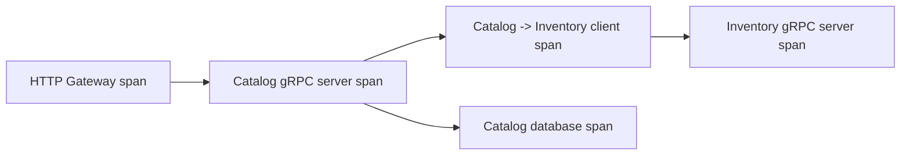

# Tracing Interceptor

A gRPC request often passes through multiple services before completing. Logs tell what each component did, but make it difficult to visualize parent/child relationships and the timing of each hop. **Distributed tracing** solves this with traces and spans: a trace represents the entire processing flow; each span records an operation such as receiving an RPC, calling a backend, or querying a database.

In Spring gRPC, tracing requires propagating trace context through metadata and preserving context across asynchronous callbacks. Interceptors can participate at this boundary, but manually creating spans, propagating context, and managing lifecycles is error-prone. For production, prefer OpenTelemetry gRPC instrumentation or a properly configured Java agent; write a custom interceptor only when you have specific requirements and it does not duplicate existing instrumentation.

## 1. Traces, spans, and context propagation

A trace typically has the following structure:



Key concepts:

| Component | Role |
| --- | --- |
| Trace ID | Identifies the entire distributed flow |
| Span ID | Identifies a single operation within a trace |
| Parent span ID | Links a child span to its parent span |
| Span attributes | Properties describing an operation, such as RPC method and status |
| Span events | Point-in-time events, such as retries or message events |
| Trace context | Data passed across process boundaries so downstream services continue the current trace |

OpenTelemetry commonly uses W3C Trace Context with headers such as `traceparent` and `tracestate`. gRPC carries these values in metadata. When service A calls service B, B uses the propagated context to create a child span in the same trace rather than starting an unrelated trace.

## 2. Why tracing in an interceptor or instrumentation?

An interceptor observes methods and call lifecycles without modifying every service method. It is a natural place to:

- Start or continue spans for inbound/outbound RPCs.
- Propagate trace context via metadata.
- Attach full method name, RPC type, and status to spans.
- Record errors, cancellations, and call duration.
- Preserve trace context in callbacks when RPCs execute asynchronously or use streaming.

However, tracing instrumentation usually handles much more than a hand-written interceptor: parent context management, span lifecycle, status mapping, message events, sampling, and propagation. Using a compatible OpenTelemetry gRPC Java library or Java agent reduces the risk of missing callbacks or ending spans at the wrong time.

**Do not enable two mechanisms that both create spans for the same RPC.** If a Java agent or gRPC OpenTelemetry instrumentation already creates client/server spans and propagates context automatically, do not add another interceptor that also creates spans for the same call. You can add an interceptor for custom attributes, but avoid duplicate spans and duplicate propagation.

## 3. Metadata carrying trace context

Trace context is control metadata, not business data. Example W3C headers:

```text
traceparent: 00-4bf92f3577b34da6a3ce929d0e0e4736-00f067aa0ba902b7-01
tracestate: vendor=value
```

Do not fabricate a `traceparent` string from a correlation ID. W3C Trace Context has its own format, trace flags, and semantics; let the OpenTelemetry propagator create and parse the headers. `tracestate` can contain vendor-specific data, so only propagate it according to your configured propagation policy.

Do not put tokens, emails, phone numbers, personal data, or payloads into trace baggage/attributes. Baggage can be forwarded across many services; only enable approved keys and cap their size.

## 4. Using OpenTelemetry instrumentation before writing a custom interceptor

In Spring gRPC, you can integrate tracing in one of the following ways depending on your dependencies and platform version:

1. **OpenTelemetry Java agent:** automatically instruments supported gRPC calls, creating spans and propagating context without modifying individual channels/services.
2. **gRPC OpenTelemetry instrumentation/library:** configures instrumentation on server and client builders/channels to create spans and propagate W3C context.
3. **Spring observability integration:** if your Spring gRPC/Spring Boot version provides corresponding auto-configuration, configure exporters, samplers, and resources through the framework's mechanisms.

Choose one primary mechanism for RPC instrumentation. Check documentation for your project's exact dependency versions, as class names, artifacts, and registration points differ across gRPC Java/Spring generations. After configuring, verify that traces contain server spans, client spans, and valid parent-child links; do not merely check that a `traceparent` header exists.

Foundation pieces typically needed:

- An `OpenTelemetry` SDK or runtime providing tracers and propagators.
- An exporter sending spans to an OTLP-compatible backend or your observability platform.
- Resource attributes such as service name, service version, and deployment environment.
- A sampler suited to system load; avoid exporting every trace by default under high traffic.
- W3C Trace Context propagators configured consistently between gateways and services.

## 5. Custom interceptor for context propagation

If custom propagation integration is needed, OpenTelemetry provides `TextMapPropagator` to inject/extract context. The following example illustrates **context propagation only**; it does not create spans on its own. Use it when no other instrumentation handles propagation.

First define a getter/setter for gRPC `Metadata`:

```java
import io.grpc.Metadata;
import io.opentelemetry.context.propagation.TextMapGetter;
import io.opentelemetry.context.propagation.TextMapSetter;

final class GrpcMetadataPropagation {
    private GrpcMetadataPropagation() {
    }

    static final TextMapSetter<Metadata> SETTER = (carrier, key, value) -> {
        Metadata.Key<String> metadataKey =
                Metadata.Key.of(key, Metadata.ASCII_STRING_MARSHALLER);
        carrier.discardAll(metadataKey);
        carrier.put(metadataKey, value);
    };

    static final TextMapGetter<Metadata> GETTER = new TextMapGetter<>() {
        @Override
        public Iterable<String> keys(Metadata carrier) {
            return carrier.keys();
        }

        @Override
        public String get(Metadata carrier, String key) {
            if (key.endsWith("-bin")) {
                return null;
            }
            Metadata.Key<String> metadataKey =
                    Metadata.Key.of(key, Metadata.ASCII_STRING_MARSHALLER);
            return carrier.get(metadataKey);
        }
    };
}
```

The setter writes the ASCII headers required by the propagator; the getter reads headers by key. Metadata keys must be lowercase. Do not use the ASCII marshaller for binary metadata ending in `-bin`.

### Client: injecting context before sending the call

The client interceptor grabs the active OpenTelemetry context at `start` time and injects it into headers:

```java
import io.grpc.CallOptions;
import io.grpc.Channel;
import io.grpc.ClientCall;
import io.grpc.ClientInterceptor;
import io.grpc.ForwardingClientCall;
import io.grpc.Metadata;
import io.grpc.MethodDescriptor;
import io.opentelemetry.api.OpenTelemetry;
import io.opentelemetry.context.propagation.TextMapPropagator;

public final class TracePropagationClientInterceptor
        implements ClientInterceptor {

    private final TextMapPropagator propagator;

    public TracePropagationClientInterceptor(OpenTelemetry openTelemetry) {
        this.propagator = openTelemetry.getPropagators()
                .getTextMapPropagator();
    }

    @Override
    public <ReqT, RespT> ClientCall<ReqT, RespT> interceptCall(
            MethodDescriptor<ReqT, RespT> method,
            CallOptions callOptions,
            Channel next) {
        ClientCall<ReqT, RespT> delegate = next.newCall(method, callOptions);
        return new ForwardingClientCall.SimpleForwardingClientCall<>(delegate) {
            @Override
            public void start(Listener<RespT> listener, Metadata headers) {
                propagator.inject(
                        io.opentelemetry.context.Context.current(),
                        headers,
                        GrpcMetadataPropagation.SETTER);
                super.start(listener, headers);
            }
        };
    }
}
```

This snippet assumes the stub call happens while a parent span is active. If the application makes calls from a self-managed executor, propagate OpenTelemetry Context to that executor; otherwise `Context.current()` may lack the parent span.

### Server: extracting context and binding it to callbacks

The server interceptor extracts trace context from metadata and attaches the OpenTelemetry Context to gRPC Context for each call. This example does not create a server span itself; instrumentation can create spans from the extracted context.

```java
import io.grpc.Contexts;
import io.grpc.ForwardingServerCallListener;
import io.grpc.Metadata;
import io.grpc.ServerCall;
import io.grpc.ServerCallHandler;
import io.grpc.ServerInterceptor;
import io.opentelemetry.api.OpenTelemetry;
import io.opentelemetry.context.Scope;
import io.opentelemetry.context.propagation.TextMapPropagator;
import java.util.function.Supplier;

public final class TracePropagationServerInterceptor
        implements ServerInterceptor {

    public static final io.grpc.Context.Key<
            io.opentelemetry.context.Context> OTEL_CONTEXT =
            io.grpc.Context.key("otel-context");

    private final TextMapPropagator propagator;

    public TracePropagationServerInterceptor(OpenTelemetry openTelemetry) {
        this.propagator = openTelemetry.getPropagators()
                .getTextMapPropagator();
    }

    @Override
    public <ReqT, RespT> ServerCall.Listener<ReqT> interceptCall(
            ServerCall<ReqT, RespT> call,
            Metadata headers,
            ServerCallHandler<ReqT, RespT> next) {

        io.opentelemetry.context.Context extracted = propagator.extract(
                io.opentelemetry.context.Context.current(),
                headers,
                GrpcMetadataPropagation.GETTER);

        io.grpc.Context grpcContext = io.grpc.Context.current()
                .withValue(OTEL_CONTEXT, extracted);

        return Contexts.interceptCall(grpcContext, call, headers, (c, h) -> {
            ServerCall.Listener<ReqT> delegate =
                    callWithContext(extracted, () -> next.startCall(c, h));

            return new ForwardingServerCallListener
                    .SimpleForwardingServerCallListener<>(delegate) {
                @Override
                public void onMessage(ReqT message) {
                    runWithContext(extracted, () -> super.onMessage(message));
                }

                @Override
                public void onHalfClose() {
                    runWithContext(extracted, super::onHalfClose);
                }

                @Override
                public void onCancel() {
                    runWithContext(extracted, super::onCancel);
                }

                @Override
                public void onComplete() {
                    runWithContext(extracted, super::onComplete);
                }

                @Override
                public void onReady() {
                    runWithContext(extracted, super::onReady);
                }
            };
        });
    }

    private static void runWithContext(
            io.opentelemetry.context.Context context,
            Runnable action) {
        try (Scope scope = context.makeCurrent()) {
            action.run();
        }
    }

    private static <T> T callWithContext(
            io.opentelemetry.context.Context context,
            Supplier<T> action) {
        try (Scope scope = context.makeCurrent()) {
            return action.get();
        }
    }
}
```

This example demonstrates how to preserve OpenTelemetry context across gRPC callbacks; test it with your gRPC Java version and do not register it if existing instrumentation already extracts/propagates context. When a service offloads work to another executor, continue wrapping tasks with OpenTelemetry Context or the corresponding executor propagation utility.

Inside wrapped callbacks, the service can also read the active context via `io.opentelemetry.context.Context.current()`. If a component needs to read the value stored in gRPC Context, it can use `TracePropagationServerInterceptor.OTEL_CONTEXT.get()`; never store this context in a mutable field of a singleton service.

## 6. Span lifecycle, status, and errors

Propagation only carries context across boundaries. A useful trace also needs spans created, attributed, and ended at the right times:

- A client span starts when the client call is initiated and ends when the call closes.
- A server span wraps the server-side RPC processing duration.
- Span status reflects errors per OpenTelemetry conventions; do not mark every non-`OK` gRPC status as an unexpected system error. For example, `NOT_FOUND` can be an expected business outcome.
- When an exception occurs, record exception events/attributes according to your data policy; do not attach request payloads or tokens.
- For streaming, spans usually live until the stream finishes or is cancelled; do not end the span right after the first message.

gRPC instrumentation can automatically map statuses and manage spans. If you create spans manually in an interceptor, guarantee the span ends exactly once across `close`, cancellation, or initialization errors; also restore the Scope in every callback. Avoid creating a second span wrapping one already created by instrumentation.

## 7. Sampling and data inside spans

Tracing can generate large volumes of data. Samplers decide which traces are kept:

- Head sampling decides early when the trace begins, reducing overhead but potentially missing errors that occur later.
- Tail sampling decides after the collector/backend observes the trace, allowing error or high-latency traces to be retained at the cost of extra infrastructure and memory.
- Sampling rates must be consistent across services so traces do not break mid-flow.

Only add span attributes useful for troubleshooting, such as `rpc.method`, `rpc.system`, service name, and deployment version. Never attach user IDs, tokens, emails, or arbitrary metadata values as attributes. High-cardinality data increases backend costs; sensitive data creates privacy risks.

## 8. Registering tracing in Spring gRPC

When using an instrumentation library, apply it to both the server and outbound channels/clients. Instrumenting only the server may stop traces at the first service; instrumenting only the client misses inbound backend spans.

In Spring gRPC, servers and channels may be auto-configured by the framework. Register interceptors through the extension point for your exact Spring gRPC version; do not assume a `@Component` or `@Bean` class is automatically attached to all channels/servers. If using a Java agent or auto-instrumentation, check whether the framework is already instrumented before adding manual interceptors.

Checks after configuration:

1. Invoke a unary RPC through an instrumented client.
2. Confirm the client span and server span share the same trace ID.
3. Confirm the server span is a child of the client span or valid parent per topology.
4. Call a downstream backend and verify a corresponding child span exists.
5. Check status, duration, service/resource attributes, and sampling.
6. Test errors, deadlines, cancellations, and streaming to verify spans close cleanly with the lifecycle.

## 9. Testing a tracing interceptor

| Test case | What to verify |
| --- | --- |
| Incoming request has valid `traceparent` | Server continues the right trace context |
| Invalid trace context header | Propagator handles gracefully per spec; bad metadata does not crash the RPC |
| Outbound gRPC call | Trace context is injected into metadata |
| Two concurrent RPCs | Contexts/spans do not mix across calls |
| Async executor | Parent span remains active in downstream calls when context is propagated |
| Errored or cancelled RPC | Span is ended and status/events reflect the outcome |
| Streaming | Span matches the lifetime of the stream |
| Java agent and custom interceptor both enabled | No duplicate client/server spans or duplicate propagation |
| Attributes/logs | Contain no tokens, payloads, or personal data |

You can unit-test propagation with getters/setters and run integration tests via an in-process channel/server. To verify traces are actually exported, use an in-memory exporter or the OpenTelemetry SDK test exporter instead of merely asserting that metadata headers are present.

## 10. Implementation checklist

- [ ] Use OpenTelemetry gRPC Java instrumentation or the Java agent as the primary tracing mechanism.
- [ ] Do not create duplicate spans alongside auto-instrumentation.
- [ ] Propagate W3C Trace Context in metadata via propagators, never manually assemble `traceparent`.
- [ ] Instrument both inbound server and outbound client calls.
- [ ] Preserve OpenTelemetry Context across callbacks and asynchronous executors.
- [ ] End spans properly on close/cancel; streaming spans track the stream lifetime.
- [ ] Status/error mapping reflects application semantics.
- [ ] Sampling fits traffic volume and troubleshooting goals.
- [ ] Only add approved attributes; never put tokens, PII, or payloads into spans.
- [ ] Test parent-child relationships, errors, cancellations, streaming, and export.

**Self-check**

**Question 1.** How do Trace ID and Span ID differ?

*Answer:* Trace ID identifies the entire distributed flow; Span ID identifies a single operation within the trace. Multiple spans share the same Trace ID but have different Span IDs.

**Question 2.** Why shouldn't you build `traceparent` manually from a correlation ID?

*Answer:* W3C Trace Context has a specific structure and semantics, including trace ID, parent span ID, and flags. Use the OpenTelemetry propagator for compliant injection/extraction.

**Question 3.** Does a client interceptor injecting context automatically create a client span?

*Answer:* No. Injecting only propagates existing context. To record a span for the RPC, use gRPC OpenTelemetry instrumentation/Java agent or manage the full span lifecycle yourself.

**Question 4.** Why must both client and server be instrumented?

*Answer:* The client span represents the outbound call; the server span represents inbound handling. Together they link traces across process boundaries and pinpoint which hop introduces latency.

**Question 5.** For a streaming RPC, when should the server span end?

*Answer:* When the entire stream ends or is cancelled, not immediately after the first message.

A tracing interceptor is effective when it maintains trace context across RPCs and callbacks while spans accurately reflect call lifecycles. Prefer supported OpenTelemetry instrumentation, write custom propagation interceptors only when necessary, and test parent-child linking, status mapping, sampling, and sensitive data handling before enabling tracing in production.
