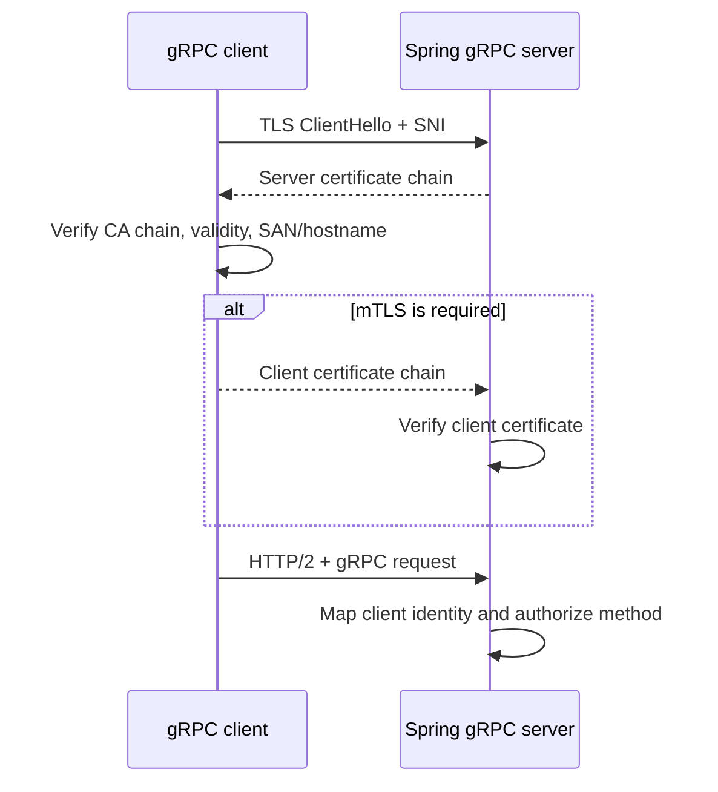

# TLS Transport Security and Identity

## 1. TLS protects connections and verifies peers

gRPC runs over HTTP/2. In production environments, TLS protects data in transit through encryption, verifies integrity, and authenticates peer identity using digital certificates.

There are two distinct questions:

- **Transport security:** is the client connecting to the right server and is data protected in transit?
- **Application identity and authorization:** which principal is the caller, and which methods or resources is that principal allowed to access?

TLS server authentication verifies the server's identity to the client. **Mutual TLS (mTLS)** adds client certificate verification on the server side. However, mTLS only proves that the peer possesses the private key corresponding to a certificate issued by a trusted CA; the application must still map the certificate to a principal and check permissions.



The TLS handshake happens before the protobuf request is processed. If the handshake fails, the unary handler is not invoked; the error occurs at the connection/transport layer.

## 2. Certificate, private key, CA, and SAN

A TLS deployment typically includes the following components:

| Component | Role |
| --- | --- |
| Server certificate | Proves the server's identity to the client. |
| Server private key | Proves the server owns the certificate; must be protected. |
| CA certificate / trust bundle | Root of trust for verifying the certificate chain. |
| Intermediate certificate | Links the leaf certificate to the root CA in the trust chain. |
| Client certificate and private key | Used when the server requires mTLS. |
| Subject Alternative Name (SAN) | Contains the DNS name, IP, or URI identity verified according to the certificate purpose. |

When a client connects to `pricing.internal.example`, the server certificate needs a DNS SAN matching that hostname. The client verifies the certificate chain up to a trusted CA, validity period, key usage/purpose, and hostname/SAN. Do not rely on Common Name (CN) as a modern hostname verification mechanism.

**Trust store and certificate chain serve different roles:** the server sends its certificate chain; the client uses its trust store to decide which CAs are trusted. Do not disable certificate validation or hostname verification to "fix" connection errors.

## 3. Configuring TLS for a gRPC Java server

The example below uses the Netty transport of gRPC Java. Classes are imported from the grpc-netty-shaded artifact; if the project uses unshaded grpc-netty, the corresponding Netty packages will differ. Do not mix the two variants in the same application.

Server authenticating only itself to the client with a server certificate:

```java
import io.grpc.Server;
import io.grpc.netty.shaded.io.grpc.netty.GrpcSslContexts;
import io.grpc.netty.shaded.io.grpc.netty.NettyServerBuilder;
import io.grpc.netty.shaded.io.netty.handler.ssl.SslContext;

import java.io.File;

SslContext serverTls = GrpcSslContexts.forServer(
        new File("certs/server-chain.pem"),
        new File("certs/server-key.pem"))
        .build();

Server server = NettyServerBuilder.forPort(9090)
        .sslContext(serverTls)
        .addService(productQueryGrpcService)
        .build()
        .start();
```

server-chain.pem needs to contain the leaf certificate and any required intermediate certificates. server-key.pem is the corresponding private key. The private key must be protected using file permissions, a secret manager, or the platform's key management mechanism; never commit it to the repository.

One-way server TLS encrypts traffic and authenticates the server to the client, but it does not authenticate the client's identity via a certificate. If the system uses bearer tokens or another application authentication mechanism, that authentication still needs to be performed separately.

### Configuring mTLS on the server

To require a client certificate, the server must trust the CA that issues client certificates and set client authentication to REQUIRE:

```java
import io.grpc.Server;
import io.grpc.netty.shaded.io.grpc.netty.GrpcSslContexts;
import io.grpc.netty.shaded.io.grpc.netty.NettyServerBuilder;
import io.grpc.netty.shaded.io.netty.handler.ssl.ClientAuth;
import io.grpc.netty.shaded.io.netty.handler.ssl.SslContext;

SslContext mutualTls = GrpcSslContexts.forServer(
        new File("certs/server-chain.pem"),
        new File("certs/server-key.pem"))
        .trustManager(new File("certs/client-ca-bundle.pem"))
        .clientAuth(ClientAuth.REQUIRE)
        .build();

Server server = NettyServerBuilder.forPort(9090)
        .sslContext(mutualTls)
        .addService(productQueryGrpcService)
        .build()
        .start();
```

Common Netty options:

- ClientAuth.NONE: no client certificate required.
- ClientAuth.OPTIONAL: the client may send a certificate; if sent, the server verifies it.
- ClientAuth.REQUIRE: the client must send a valid certificate.

Only use OPTIONAL when there is a clear compatibility reason and handlers have a policy for peers without a certificate. For mandatory mTLS, REQUIRE causes the handshake to fail if the client does not provide an accepted certificate.

## 4. Configuring TLS on the gRPC client

The client must trust the CA that issued the server certificate and connect using a hostname present in the SAN:

```java
import io.grpc.ManagedChannel;
import io.grpc.netty.shaded.io.grpc.netty.GrpcSslContexts;
import io.grpc.netty.shaded.io.grpc.netty.NettyChannelBuilder;
import io.grpc.netty.shaded.io.netty.handler.ssl.SslContext;

SslContext clientTls = GrpcSslContexts.forClient()
        .trustManager(new File("certs/server-ca-bundle.pem"))
        .build();

ManagedChannel channel = NettyChannelBuilder
        .forAddress("pricing.internal.example", 9090)
        .sslContext(clientTls)
        .build();
```

Do not use usePlaintext() for production connections that require TLS. Also do not use overrideAuthority(...) to bypass hostname mismatches; this method overrides the authority used during verification and is only suitable for certain controlled test/proxy configurations.

### Client certificate for mTLS

If the server requires mTLS, the client must send its own certificate chain and private key:

```java
SslContext clientMtls = GrpcSslContexts.forClient()
        .trustManager(new File("certs/server-ca-bundle.pem"))
        .keyManager(
                new File("certs/checkout-client-chain.pem"),
                new File("certs/checkout-client-key.pem"))
        .build();

ManagedChannel channel = NettyChannelBuilder
        .forAddress("pricing.internal.example", 9090)
        .sslContext(clientMtls)
        .build();
```

trustManager(...) verifies the **server**; keyManager(...) provides the **client** identity to the server. These two configurations handle the two different directions of authentication. The client certificate must have the appropriate extended key usage/purpose and be issued by a CA trusted by the server.

## 5. Integrating in a Spring gRPC application

In a Spring gRPC application using auto-configuration, the server, channels, and stubs are usually managed by the framework. TLS should be configured on **that managed server/channel** so that lifecycle, interceptors, health services, and other channel settings are preserved.

The Netty builder examples above illustrate the underlying TLS building blocks of gRPC Java. When using the Spring Boot starter:

- Declare the certificate chain, private key, trust bundle, and client-auth policy through the SSL configuration supported by the project's Spring gRPC version.
- For named client channels, configure trust material and client key material for the corresponding channel.
- If the framework provides a customizer or custom SSL context hook, attach the configuration to the auto-configured factory/channel/server.
- Do not spin up a second parallel Netty server just to enable TLS if Spring already manages the primary server.
- Verify whether the dependency in use is grpc-netty or grpc-netty-shaded to avoid importing the wrong packages.

Property names and extension points may differ across Spring gRPC versions. Consult the exact reference for the dependency version in the project before adding configuration to application.yml; do not copy properties from another version without verifying.

## 6. Extracting client identity from mTLS

Once mTLS succeeds, the server can retrieve the peer certificate from the SSLSession attached to the ServerCall. Identity should be extracted from a SAN according to the organization's convention, such as a URI SAN representing a workload identity; avoid using arbitrary CN strings as the principal.

Example interceptor reading a URI SAN:

```java
import io.grpc.Context;
import io.grpc.Contexts;
import io.grpc.Grpc;
import io.grpc.Metadata;
import io.grpc.ServerCall;
import io.grpc.ServerCallHandler;
import io.grpc.ServerInterceptor;
import io.grpc.Status;

import java.security.cert.Certificate;
import java.security.cert.X509Certificate;
import java.util.Collection;
import java.util.List;
import javax.net.ssl.SSLPeerUnverifiedException;
import javax.net.ssl.SSLSession;

public final class MtlsIdentityInterceptor
        implements ServerInterceptor {

    public static final Context.Key<String> CLIENT_ID =
            Context.key("mtls-client-id");

    @Override
    public <ReqT, RespT> ServerCall.Listener<ReqT> interceptCall(
            ServerCall<ReqT, RespT> call,
            Metadata headers,
            ServerCallHandler<ReqT, RespT> next) {

        SSLSession session =
                call.getAttributes().get(Grpc.TRANSPORT_ATTR_SSL_SESSION);

        if (session == null) {
            call.close(
                    Status.UNAUTHENTICATED
                            .withDescription("TLS client identity is required"),
                    new Metadata());
            return new ServerCall.Listener<>() {};
        }

        try {
            Certificate[] peerCertificates = session.getPeerCertificates();
            X509Certificate peer =
                    (X509Certificate) peerCertificates[0];

            String clientId = findUriSan(peer);
            if (clientId == null) {
                call.close(
                        Status.UNAUTHENTICATED
                                .withDescription("Client certificate has no URI SAN"),
                        new Metadata());
                return new ServerCall.Listener<>() {};
            }

            Context context = Context.current()
                    .withValue(CLIENT_ID, clientId);

            return Contexts.interceptCall(
                    context, call, headers, next);

        } catch (SSLPeerUnverifiedException
                 | java.security.cert.CertificateParsingException
                 | ClassCastException invalidPeer) {
            call.close(
                    Status.UNAUTHENTICATED
                            .withDescription("Client certificate is not valid"),
                    new Metadata());
            return new ServerCall.Listener<>() {};
        }
    }

    private static String findUriSan(X509Certificate certificate)
            throws java.security.cert.CertificateParsingException {

        Collection<List<?>> names =
                certificate.getSubjectAlternativeNames();

        if (names == null) {
            return null;
        }

        return names.stream()
                .filter(entry -> Integer.valueOf(6).equals(entry.get(0)))
                .map(entry -> (String) entry.get(1))
                .findFirst()
                .orElse(null);
    }
}
```

The code above assumes the server already has mandatory mTLS enabled at the transport layer. Without a client certificate, the TLS handshake usually fails before the interceptor runs; the session == null branch serves as a defensive guard for configurations or transports that do not supply an SSL session.

URI SAN type 6 represents a URI in Subject Alternative Name. The specific identity convention must be agreed upon by the CA and the organization, for example spiffe://example.org/ns/commerce/sa/checkout. Do not treat an arbitrary URI as immediate authorization to access resources.

Handlers can read the identity placed into Context by the interceptor:

```java
String clientId = MtlsIdentityInterceptor.CLIENT_ID.get();

if (!authorizationService.mayReadProduct(clientId, productId)) {
    observer.onError(Status.PERMISSION_DENIED
            .withDescription("Client does not have permission to read product")
            .asRuntimeException());
    return;
}
```

authorizationService maps the client identity to a policy/role and checks the specific resource. If the certificate is valid but the identity is not granted access, the result should be PERMISSION_DENIED, not UNAUTHENTICATED.

## 7. TLS identity is not automatically application authorization

Three steps must be distinguished:

1. **Certificate path validation:** the certificate was issued by a trusted CA, is within its validity period, has the right purpose/usage, and has not been rejected by policy.
2. **Peer identity extraction:** extracting the identity from a SAN or claim defined by the organization.
3. **Authorization:** determining whether the identity is allowed to invoke the method and access the specific resource.

A valid certificate only verifies cryptographic identity under the trust policy. It does not inherently grant permission to call every RPC. Permissions may depend on tenant, service, method, environment, or resource.

If TLS terminates at an ingress/proxy, the backend gRPC server may only see the proxy's certificate. In that case, do not trust an arbitrary identity header sent over the network. A clear trust boundary is needed: the proxy authenticates the client, forwards identity via signed tokens/metadata or a protected internal channel, and the backend only accepts that information from an authenticated proxy.

## 8. Certificate rotation and operations

Certificates have expiration dates; TLS requires a renewal and replacement process without causing downtime:

- Monitor expiration dates of server and client certificates.
- Issue new certificates before old ones expire.
- When rotating CAs, deploy a trust bundle containing both the old and new CAs during the transition period.
- Update certificates/keys on servers and clients in a compatible order; verify new connections before revoking the old CA.
- Protect private keys using a secret manager, file permissions, or hardware-backed key stores.
- Never log private keys, tokens, or full certificate material.
- Check certificate revocation according to the capabilities and policies of your PKI infrastructure.
- Alert on handshake failures, certificate expiry, and rejected connection counts.

Channels and TLS contexts may hold loaded certificates in memory. Replacing files on disk does not guarantee that active connections or existing builders automatically pick up the new certificates. Check the reload mechanism of your framework/transport; if safe hot-reloading is not supported, perform channel/server replacement or rolling restarts according to operational procedures.

## 9. Testing TLS and mTLS

InProcessServerBuilder does not perform a TLS handshake like a TCP transport, so it cannot prove that certificate chains, hostname verification, or mTLS work. Use integration tests with the Netty transport and dedicated test certificates.

| Scenario | Expected result |
| --- | --- |
| Client trusts the right CA, hostname matches SAN | TLS handshake succeeds and the unary RPC runs. |
| Client does not trust server CA | Handshake fails; handler is not invoked. |
| Hostname does not match SAN | Client rejects server identity verification. |
| Server requires mTLS, client sends no certificate | Handshake fails. |
| Client sends certificate issued by untrusted CA | Server rejects the handshake. |
| Valid certificate but identity lacks permission | Handshake succeeds; RPC is rejected at authorization with PERMISSION_DENIED. |
| Certificate nearing expiration or expired | System raises alerts and handshake follows certificate validity/policy. |

TLS handshake errors may surface on the client as a transport status such as UNAVAILABLE with a cause; do not assume every certificate error maps to a fixed business gRPC status. Tests should verify that the call fails and the handler does not process the request, while checking the appropriate cause/logs.

Beyond certificate tests, test rotation as well: new clients trust the new CA, old clients still work during the overlap period, and then the old CA is removed after all old certificates have been replaced.

## 10. Common mistakes

1. **Using plaintext in production.** Data and server identity are unprotected. Configure TLS for production channels/servers.
2. **Disabling hostname verification to work around a mismatch.** Clients may accept the wrong server. Fix the SAN or the connection hostname.
3. **Installing only the server certificate and forgetting the intermediate chain.** Some clients cannot build the trust path. Send the full chain.
4. **Confusing trust manager with key manager.** The trust manager verifies the peer; the key manager provides the local endpoint's certificate/private key.
5. **Enabling mTLS without configuring client CA trust.** The server cannot verify client certificates. Configure the trust bundle and client-auth policy.
6. **Treating a valid certificate as permission to call every method.** TLS authentication does not replace authorization. Map the SAN identity to specific policies.
7. **Using CN as the sole identity.** CN is not suitable for modern workload identification. Use SAN according to an agreed convention.
8. **Trusting identity metadata after TLS termination at a proxy.** Backends can receive spoofed headers if the trust boundary is unprotected. Use signed identity or an authenticated proxy-backend channel.
9. **Replacing certificate files and assuming channels auto-reload.** The TLS context may still hold the old material in memory. Verify reload support or perform rolling replacement.
10. **Testing only with in-process transport.** Those tests do not exercise TLS. Use integration tests over TCP/Netty with a test CA.

## 11. Practice exercise

Implement ProductQueryService over TLS and mTLS:

1. Create a test CA, a server certificate with DNS SAN catalog.test.internal, and a client certificate with URI SAN spiffe://example.org/ns/catalog/sa/checkout.
2. Configure the server to trust the client CA and require ClientAuth.REQUIRE.
3. Configure the client to trust the server CA, send the client certificate, and connect using a hostname matching the SAN.
4. Use a server interceptor to extract the URI SAN, store the identity in io.grpc.Context, and check authorization in the handler.
5. Write tests for a valid client, missing certificate, untrusted CA, hostname mismatch, and valid identity without permission.
6. Simulate CA rotation using an overlapping trust bundle and verify connections before and after rotation.

**Self-check:** TLS protects the transport and verifies peer certificates. mTLS verifies both server and client; the server can extract client identity from the certificate SAN, yet it must still map that identity to a principal and enforce authorization. CA management, hostname verification, private keys, rotation, and testing on a real transport are mandatory parts of a secure Spring gRPC deployment.
