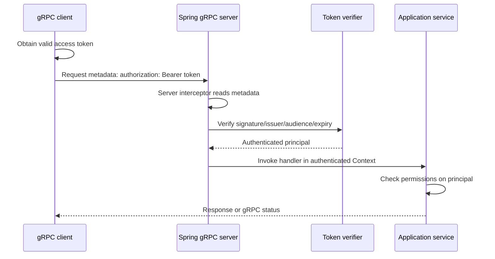

# Bearer Tokens in Metadata

## 1. Bearer tokens authenticate callers at the application layer

gRPC transmits protobuf messages over HTTP/2. In addition to requests and responses, clients can send metadata to provide authentication information. The standard convention is to place an access token in the `authorization` metadata:

`authorization: Bearer <access-token>`

The server reads the token, verifies it, and constructs a principal representing the caller. Afterward, the business layer checks whether that principal is allowed to invoke the method or access the resource.

Two layers of protection must be distinguished:

- **TLS** encrypts the transport and authenticates the server; mTLS can additionally verify the client's certificate.
- **Bearer tokens** authenticate identity and permissions at the application layer. Tokens do not replace TLS.

A bearer token means that whoever possesses the token can use it. If a token is leaked, another party can impersonate the caller within the token's lifetime and scope. Therefore, only send tokens over a secure transport, keep lifetimes short, and avoid logging tokens.



## 2. Metadata keys and Authorization format

In gRPC Java, metadata keys must be lowercase. The `authorization` header contains ASCII text, so use `Metadata.ASCII_STRING_MARSHALLER`:

```java
import io.grpc.Metadata;

public final class AuthMetadata {

    private AuthMetadata() {}

    public static final Metadata.Key<String> AUTHORIZATION =
            Metadata.Key.of(
                    "authorization",
                    Metadata.ASCII_STRING_MARSHALLER);
}
```

The outgoing value uses the `Bearer` scheme, a space, and the access token:

```java
Metadata headers = new Metadata();
headers.put(
        AuthMetadata.AUTHORIZATION,
        "Bearer " + accessToken);
```

Do not place tokens inside protobuf requests, query strings, method names, or custom business fields. Metadata is transmitted at the RPC layer and can be read by interceptors before the handler runs.

Rules:

- Use the lowercase `authorization` key.
- Only send access tokens; never send refresh tokens to a resource server.
- Do not send multiple `authorization` values in the same RPC.
- Do not double-base64-encode a JWT; pass the token verbatim as issued by the issuer.
- Keep tokens and metadata small so they do not exceed header limits on clients, servers, or proxies.

## 3. Sending per-RPC tokens with CallCredentials

Avoid attaching a static token to a singleton interceptor if the token can expire or be refreshed. gRPC Java provides `CallCredentials` to supply credentials per call. The credential can retrieve the current token right before metadata is sent.

Example contract for a token provider:

```java
public interface AccessTokenProvider {
    CompletionStage<String> getAccessToken();
}
```

`getAccessToken()` can return a valid cached token or refresh it through an OAuth2 client. Refresh logic should be managed by the application's security component.

Credential attaching the access token to metadata:

```java
package com.example.orders.client;

import io.grpc.CallCredentials;
import io.grpc.Metadata;
import io.grpc.Status;

import java.util.concurrent.CompletionStage;
import java.util.concurrent.Executor;

public final class BearerTokenCredentials extends CallCredentials {

    private final AccessTokenProvider tokenProvider;

    public BearerTokenCredentials(AccessTokenProvider tokenProvider) {
        this.tokenProvider = tokenProvider;
    }

    @Override
    public void applyRequestMetadata(
            RequestInfo requestInfo,
            Executor appExecutor,
            MetadataApplier applier) {

        final CompletionStage<String> tokenStage;

        try {
            tokenStage = tokenProvider.getAccessToken();
        } catch (RuntimeException failure) {
            applier.fail(Status.UNAUTHENTICATED
                    .withDescription("Failed to retrieve access token"));
            return;
        }

        tokenStage.whenCompleteAsync((token, failure) -> {
            if (failure != null || token == null || token.isBlank()) {
                applier.fail(Status.UNAUTHENTICATED
                        .withDescription("Access token unavailable"));
                return;
            }

            Metadata headers = new Metadata();
            headers.put(
                    AuthMetadata.AUTHORIZATION,
                    "Bearer " + token);

            applier.apply(headers);
        }, appExecutor);
    }

    @Override
    public boolean requireTransportSecurity() {
        return true;
    }
}
```

`CallCredentials` is invoked while preparing metadata for the RPC. `appExecutor` is the executor provided by gRPC to complete asynchronous work; do not block the transport thread by waiting for the token via `get()` or `join()`.

`requireTransportSecurity()` returns `true` so the credential is only used when the transport meets security requirements. The channel must still be configured with proper TLS and verify the server certificate/hostname.

Attaching credentials to a stub:

```java
OrderCommandServiceGrpc.OrderCommandServiceBlockingStub securedStub =
        baseStub.withCallCredentials(
                new BearerTokenCredentials(accessTokenProvider));

CreateOrderResponse response = securedStub
        .withDeadlineAfter(800, TimeUnit.MILLISECONDS)
        .createOrder(request);
```

`withCallCredentials(...)` returns a derived stub. The stub can be managed as a shared instance while `AccessTokenProvider` supplies a fresh or valid cached token for each call. Never store one user's token in a mutable field shared across requests.

### Avoid static token attachment when tokens can change

`MetadataUtils.newAttachHeadersInterceptor(...)` can be useful in tests or for non-sensitive static headers. For short-lived access tokens, an interceptor holding fixed metadata can keep sending an expired token. `CallCredentials` is a better fit because it resolves credentials per RPC lifecycle.

## 4. Verifying tokens on the server with ServerInterceptor

The server should verify the token before calling the business handler. A `ServerInterceptor` reads `authorization`, validates the Bearer scheme, and delegates the token to a dedicated verification component.

Example verification contract:

```java
public interface AccessTokenVerifier {
    AuthenticatedPrincipal verify(String accessToken)
            throws InvalidAccessTokenException;
}

public record AuthenticatedPrincipal(
        String subject,
        String tenantId,
        Set<String> scopes) {}
```

`AccessTokenVerifier` is responsible for validating the token against the system's trust policy. For JWTs, do not merely decode the payload: verify the signature using a trusted key, allowed algorithms, `iss`, `aud`, `exp`, `nbf`, and required claims. For opaque tokens, call the introspection endpoint over a secure channel and cache results briefly according to policy.

Example interceptor:

```java
package com.example.orders.server;

import io.grpc.Context;
import io.grpc.Contexts;
import io.grpc.Metadata;
import io.grpc.ServerCall;
import io.grpc.ServerCallHandler;
import io.grpc.ServerInterceptor;
import io.grpc.Status;

import java.util.Iterator;

public final class BearerTokenServerInterceptor
        implements ServerInterceptor {

    public static final Context.Key<AuthenticatedPrincipal> PRINCIPAL =
            Context.key("authenticated-principal");

    private final AccessTokenVerifier tokenVerifier;

    public BearerTokenServerInterceptor(
            AccessTokenVerifier tokenVerifier) {
        this.tokenVerifier = tokenVerifier;
    }

    @Override
    public <ReqT, RespT> ServerCall.Listener<ReqT> interceptCall(
            ServerCall<ReqT, RespT> call,
            Metadata headers,
            ServerCallHandler<ReqT, RespT> next) {

        Iterable<String> values =
                headers.getAll(AuthMetadata.AUTHORIZATION);

        if (values == null) {
            return reject(call, Status.UNAUTHENTICATED
                    .withDescription("Missing bearer token"));
        }

        Iterator<String> iterator = values.iterator();
        if (!iterator.hasNext()) {
            return reject(call, Status.UNAUTHENTICATED
                    .withDescription("Missing bearer token"));
        }

        String authorization = iterator.next();

        if (iterator.hasNext()
                || authorization == null
                || !authorization.regionMatches(
                        true, 0, "Bearer ", 0, 7)) {
            return reject(call, Status.UNAUTHENTICATED
                    .withDescription("Invalid authorization header"));
        }

        String token = authorization.substring(7).trim();
        if (token.isEmpty()
                || token.chars().anyMatch(Character::isWhitespace)) {
            return reject(call, Status.UNAUTHENTICATED
                    .withDescription("Invalid bearer token"));
        }

        try {
            AuthenticatedPrincipal principal =
                    tokenVerifier.verify(token);

            Context context = Context.current()
                    .withValue(PRINCIPAL, principal);

            return Contexts.interceptCall(
                    context, call, headers, next);

        } catch (InvalidAccessTokenException invalid) {
            return reject(call, Status.UNAUTHENTICATED
                    .withDescription("Invalid access token"));
        } catch (RuntimeException unexpected) {
            // Log internal error, but never log the token.
            return reject(call, Status.INTERNAL
                    .withDescription("Unable to verify credentials"));
        }
    }

    private static <ReqT, RespT> ServerCall.Listener<ReqT> reject(
            ServerCall<ReqT, RespT> call,
            Status status) {
        call.close(status, new Metadata());
        return new ServerCall.Listener<>() {};
    }
}
```

The types `AuthenticatedPrincipal`, `AccessTokenVerifier`, and `InvalidAccessTokenException` are illustrative application components. In production, log verification failures with a correlation ID and a safe error category; never log raw tokens, authorization headers, or full sensitive claims.

`Contexts.interceptCall(...)` binds the principal to `io.grpc.Context` throughout the RPC's callbacks. Handlers and services can read the principal from the context instead of trusting a user ID passed by the client in protobuf.

## 5. Authentication is distinct from authorization

Successful token verification only answers **who the caller is**. The server must still check whether the caller is permitted to perform the specific action.

- Missing token, invalid signature, wrong issuer/audience, expired, or revoked: `UNAUTHENTICATED`.
- Valid token but missing scope or lacking permission on the resource: `PERMISSION_DENIED`.
- Malformed request or missing required fields: typically `INVALID_ARGUMENT`.

Example handler checking scopes and resource permissions:

```java
AuthenticatedPrincipal principal =
        BearerTokenServerInterceptor.PRINCIPAL.get();

if (principal == null) {
    observer.onError(Status.UNAUTHENTICATED
            .withDescription("Caller is not authenticated")
            .asRuntimeException());
    return;
}

if (!principal.scopes().contains("orders:read")
        || !authorizationService.canReadOrder(
                principal.subject(),
                principal.tenantId(),
                request.getOrderId())) {
    observer.onError(Status.PERMISSION_DENIED
            .withDescription("Caller does not have permission to read order")
            .asRuntimeException());
    return;
}
```

`authorizationService` maps the principal to policies and checks the specific resource. Scope verification is only one part of authorization. The server must still enforce ownership, tenant boundaries, and resource-level policies. Do not trust `tenant_id`, `role`, or `scope` sent by the client in metadata or protobuf requests; obtain verified permissions from the server-side principal and policy.

Do not forward raw access tokens to every downstream service by default. If a service needs to call on behalf of a user, use token exchange/delegation or dedicated credentials scoped to the downstream audience and scopes.

## 6. Integrating credentials into Spring gRPC

In a Spring application, `AccessTokenProvider`, `CallCredentials`, channels, and stubs should be managed via dependency injection. Example client configuration:

```java
@Configuration
public class OrderGrpcClientConfiguration {

    @Bean
    BearerTokenCredentials bearerTokenCredentials(
            AccessTokenProvider tokenProvider) {
        return new BearerTokenCredentials(tokenProvider);
    }

    @Bean
    OrderCommandServiceGrpc.OrderCommandServiceBlockingStub orderStub(
            GrpcChannelFactory channelFactory,
            BearerTokenCredentials credentials) {

        return OrderCommandServiceGrpc.newBlockingStub(
                channelFactory.createChannel("orders"))
                .withCallCredentials(credentials);
    }
}
```

`GrpcChannelFactory` creates channels configured in Spring. The `orders` channel needs proper TLS and trust material. When using Spring gRPC auto-configuration, register `BearerTokenServerInterceptor` through the global or service-specific interceptor mechanism supported by your framework version. Do not create extra servers/channels just to attach credentials if the framework already manages their lifecycle.

Do not put personal access tokens into `application.yml`, shared environments, or source code. Configure the token source, client registration, issuer, and audience; dynamic tokens must be obtained from a security component appropriate to the request/caller.

## 7. Refresh tokens and access token lifecycle

Access tokens are typically short-lived. `AccessTokenProvider` needs to coordinate with an OAuth2 client or identity provider to supply valid tokens:

1. Check that the cached token has enough remaining lifetime before using it.
2. If the token is about to expire, refresh it using a refresh token or client credentials according to the granted flow.
3. Synchronize refreshes so concurrent RPCs do not trigger a stampede of token requests.
4. Cache tokens only within the appropriate principal/client registration scope; never share user tokens across callers.
5. If the issuer revokes the token or refresh fails, reject the call with an appropriate authentication error and require re-authentication/re-authorization.

Leave a small clock-skew margin when evaluating `exp` so a token does not expire right as the request reaches the server. Do not arbitrarily extend token lifetimes just to reduce refresh frequency.

With the client credentials flow, the token represents a service account. With authorization code or delegated flows, the token may represent a user. Choose the flow according to the trust model and the target service's audience; do not assume every RPC should use the same token type.

## 8. Protecting tokens and metadata in operations

A bearer token is a capability-granting secret. Operational rules:

- Only transmit tokens over TLS; verify the server's CA chain and hostname.
- Never log `authorization` headers, tokens, refresh tokens, or cookies.
- Never include tokens in exception descriptions, trailers, metric labels, or trace attributes.
- Restrict audience and scopes to the services/methods that require access.
- Use short-lived tokens and appropriate revocation mechanisms.
- Protect caches/token stores with least-privilege access and encryption at rest if needed.
- Never forward tokens to hosts or services outside the trust boundary.
- Keep metadata small and limited to essential data.

If TLS terminates at an ingress/proxy, define which proxies are trusted and how identity is propagated to the backend. Do not trust an `authorization` or identity header injected by an unauthenticated hop. The backend should either receive the token to verify itself or receive a signed assertion from a trusted proxy over a protected internal channel.

## 9. Testing Bearer authentication

Interceptors and handlers can be tested using the in-process gRPC transport with synthetic tokens and a test verifier:

| Scenario | Expected result |
| --- | --- |
| Missing `authorization` | `UNAUTHENTICATED`; handler does not run. |
| Wrong scheme or empty token | `UNAUTHENTICATED`; handler does not run. |
| Multiple authorization values | Reject the request; do not arbitrarily pick one token. |
| Forged or expired token | `UNAUTHENTICATED`. |
| Valid token with matching scope | Handler receives principal in context and processes request. |
| Valid token missing scope/resource permission | `PERMISSION_DENIED`. |
| Token nearing expiration | Provider refreshes or obtains a valid token before the call. |
| Two concurrent callers | Principals/tokens across RPCs are never mixed up. |

In-process tests verify metadata, interceptors, principal context, and status mapping. They do not test the TLS handshake or prove that `CallCredentials.requireTransportSecurity()` is enforced on a network transport. Add integration tests using Netty TLS with a test CA to verify credentials are only sent over a secure channel.

Never use production access tokens in tests. For JWTs, generate test tokens signed with a test key; for opaque tokens, use a verifier/introspection stub. Inspect logs and exceptions to ensure tokens are never leaked.

## 10. Common mistakes

1. **Sending tokens in protobuf payloads or query strings.** Tokens can easily end up in payload logs. Use the `authorization` request metadata.
2. **Using plaintext with bearer tokens.** Tokens can be intercepted. Require TLS and verify the server certificate.
3. **Attaching a static token to a singleton interceptor.** Tokens can expire or belong to a different caller. Use `CallCredentials` and a per-call provider.
4. **Decoding a JWT without verifying its signature.** Attackers can forge claims. Verify signature, issuer, audience, expiry, not-before, and algorithm.
5. **Treating a valid token as permission to access every resource.** Authentication does not replace authorization. Check scopes, tenant, and resource permissions.
6. **Sending refresh tokens as bearer tokens to a resource server.** Refresh tokens have different privileges and lifecycles. Only send audience-appropriate access tokens.
7. **Logging the authorization header for debugging.** Leaks a reusable secret. Mask or strip all token values.
8. **Arbitrarily picking one of multiple authorization headers.** Creates inconsistent authentication behavior. Reject duplicate headers.
9. **Forwarding tokens to all downstream services.** Can expose overly broad privileges. Use token exchange or audience-scoped service credentials.
10. **Testing only the interceptor while skipping TLS.** Does not prove the token is protected in transit. Add Netty TLS/mTLS tests.

## 11. Practice exercise

Protect the unary method `GetOrder` with a Bearer token:

1. Create an `AccessTokenProvider` that obtains tokens from an OAuth2 client or test provider.
2. Attach `BearerTokenCredentials` to the generated blocking stub via `withCallCredentials(...)`.
3. Configure a TLS channel and verify the server hostname.
4. Register `BearerTokenServerInterceptor` in the Spring gRPC server.
5. Verify a JWT or opaque token and store `AuthenticatedPrincipal` in `io.grpc.Context`.
6. Check the `orders:read` scope, tenant, and permissions on the order ID in the handler.
7. Write tests for missing token, invalid token, expired token, valid token, insufficient permissions, and two concurrent callers.
8. Verify that logs, traces, and exceptions contain no tokens; add a TLS transport test to confirm credentials do not run over plaintext.

**Self-check:** The client sends `authorization: Bearer <access-token>` in metadata via `CallCredentials` per RPC. The server interceptor verifies the token and places a principal into the gRPC Context; the handler then enforces resource authorization. TLS protects the token in transit, while short-lived tokens, minimal audience/scopes, safe refresh logic, and secret-free logging reduce the risk of credential exposure.
