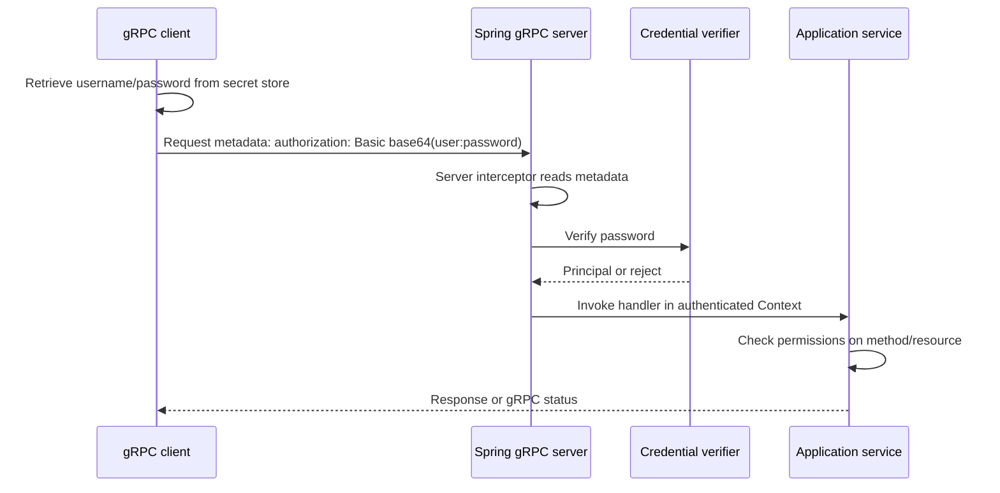

# Basic Credentials and Usage Limitations

## 1. How does Basic authentication work?

gRPC transmits protobuf messages over HTTP/2. In addition to requests and responses, clients can send metadata to provide authentication information. A common convention is to place access credentials in metadata:

`authorization: Basic <base64(username:password)>`

The server reads the header, decodes Base64, splits the username/password, and verifies the login credentials against an account store or identity provider.

Base64 is merely an encoding for representing bytes as characters transmissible in a header. It **does not encrypt or protect secrets**. Anyone observing an unencrypted connection can recover the username/password. Therefore, Basic authentication must only be used over a gRPC transport with TLS, and the client must properly verify the server's certificate/hostname.

Basic also has an important limitation: the client resends the same credentials on every RPC; this mechanism does not inherently provide short-lived access tokens, scopes, audience, delegation, or refresh tokens. For user-facing applications and modern distributed systems, OAuth2/OIDC or workload identities are usually a better fit.



Authentication and authorization are two separate steps: verifying the right password only identifies the caller; the server must still check whether the caller has permission to perform the operation.

## 2. Metadata key and Basic format

Metadata keys in gRPC Java use lowercase and a marshaller matching the data type. The authorization header is ASCII text:

```java
import io.grpc.Metadata;

public final class BasicAuthMetadata {

    private BasicAuthMetadata() {}

    public static final Metadata.Key<String> AUTHORIZATION =
            Metadata.Key.of(
                    "authorization",
                    Metadata.ASCII_STRING_MARSHALLER);
}
```

The header value consists of the scheme, a space, and the Base64 string:

```java
String userPass = username + ":" + password;

String encoded = Base64.getEncoder().encodeToString(
        userPass.getBytes(StandardCharsets.UTF_8));

Metadata headers = new Metadata();
headers.put(
        BasicAuthMetadata.AUTHORIZATION,
        "Basic " + encoded);
```

Basic uses the first colon to separate username and password. The username must not contain a colon; the password may contain colons. Do not trim passwords arbitrarily, because whitespace may be part of the password.

The example consistently uses UTF-8 on both client and server to encode the username/password pair. Basic originally had historical charset rules; therefore, when integrating cross-platform clients, explicitly publish the charset the service accepts and test non-ASCII characters.

Do not place username/password inside protobuf requests, query strings, method names, or custom business fields. Do not send multiple authorization values in one RPC. The server should reject duplicate headers instead of picking one arbitrarily.

## 3. Sending Basic credentials per RPC with CallCredentials

Do not attach a fixed token or credential to a singleton interceptor if credentials can be rotated or vary by caller. gRPC Java provides `CallCredentials` to supply metadata while constructing each RPC.

Define a credential provider that fetches the secret from security configuration or a secret manager:

```java
public record BasicCredential(
        String username,
        String password) {}

public interface BasicCredentialProvider {
    CompletionStage<BasicCredential> currentCredential();
}
```

The provider can return credentials for a least-privilege service account. If credentials represent individual users, the provider must retrieve the right credential from the current request context; never share one user's credentials across other requests.

`CallCredentials` implementation:

```java
package com.example.catalog.client;

import io.grpc.CallCredentials;
import io.grpc.Metadata;
import io.grpc.Status;

import java.nio.charset.StandardCharsets;
import java.util.Base64;
import java.util.concurrent.CompletionStage;
import java.util.concurrent.Executor;

public final class BasicCallCredentials extends CallCredentials {

    private final BasicCredentialProvider provider;

    public BasicCallCredentials(BasicCredentialProvider provider) {
        this.provider = provider;
    }

    @Override
    public void applyRequestMetadata(
            RequestInfo requestInfo,
            Executor appExecutor,
            MetadataApplier applier) {

        final CompletionStage<BasicCredential> stage;

        try {
            stage = provider.currentCredential();
        } catch (RuntimeException failure) {
            applier.fail(Status.UNAUTHENTICATED
                    .withDescription("Missing Basic credential"));
            return;
        }

        stage.whenCompleteAsync((credential, failure) -> {
            if (failure != null) {
                applier.fail(Status.UNAVAILABLE
                        .withDescription("Unable to retrieve credential"));
                return;
            }

            if (credential == null
                    || credential.username() == null
                    || credential.username().isBlank()
                    || credential.password() == null) {
                applier.fail(Status.UNAUTHENTICATED
                        .withDescription("Invalid Basic credential"));
                return;
            }

            String userPass =
                    credential.username() + ":" + credential.password();
            String encoded = Base64.getEncoder().encodeToString(
                    userPass.getBytes(StandardCharsets.UTF_8));

            Metadata headers = new Metadata();
            headers.put(
                    BasicAuthMetadata.AUTHORIZATION,
                    "Basic " + encoded);

            applier.apply(headers);
        }, appExecutor);
    }

    @Override
    public boolean requireTransportSecurity() {
        return true;
    }
}
```

Key points to understand:

- applyRequestMetadata(...) is invoked while preparing an RPC; the provider retrieves the current credential for that call.
- appExecutor allows completing metadata provisioning asynchronously. Do not block the transport thread by waiting for credentials via get() or join().
- Provider failures caused by a temporarily unavailable secret store are distinguished from missing or misconfigured credentials.
- requireTransportSecurity() returns true, requiring the credential to be used only over a secure transport.
- The snippet creates Java Strings containing the password for Base64 encoding. String is immutable and cannot be wiped immediately; in high-security systems, minimize secret lifetime, use a secret manager, and prefer token-based mechanisms over Basic.

Attach credentials to the generated stub:

```java
ProductQueryServiceGrpc.ProductQueryServiceBlockingStub securedStub =
        baseStub.withCallCredentials(
                new BasicCallCredentials(basicCredentialProvider));

GetProductResponse response = securedStub
        .withDeadlineAfter(700, TimeUnit.MILLISECONDS)
        .getProduct(request);
```

withCallCredentials(...) returns a derived stub. The stub can be managed as a Spring bean if the provider genuinely supplies the right caller's credential per call. Never store a user's password in a singleton field shared across all requests.
## 4. Verifying Basic credentials on the server

The server should read metadata and verify login credentials in a ServerInterceptor before the business handler runs. Never store plaintext passwords. For internal accounts, store password hashes using a Spring Security PasswordEncoder such as BCrypt or Argon2 and use a dedicated verification service.

Illustrative contract:

```java
public interface BasicCredentialVerifier {
    Optional<AuthenticatedPrincipal> authenticate(
            String username,
            String rawPassword);
}

public record AuthenticatedPrincipal(
        String subject,
        String tenantId,
        Set<String> authorities) {}
```

The verifier implementation looks up the account, checks account status, and calls PasswordEncoder.matches(rawPassword, storedPasswordHash). Never compare a raw password against a plaintext string stored in the database. If using LDAP or an identity provider, the verifier should delegate verification to that system rather than duplicating the password store.

Interceptor reading the header, checking the scheme, and decoding:

```java
package com.example.catalog.server;

import io.grpc.Context;
import io.grpc.Contexts;
import io.grpc.Metadata;
import io.grpc.ServerCall;
import io.grpc.ServerCallHandler;
import io.grpc.ServerInterceptor;
import io.grpc.Status;

import java.nio.ByteBuffer;
import java.nio.charset.CharacterCodingException;
import java.nio.charset.CodingErrorAction;
import java.nio.charset.StandardCharsets;
import java.util.Base64;
import java.util.Iterator;
import java.util.Optional;

public final class BasicAuthServerInterceptor
        implements ServerInterceptor {

    public static final Context.Key<AuthenticatedPrincipal> PRINCIPAL =
            Context.key("authenticated-principal");

    private final BasicCredentialVerifier verifier;

    public BasicAuthServerInterceptor(
            BasicCredentialVerifier verifier) {
        this.verifier = verifier;
    }

    @Override
    public <ReqT, RespT> ServerCall.Listener<ReqT> interceptCall(
            ServerCall<ReqT, RespT> call,
            Metadata headers,
            ServerCallHandler<ReqT, RespT> next) {

        Iterable<String> values =
                headers.getAll(BasicAuthMetadata.AUTHORIZATION);

        if (values == null) {
            return reject(call, Status.UNAUTHENTICATED
                    .withDescription("Missing Basic credential"));
        }

        Iterator<String> iterator = values.iterator();
        if (!iterator.hasNext()) {
            return reject(call, Status.UNAUTHENTICATED
                    .withDescription("Missing Basic credential"));
        }

        String header = iterator.next();

        if (iterator.hasNext()
                || header == null
                || !header.regionMatches(true, 0, "Basic ", 0, 6)) {
            return reject(call, Status.UNAUTHENTICATED
                    .withDescription("Invalid authorization header"));
        }

        String encoded = header.substring(6);
        if (encoded.isBlank()
                || encoded.length() > 8192
                || encoded.chars().anyMatch(Character::isWhitespace)) {
            return reject(call, Status.UNAUTHENTICATED
                    .withDescription("Invalid Basic credential"));
        }

        byte[] decoded;
        try {
            decoded = Base64.getDecoder().decode(encoded);
        } catch (IllegalArgumentException malformed) {
            return reject(call, Status.UNAUTHENTICATED
                    .withDescription("Invalid Basic credential"));
        }

        try {
            String userPass = StandardCharsets.UTF_8.newDecoder()
                    .onMalformedInput(CodingErrorAction.REPORT)
                    .onUnmappableCharacter(CodingErrorAction.REPORT)
                    .decode(ByteBuffer.wrap(decoded))
                    .toString();

            int separator = userPass.indexOf(':');
            if (separator <= 0 || separator == userPass.length() - 1) {
                return reject(call, Status.UNAUTHENTICATED
                        .withDescription("Invalid Basic credential"));
            }

            String username = userPass.substring(0, separator);
            String password = userPass.substring(separator + 1);

            Optional<AuthenticatedPrincipal> principal =
                    verifier.authenticate(username, password);

            if (principal.isEmpty()) {
                return reject(call, Status.UNAUTHENTICATED
                        .withDescription("Invalid credentials"));
            }

            Context context = Context.current()
                    .withValue(PRINCIPAL, principal.get());

            return Contexts.interceptCall(
                    context, call, headers, next);

        } catch (CharacterCodingException malformedUtf8) {
            return reject(call, Status.UNAUTHENTICATED
                    .withDescription("Invalid Basic credential"));
        } catch (AuthenticationStoreUnavailableException unavailable) {
            return reject(call, Status.UNAVAILABLE
                    .withDescription("Credential verification service temporarily unavailable"));
        } catch (RuntimeException unexpected) {
            // Log internal error with correlation ID; do not log credentials.
            return reject(call, Status.INTERNAL
                    .withDescription("Unable to verify credential"));
        } finally {
            java.util.Arrays.fill(decoded, (byte) 0);
        }
    }

    private static <ReqT, RespT> ServerCall.Listener<ReqT> reject(
            ServerCall<ReqT, RespT> call,
            Status status) {
        call.close(status, new Metadata());
        return new ServerCall.Listener<>() {};
    }
}
```

BasicCredentialVerifier, AuthenticatedPrincipal, and AuthenticationStoreUnavailableException are illustrative application types. In production, log verification errors with a correlation ID and a safe error category; never log raw credentials, authorization headers, or full sensitive details.

Contexts.interceptCall(...) attaches the principal to io.grpc.Context across RPC callbacks. Handlers and services can obtain the principal from context rather than trusting a user ID sent by the client in protobuf.

Username must not contain a colon per the Basic format; the server uses the first colon to split the password, so the password can still contain colons. If the application intentionally allows empty passwords, adjust the check according to an explicit policy rather than accepting them by accident.

## 5. Attaching the principal in Spring gRPC and checking permissions

The handler retrieves the verified principal from context:

```java
AuthenticatedPrincipal principal =
        BasicAuthServerInterceptor.PRINCIPAL.get();

if (principal == null) {
    observer.onError(Status.UNAUTHENTICATED
            .withDescription("Caller is not authenticated")
            .asRuntimeException());
    return;
}

if (!principal.authorities().contains("PRODUCT_READ")
        || !authorizationService.canReadProduct(
                principal.subject(),
                principal.tenantId(),
                request.getProductId())) {
    observer.onError(Status.PERMISSION_DENIED
            .withDescription("Caller does not have permission to read product")
            .asRuntimeException());
    return;
}
```

A valid password only verifies identity. Permissions must still be checked by method, tenant, and resource. Do not trust tenant_id, role, or username sent by the client in protobuf as proof of the principal.

In Spring gRPC, register the interceptor through the global or service-specific interceptor mechanism supported by the project's framework version. The verifier can be managed as a Spring bean to use PasswordEncoder, repositories, or an identity provider. Do not merely define a ServerInterceptor bean and assume every framework version automatically attaches it to all services.

## 6. Configuring the client in Spring

Manage the provider, credentials, channel, and stub via dependency injection:

```java
@Configuration
public class CatalogGrpcClientConfiguration {

    @Bean
    BasicCallCredentials basicCallCredentials(
            BasicCredentialProvider provider) {
        return new BasicCallCredentials(provider);
    }

    @Bean
    ProductQueryServiceGrpc.ProductQueryServiceBlockingStub productStub(
            GrpcChannelFactory channelFactory,
            BasicCallCredentials credentials) {

        return ProductQueryServiceGrpc.newBlockingStub(
                channelFactory.createChannel("catalog"))
                .withCallCredentials(credentials);
    }
}
```

GrpcChannelFactory creates channels managed by Spring. The catalog channel must be configured with proper TLS, trust bundle, and hostname verification. requireTransportSecurity() is an additional safeguard on the credentials; it does not configure TLS on the channel by itself.

Never hardcode username/password directly in source code or committed configuration files. Load secrets from a secret manager or the platform's secret management mechanism, restrict read permissions, and maintain a rotation process. For per-user credentials, ensure the provider retrieves the right principal for the current request, even when RPCs run asynchronously or switch threads.

## 7. Usage limitations of Basic authentication

Basic is simple and widely supported, yet it has limitations that restrict it to controlled environments:

| Limitation | Consequence | Mitigation |
| --- | --- | --- |
| Sends username/password on every RPC | Every call carries a high-value credential. | Require TLS, never log headers, restrict permissions and network scope. |
| Base64 is not encryption | Eavesdroppers can recover credentials. | Never use plaintext; verify server certificates. |
| No built-in expiry or scope in Basic | Credentials tend to be long-lived and tied to account privileges. | Use dedicated accounts, least privilege, rotation; prefer short-lived access tokens. |
| Hard to represent end users across multi-service systems | Sharing a single account loses per-user audit identity. | Use OAuth2/OIDC delegation or token exchange. |
| No refresh protocol | When passwords change, clients must fetch new secrets and update config. | Use a secret manager and controlled rotation. |
| Vulnerable to brute force or credential stuffing | Verification endpoints can be probed for passwords. | Apply rate limiting, controlled lockouts, auditing, and alerts. |
| Difficult to revoke a specific session | Changing a password can disrupt all clients sharing the account. | Dedicated accounts/secrets per workload; migrate to short-lived tokens. |

Basic can be acceptable inside a trusted internal network, for legacy integrations, or for narrowly scoped service accounts when the system does not yet support token-based authentication. It should not be used as the login mechanism for new public distributed systems when OAuth2/OIDC is available.

### When should you move to OAuth2/OIDC?

Use OAuth2/OIDC when you need one or more of the following capabilities:

- Short-lived access tokens that can be revoked or renewed by policy.
- Scopes and audiences restricted by service or RPC group.
- Delegation, service-to-service identity, or token exchange.
- Integration with an identity provider, SSO, MFA, and account lifecycle management.
- Auditing by user/service principal without sending passwords to every resource server.

Do not forward refresh tokens to a gRPC resource server. Clients obtain access tokens from the authorization server and send the access token in metadata via CallCredentials.

## 8. Credential rotation and operations

If you still have to use Basic, treat username/password as secrets with a lifecycle:

1. Create a separate service account per workload or integration.
2. Grant least privilege; never use administrative accounts.
3. Store secrets in a secret manager or access-controlled secret vault.
4. Rotate passwords periodically and upon any sign of compromise.
5. Provide a transition window so clients can update secrets before old credentials are disabled.
6. Monitor authentication failures, locked accounts, and anomalous access errors.
7. Never write passwords, Base64 credentials, or authorization headers to logs, traces, metrics, or exceptions.

Base64 does not hide passwords. Never log the Base64 value either, as it can be decoded directly. When logging, record only the method, authentication outcome, controlled account ID, and correlation ID; avoid logging usernames if data policy requires anonymization.
## 9. Testing Basic authentication

Use the in-process transport to test metadata, interceptors, and principals without opening TCP ports. Use a stub verifier with test accounts; never use production passwords.

| Scenario | Expected result |
| --- | --- |
| Missing authorization header | `UNAUTHENTICATED`; handler does not run. |
| Wrong scheme, invalid Base64, or invalid UTF-8 | `UNAUTHENTICATED`. |
| Duplicate authorization headers | Reject; do not arbitrarily pick one value. |
| Non-existent username or wrong password | `UNAUTHENTICATED`; do not reveal which accounts exist. |
| Verifier/store temporarily unavailable | `UNAVAILABLE`, do not disguise as a password failure. |
| Valid credential | Handler receives principal in context. |
| Valid principal lacking permission | `PERMISSION_DENIED`. |
| Two concurrent callers | Principals across RPCs are never mixed up. |
| Plaintext channel | Credentials are not applied due to transport security requirement; integration tests verify behavior on a real transport. |

Example test harness for a server interceptor with in-process transport:

```java
String serverName = InProcessServerBuilder.generateName();

Server server = InProcessServerBuilder.forName(serverName)
        .directExecutor()
        .intercept(basicAuthServerInterceptor)
        .addService(testProductService)
        .build()
        .start();

ManagedChannel channel = InProcessChannelBuilder.forName(serverName)
        .directExecutor()
        .build();

try {
    ProductQueryServiceGrpc.ProductQueryServiceBlockingStub stub =
            ProductQueryServiceGrpc.newBlockingStub(channel)
                    .withCallCredentials(testBasicCredentials);

    // Invoke RPC and assert response/status for each case.
} finally {
    channel.shutdownNow();
    server.shutdownNow();
}
```

In-process transport does not perform a TLS handshake. Separate integration tests with Netty TLS and test certificates are required to verify `requireTransportSecurity()` and channel/server configuration work properly. Log capture can be checked to ensure neither passwords nor Base64 strings appear.

## 10. Common mistakes

1. **Assuming Base64 protects passwords.** Base64 can be decoded directly. Only send Basic over TLS.
2. **Using Basic over a plaintext channel.** Username/password can be eavesdropped. Require TLS and verify server identity.
3. **Storing plaintext passwords in the database.** A database leak exposes all passwords. Store password hashes using a suitable PasswordEncoder.
4. **Attaching static credentials to a singleton stub.** Secrets expire or rotate while the client keeps sending old values. Use a provider and per-RPC CallCredentials.
5. **Sharing one service account across all users.** Audits cannot distinguish callers and privileges become overly broad. Create per-workload accounts or use token delegation.
6. **Accepting multiple authorization headers.** Can create discrepancies between proxies and servers. Reject duplicate headers.
7. **Logging headers or Base64 strings for debugging.** That string contains recoverable passwords. Mask or strip all credentials.
8. **Conflating authentication with authorization.** A valid password does not mean permission to access every resource. Check principal, roles, tenant, and resource.
9. **Lacking rate limiting or rotation.** Increases brute-force risk and keeps credentials alive too long. Rate-limit auth requests, audit, and rotate secrets.
10. **Using Basic for all modern identity needs.** Basic lacks expiry, scopes, and delegation. Migrate to OAuth2/OIDC when those capabilities are needed.

## 11. Practice exercise

Protect the unary method `GetProduct` with Basic credentials in a TLS-enabled test environment:

1. Create a `catalog-reader` service account with read-only product permissions.
2. Store the password as a hash in the account store; use `PasswordEncoder` to verify it.
3. Write a `BasicCredentialProvider` that reads the secret from a secure configuration source.
4. Attach `BasicCallCredentials` to the generated stub and enforce transport security.
5. Register `BasicAuthServerInterceptor` in the Spring gRPC server; store the verified principal in `io.grpc.Context`.
6. Check product read permissions in the handler; return `PERMISSION_DENIED` if the principal lacks permission.
7. Write tests for missing header, wrong scheme, invalid Base64, wrong password, valid credential, insufficient permissions, and verifier unavailable.
8. Verify logs contain no passwords or Base64 credentials; perform a password rotation and verify the client updates its secret.

**Self-check:** Basic sends username/password in metadata as `Basic Base64(username:password)`. Base64 is not encryption, so TLS and server certificate validation are mandatory. Use `CallCredentials` to supply credentials per RPC, `ServerInterceptor` to verify password hashes and place the principal into `io.grpc.Context`, and check authorization separately. Basic fits certain narrowly scoped internal integrations; when expiry, scopes, delegation, and modern identity are needed, use OAuth2/OIDC.


