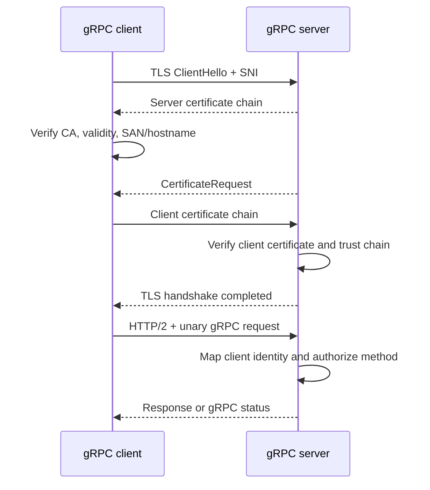

# mTLS Between Client and Server

## 1. What problem does Mutual TLS solve?

gRPC runs over HTTP/2. In production environments, TLS encrypts data in transit, protects integrity, and verifies the server's identity to the client. With **mutual TLS (mTLS)**, the server also requires the client to present a certificate to verify the peer's identity in the reverse direction.

One-way TLS and mTLS differ at the client authentication step:

- **TLS server authentication:** the client verifies the server's certificate; the server does not require a client certificate.
- **mTLS:** the client verifies the server certificate, and the server simultaneously verifies the client certificate before accepting the connection.

mTLS is well suited for service-to-service communication, in-cluster workloads, or systems requiring cryptographic identification at the transport layer. A valid certificate proves the peer possesses the corresponding private key and the certificate is accepted by the trust policy. It does not automatically grant permission to call every RPC; the application must still map the identity to a principal and enforce authorization.



The TLS handshake happens before the protobuf handler is invoked. If the certificate is invalid or the client fails to provide a certificate when required by the server, the connection is rejected at the transport layer.

## 2. Certificates and trust material on both sides

Each peer needs two pieces of material: its own identity and the CA it trusts to verify the other peer.

| Side | Local identity | Trust material |
| --- | --- | --- |
| Server | Server certificate chain and private key | CA bundle that issues client certificates |
| Client | Client certificate chain and private key | CA bundle that issues server certificates |

A certificate chain typically consists of the leaf certificate and any required intermediate certificates. A trust bundle contains the root CA or policy-trusted CAs. Do not confuse the certificate chain with the trust store: one proves local identity, while the other verifies remote identity.

Certificates must have appropriate SANs and key usage purposes:

- The server certificate has a DNS SAN matching the hostname the client connects to, such as `catalog.internal.example`.
- The client certificate has an identity SAN following the organization's convention, typically a URI SAN for workloads, such as `spiffe://example.org/ns/catalog/sa/checkout`.
- The server certificate has Extended Key Usage appropriate for `serverAuth`; the client certificate has `clientAuth`.
- The private key must match the leaf certificate and be protected via a secret manager, file permissions, or hardware-backed key store.

The client must verify the CA chain, validity period, and server hostname/SAN. The server must verify the CA chain and client certificate policy. Do not disable hostname verification or accept all certificates to work around configuration errors.

## 3. Configuring mTLS on a gRPC Java server

The example uses the Netty transport from the `grpc-netty-shaded` artifact. Shaded Netty packages reside under `io.grpc.netty.shaded`; if the project uses unshaded `grpc-netty`, the corresponding imports differ. Do not mix the two dependency variants.

The server loads its own certificate chain/private key, trusts the CA issuing client certificates, and enforces client authentication:

```java
import io.grpc.Server;
import io.grpc.netty.shaded.io.grpc.netty.GrpcSslContexts;
import io.grpc.netty.shaded.io.grpc.netty.NettyServerBuilder;
import io.grpc.netty.shaded.io.netty.handler.ssl.ClientAuth;
import io.grpc.netty.shaded.io.netty.handler.ssl.SslContext;

import java.io.File;

SslContext serverTls = GrpcSslContexts.forServer(
        new File("certs/catalog-server-chain.pem"),
        new File("certs/catalog-server-key.pem"))
        .trustManager(new File("certs/workload-client-ca.pem"))
        .clientAuth(ClientAuth.REQUIRE)
        .build();

Server server = NettyServerBuilder.forPort(9090)
        .sslContext(serverTls)
        .addService(productQueryGrpcService)
        .build()
        .start();
```

Configuration breakdown:

- `forServer(certificateChain, privateKey)` supplies the server's TLS identity.
- `trustManager(clientCaBundle)` verifies client certificates against trusted CAs.
- `clientAuth(ClientAuth.REQUIRE)` requires the client to send a valid certificate.
- `sslContext(serverTls)` attaches the TLS context to the gRPC Netty server.

Netty client authentication modes:

| Mode | Behavior |
| --- | --- |
| `ClientAuth.NONE` | No client certificate is required. |
| `ClientAuth.OPTIONAL` | The client may send a certificate; if sent, the server verifies it. |
| `ClientAuth.REQUIRE` | The client must send a valid certificate. |

For mandatory mTLS, choose `REQUIRE`. `OPTIONAL` is only suitable when there is an explicit compatibility requirement and the application defines a policy for peers without a certificate. With `REQUIRE`, the handshake usually fails before any server interceptor or handler runs if the client lacks a certificate.

## 4. Configuring mTLS on a gRPC Java client

The client both verifies the server using a trust bundle and presents its own certificate/private key:

```java
import io.grpc.ManagedChannel;
import io.grpc.netty.shaded.io.grpc.netty.GrpcSslContexts;
import io.grpc.netty.shaded.io.grpc.netty.NettyChannelBuilder;
import io.grpc.netty.shaded.io.netty.handler.ssl.SslContext;

import java.io.File;

SslContext clientTls = GrpcSslContexts.forClient()
        .trustManager(new File("certs/server-ca-bundle.pem"))
        .keyManager(
                new File("certs/checkout-client-chain.pem"),
                new File("certs/checkout-client-key.pem"))
        .build();

ManagedChannel channel = NettyChannelBuilder
        .forAddress("catalog.internal.example", 9090)
        .sslContext(clientTls)
        .build();
```

The two settings address opposite directions:

- `trustManager(serverCaBundle)` verifies the server certificate.
- `keyManager(clientChain, clientKey)` supplies the client identity for server verification.

The hostname in `forAddress(...)` must match a DNS SAN on the server certificate. Do not use authority overrides to skip hostname mismatches. Do not call `usePlaintext()` on a channel requiring mTLS.

Once the channel is created, generated stubs use it as normal:

```java
import java.util.concurrent.TimeUnit;

ProductQueryServiceGrpc.ProductQueryServiceBlockingStub stub =
        ProductQueryServiceGrpc.newBlockingStub(channel);

GetProductResponse response = stub
        .withDeadlineAfter(700, TimeUnit.MILLISECONDS)
        .getProduct(request);
```

A channel is a long-lived resource: reuse channels and stubs rather than creating new ones per RPC, and close channels in alignment with the application lifecycle.

## 5. Integrating mTLS with Spring gRPC

In a Spring gRPC application using auto-configuration, the framework typically manages the server, channels, and stubs. Configure TLS on the Spring-managed server/channel to preserve lifecycle handling, interceptors, health services, and other transport settings.

The Netty builder examples above describe the foundational APIs of gRPC Java. When integrating with Spring Boot:

- Configure the server certificate, private key, trust bundle, and client-auth policy through the SSL configuration supported by your Spring gRPC version.
- Configure the trust bundle, client certificate, and client key for the appropriate named channel.
- If the version provides a customizer or custom SSL context factory, attach the configuration to the auto-configured server/channel.
- Do not start a second parallel Netty server just to enable mTLS when Spring already manages the primary server.
- Verify whether the dependency is `grpc-netty` or `grpc-netty-shaded` before using packages or customizers.

Property names and extension points depend on the Spring gRPC version. Consult the reference matching your project's dependency version before adding properties to `application.yml`; do not copy configurations from another version without verifying. Whether configured via properties or customizers, the server must require client certificates and the channel must have both trust material and key material.


## 6. Extracting client identity from the TLS session

After a successful mTLS handshake, the gRPC server can read the TLS session from `ServerCall` attributes. The peer certificate chain is verified by the transport; the application retrieves the leaf certificate and extracts identity according to the SAN convention.

Example `ServerInterceptor` reading a URI SAN and storing the identity in `io.grpc.Context`:

```java
import io.grpc.Context;
import io.grpc.Contexts;
import io.grpc.Grpc;
import io.grpc.Metadata;
import io.grpc.ServerCall;
import io.grpc.ServerCallHandler;
import io.grpc.ServerInterceptor;
import io.grpc.Status;

import java.security.cert.Certificate;
import java.security.cert.CertificateParsingException;
import java.security.cert.X509Certificate;
import java.util.Collection;
import java.util.List;
import javax.net.ssl.SSLPeerUnverifiedException;
import javax.net.ssl.SSLSession;

public final class MtlsIdentityInterceptor implements ServerInterceptor {

    public static final Context.Key<String> CLIENT_ID =
            Context.key("mtls-client-id");

    @Override
    public <ReqT, RespT> ServerCall.Listener<ReqT> interceptCall(
            ServerCall<ReqT, RespT> call,
            Metadata headers,
            ServerCallHandler<ReqT, RespT> next) {

        SSLSession session =
                call.getAttributes().get(Grpc.TRANSPORT_ATTR_SSL_SESSION);

        if (session == null) {
            return reject(call, "TLS peer identity is unavailable");
        }

        try {
            Certificate[] chain = session.getPeerCertificates();
            if (chain.length == 0 || !(chain[0] instanceof X509Certificate leaf)) {
                return reject(call, "Client certificate is unavailable");
            }

            String clientId = findUriSan(leaf);
            if (clientId == null) {
                return reject(call, "Client certificate has no URI SAN");
            }

            Context context = Context.current().withValue(CLIENT_ID, clientId);
            return Contexts.interceptCall(context, call, headers, next);

        } catch (SSLPeerUnverifiedException
                 | CertificateParsingException invalidPeer) {
            return reject(call, "Client certificate identity is invalid");
        }
    }

    private static String findUriSan(X509Certificate certificate)
            throws CertificateParsingException {

        Collection<List<?>> names =
                certificate.getSubjectAlternativeNames();

        if (names == null) {
            return null;
        }

        String foundUri = null;
        for (List<?> entry : names) {
            if (entry.size() >= 2
                    && Integer.valueOf(6).equals(entry.get(0))
                    && entry.get(1) instanceof String uri) {
                if (uri.isBlank() || foundUri != null) {
                    return null;
                }
                foundUri = uri;
            }
        }
        return foundUri;
    }

    private static <ReqT, RespT> ServerCall.Listener<ReqT> reject(
            ServerCall<ReqT, RespT> call,
            String description) {
        call.close(
                Status.UNAUTHENTICATED.withDescription(description),
                new Metadata());
        return new ServerCall.Listener<>() {};
    }
}
```

With `ClientAuth.REQUIRE`, a client missing a certificate or presenting an untrusted certificate is usually rejected during the handshake; the interceptor does not run. The `session == null` branch serves as a guard in case the transport does not supply a TLS session. SAN parsing failures must likewise not be treated as a valid principal.

URI SAN type `6` denotes a URI-form Subject Alternative Name. For example, a workload identity might take the form `spiffe://example.org/ns/commerce/sa/checkout`. The URI convention must be agreed upon by the CA and the organization; do not treat arbitrary URIs as authorization.

## 7. From certificate identity to authorization

mTLS authenticates the peer at the transport layer. The application needs additional steps for identity mapping and policy enforcement:

mTLS identity is bound to the TLS connection/channel rather than individual RPCs. HTTP/2 can multiplex many RPCs over the same connection, so calls sharing a channel all carry that client certificate's workload identity. If per-RPC user authentication is required, use per-call metadata credentials (such as a Bearer token via `CallCredentials`) alongside mTLS; never use a service channel's certificate to infer an end-user identity.

1. The transport verifies the certificate chain, validity, key usage, and trust anchor.
2. The interceptor extracts the identity from the designated SAN.
3. An identity provider or policy registry maps the identity to a service principal/role.
4. The handler checks whether the principal is allowed to invoke the method and access the specific resource.

Example handler restricting product read permission:

```java
String clientId = MtlsIdentityInterceptor.CLIENT_ID.get();

if (clientId == null
        || !authorizationService.canReadProduct(
                clientId, request.getProductId())) {
    observer.onError(Status.PERMISSION_DENIED
            .withDescription("Workload does not have permission to read product")
            .asRuntimeException());
    return;
}
```

A valid certificate where the workload lacks permission should yield `PERMISSION_DENIED`. Missing or unverifiable peer identity is an authentication error. Do not treat one workload's certificate as permission to access every service or every tenant.

If TLS terminates at an ingress/proxy, the backend may only see the proxy's certificate. Do not trust client-supplied identity headers. A clear trust boundary is required: the proxy authenticates the client and propagates identity via a signed assertion or an authenticated internal channel; the backend accepts identity only from trusted proxies.

## 8. Certificate rotation and operations

Certificates and CAs expire. Rotation must maintain continuous verification throughout the transition:

- Issue new server/client certificates before old certificates expire.
- When rotating CAs, deploy a trust bundle containing both the old and new CAs before replacing leaf certificates.
- Update certificates/keys on each side; verify new connections work before removing the old CA.
- Keep private keys in a secret manager or controlled key store; restrict read permissions and audit access.
- Monitor expiration dates, handshake failures, rejected certificates, and failed mTLS connection counts.
- Maintain a revocation process for compromised certificates using CRL/OCSP or your PKI infrastructure's policy.
- Never log private keys, PEM contents, or full certificate material.

Do not assume that merely configuring a trust bundle enables certificate revocation checking. CRL/OCSP and revocation policies must be configured and tested according to your TLS provider and PKI infrastructure's capabilities. Keep TLS 1.2 or higher and secure cipher suites per supported configuration; do not re-enable deprecated protocols or ciphers for legacy client compatibility.

Channels and TLS contexts can hold loaded certificates in memory. Replacing files on disk does not guarantee existing channels automatically reload. Check the reload mechanism of your transport/framework version; if safe reload is not supported, use channel/server replacement or rolling restarts. Keep old channels alive for an appropriate drain period to avoid cutting off in-flight RPCs.

## 9. Testing mTLS on a real transport

The in-process transport is useful for handlers and interceptors, but it does not perform a TLS handshake like TCP/Netty. It cannot prove certificate chains, hostname verification, or client certificate enforcement. Write integration tests with the Netty transport and a dedicated test CA.

| Scenario | Expected result |
| --- | --- |
| Client trusts server CA, hostname matches SAN, client certificate trusted by server | Handshake succeeds; unary RPC executes. |
| Client does not trust server CA | Handshake fails; handler does not run. |
| Connection hostname does not match DNS SAN | Client rejects server identity. |
| Server requires mTLS but client sends no certificate | Handshake fails. |
| Client certificate issued by untrusted CA | Server rejects the handshake. |
| Valid certificate but URI SAN is not allowed by policy | TLS succeeds; authorization rejects with `PERMISSION_DENIED`. |
| Expired certificate or wrong key usage | Handshake is rejected according to validation policy. |

You can spin up a test server on an ephemeral port using `NettyServerBuilder.forPort(0)` and retrieve the bound port after the server starts. Use a `NettyChannelBuilder` client pointing to a hostname present in the test server certificate. Verify that a valid RPC succeeds, then exercise clients with wrong trust bundles or key material.

Do not assert that every handshake failure maps to one fixed gRPC status; clients may observe a transport error such as `UNAVAILABLE` with a cause. Tests should verify that the call fails and the handler is not invoked, while checking the TLS root cause in logs/test diagnostics.

For authorization, use a valid certificate whose URI SAN lacks permission to prove that a successful handshake can still be rejected by the handler. This test verifies the boundary between authentication and authorization.

## 10. Common mistakes

1. **Configuring only the server certificate.** The server does not authenticate clients yet. Enable a trust manager for the client CA and `ClientAuth.REQUIRE`.
2. **Confusing trust manager with key manager.** Trust manager verifies peers; key manager provides local identity.
3. **Missing intermediate certificates.** Peers may fail to build the trust chain. Send the full chain.
4. **Server certificate missing a DNS SAN.** Clients cannot verify the hostname. Issue certificates with a SAN matching the endpoint.
5. **Client certificate missing clientAuth EKU or SAN identity.** The certificate fails usage checks or cannot be mapped to a principal. Issue certificates compliant with policy.
6. **Treating mTLS as authorization.** A valid certificate does not mean permission to call every method. Map the SAN identity to policies and check resources.
7. **Using plaintext or bypassing hostname verification.** Peers can be spoofed or traffic eavesdropped. Keep default TLS validation enabled.
8. **Trusting identity headers after TLS termination at a proxy.** Backends can receive forged identities if the proxy boundary is unauthenticated. Use signed assertions or a trusted proxy-backend channel.
9. **Replacing PEM files and assuming channels auto-reload.** The TLS context may still use the old certificate. Use supported reloading or rolling replacement.
10. **Using only in-process tests to validate mTLS.** In-process transport does not exercise handshakes. Add TCP/Netty integration tests.

## 11. Practice exercise

Protect unary `ProductQueryService` with mTLS:

1. Create a test CA; issue a server certificate with DNS SAN `catalog.test.internal` and EKU `serverAuth`.
2. Issue a client certificate with URI SAN `spiffe://example.org/ns/catalog/sa/checkout` and EKU `clientAuth`.
3. Configure the server to trust the client CA and enforce `ClientAuth.REQUIRE`.
4. Configure the client to trust the server CA, load the client certificate/private key, and connect using a hostname matching the SAN.
5. Register `MtlsIdentityInterceptor`, map the URI SAN to a service principal, and check permissions in the handler.
6. Write transport tests for a valid client, missing certificate, wrong CA, hostname mismatch, expired certificate, and unauthorized identity.
7. Simulate CA rotation using an overlapping trust bundle; verify new clients/servers work before removing the old CA.

**Self-check:** mTLS verifies both server and client during the TLS handshake. The server uses its trust policy to accept the client certificate, then extracts the SAN identity and maps it to a principal. Authorization must still check methods, tenants, and resources. Protecting private keys, verifying hostnames, overlapping rotation, and testing on real TCP/TLS are essential parts of deploying mTLS in Spring gRPC.
