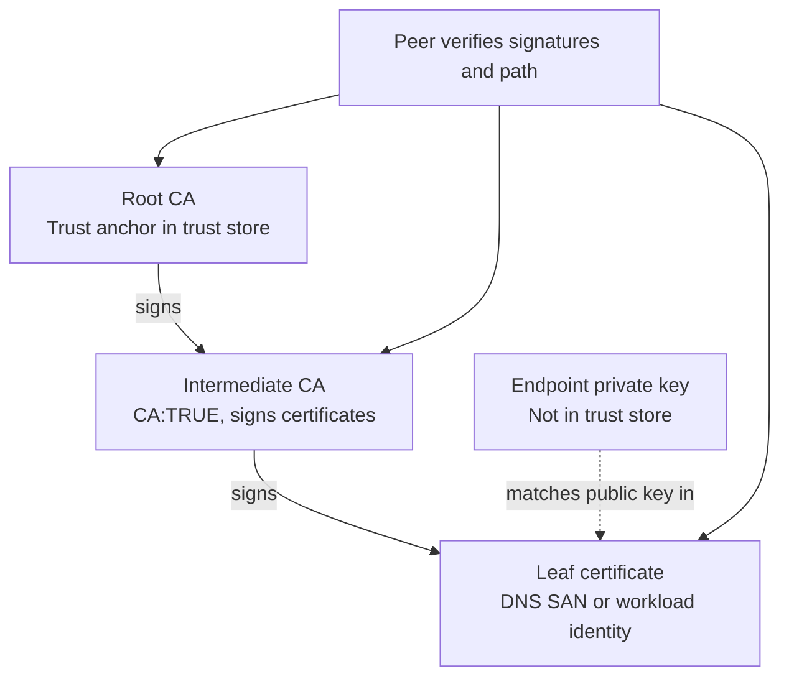

# Certificate Chains and Trust Stores

## 1. What is a certificate chain?

TLS does not check a single certificate in isolation. A peer must prove that its certificate was issued through a chain of signatures leading to a **trust anchor** already trusted by the receiver. This chain typically has three layers:

1. **Leaf certificate:** the certificate of the server or client participating in the connection. It contains the endpoint's public key and identity.
2. **Intermediate CA certificate:** an intermediate CA that signs the leaf certificate or the next intermediate CA.
3. **Root CA certificate:** the trust anchor at the top of the chain. The root's private key is usually kept offline or strictly protected.



When a server sends its certificate chain, it normally sends the leaf certificate first, followed by the intermediate certificates needed to build a path to the root. The server usually does not need to send the root certificate because the client must already have the trust anchor in its trust store. Sending the root in the chain does not make the root automatically trusted either.

A valid chain must satisfy multiple conditions: each certificate's signature verifies under its issuer's public key, validity dates are current, CA certificates have proper CA constraints, key usage/EKU match the purpose, and the path terminates at an accepted trust anchor.

## 2. How does a trust store differ from a certificate chain and a keystore?

Three concepts are frequently confused:

| Component | What it contains | What it is used for |
| --- | --- | --- |
| Certificate chain | Leaf certificate and related intermediate certificates | Sent by a peer so the other side can build and verify the certificate path. |
| Trust store | Trusted CA certificates or trust anchors | Determines who can issue accepted certificates. |
| Identity keystore | Endpoint's private key together with its certificate chain | Proves the endpoint owns that certificate identity. |

In Java, KeyStore is an API/container; the names "trust store" or "keystore" describe their operational role. A PKCS#12 file may hold a private key and certificate chain, or hold only certificate entries used as a trust store. Do not infer the role solely from a .p12 or .jks file extension.

**A trust store does not contain the peer's private key.** It contains certificates the application trusts. The endpoint's private key lives in a key entry of a keystore or is provided via a secret manager/HSM. Never export a private key into a trust store just to establish trust.

## 3. How TLS builds and verifies a certificate path

When a client connects to catalog.internal.example, the TLS stack performs these high-level steps:

1. Receives the leaf certificate and intermediate certificates sent by the server.
2. Locates matching issuer certificates to construct a path to a trust anchor.
3. Verifies signatures on each certificate and CA constraints such as basicConstraints, keyCertSign, path length, and name constraints.
4. Checks validity (notBefore, notAfter), key usage, Extended Key Usage, and applicable policies.
5. Verifies that the path terminates at a trust anchor in the trust store.
6. Verifies the endpoint's identity, such as whether the DNS hostname matches the server's DNS SAN.

**Path validation and hostname verification are two separate checks.** A certificate may be signed by a trusted CA yet still not represent the hostname the client is calling. Likewise, a matching SAN cannot rescue a chain with an invalid signature or an untrusted CA.

A root CA is typically a pre-configured trust anchor; it is not necessarily processed identically to intermediate certificates during path validation. A trust anchor is a policy decision by the relying party, not a conclusion asserted by the certificate itself.

## 4. CA constraints, SAN, and EKU

An intermediate CA certificate must have basicConstraints permitting it to act as a CA (CA:TRUE) and appropriate key usage, typically including keyCertSign. If an intermediate certificate lacks permission to sign certificates, path validation must reject the chain.

Leaf certificates for servers/clients usually have CA:FALSE and the appropriate Extended Key Usage:

- Server certificates need the serverAuth purpose.
- Client certificates used for mTLS need the clientAuth purpose.
- The DNS SAN on the server certificate must match the hostname the client verifies.
- A URI SAN or an agreed-upon SAN type can represent the client's workload identity.

Do not use Common Name (CN) as a substitute for DNS SAN in modern hostname verification. Also do not treat an arbitrary URI SAN as authorization: after the transport verifies the certificate, the application must still map the identity to a principal and enforce authorization.

## 5. Creating a trust store with keytool

Java keytool can import CA certificates into a PKCS#12 trust store. Example creating a trust store for a client trusting a root CA:

```bash
keytool -importcert \
  -alias catalog-root-ca \
  -file certs/catalog-root-ca.pem \
  -keystore certs/catalog-truststore.p12 \
  -storetype PKCS12
```

keytool will prompt for a trust store password and ask you to confirm the certificate fingerprint. Only accept the fingerprint after verifying it over an independent trusted channel. Never blindly accept a certificate just because it was presented by a server experiencing a TLS error.

Inspecting trust store contents:

```bash
keytool -list -v \
  -keystore certs/catalog-truststore.p12 \
  -storetype PKCS12
```

A trust store should contain only approved CAs or trust anchors. Do not import arbitrary leaf certificates to "make the connection work"; leaf certificate pinning is a distinct policy with strict rotation and fingerprint management requirements.

The trust store password protects file access and integrity according to the keystore provider's mechanism. CA certificates are public data; a password does not turn certificates into secrets and does not replace private key management.

## 6. Using a PKCS#12 trust store with gRPC Java Netty

gRPC Java Netty uses io.netty.handler.ssl.SslContext to configure TLS. When using grpc-netty-shaded, Netty classes live under the io.grpc.netty.shaded package. You can load a PKCS#12 trust store with Java KeyStore, create a TrustManagerFactory, and pass the trust manager to GrpcSslContexts:

```java
import io.grpc.netty.shaded.io.grpc.netty.GrpcSslContexts;
import io.grpc.netty.shaded.io.netty.handler.ssl.SslContext;

import javax.net.ssl.TrustManagerFactory;
import java.io.InputStream;
import java.nio.file.Files;
import java.nio.file.Path;
import java.security.KeyStore;

char[] trustStorePassword = loadTrustStorePassword();

KeyStore trustStore = KeyStore.getInstance("PKCS12");
try (InputStream input =
             Files.newInputStream(Path.of("certs/catalog-truststore.p12"))) {
    trustStore.load(input, trustStorePassword);
}

TrustManagerFactory trustManagers = TrustManagerFactory.getInstance(
        TrustManagerFactory.getDefaultAlgorithm());
trustManagers.init(trustStore);

SslContext clientTls = GrpcSslContexts.forClient()
        .trustManager(trustManagers)
        .build();
```

loadTrustStorePassword() is a helper that reads the secret from the application's secure configuration source; never hard-code passwords in source code. If the application only uses a PEM CA bundle, you can pass the PEM file directly via trustManager(File) without creating a PKCS#12 file.

Using that SslContext for a channel:

```java
import io.grpc.ManagedChannel;
import io.grpc.netty.shaded.io.grpc.netty.NettyChannelBuilder;

ManagedChannel channel = NettyChannelBuilder
        .forAddress("catalog.internal.example", 9090)
        .sslContext(clientTls)
        .build();
```

The trust manager determines which CAs are trusted. The client must still verify the hostname against the endpoint's SAN. Do not disable hostname verification when the chain is already valid; if the hostname is wrong, fix the endpoint or reissue the certificate with the correct SAN.

### JVM default trust store and Netty

javax.net.ssl.trustStore is a common setting with JSSE. When an application builds a Netty SslContext manually, configure the trust manager explicitly as shown above; do not assume every custom context automatically reads the same JVM trust store or system property. Behavior depends on how the context is constructed and which TLS provider is used. Verify the exact transport in use and write integration tests to prove the trust material is actually loaded.

## 7. Server-side trust store when enabling mTLS

In mTLS, each side verifies the other's certificate. Thus trust stores serve distinct directions:

- Client trusts the CA that issued the server certificate.
- Server trusts the CA that issued the client certificate.

Example of a server using its own certificate chain while only accepting client certificates issued by CAs in a bundle:

```java
import io.grpc.Server;
import io.grpc.netty.shaded.io.grpc.netty.GrpcSslContexts;
import io.grpc.netty.shaded.io.grpc.netty.NettyServerBuilder;
import io.grpc.netty.shaded.io.netty.handler.ssl.ClientAuth;
import io.grpc.netty.shaded.io.netty.handler.ssl.SslContext;

import java.io.File;

SslContext serverTls = GrpcSslContexts.forServer(
        new File("certs/catalog-server-chain.pem"),
        new File("certs/catalog-server-key.pem"))
        .trustManager(new File("certs/workload-client-ca-bundle.pem"))
        .clientAuth(ClientAuth.REQUIRE)
        .build();

Server server = NettyServerBuilder.forPort(9090)
        .sslContext(serverTls)
        .addService(productQueryGrpcService)
        .build()
        .start();
```

The server's trust bundle must contain the trusted CAs for verifying client certificates. The server identity chain (catalog-server-chain.pem) is the certificate the server sends to the client; it is not the server's trust store.

An mTLS client needs both a trust bundle to verify the server and key material to present the client identity:

```java
import io.grpc.netty.shaded.io.grpc.netty.GrpcSslContexts;
import io.grpc.netty.shaded.io.netty.handler.ssl.SslContext;

import java.io.File;

SslContext clientMtls = GrpcSslContexts.forClient()
        .trustManager(new File("certs/server-ca-bundle.pem"))
        .keyManager(
                new File("certs/checkout-client-chain.pem"),
                new File("certs/checkout-client-key.pem"))
        .build();
```

trustManager(...) and keyManager(...) handle opposite directions. Loading only a client certificate without an appropriate server trust bundle fails to verify the server; loading only a trust bundle without client key material fails to satisfy a server requiring mTLS.

## 8. Missing intermediate certificates or broken chains

A common mistake is configuring the server to send only the leaf certificate without the required intermediate certificates. The client has the right root CA in its trust store yet still cannot build a path because the intermediate link is missing.

Check the following:

- Does the server certificate have the right issuer and was it signed by the corresponding intermediate?
- Does the server send the leaf first followed by the intermediates in proper chain order?
- Does the intermediate have CA:TRUE, valid key usage, and current validity?
- Does the trust store contain the right root CA or policy-accepted trust anchor?
- Is the client accidentally trusting a CA from another environment (test, staging, production)?
- Is there a cross-signed certificate causing the path builder to pick an unintended branch?

Never fix a missing chain by disabling verification or adding every received certificate to the trust store. Fix the chain sent by the server or update trust anchors in a controlled manner.

## 9. Diagnosing chains and trust stores

You can use keytool to inspect subject, issuer, validity, SAN, and fingerprint:

```bash
keytool -printcert -file certs/catalog-server-leaf.pem
keytool -printcert -file certs/catalog-intermediate.pem
```

Use OpenSSL to verify the path against the provided root CA and intermediate:

```bash
openssl verify \
  -CAfile certs/catalog-root-ca.pem \
  -untrusted certs/catalog-intermediate.pem \
  certs/catalog-server-leaf.pem
```

Inspect the chain the server actually sends over TLS:

```bash
openssl s_client \
  -connect catalog.internal.example:9090 \
  -servername catalog.internal.example \
  -alpn h2 \
  -showcerts
```

openssl verify is useful for distinguishing a missing chain, mismatched issuer, or wrong trust anchor. s_client -showcerts reveals the certificates the server sends during the handshake. OpenSSL results do not guarantee every Java/Netty configuration detail behaves identically; verify again using your application's actual client transport.

Errors should be categorized:

| Symptom | Likely cause to check |
| --- | --- |
| unable to get local issuer certificate | Missing intermediate or missing CA in trust store. |
| certificate has expired | Leaf or intermediate expired; check system clock. |
| PKIX path building failed | Cannot build a path to a trusted trust anchor. |
| Hostname/SAN mismatch | Chain may be valid, but the certificate does not represent the connected hostname. |
| Client certificate rejected | Server missing client CA in trust bundle, client chain missing intermediate, or mismatched EKU. |

Do not rely on a single exception message string, as TLS providers word errors differently. Collect the cause chain, certificate subject/issuer, and log-safe fingerprints; never log private keys or secrets.

## 10. Trust stores, rotation, and certificate revocation

A trust store is part of the trust policy, so modifying trust anchors can widen or narrow the set of accepted peers. Manage it as controlled security configuration:

1. Store CA bundles in versioned, audited secret/configuration management.
2. Verify CA fingerprints through an independent channel before adding a trust anchor.
3. When rotating CAs, deploy a trust bundle containing both the old and new CAs during the overlap window.
4. Issue and deploy new leaf certificates; verify connectivity across all clients/servers.
5. Remove the old CA only after no endpoints depend on old certificates.
6. Monitor expiry, handshake failures, and trust-store versions running across instances.

Replacing a trust store file on disk does not guarantee a running SslContext or channel reloads automatically. The TLS context may retain the previously initialized trust manager. Check the reload mechanism of your framework/transport version; if unsupported, replace contexts/channels or perform rolling restarts with proper draining of in-flight connections.

Importing a CA into a trust store **does not automatically enable certificate revocation checking**. CRL/OCSP or PKIXRevocationChecker must be configured according to TLS provider capabilities and PKI policy. Verify revocation in integration tests; do not assume a trust anchor alone rejects revoked certificates.

## 11. Integrating with Spring gRPC

In Spring gRPC, the server and named client channels are typically managed by auto-configuration. Configure trust material on the exact managed server/channel to keep lifecycle, interceptors, and health services consistent.

- For server mTLS, supply the server identity chain/private key and the client CA trust bundle; enable the client certificate requirement policy.
- For client TLS, supply the server CA trust bundle.
- For client mTLS, add the client certificate chain/private key to the named channel.
- If using a customizer or SSL context factory, attach the trust manager to the context Spring actually uses to construct the server/channel.
- Do not spin up a parallel Netty server/channel just to load a trust store when the framework already manages the primary transport.

Property names and extension points depend on the Spring gRPC and starter versions. Consult documentation matching the project's exact dependency version before configuring application.yml; do not guess property names. Whether using PEM or PKCS#12, verify that the final trust manager is attached to the transport actually serving RPCs.

## 12. Testing and common mistakes

A TCP/Netty integration test suite should cover these cases:

| Scenario | Expected result |
| --- | --- |
| Full server chain, root CA in client trust store, hostname matches SAN | TLS succeeds and RPC runs. |
| Client does not trust server root CA | Handshake fails; handler does not run. |
| Server omits required intermediate | Path validation fails unless the client has an alternate path. |
| Expired certificate or wrong EKU | Rejected according to validation policy. |
| Valid chain but hostname does not match SAN | Hostname verification fails. |
| mTLS: valid client chain and server trusts right client CA | Handshake succeeds. |
| mTLS: client certificate issued by untrusted CA | Server rejects the handshake. |
| Overlapping CA rotation | Connections with old and new certificates work during the transition per policy. |

The in-process transport is suitable for testing handlers/interceptors, yet it does not test the TLS handshake or trust stores. Use Netty transport on an ephemeral port with a test CA to verify chains, hostnames, trust anchors, and real mTLS.

Mistakes to avoid:

1. **Confusing certificate chain with trust store.** A chain is data sent by the peer; a trust store holds CAs trusted by the receiver.
2. **Assuming the server must send the root CA.** Normally the server sends leaf and intermediates; the client holds the root trust anchor.
3. **Putting arbitrary leaf certificates into the trust store to fix errors.** This alters the trust policy and makes rotation hard to control.
4. **Confusing trust store with identity keystore.** A trust store verifies peers; a keystore/key manager supplies the local private key and certificate.
5. **Assuming javax.net.ssl.trustStore always applies to custom Netty contexts.** Configure the trust manager explicitly on the context used by the channel.
6. **Checking only signatures while forgetting hostname, EKU, or validity.** A valid path does not guarantee valid endpoint identity.
7. **Assuming importing a CA enables CRL/OCSP automatically.** Revocation requires separate policy and configuration.
8. **Replacing the truststore file and expecting running channels to auto-reload.** Replace or reload the TLS context via a supported mechanism.

## 13. Practice exercise

Set up a trust chain for ProductQueryService:

1. Create a test root CA, an intermediate CA, a server certificate with DNS SAN catalog.test.internal, and a client certificate with a workload URI SAN.
2. Create a PKCS#12 trust store for the client from the server root CA; inspect alias, subject, and fingerprint with keytool.
3. Configure the server to send the leaf together with the intermediate certificate; verify the chain using OpenSSL and a gRPC Netty client.
4. Enable mTLS: server trusts the client CA and requires client certificates; client trusts the server CA and sends client key material.
5. Write tests for a full chain, missing intermediate, untrusted CA, hostname mismatch, expired certificate, and client certificate with wrong EKU.
6. Perform CA rotation with an overlapping trust bundle; verify instances use the new trust store before removing the old CA.
7. Document how the application loads trust stores, how contexts are reloaded, and the actual revocation policy.

**Self-check:** A certificate chain provides the links from leaf to CA; a trust store determines the trust anchors a peer accepts. In mTLS, the client trusts the server CA while the server trusts the client CA. Path validation, hostname/SAN, EKU, and revocation are distinct checks that must be configured and tested. With gRPC Netty, attach the trust manager explicitly to the SslContext used by channels/servers and manage rotation as a security policy change.
