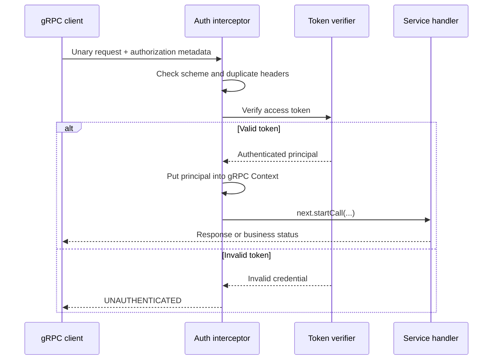

# Auth Interceptor

## 1. Role of the authentication interceptor

In gRPC, a unary request passes through the transport, metadata, and interceptors before reaching the service handler. An **authentication interceptor** verifies the caller's identity at the server boundary and attaches the verified principal to `io.grpc.Context` for use by the handler and downstream components.

With Bearer authentication, the client sends an access token in metadata:

`authorization: Bearer <access-token>`

The interceptor reads the header, validates its structure, passes the token to a verification component, and invokes `next.startCall(...)` only when verification succeeds. If credentials are missing or invalid, the interceptor closes the RPC with `UNAUTHENTICATED`.

Authentication and authorization must be kept distinct:

- **Authentication:** verifies who the caller is—for example, whether the token has a valid signature and belongs to a trusted issuer/audience.
- **Authorization:** checks whether the caller is allowed to invoke the method or act on the resource.

A valid token does not mean the caller is allowed to invoke every RPC. The authentication interceptor can establish the principal; a policy interceptor or handler then checks permissions.



## 2. Defining the principal and token verifier contracts

Do not let the interceptor decode JWTs and decide all policy rules inline. Extract verification behind an interface so you can swap in a JWT verifier, opaque-token introspection, or an identity provider without changing the gRPC flow.

The principal should hold the minimal verified information:

```java
import java.util.Set;

public record AuthenticatedPrincipal(
        String subject,
        String tenantId,
        Set<String> scopes) {

    public AuthenticatedPrincipal {
        scopes = Set.copyOf(scopes);
    }
}
```

Token verification interface:

```java
public interface AccessTokenVerifier {

    AuthenticatedPrincipal verify(String accessToken)
            throws InvalidAccessTokenException,
                   TokenVerifierUnavailableException;
}
```

`InvalidAccessTokenException` represents a token with a bad signature, expiration, wrong issuer/audience, revocation, or missing required claims. `TokenVerifierUnavailableException` represents a verifier or key store that is temporarily unavailable.

For JWTs, the verifier must check the signature against a trusted key, permit only configured algorithms, and verify `iss`, `aud`, `exp`, `nbf`, and required claims. Merely decoding the payload is not authentication. For opaque tokens, the verifier can call an introspection endpoint and cache results according to policy.

`AuthenticatedPrincipal` holds verified data and never contains the raw access token or refresh token. Making the principal immutable prevents one RPC from mutating identity data used by other components.

## 3. Implementing Bearer authentication with ServerInterceptor

In gRPC Java, `ServerInterceptor` runs before the handler. The example below:

- Accepts only a single `authorization` value.
- Checks the `Bearer` scheme and non-empty token.
- Calls the verifier.
- Places the principal into `io.grpc.Context`.
- Terminates the RPC with an appropriate status if authentication fails.

```java
package com.example.orders.grpc;

import io.grpc.Context;
import io.grpc.Contexts;
import io.grpc.Metadata;
import io.grpc.ServerCall;
import io.grpc.ServerCallHandler;
import io.grpc.ServerInterceptor;
import io.grpc.Status;

import java.util.Iterator;

public final class BearerAuthInterceptor implements ServerInterceptor {

    public static final Context.Key<AuthenticatedPrincipal> PRINCIPAL =
            Context.key("authenticated-principal");

    private static final Metadata.Key<String> AUTHORIZATION =
            Metadata.Key.of(
                    "authorization",
                    Metadata.ASCII_STRING_MARSHALLER);

    private final AccessTokenVerifier tokenVerifier;

    public BearerAuthInterceptor(AccessTokenVerifier tokenVerifier) {
        this.tokenVerifier = tokenVerifier;
    }

    @Override
    public <ReqT, RespT> ServerCall.Listener<ReqT> interceptCall(
            ServerCall<ReqT, RespT> call,
            Metadata headers,
            ServerCallHandler<ReqT, RespT> next) {

        Iterable<String> values = headers.getAll(AUTHORIZATION);
        if (values == null) {
            return reject(call, Status.UNAUTHENTICATED
                    .withDescription("Missing access token"));
        }

        Iterator<String> iterator = values.iterator();
        if (!iterator.hasNext()) {
            return reject(call, Status.UNAUTHENTICATED
                    .withDescription("Missing access token"));
        }

        String authorization = iterator.next();
        if (iterator.hasNext()
                || authorization == null
                || !authorization.regionMatches(
                        true, 0, "Bearer ", 0, 7)) {
            return reject(call, Status.UNAUTHENTICATED
                    .withDescription("Invalid authorization metadata"));
        }

        String token = authorization.substring(7).trim();
        if (token.isEmpty()
                || token.chars().anyMatch(Character::isWhitespace)) {
            return reject(call, Status.UNAUTHENTICATED
                    .withDescription("Invalid bearer token"));
        }

        try {
            AuthenticatedPrincipal principal =
                    tokenVerifier.verify(token);

            if (principal == null) {
                return reject(call, Status.UNAUTHENTICATED
                        .withDescription("Invalid access token"));
            }

            Context context = Context.current()
                    .withValue(PRINCIPAL, principal);

            return Contexts.interceptCall(
                    context, call, headers, next);

        } catch (InvalidAccessTokenException invalid) {
            return reject(call, Status.UNAUTHENTICATED
                    .withDescription("Invalid access token"));
        } catch (TokenVerifierUnavailableException unavailable) {
            return reject(call, Status.UNAVAILABLE
                    .withDescription("Credential verification service temporarily unavailable"));
        } catch (RuntimeException unexpected) {
            // Log internal error with correlation ID; never log the token.
            return reject(call, Status.INTERNAL
                    .withDescription("Unable to verify credentials"));
        }
    }

    private static <ReqT, RespT> ServerCall.Listener<ReqT> reject(
            ServerCall<ReqT, RespT> call,
            Status status) {
        call.close(status, new Metadata());
        return new ServerCall.Listener<>() {};
    }
}
```

`AccessTokenVerifier`, `InvalidAccessTokenException`, and `TokenVerifierUnavailableException` are application contracts to implement. The example uses `Status.UNAVAILABLE` when the verifier is down so clients can distinguish infrastructure auth outages from invalid credentials. Never expose internal details or tokens in the status description.

`Contexts.interceptCall(...)` binds the context across server call callbacks and invokes the handler within that context. If authentication fails, the interceptor calls `call.close(...)` and returns an empty listener; `next.startCall(...)` is never called, so the service handler does not execute.

## 4. How is the principal used in the handler?

The handler retrieves the principal from context instead of trusting a user ID, tenant, or role self-reported by the client in protobuf:

```java
AuthenticatedPrincipal principal =
        BearerAuthInterceptor.PRINCIPAL.get();

if (principal == null) {
    observer.onError(Status.UNAUTHENTICATED
            .withDescription("Caller is not authenticated")
            .asRuntimeException());
    return;
}

if (!principal.scopes().contains("orders:read")
        || !authorizationService.canReadOrder(
                principal.subject(),
                principal.tenantId(),
                request.getOrderId())) {
    observer.onError(Status.PERMISSION_DENIED
            .withDescription("Caller does not have permission to read order")
            .asRuntimeException());
    return;
}
```

Here, scopes serve as a method-level condition; `authorizationService` checks ownership, tenant boundaries, and policies for the specific order. Checking only scopes is insufficient when permissions depend on the resource.

Status classification:

| Case | gRPC status |
| --- | --- |
| Missing, invalid, expired, or unverifiable token | `UNAUTHENTICATED` |
| Valid token but missing scope/resource permission | `PERMISSION_DENIED` |
| Verifier or key store temporarily unavailable | `UNAVAILABLE` |
| Unexpected internal error | `INTERNAL` with a sanitized description |

Do not return `PERMISSION_DENIED` for an invalid token just to mask errors; that status indicates the caller is authenticated but unauthorized. Conversely, do not return `UNAUTHENTICATED` for every business error.

## 5. Public methods and secure-by-default policy

Some RPCs may be public, such as health checks or discovery. If authentication needs to be bypassed, use an allowlist by **full method name**, never substring matching or bypassing an entire service by approximate name.

Method names in gRPC Java typically follow `package.Service/Method`. Allowlists must be reviewed alongside the API contract and tested. Require authentication by default; only explicitly declared methods should be exempt.

You can add an initial branch in the interceptor before reading the token:

```java
String method = call.getMethodDescriptor().getFullMethodName();

if (publicMethods.contains(method)) {
    return next.startCall(call, headers);
}
```

`publicMethods` should be an explicitly configured immutable set. Never add methods that read sensitive data to the allowlist just to work around a client forgetting to send credentials.

## 6. Interceptor ordering and responsibility boundaries

The authentication interceptor generally needs to run before interceptors that depend on the principal, such as authorization, caller auditing, or tenant policy. Exact registration/wrapping order depends on the server API and framework; verify it with an integration test rather than assuming from bean creation order.

A pipeline can be organized as follows:

1. Transport TLS verifies peer certificates and protects the connection.
2. Authentication interceptor verifies the Bearer token or extracts identity from mTLS.
3. Authorization interceptor checks method-level permissions.
4. Handler checks permissions on specific data and runs business logic.
5. Logging/metrics record the method, allowed principal ID, and status, without logging credentials.

Do not cram all logic into a single interceptor. Authentication handles credentials and principals; authorization handles policies; handlers understand resources and business rules. This separation allows testing each layer independently and swapping token mechanisms without rewriting authorization logic.

If both mTLS and Bearer tokens are used, define clearly whether the token represents a workload or a user. Certificates typically identify workloads at the connection level; Bearer tokens can identify users/delegated principals at the RPC level. Never silently overwrite one identity with the other. Policy must define how they combine—for instance, accepting a token only when its client/workload claim matches the peer certificate.

## 7. Registering the interceptor in Spring gRPC

In a Spring gRPC application, the interceptor needs to be registered with the framework-managed server. You can manage the verifier and interceptor via dependency injection:

```java
@Configuration
public class GrpcSecurityConfiguration {

    @Bean
    BearerAuthInterceptor bearerAuthInterceptor(
            AccessTokenVerifier tokenVerifier) {
        return new BearerAuthInterceptor(tokenVerifier);
    }
}
```

Defining a Spring bean does not automatically guarantee the interceptor is attached to every service. Register it through the global or service-specific server interceptor mechanism supported by **your project's Spring gRPC/starter version**. When using a gRPC Java server builder directly, the interceptor can be attached via `ServerBuilder.intercept(...)` before starting the server.

Do not create a parallel secondary server if Spring already manages the primary server. Verify the actual integration configuration with a test calling the Spring server over a channel, and check that the handler does not run when the token is missing.

## 8. Avoiding blocking the transport thread during token verification

`ServerInterceptor.interceptCall(...)` is a synchronous point before the handler starts. If the verifier performs blocking HTTP introspection to an identity provider, it can tie up the call-processing thread and degrade RPC throughput.

Mitigation approaches:

- For JWTs, verify signatures locally using cached keys; refresh JWKS on a schedule or when encountering a new key ID with rate limits.
- For opaque tokens, cache introspection results with a short TTL and an explicit invalidation policy.
- Never call `Future.get()`, `join()`, or perform blocking network waits inside the interceptor.
- If a cache miss requires remote async introspection, design an asynchronous authentication hook suited to your server/gateway architecture; do not force a synchronous interceptor API to block waiting for results.
- Configure timeouts, concurrency limits, and circuit breakers for verification dependencies.

Never cache invalid or valid tokens indefinitely. TTLs must account for expiration, revocation, permission changes, and acceptable system staleness.

## 9. Propagating gRPC Context across async tasks

`io.grpc.Context` is bound around callbacks managed by `Contexts.interceptCall(...)`. However, when a handler offloads work to a custom executor, do not assume the context automatically propagates to another thread.

Capture the current context and wrap the task:

```java
Context rpcContext = Context.current();

executor.execute(rpcContext.wrap(() -> {
    AuthenticatedPrincipal principal =
            BearerAuthInterceptor.PRINCIPAL.get();

    orderWorker.process(request, principal);
}));
```

Pass only the minimal principal needed to the task. If a task outlives the RPC, clearly define identity lifetime, cancellation, and audit context; do not hold onto request contexts indefinitely. Never use `ThreadLocal` or mutable singleton fields to store the principal, as concurrent RPCs can mix up identities.

## 10. Testing the Auth interceptor

Use the in-process transport to test metadata, interceptors, context, and statuses without opening TCP ports. Key test cases:

| Scenario | Expected result |
| --- | --- |
| Missing authorization metadata | `UNAUTHENTICATED`; handler does not run. |
| Wrong scheme, empty token, or duplicate headers | `UNAUTHENTICATED`; do not arbitrarily pick one token. |
| Invalid signature/expired/wrong audience token | `UNAUTHENTICATED`. |
| Valid token | Handler reads the expected principal from `Context`. |
| Valid token lacking scope | `PERMISSION_DENIED`. |
| Verifier unavailable | `UNAVAILABLE`; handler does not run. |
| Public method on allowlist | Callable without a token; other methods still require authentication. |
| Two concurrent RPCs with two principals | Each handler receives the right principal for its call. |
| Handler offloads work to an executor | Principal is readable only when context is wrapped/propagated. |

Example in-process fixture:

```java
String serverName = InProcessServerBuilder.generateName();

Server server = InProcessServerBuilder.forName(serverName)
        .directExecutor()
        .intercept(bearerAuthInterceptor)
        .addService(testOrderService)
        .build()
        .start();

ManagedChannel channel = InProcessChannelBuilder.forName(serverName)
        .directExecutor()
        .build();

try {
    OrderQueryServiceGrpc.OrderQueryServiceBlockingStub stub =
            OrderQueryServiceGrpc.newBlockingStub(channel);

    // Invoke RPC with test credentials and assert response/status.
} finally {
    channel.shutdownNow();
    server.shutdownNow();
}
```

`testOrderService` and `bearerAuthInterceptor` are test fixtures. You can use a fake verifier to control valid/invalid tokens and expected principals. Never use production tokens in tests. For TLS or mTLS, add TCP/Netty integration tests because the in-process transport does not perform handshakes.

## 11. Common mistakes

1. **Putting token verification logic in every handler.** Easy to miss a method and duplicate code. Place authentication in a server interceptor.
2. **Decoding JWTs without verifying signatures.** Claims can be forged. Use a verifier that checks signature, issuer, audience, and expiry.
3. **Accepting multiple authorization headers.** Proxies and servers may interpret them differently. Reject duplicate headers.
4. **Calling remote verifiers in a blocking manner.** Can stall RPC processing threads. Use local verification/caching or an async authentication flow.
5. **Storing raw tokens in Context or logs.** Increases secret exposure risk. Put only the minimal principal in context.
6. **Treating authentication as authorization.** An authenticated caller may still lack permission to access an order. Check scopes, tenant, and resources.
7. **Allowing public methods via loose string matching.** May inadvertently bypass protection on other RPCs. Use a full-method-name allowlist.
8. **Failing to propagate Context across thread switches.** Async tasks lose the principal or read a stale ThreadLocal. Use `Context.wrap(...)`.
9. **Creating an interceptor bean but forgetting to register it with the server.** RPCs run unauthenticated. Test through the actual integrated server/channel.
10. **Returning the same status for every failure.** Clients cannot distinguish bad credentials, missing permissions, and verifier outages. Map statuses to the proper error class.

## 12. Practice exercise

Protect unary `GetOrder` with a Bearer authentication interceptor:

1. Create an `AccessTokenVerifier` that validates JWTs by issuer, audience, signature, and expiry.
2. Implement `BearerAuthInterceptor`, rejecting missing headers, wrong schemes, and duplicate headers.
3. Store an immutable `AuthenticatedPrincipal` in `io.grpc.Context`.
4. Register the interceptor in the Spring gRPC server using the extension point for your version.
5. Add authorization for the `orders:read` scope, tenant, and permissions on the order ID.
6. Write in-process tests for missing token, invalid token, valid token, missing scope, verifier unavailable, and two concurrent callers.
7. Add tests for the public-method allowlist and executor tasks with context propagation.
8. Verify logs, exceptions, and status descriptions contain no raw tokens or secrets.

**Self-check:** An auth interceptor verifies credentials before invoking the handler and places the verified principal into `io.grpc.Context`. The handler or an authorization interceptor checks permissions by method, tenant, and resource. Use `UNAUTHENTICATED` for identity errors, `PERMISSION_DENIED` for missing permissions, and avoid blocking token introspection on RPC processing threads. Register the interceptor explicitly in Spring gRPC and test both status mapping and principal isolation across calls.
