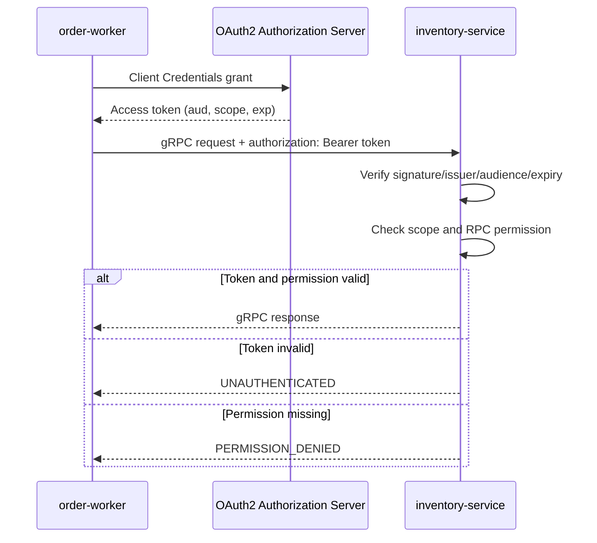

# Service Account Authentication for Spring gRPC

In a **SPRING_GRPC** system, a service account is a machine identity representing an application or workload when calling another service. For example, `order-worker` needs to call `inventory-service` to read stock levels. Instead of using an end-user's account, the client obtains an access token for the service account's own identity, sends the token with each RPC, and lets the server verify the identity and granted permissions.

A secure deployment requires all three parts: **issuing a token for the workload**, **sending the token via gRPC metadata**, and **authenticating/authorizing on the server**. With Spring, you can use OAuth2 Client on the calling side and OAuth2 Resource Server combined with Spring gRPC Security on the receiving side. This lesson focuses on the service-to-service model using OAuth2 Client Credentials; platforms using workload identity or service account assertions can swap the token source while preserving the same server-side verification principles.

## 1. A service account is a workload identity

A service account is a principal that does not represent a human user. It is usually bound to a specific application, job, pod, VM, or workload.

| Component | Identity | Required permissions |
| --- | --- | --- |
| `order-worker` | `orders-writer` | Invoke `CreateOrder` and read inventory |
| `inventory-service` | `inventory-api` | Accept requests from authorized workloads |
| `billing-worker` | `billing-reader` | Only call read-only billing APIs |

Distinguish clearly:

- **Authentication:** verifying which service account the caller actually is.
- **Authorization:** deciding which methods that service account can invoke and which resources it can act on.
- **Transport security:** encrypting the connection and optionally authenticating both endpoints' certificates via TLS/mTLS.

A valid token only proves the identity/claims asserted by the issuer. It does not automatically grant permission to call every RPC.

## 2. Service-to-service authentication flow

With OAuth2 Client Credentials, the client uses the workload's registration credentials to obtain an access token from the authorization server. The gRPC client then sends the token in the `authorization` metadata as a Bearer token.



Tokens should have short lifetimes, an audience specific to the target API, and minimal scopes. Clients must fetch a new token when the old one expires; never hardcode static tokens in source code or keep long-lived tokens in configuration.

## 3. Configuring OAuth2 Client for a service account

In Spring Boot, declare a client registration using the `client_credentials` grant type. Example:

```yaml
spring:
  security:
    oauth2:
      client:
        registration:
          inventory-service:
            provider: company-idp
            client-id: ${INVENTORY_CLIENT_ID}
            client-secret: ${INVENTORY_CLIENT_SECRET}
            authorization-grant-type: client_credentials
            scope:
              - stock.read
        provider:
          company-idp:
            token-uri: ${OAUTH_TOKEN_URI}

  grpc:
    client:
      channel:
        inventory:
          target: static://inventory.internal:9090
          ssl:
            enabled: true
```

In this example:

- `inventory-service` is the registration ID in Spring configuration.
- `client-id` identifies the workload at the authorization server.
- `client-secret` is the credential the client uses to prove its identity when requesting a token; load it from a secret manager or workload identity integration.
- `stock.read` is the scope requested by the client.
- The `inventory` channel points to the gRPC server and uses TLS.

Some authorization servers require additional audience/resource parameters or use a JWT client assertion instead of a client secret. Configure the token request according to your provider's specification. Do not assume declaring a scope alone guarantees the token carries the right audience.

### 3.1. Required dependencies

With Spring Boot gRPC, clients and servers use their respective starters; OAuth2 client and resource server are two separate dependency roles:

| Application | Primary dependencies |
| --- | --- |
| Service calling RPCs | `spring-boot-starter-grpc-client` and `spring-boot-starter-oauth2-client` |
| Service receiving RPCs | `spring-boot-starter-grpc-server` and `spring-boot-starter-oauth2-resource-server` |

If the project manages dependencies with the Spring Boot BOM, let the BOM select compatible versions. Do not manually mix disparate Spring Security/Spring gRPC versions.

### 3.2. Managing workload credentials

Prioritize according to your platform's capabilities:

1. Workload identity or federation so the workload receives its identity from the runtime environment.
2. Managed identity/metadata service or official cloud provider SDK to obtain short-lived tokens.
3. Client secrets stored in a secret manager with automated rotation.
4. Static private keys/service account keys only when the platform lacks safer options, paired with access controls, rotation, and revocation.

Never commit client secrets, private keys, service account JSON files, or access tokens to Git, Docker images, logs, or shared configuration files. Do not share the same service account across all workloads; separate identities to limit blast radius if a credential is compromised.

## 4. Attaching the Bearer token to the gRPC client

Spring gRPC provides `BearerTokenAuthenticationInterceptor` to attach a Bearer token to each RPC's metadata. It can be paired with Spring Security's `OAuth2AuthorizedClientManager` to retrieve and manage access tokens per client registration.

Example manager configuration for a background application without a user login session:

```java
@Configuration
class ServiceAccountOAuth2Configuration {

    @Bean
    OAuth2AuthorizedClientManager authorizedClientManager(
            ClientRegistrationRepository registrations,
            OAuth2AuthorizedClientService authorizedClients) {

        var manager = new AuthorizedClientServiceOAuth2AuthorizedClientManager(
                registrations, authorizedClients);

        manager.setAuthorizedClientProvider(
                OAuth2AuthorizedClientProviderBuilder.builder()
                        .clientCredentials()
                        .build());

        return manager;
    }
}
```

Create a provider using the registration ID and a fixed principal name for the workload:

```java
@Component
class ServiceAccountTokenProvider {

    private final OAuth2AuthorizedClientManager manager;

    ServiceAccountTokenProvider(OAuth2AuthorizedClientManager manager) {
        this.manager = manager;
    }

    String accessToken() {
        OAuth2AuthorizeRequest request = OAuth2AuthorizeRequest
                .withClientRegistrationId("inventory-service")
                .principal("order-worker")
                .build();

        OAuth2AuthorizedClient client = manager.authorize(request);
        if (client == null) {
            throw new IllegalStateException(
                    "Cannot obtain service account access token");
        }

        return client.getAccessToken().getTokenValue();
    }
}
```

`AuthorizedClientServiceOAuth2AuthorizedClientManager` persists authorized clients via `OAuth2AuthorizedClientService`, and the `clientCredentials()` provider can re-issue tokens when needed. The principal name here is the workload identifier in the authorized client store; it is neither a password nor a user login.

Create the stub for the protected channel:

```java
@Configuration
class InventoryGrpcClientConfiguration {

    @Bean
    StockServiceGrpc.StockServiceBlockingStub stockStub(
            GrpcChannelFactory channels,
            ServiceAccountTokenProvider tokens) {

        var auth = new BearerTokenAuthenticationInterceptor(
                tokens::accessToken);

        var options = ChannelBuilderOptions.defaults()
                .withInterceptors(List.of(auth));

        return StockServiceGrpc.newBlockingStub(
                channels.createChannel("inventory", options));
    }
}
```

This attaches the interceptor to the channel created with the corresponding options. Using `@GlobalClientInterceptor` adds the token to every matching channel; use the global approach only when all destinations accept the same service identity. With multiple service accounts or audiences, create separate interceptors/channels per destination.

The token supplier may need to call the token endpoint when the cache is empty or the token has expired. If token acquisition is synchronous, consider warm-up, timeouts, and error handling so you avoid unexpected RPC latency on the first call or during refresh.

## 5. Verifying tokens on the gRPC server

The server must never trust a token just because the client sent the header. It must verify the signature or introspect the token with the authorization server, checking the issuer, audience, expiration, and required claims.

For JWTs, configure OAuth2 Resource Server with the issuer URI:

```yaml
spring:
  security:
    oauth2:
      resourceserver:
        jwt:
          issuer-uri: ${OAUTH_ISSUER_URI}
```

Spring Security can discover the issuer's metadata/JWKs to verify signatures and time/issuer claims as configured. For opaque tokens, use an introspection endpoint with dedicated resource server credentials. Never attempt to decode an opaque token as a JWT.

### 5.1. Protecting RPCs with Spring gRPC Security

When the corresponding OAuth2 Resource Server dependency is present, Spring gRPC supports configuring `GrpcSecurity` and registering a global `AuthenticationProcessInterceptor`:

```java
@Configuration
class GrpcServiceSecurityConfiguration {

    @Bean
    @GlobalServerInterceptor
    AuthenticationProcessInterceptor grpcAuthentication(
            GrpcSecurity grpc) throws Exception {

        return grpc
                .authorizeRequests(requests -> requests
                        .methods(
                                "learning.stock.v1.StockService/GetStock")
                        .hasAuthority("SCOPE_stock.read")
                        .methods(
                                "learning.stock.v1.StockService/WatchStock")
                        .hasAuthority("SCOPE_stock.read")
                        .allRequests()
                        .denyAll())
                .oauth2ResourceServer(oauth2 ->
                        oauth2.jwt(Customizer.withDefaults()))
                .build();
    }
}
```

Method names in the rules must match the full gRPC service/method names generated from the contract. `SCOPE_stock.read` is the authority Spring Security typically maps from the JWT `stock.read` scope. If the authorization server uses custom claims such as `roles` or `permissions`, configure a converter to map those claims to appropriate authorities.

`allRequests().denyAll()` establishes deny-by-default. Only permit public RPCs or health/reflection endpoints intentionally. You can use `@PreAuthorize` on service methods to express authorization close to business logic; avoid creating two conflicting rule sets.

## 6. Verifying identity, audience, and scope

For service accounts, the server should clearly determine which workload a token represents. Claims typically inspected:

| Claim | Purpose |
| --- | --- |
| `iss` | Issuer that issued the token |
| `sub` or `client_id` | Principal/service account |
| `aud` | API or resource server permitted to accept the token |
| `exp`, `nbf` | Expiration time and not-before validity start time |
| `scope` or `scp` | Permissions granted to the client |
| Tenant/project claim | Resource partitioning if the system has a tenant model |

Issuer validation does not imply audience validation. Ensure the token was issued for the right gRPC API; if the IdP does not validate audience on behalf of the resource server, add an `aud` validator or configure introspection accordingly.

An example permission mapping:

| Service account | Scope | RPC |
| --- | --- | --- |
| `orders-writer` | `stock.read` | `GetStock` |
| `orders-writer` | `stock.reserve` | `ReserveStock` |
| `report-reader` | `stock.read` | `GetStock` |
| `report-reader` | Lacks `stock.reserve` | Denied `ReserveStock` |

Do not grant a broad scope like `admin` to every workload if it only needs read access to a few RPCs. Permissions should be tied to specific actions and enforced on the server.

## 7. How service account authentication differs from TLS/mTLS

| Mechanism | What does it verify? | Scope |
| --- | --- | --- |
| TLS server authentication | The client is connecting to the right server with a valid certificate | Connection |
| mTLS | Both client and server hold trusted certificates | Connection |
| OAuth2 Bearer token | Principal and claims confirmed by the issuer | Per RPC |
| Scope/role-based authorization | Which methods the principal is allowed to invoke | Per RPC/business logic |

TLS protects the token from being read or tampered with in transit. The Bearer token identifies the service account and its granted permissions. mTLS can add a connection-layer identity; it does not replace scope authorization if the application needs method-level permissions.

Never send Bearer tokens over a plaintext channel on an untrusted network. Also never treat a valid client certificate as permission to access the entire service.

## 8. Handling authentication and authorization errors

Distinguishing authentication errors from authorization errors helps clients and operations respond properly:

| Case | Typical gRPC status | Meaning |
| --- | --- | --- |
| No token sent | `UNAUTHENTICATED` | No verified identity |
| Invalid signature, issuer, audience, or expired token | `UNAUTHENTICATED` | Invalid credentials |
| Valid token but missing scope | `PERMISSION_DENIED` | Authenticated but unauthorized |
| Valid token calling a disallowed method | `PERMISSION_DENIED` | Policy rejects the RPC |

Clients should not retry indefinitely when receiving `UNAUTHENTICATED` or `PERMISSION_DENIED`. When a token expires, the token provider needs to acquire a new token via OAuth2 client credentials; only perform bounded retries if the failure is genuinely recoverable and the RPC operation is safe to repeat.

Never return internal details such as JWKs, client secrets, tokens, or cryptographic verification causes in responses. Log error codes, methods, normalized issuer/principal, and correlation IDs per policy; never log raw Authorization metadata.

## 9. Testing service account authentication

An integration test suite should cover both allowed and rejected cases:

1. Token issued by trusted issuer, matching audience, and containing `stock.read`: `GetStock` succeeds.
2. Missing Authorization metadata: server returns `UNAUTHENTICATED`.
3. Expired token, invalid signature, or wrong issuer: server returns `UNAUTHENTICATED`.
4. Valid token missing `stock.reserve`: `ReserveStock` returns `PERMISSION_DENIED`.
5. Token with another API's audience: server rejects it.
6. Token nearing expiration: client provider acquires a fresh token and RPCs continue succeeding.
7. Untrusted TLS certificate: handshake fails before the request reaches the auth interceptor.

You can test manually with grpcurl when reflection is enabled on the server:

```bash
grpcurl \
  -cacert server-ca.pem \
  -H "Authorization: Bearer ${ACCESS_TOKEN}" \
  -d '{"sku":"BOOK-101"}' \
  inventory.internal:9090 \
  learning.stock.v1.StockService/GetStock
```

Never put real tokens into documentation, shell history, or CI logs. In automated tests, use a mock issuer/test keys and short-lived tokens; assert the exact gRPC status code rather than merely checking that the client threw an exception.

An in-process test can verify interceptors and authorization logic, yet it does not verify the TLS handshake. To test TLS combined with service account tokens, run a real network server in tests or an integration environment.

## 10. Operations and credential rotation

- Use a dedicated service account per workload or group of workloads sharing identical permissions.
- Grant minimal scopes and audiences per API.
- Prefer workload identity/federation and short-lived tokens over long-lived private keys.
- If using client secrets, store them in a secret manager, restrict read permissions, and schedule rotations.
- Monitor token acquisition failures, `UNAUTHENTICATED`/`PERMISSION_DENIED` rates, and token endpoint latency.
- Never cache tokens past `exp`; refresh ahead of expiration with a reasonable buffer.
- When a credential is compromised, revoke or disable the principal, issue new credentials, and audit access logs.
- Ensure TLS is enabled on production channels and servers verify CA/hostname properly.

## 11. Practice exercise

1. Create an OAuth2 client registration `inventory-service` using the `client_credentials` grant type.
2. Configure the Spring gRPC `inventory` channel pointing to a TLS server.
3. Use `OAuth2AuthorizedClientManager` to acquire tokens for the service account principal.
4. Attach `BearerTokenAuthenticationInterceptor` to the right channel and invoke the generated blocking stub.
5. Configure the server's OAuth2 Resource Server with an appropriate issuer URI and audience.
6. Use `GrpcSecurity` so only `SCOPE_stock.read` is allowed to invoke `GetStock`.
7. Call with a token missing the scope and verify `PERMISSION_DENIED`.
8. Test a token with the wrong issuer/audience or expired token and verify `UNAUTHENTICATED`.
9. Verify token refresh after the access token expires.
10. Add a real TLS integration test and record the results for each authentication/authorization layer.

### Key takeaway

**Service account authentication verifies workload identity for each service-to-service call.** The client uses OAuth2 Client Credentials or the platform's workload identity mechanism to obtain short-lived access tokens; Spring gRPC attaches the token via a Bearer interceptor; the server verifies issuer, signature, audience, and expiration, then checks scope/authority for each RPC. Combine this with TLS, secret management, token refresh, and tests covering both valid and rejected cases to protect service-to-service communication.

## References

- [Spring gRPC — Client Security and OAuth2 Clients](https://docs.spring.io/spring-grpc/reference/client.html)
- [Spring gRPC — Server Security](https://docs.spring.io/spring-grpc/reference/server.html)
- [Spring Boot — gRPC and OAuth2 Resource Server](https://docs.spring.io/spring-boot/reference/io/grpc.html)
- [Spring gRPC API — BearerTokenAuthenticationInterceptor](https://docs.spring.io/spring-grpc/reference/api/java/org/springframework/grpc/client/interceptor/security/BearerTokenAuthenticationInterceptor.html)
- [Spring gRPC API — ClientCredentialsTokenSupplier](https://docs.spring.io/spring-grpc/reference/api/java/org/springframework/grpc/client/interceptor/security/ClientCredentialsTokenSupplier.html)
- [gRPC — Authentication](https://grpc.io/docs/guides/auth/)
