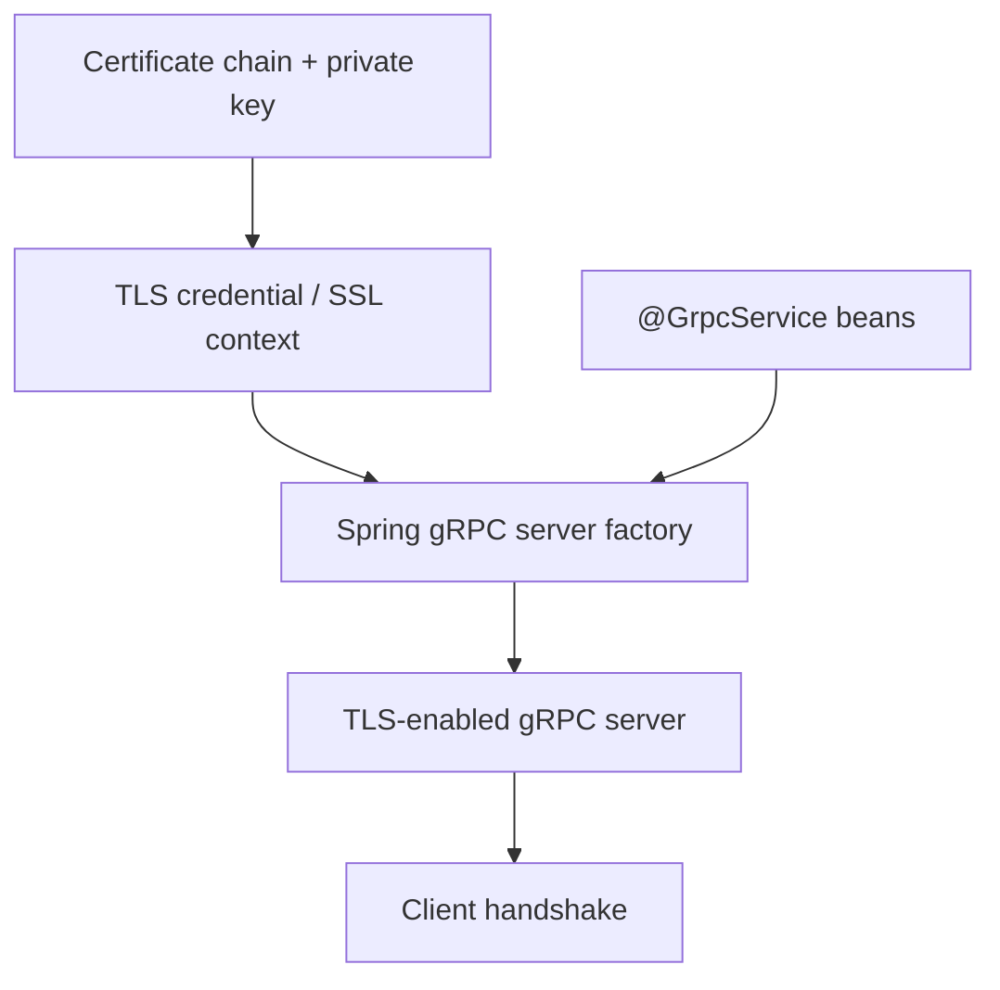

# Creating Server Credentials from Certificates

## Lesson Objectives

In **SPRING_GRPC**, TLS protects the connection between client and server, authenticates the server's identity, and encrypts data transmitted over HTTP/2. To enable TLS on the server side, the application needs a **certificate chain** proving the server's identity and the corresponding **private key**. These two components are used to create the server credentials that the gRPC transport uses during the TLS handshake.

This lesson focuses on creating credentials from certificates: preparing the PEM certificate chain and private key, verifying that they match, creating credentials with gRPC Java, properly integrating with a Spring gRPC-managed server, distinguishing one-way TLS from mutual TLS (mTLS), and verifying the handshake from the client.

After this lesson, you will be able to:

1. Distinguish between a certificate, certificate chain, private key, and trust anchor.
2. Prepare a certificate with a SAN matching the hostname the client uses.
3. Verify the validity period, chain, usage purpose, and correspondence between a certificate and a private key.
4. Create server TLS credentials from a certificate chain and private key using gRPC Java.
5. Configure a Spring gRPC server to use credentials according to the extension point of the running version.
6. Enable client certificate verification when mTLS is needed.
7. Test handshakes, diagnose errors, and operate certificates securely.

> **Scope:** Examples use official gRPC Java and Spring gRPC. Specific credential APIs depend on the gRPC Java version and server factory. The standalone examples below illustrate gRPC Java; when Spring manages the server, configure credentials through the SSL/server factory mechanism supported by the Spring gRPC version.

## 1. What Do Server Credentials Consist Of?

When a client connects to a TLS endpoint, the server must prove it owns the identity corresponding to the hostname. The server sends its certificate chain during the handshake and proves ownership of the private key through TLS cryptographic operations.

| Component | Role | Can Be Public? |
| --- | --- | --- |
| **Server certificate** | Contains public key, subject, SAN, issuer, validity period, and CA signature | Can be sent to clients |
| **Intermediate certificate(s)** | Links the server certificate to the root CA trusted by the client | Can be sent in the chain |
| **Private key** | Proves the server owns the public key in the certificate | **No**; must be protected as a secret |
| **Root CA certificate** | Trust anchor for the client to verify the chain | Usually distributed to clients via a trust store |
| **Client CA certificate** | Used on the server to verify client certificates when mTLS is enabled | Can be public, but must be managed as trust configuration |

**Server credentials are not just a certificate file.** Without a private key matching the certificate's public key, the server cannot complete the TLS handshake. Without the required intermediate certificates, the client may not be able to build a chain to a root CA it trusts.

TLS server authentication and client authentication are two different directions of verification:

- In standard one-way TLS, the server presents a certificate; the client verifies the server certificate.
- In mTLS, the client also presents a certificate; the server verifies the client certificate using trust roots dedicated to clients.

## 2. Preparing the Certificate Chain and Private Key

Suppose the server has the DNS name `grpc.example.com`. The deployment file set may include:

```text
certs/
├── server-chain.pem
├── server-key.pem
└── client-ca.pem       # Only needed when verifying client certificates (mTLS)
```

### 2.1. The Certificate Must Represent the Correct Hostname

The server certificate needs a Subject Alternative Name (SAN) matching the name the client uses to connect:

- If the client connects to `grpc.example.com`, the certificate needs the DNS SAN `DNS:grpc.example.com`.
- If the client connects by IP literal, the certificate needs the corresponding IP SAN.
- Do not rely on Common Name (CN) as a modern replacement for SAN.
- The name in SAN must match the hostname verified by the client; SNI can be sent by the client so the server selects the appropriate certificate when hosting multiple hostnames.

The certificate must also be within its validity period, signed by a CA trusted by the client, have an appropriate usage purpose for server authentication (EKU `serverAuth` if EKU is declared), and use an algorithm/key supported by the TLS provider.

### 2.2. Certificate Chain Contents

`server-chain.pem` usually contains the server (leaf) certificate first, followed by intermediate certificates in order leading up to the root CA:

```text
-----BEGIN CERTIFICATE-----
(server leaf certificate)
-----END CERTIFICATE-----
-----BEGIN CERTIFICATE-----
(intermediate CA certificate)
-----END CERTIFICATE-----
```

The root CA is typically already in the client's trust store, so it does not need to be sent again in the chain. The exact structure depends on the CA and client trust configuration. Do not put the private key into the chain file.

### 2.3. The Private Key Must Match the Leaf Certificate

`server-key.pem` contains the server's private key. The file must be in a PEM format supported by the TLS provider/transport in use; a common example is PKCS#8. Some providers support additional formats, but you should not assume every version can read every key type or passphrase-encrypted keys.

Inspect the certificate and key before configuring the server:

```bash
openssl x509 -in certs/server-chain.pem -noout \
  -subject -issuer -dates -ext subjectAltName

openssl x509 -in certs/server-chain.pem -pubkey -noout \
  | openssl pkey -pubin -outform DER \
  | openssl dgst -sha256

openssl pkey -in certs/server-key.pem -pubout -outform DER \
  | openssl dgst -sha256
```

The two public key digests in the last two commands must be identical. If they are not, the certificate and private key are not a matching pair.

Verify the chain against the corresponding root CA and intermediate:

```bash
openssl verify \
  -CAfile certs/root-ca.pem \
  -untrusted certs/intermediate-ca.pem \
  certs/server-chain.pem
```

A successful result looks like `server-chain.pem: OK`. This command only checks the chain against the provided CA files; it does not replace checking the hostname, EKU, TLS configuration, or a real handshake from a client.

## 3. Creating Server TLS Credentials with gRPC Java

gRPC Java provides credential APIs to describe the server's TLS identity and policy. For a server that only authenticates its own identity, the credentials require a certificate chain and a private key:

```java
import io.grpc.Grpc;
import io.grpc.Server;
import io.grpc.ServerCredentials;
import io.grpc.TlsServerCredentials;

import java.io.ByteArrayInputStream;
import java.nio.file.Files;
import java.nio.file.Path;

byte[] certificateChain =
        Files.readAllBytes(Path.of("certs/server-chain.pem"));
byte[] privateKey =
        Files.readAllBytes(Path.of("certs/server-key.pem"));

ServerCredentials credentials = TlsServerCredentials.newBuilder()
        .keyManager(
                new ByteArrayInputStream(certificateChain),
                new ByteArrayInputStream(privateKey))
        .build();

Server server = Grpc.newServerBuilderForPort(9090, credentials)
        .addService(new InventoryGrpcEndpoint())
        .build()
        .start();
```

In this example:

1. Read the PEM certificate chain and private key from a protected configuration source.
2. `keyManager(...)` supplies the certificate/key pair to the TLS server credentials.
3. `Grpc.newServerBuilderForPort(...)` creates a server builder using those credentials.
4. The service is bound to the server and the server starts listening with TLS.

This is the gRPC Java API; specific imports and overloads must match the project's dependency version. For deployment files or secret providers, use the file/stream-reading API supported by your version instead of holding byte arrays manually when appropriate. Do not write private key contents to logs or exception messages.

### 3.1. Shorter Approach with ServerBuilder

gRPC Java also has a convenience API for file-based certificate chains and private keys:

```java
Server server = ServerBuilder.forPort(9090)
        .useTransportSecurity(
                new File("certs/server-chain.pem"),
                new File("certs/server-key.pem"))
        .addService(new InventoryGrpcEndpoint())
        .build()
        .start();
```

This approach suits server builders that support `useTransportSecurity(File, File)`. When you need a trust manager, client certificate authentication, or more detailed TLS policies, use the credential API appropriate for your gRPC Java version and transport.

The two examples above are two ways of configuring a gRPC Java server. Do not apply both simultaneously to the same server.

## 4. Integrating Credentials into a Spring gRPC-Managed Server

In Spring gRPC, endpoints are typically discovered by Spring via `@GrpcService`, and the server factory manages service binding and starting/stopping the transport. When enabling TLS, you need to configure the **Spring-managed server instance** to use the certificate chain and private key.



Integration principles:

- Use the SSL configuration or server factory customization supported by the documentation of the **exact Spring gRPC version**.
- Configure the certificate chain and private key on the server side; do not configure a client trust file as if it were the server identity.
- Let Spring gRPC manage the server lifecycle and service registration. Do not create a separate standalone server just to enable TLS if the application already has a starter-managed server.
- Keep file paths or secret references outside source code; ensure the process has read access while unnecessary users/groups cannot read the private key.
- If using a custom server factory, ensure `@GrpcService` beans are still bound to the server configured with the credentials.

Do not copy an SSL property name from another version or starter without checking the corresponding documentation. Different gRPC starters may use different packages, properties, and server factories. Verify that the configuration in use is actually applied to the listener that clients connect to.

### 4.1. Credentials and Service Registration Are Separate Concerns

Credentials protect the transport; they do not define RPC services. `@GrpcService` beans still provide service definitions such as Inventory or Pricing. A server can serve multiple services over the same TLS listener if all of them are bound to that server instance.

If an application has multiple servers/listeners, each listener may need its own credentials. Do not assume that configuring a certificate for one server automatically secures another server or an HTTP management port.

## 5. Verifying the Server Certificate from the Client Side

The client must trust the CA that signed the server certificate and connect using a hostname matching the SAN. In production, clients use appropriate TLS credentials/trust configuration; do not disable hostname verification to work around certificate errors.

Example of checking TLS with OpenSSL:

```bash
openssl s_client \
  -connect grpc.example.com:9090 \
  -servername grpc.example.com \
  -alpn h2 \
  -CAfile certs/root-ca.pem \
  -verify_return_error \
  -showcerts
```

Points to check:

- The server sends the right leaf certificate and intermediate chain.
- The hostname sent via SNI is the expected hostname.
- ALPN negotiates `h2` for gRPC over HTTP/2.
- The certificate chain is verified up to the root CA.
- The certificate is still valid and the SAN matches the hostname.

You can invoke RPCs using grpcurl if the server enables reflection or the client provides a proto descriptor:

```bash
grpcurl -cacert certs/root-ca.pem \
  grpc.example.com:9090 list
```

If the server does not enable reflection, use `-proto`/`-import-path` or a descriptor set to call methods. In development environments using a self-signed CA, the client needs to trust the right CA; do not use insecure mode as a production solution.

## 6. Enabling Mutual TLS When Client Authentication Is Needed

One-way TLS authenticates the server to the client. If the server needs to authenticate the client's identity at the TLS layer, enable mTLS. The server then also has a trust manager containing the CA authorized to issue client certificates and requires the client to present a certificate.

Example with the gRPC Java credential API:

```java
TlsServerCredentials credentials = TlsServerCredentials.newBuilder()
        .keyManager(
                new ByteArrayInputStream(serverCertificateChain),
                new ByteArrayInputStream(serverPrivateKey))
        .trustManager(new ByteArrayInputStream(clientCaCertificates))
        .clientAuth(TlsServerCredentials.ClientAuth.REQUIRE)
        .build();
```

Enum names and builder APIs must match the gRPC Java version in use. Meaning of the configuration:

- `keyManager` provides the server's identity.
- `trustManager` provides trust roots for the server to verify client certificates.
- `ClientAuth.REQUIRE` requires the client to send a valid certificate during the handshake.

If you only need TLS server authentication, do not accidentally enable the client certificate requirement. If you enable mTLS without configuring the trust manager properly, clients without a certificate or with a certificate not issued by a trusted CA will fail to connect.

### 6.1. mTLS Does Not Replace Authorization

A client certificate proves identity at the transport layer, but the application still needs to map the certificate identity to a principal/tenant/role and check permissions on each RPC. A valid certificate does not mean the client is allowed to call every service or access every resource.

You can combine mTLS with a gRPC interceptor to read the SSL session/peer identity according to the API supported by the transport, build a caller identity, and apply an authorization policy. Do not parse the subject string by arbitrarily splitting text; use verified certificate information and well-defined identity mapping rules.

## 7. Distinguishing TLS Error Types

| Symptom | Possible Cause | How to Check |
| --- | --- | --- |
| Server fails to start | File does not exist, no read permission, malformed PEM, or private key cannot be parsed | Check path, file permissions, and PEM format |
| Key/certificate mismatch | Private key does not match the public key in the leaf certificate | Compare public key digests |
| Client reports unknown CA | Client does not trust the root CA or server is missing an intermediate | Check trust store and the chain sent by the server |
| Hostname verification failed | SAN does not contain the hostname used by the client | Check SAN and the actual authority/hostname |
| Certificate expired/not yet valid | Certificate validity period or system clock is wrong | Check notBefore/notAfter and clock sync |
| Handshake protocol/ALPN error | Incompatible TLS version/cipher/ALPN or client is not using HTTP/2 | Check TLS config and ALPN `h2` |
| mTLS handshake failed | Client did not send a certificate or server does not trust the client's CA | Check client cert, client CA bundle, and clientAuth policy |
| TLS connection succeeds but RPC returns UNIMPLEMENTED | Transport works, but method/service is not bound or path is wrong | Check full service name, method, and service registration |

Do not use `-insecure`, disable certificate verification, or skip hostname checks to hide trust errors. Identify the root cause and fix the certificate, trust bundle, DNS, or transport configuration.

## 8. Protecting Private Keys and Operating Certificates

The private key is the most sensitive asset in the credentials. Certificates can be sent to any client; private keys must not be committed to Git, baked into public images, written to logs, or stored in directories with broad read permissions.

Operational practices:

- Store private keys in a secret manager, KMS/HSM, or a protected secret mount appropriate for the environment.
- Restrict file permissions to the user running the server; do not grant read permissions to unnecessary groups/users.
- Separate certificates/keys by environment and hostname; do not reuse the same private key across all applications.
- Monitor expiration dates and alert before certificates expire.
- Establish a certificate rotation procedure: issue the new cert, deploy the new chain/key, verify the handshake, then revoke or retire the old cert according to policy.
- When rotating, understand how the TLS provider/server factory reloads material. Some configurations only read certificates at server startup; in that case, perform a controlled restart/reload.
- Keep server clocks synchronized; incorrect time can cause a valid certificate to be treated as not yet valid or already expired.

Do not put private keys as plain text in application properties or environment variables if the deployment mechanism can provide a safer secret file/reference. Do not print objects/exceptions containing key material when debugging.

## 9. Testing Server Credentials

A meaningful TLS test must verify both the certificate and the RPC, not merely that the server process started.

### 9.1. Checking Files and Key Pairs Before Startup

In the deployment pipeline or certificate verification step, verify:

1. The certificate can be parsed.
2. The private key can be parsed.
3. The public key digest matches between the certificate and the private key.
4. The certificate chain verifies against the expected CA.
5. The SAN matches the DNS/IP used by clients.
6. The certificate validity period is valid and EKU is appropriate.

The OpenSSL commands above are useful for this pre-startup verification step.

### 9.2. Integration Testing Over TLS

Start the test Spring gRPC server with a test certificate generated by a test fixture or securely managed test certificate. Create a client channel that trusts the test CA, connect using a hostname matching the SAN, and call an RPC via the generated stub.

Tests should verify:

- A client trusting the right CA succeeds in the handshake and RPC.
- A client not trusting the CA fails the handshake.
- A hostname not matching the SAN causes the client to reject the certificate.
- If mTLS is enabled, a client without a certificate is rejected.
- A client certificate issued by a trusted CA connects successfully; a certificate outside the trust chain is rejected.

Do not use production certificates/private keys in unit tests or repositories. Use dedicated test fixtures with minimal validity and privileges.

### 9.3. Operational Verification After Rotation

After replacing a certificate, test a new connection with a client trusting the right CA, check that the server is presenting the new certificate, and monitor for handshake failures/UNAVAILABLE. If the server only loads certificates at startup, perform a rolling restart or reload using the supported mechanism; do not assume replacing the file automatically updates the TLS context.

## 10. Common Mistakes

| Design/Operational Mistake | Consequence | Resolution |
| --- | --- | --- |
| Providing only a certificate without a private key | Server cannot prove ownership of the public key | Provide the matching certificate/key pair |
| Mistakenly using the client CA as the server certificate | Server presents an identity with the wrong purpose or invalid chain | Use a certificate with SAN/EKU suitable for server authentication |
| Certificate lacks a matching SAN | Client fails hostname verification | Issue a certificate with the exact DNS/IP SAN |
| Missing intermediate certificate | Some clients cannot build the chain | Provide the leaf together with the intermediate chain in order |
| Sending the root CA in the chain while missing the intermediate | Does not fix the trust path | Distribute the proper intermediate; the root is the client-side trust anchor |
| Storing the private key in source/image | Credential leakage, hard to rotate | Use a secret manager/secret mount and minimal file permissions |
| Creating a manual server alongside the Spring server | Two listeners or split service registration | Configure credentials on the Spring-managed server factory |
| Disabling certificate verification for testing | Hides trust/hostname errors and creates dangerous habits | Use a test CA and proper trust configuration |
| Enabling mTLS without client trust roots | Client handshakes are rejected | Deliberately configure the trust manager and clientAuth |
| Testing only server startup | Does not prove clients can verify the cert or call RPCs | Run TLS integration tests with a real trust bundle and hostname |
| Replacing cert files without reloading the TLS context | Server keeps using the old certificate | Perform reload/restart according to the server factory's capabilities |

## 11. Hands-on Exercises

1. Create a test CA, issue a server certificate with SAN `DNS:localhost` or a dedicated test hostname, and generate the corresponding private key.
2. Use OpenSSL to inspect the subject, issuer, validity, SAN, chain, and public key digest; explain each result.
3. Create `TlsServerCredentials` from the certificate chain/private key and start a test gRPC server.
4. Integrate credentials into the Spring gRPC server factory for your project's version; verify `@GrpcService` beans remain bound to the TLS listener.
5. Call an RPC using a client that trusts the test CA; test a client that does not trust the CA and a hostname not matching the SAN.
6. Enable mTLS with a separate client CA. Test a client without a certificate, an untrusted client certificate, and a valid client certificate.
7. Replace the certificate with a new pair and establish a rotation/restart procedure with handshake verification.
8. Write a deployment checklist: secret location, file permissions, expiry alert, trust bundle, SAN, TLS version, ALPN `h2`, and rollback when rotation fails.

### Self-Check Questions

- Why do server credentials need both a certificate chain and a private key?
- What roles do the leaf certificate and intermediate certificate play in the chain?
- Why is SAN more important than checking CN alone?
- Which trust store does the client use to verify the server certificate?
- How does `keyManager` differ from `trustManager` on the server side?
- When is `ClientAuth.REQUIRE` needed?
- Why does mTLS not replace application-layer authorization?
- Why is `usePlaintext()` unsuitable for production?
- How do you verify that a certificate and a private key form a pair?
- After rotating a certificate file, what determines whether the server uses the new certificate immediately?

## References

- [gRPC — Authentication](https://grpc.io/docs/guides/auth/): TLS and authentication mechanisms for gRPC.
- [gRPC Java — TlsServerCredentials](https://grpc.github.io/grpc-java/javadoc/io/grpc/TlsServerCredentials.html): creating server TLS credentials from key material and client trust.
- [gRPC Java — ServerBuilder](https://grpc.github.io/grpc-java/javadoc/io/grpc/ServerBuilder.html): configuring transport security and registering services.
- [Spring gRPC — GRPC Server](https://docs.spring.io/spring-grpc/reference/server.html): server integration and server configuration in Spring.
- [OpenSSL — x509](https://docs.openssl.org/3.0/man1/openssl-x509/): reading and inspecting certificates.
- [OpenSSL — verify](https://docs.openssl.org/3.0/man1/openssl-verify/): verifying certificate chains.
- [OpenSSL — s_client](https://docs.openssl.org/3.0/man1/openssl-s_client/): testing TLS handshakes from the client.

**Expected Outcome:** Learners can create server TLS credentials from a certificate chain and its matching private key, understand how gRPC uses credentials to protect the listener, integrate the configuration into a Spring gRPC-managed server, verify hostname/trust/handshake, and extend to mTLS when client authentication is required.
