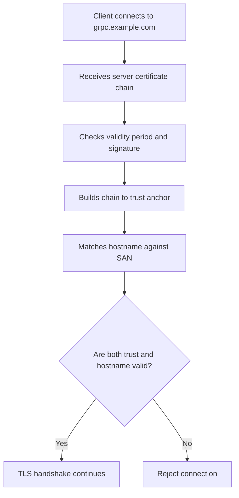

# Server Certificates and Hostnames

## Lesson Objectives

In **SPRING_GRPC**, TLS verifies the server's identity before the client sends RPC data. The server certificate must represent the exact hostname that the client uses to connect. Even if a certificate is signed by a trusted CA, if it does not contain that hostname in its Subject Alternative Name (SAN), the client must still reject the connection.

This lesson focuses on the relationship between **server certificates and hostnames**: how to choose DNS/IP SANs, how the client determines the name to verify, the roles of SNI and authority, wildcard rules, trust chains, and how to test hostname mismatch errors in gRPC.

After this lesson, you will be able to:

1. Explain how hostname verification is independent from certificate chain validation.
2. Design SANs for DNS names and IP addresses of a gRPC endpoint.
3. Distinguish between the hostname the client connects to, the SNI the server receives, and the RPC authority.
4. Understand wildcard rules and mismatch cases.
5. Configure a gRPC client to use the correct hostname and trust roots.
6. Diagnose SAN, CA chain, expiry, and routing errors.
7. Test certificates using OpenSSL and a generated gRPC client.

> **Scope:** Examples use gRPC Java, Spring gRPC, and OpenSSL. Server credentials were created in the previous lesson; here the focus is on identity within the certificate and how the client verifies the server name. Specific configuration names still depend on the transport/server factory version.

## 1. The Certificate Must Match the Name the Client Uses

Suppose the gRPC server is published at:

```text
grpc.example.com:9090
```

The client creates a channel to the hostname grpc.example.com. During the TLS handshake, the server presents its certificate chain. The client must verify at least two independent things:

1. **Trust chain:** the certificate is signed by a CA in the trust roots trusted by the client, the chain is valid, and the certificate is within its validity period.
2. **Server identity:** the server name the client intends to connect to matches an appropriate SAN in the leaf certificate.

A certificate issued by a trusted CA can still have the wrong hostname. For example, a valid certificate for api.example.com does not prove the identity of grpc.example.com. Conversely, a SAN with the right hostname will still not be accepted if the certificate is signed by an untrusted CA.



Hostname verification is part of server authentication in TLS. Do not disable this step to bypass certificate mismatches.

## 2. Subject Alternative Name (SAN)

SAN is where modern certificates declare the identities they represent. For gRPC endpoints, two SAN types are commonly encountered:

- **dNSName:** DNS name, for example grpc.example.com.
- **iPAddress:** IP address, for example 10.20.0.15.

The client must use the appropriate SAN type matching how it identifies the server. If the channel target is a DNS hostname, the certificate needs a matching DNS SAN. If the client connects by IP literal and verifies by IP, the certificate needs the corresponding IP SAN; a DNS SAN containing a string resembling an IP address does not substitute for an IP SAN.

### 2.1. SAN Examples for Multiple Endpoints

A certificate can represent multiple DNS names if those names belong to the same server identity and are approved by the CA:

```text
X509v3 Subject Alternative Name:
    DNS:grpc.example.com,
    DNS:grpc.internal.example.com,
    DNS:grpc-canary.example.com
```

If a client actually connects by IP, the certificate can include an IP SAN:

```text
X509v3 Subject Alternative Name:
    DNS:grpc.example.com,
    IP Address:10.20.0.15
```

Do not add dozens of SANs "just for convenience." Each additional name expands the scope of identities that the certificate's private key can prove. Only include hostnames/IPs that the server genuinely owns and needs to serve.

### 2.2. CN Does Not Replace SAN

Subject Common Name (CN) was used in some legacy systems to represent a hostname. For modern hostname verification, clients should rely on SAN. Do not issue a new certificate with only a CN and expect every gRPC client to accept it.

For example, the subject might be:

```text
CN = grpc.example.com
```

However, if SAN does not contain DNS:grpc.example.com, the certificate may still fail hostname verification. CN is not a fix for a missing SAN.

## 3. Wildcard Hostname Rules

Wildcard SANs are commonly used for multiple hosts at the same DNS level:

```text
DNS:*.example.com
```

This wildcard can match grpc.example.com or inventory.example.com. It does not match:

- example.com (apex/root domain).
- a.grpc.example.com (multiple sub-levels).
- grpc.example.org (different domain).

Do not rely on broad wildcards to cover unrelated domains. A wildcard certificate still requires a trusted chain, a valid validity period, and an appropriate server authentication usage purpose. If a service has stable hostnames, specific SANs are usually easier to review and limit in scope.

## 4. Hostname, SNI, and Authority in gRPC

These three concepts are related but not identical:

| Concept | Role | Example |
| --- | --- | --- |
| **Target hostname** | Name the client uses to locate the endpoint in the channel target | grpc.example.com |
| **SNI (Server Name Indication)** | Name the client sends in TLS ClientHello so the server/proxy chooses the appropriate certificate or virtual host | grpc.example.com |
| **HTTP/2 authority** | Authority of the request, typically containing the host and optionally the port; used in routing/policy | grpc.example.com:9090 |
| **Certificate SAN** | The DNS/IP identities that the server certificate proves | DNS:grpc.example.com |

In typical configurations, the target hostname is the primary input for the gRPC client to determine the server identity and send SNI. A proxy or load balancer may use SNI to select the right certificate. HTTP/2 authority, by contrast, belongs to the RPC layer after TLS has been established.

### 4.1. DNS Names and IP Addresses

Prefer using stable DNS names in deployment environments:

```java
ManagedChannel channel = ManagedChannelBuilder
        .forAddress("grpc.example.com", 9090)
        .useTransportSecurity()
        .build();
```

With this approach, the client verifies the server against the hostname grpc.example.com. The certificate needs the corresponding SAN and the chain must be trusted by the client.

If the client uses:

```java
ManagedChannel channel = ManagedChannelBuilder
        .forAddress("10.20.0.15", 9090)
        .useTransportSecurity()
        .build();
```

then identity is checked against the IP used by the client. A certificate with only DNS:grpc.example.com will not automatically match the IP 10.20.0.15. There are two design approaches:

- The client uses the DNS name already present in the certificate, and a DNS resolver/load balancer maps that name to the IP.
- If the endpoint is genuinely identified by IP, issue a certificate with the exact IP SAN.

### 4.2. Authority Override Is Only for Intentional Cases

gRPC Java provides APIs such as **overrideAuthority(...)** on the channel builder to change the authority used for call/TLS name in certain special routing configurations. This is not a general way to bypass hostname verification. If the connection target is an IP while the logical server identity is a DNS name, only override when the architecture explicitly defines that identity and you have verified SNI, authority, certificate SAN, and transport behavior.

Do not use arbitrary client-supplied authority values. Improper overriding can cause routing and TLS identity to no longer reflect the intended endpoint.

## 5. Issuing Certificates with SAN

Server certificates are typically issued by an internal CA or public CA based on a CSR. When creating the CSR, declare SANs in the request. Example OpenSSL configuration file:

```ini
[ req ]
prompt = no
distinguished_name = subject
req_extensions = request_extensions

[ subject ]
CN = grpc.example.com

[ request_extensions ]
subjectAltName = @server_names

[ server_names ]
DNS.1 = grpc.example.com
DNS.2 = grpc.internal.example.com
IP.1 = 10.20.0.15
```

Generate the private key and CSR:

```bash
openssl genpkey -algorithm RSA \
  -pkeyopt rsa_keygen_bits:3072 \
  -out server-key.pem

openssl req -new \
  -key server-key.pem \
  -out server.csr \
  -config server-san.cnf
```

A CSR only **requests** that the CA include the SANs in the certificate; the CA may apply its own policy and reject or alter SANs. When signing the certificate, the CA profile must issue the approved SANs, along with appropriate extensions such as extendedKeyUsage serverAuth and key usage matching the algorithm/TLS profile. Do not treat a CSR having SANs as proof that the final certificate has them.

Inspect the issued certificate:

```bash
openssl x509 -in server.pem -noout \
  -subject -issuer -dates \
  -ext subjectAltName \
  -ext extendedKeyUsage
```

Read the output to confirm the exact DNS/IP SANs, validity period, and EKU. A certificate intended for TLS servers needs a server authentication usage purpose matching the CA/TLS profile.

## 6. Configuring a gRPC Client to Verify Hostname

### 6.1. Using the Default Trust Store

If the CA that issued the certificate is already installed in the trust store used by the JVM/TLS provider, the client can use transport security:

```java
ManagedChannel channel = ManagedChannelBuilder
        .forAddress("grpc.example.com", 9090)
        .useTransportSecurity()
        .build();
```

Do not call usePlaintext() in production. The channel address must be a hostname represented by the certificate, not another IP simply because that IP is easier to configure.

### 6.2. Using a Dedicated Private CA

If the server certificate is signed by a private CA, the client must trust that CA. You can install the CA into the JVM trust store or configure trust roots for the channel using the credential API appropriate for your gRPC Java version.

Example using TlsChannelCredentials:

```java
ChannelCredentials credentials;

try (InputStream roots =
        Files.newInputStream(Path.of("certs/internal-root-ca.pem"))) {
    credentials = TlsChannelCredentials.newBuilder()
            .trustManager(roots)
            .build();
}

ManagedChannel channel = Grpc.newChannelBuilder(
        "dns:///grpc.example.com:9090",
        credentials)
        .build();
```

This example uses a dedicated trust root for the channel; APIs and overloads must match the gRPC Java version in use. The trust manager only decides which CA is trusted. It does not make a certificate with a different hostname valid. The client must still verify the server's SAN against the target identity grpc.example.com.

### 6.3. Do Not Disable Hostname Verification

Do not use a custom verifier that always returns true, do not skip peer name checks, and do not use an insecure trust manager to evade errors. Those approaches allow a server with a certificate that does not represent the right hostname to impersonate the endpoint.

If you need to test self-signed certificates, create a dedicated test CA and configure the client to trust the test CA. Tests must still verify the hostname.

## 7. Verifying Hostname and Chain with OpenSSL

You can test an endpoint via IP while still verifying the exact DNS identity by explicitly specifying SNI and hostname:

```bash
openssl s_client \
  -connect 10.20.0.15:9090 \
  -servername grpc.example.com \
  -verify_hostname grpc.example.com \
  -alpn h2 \
  -CAfile certs/root-ca.pem \
  -verify_return_error \
  -showcerts
```

Meaning of the parameters:

- -connect: actual network address to open the TCP connection.
- -servername: SNI sent in TLS ClientHello to select the virtual host/certificate.
- -verify_hostname: DNS name to verify in the certificate.
- -alpn h2: requests HTTP/2 negotiation, required for gRPC.
- -CAfile: trust anchor used by the client to verify the chain.
- -verify_return_error: exits with a verification error instead of merely printing a warning.

To verify the chain and DNS name offline:

```bash
openssl verify \
  -CAfile certs/root-ca.pem \
  -untrusted certs/intermediate-ca.pem \
  -verify_hostname grpc.example.com \
  certs/server.pem
```

If the client uses an IP identity, verify with -verify_ip instead of -verify_hostname:

```bash
openssl verify \
  -CAfile certs/root-ca.pem \
  -verify_ip 10.20.0.15 \
  certs/server.pem
```

Offline commands need to supply all intermediate certificates if the chain has intermediates. Offline verification also does not prove the listener is presenting the right certificate; it must be combined with a handshake to the actual endpoint.

## 8. Diagnosing Hostname Mismatch Errors

| Error | Common Cause | Resolution |
| --- | --- | --- |
| Certificate valid but hostname mismatch | SAN does not contain the hostname used by the client | Issue a certificate with the exact DNS SAN or use the proper DNS target |
| DNS name works, IP does not work | Certificate has a DNS SAN but no IP SAN | Use the DNS name or issue an IP SAN if IP is a required identity |
| One hostname works, alias hostname fails | Alias is not in SAN | Add a CA-approved SAN or standardize the endpoint |
| Connecting to load balancer returns wrong certificate | Missing/wrong SNI or incorrect virtual host mapping | Check SNI, TLS listener, and certificate selection on the proxy |
| Trust chain failed | Client does not trust CA or server is missing intermediate | Fix the trust store or the chain presented by the server |
| Certificate expired/not yet valid | Certificate validity period or system clock is wrong | Check validity and synchronize clocks |
| Wildcard does not match multi-level hostname | Wildcard only covers a single label | Issue a specific SAN for deeper hostnames |
| TLS succeeds but RPC returns UNIMPLEMENTED | Handshake finished but service/method path is wrong | Check Protobuf package, service name, and method |

Do not change the hostname just to match the certificate if doing so causes the client to connect to the wrong service or bypass DNS policy. Fix the certificate, DNS, SNI, or target authority according to the architecture.

## 9. Integration Testing for Server Certificates and Hostnames

A valuable test must cover both positive and negative cases:

1. Client trusts the right CA and targets a hostname in SAN: handshake and RPC succeed.
2. Client does not trust the CA: handshake fails even if the hostname is right.
3. Client trusts the CA but targets the wrong hostname: hostname verification fails.
4. Client connects by IP when the certificate only has a DNS SAN: IP verification fails.
5. Client uses a DNS alias not included in SAN: verification fails.
6. If using SNI virtual hosting, a client sending the right SNI receives the right certificate; the wrong SNI may receive another certificate and fail the handshake.

For Spring gRPC tests, use dedicated certificate/CA fixtures. The client channel must use the fixture trust roots and a target hostname listed in the SAN. If the test server binds a loopback IP while you want to test DNS identity, configure an appropriate test resolver/target; do not disable hostname verification to make tests pass.

After the handshake succeeds, invoke a generated stub to prove HTTP/2 and RPC work. Reflection or a descriptor set can be used to inspect methods, but reflection does not replace certificate verification.

## 10. Operating Hostnames and Certificates Across Environments

The hostname in a certificate is tied to the server's identity, so it must be managed alongside DNS, load balancers, and deployment environments.

- Use stable DNS names as endpoints for clients rather than relying on pod/instance IPs that can change.
- Issue certificate SANs for the exact names clients actually use: internal DNS, public DNS, or service mesh names.
- Keep DNS, SNI routing, load balancers, and certificate SANs consistent.
- When changing domains, migrating clients to the new domain must have an overlap period: old and new certificates both include the required names or follow a compatible rollout plan.
- Monitor certificate expiration and test renewal/rotation before the expiration date.
- Avoid broad wildcards when specific SANs meet your needs.
- Do not put internal hostnames into public certificates if policy forbids it; use a private CA/PKI and appropriate trust distribution.

A certificate can be rotated while keeping the hostname unchanged. Conversely, changing a hostname may require issuing a new certificate even if the public key does not change.

## 11. Common Mistakes

| Incorrect Practice | Consequence | Correct Practice |
| --- | --- | --- |
| Setting only CN, omitting SAN | Modern clients may reject the hostname | Issue appropriate DNS/IP SANs |
| Connecting by IP when only DNS SAN exists | IP identity mismatch | Use a DNS target or add an IP SAN |
| Trusting CA while skipping hostname verification | May accept a server with the wrong identity | Always verify SAN against target identity |
| Using wildcard *.example.com for all domains | Wildcard does not match apex or multi-level names | Issue exact SANs or properly scoped wildcards |
| SNI pointing to a different virtual host | Server presents an unsuitable certificate | Align target hostname, SNI, and proxy configuration |
| CSR has SANs but final cert lacks them | CA did not copy or permit the requested SANs | Inspect the certificate after the CA signs it |
| Arbitrarily overriding authority | TLS identity and HTTP/2 routing may be wrong | Only override per architecture and verify transport |
| Using a trust-all verifier for testing | Masks certificate errors | Use a test CA and valid test hostnames |
| Checking chain without checking SAN | Chain passes but server identity is still wrong | Check both trust path and hostname |
| Testing only with OpenSSL without calling RPCs | TLS may be right while the gRPC service is not working | Run integration tests with a generated gRPC stub |

## 12. Hands-on Exercises

1. Issue a test certificate with SAN DNS:grpc.test.local and IP:127.0.0.1. Inspect the certificate using OpenSSL.
2. Connect a gRPC client by DNS name and by IP; explain why each case passes/fails based on SAN.
3. Configure a client to trust a private CA; then switch to an untrusted CA and verify the handshake is rejected.
4. Create a certificate with DNS:*.example.test; test the names grpc.example.test, example.test, and a.grpc.example.test.
5. Use OpenSSL s_client specifying -servername, -verify_hostname, and -alpn h2; compare when SNI is right/wrong.
6. Configure a Spring gRPC integration test using certificate fixtures, call an RPC over a TLS channel, and add a negative test for hostname mismatch.
7. Simulate changing a DNS endpoint during a rollout; design SAN overlap so old and new clients both work during the transition period.

### Self-Check Questions

- Why can a certificate signed by a trusted CA still be rejected by a client?
- How does a DNS SAN differ from an IP SAN?
- Why does connecting by IP require an IP SAN?
- Does CN replace SAN in modern certificates?
- At what stage is SNI sent and what is it used for?
- Is HTTP/2 authority the same as certificate identity?
- Which hostnames does the wildcard *.example.com match and not match?
- What two distinct problems do a trust manager and hostname verification solve?
- When can overrideAuthority be used and why should it not be used arbitrarily?
- How do you properly test chain trust, hostname verification, and gRPC RPCs together?

## References

- [RFC 9525 — Service Identity in TLS](https://www.rfc-editor.org/rfc/rfc9525): rules for verifying server identity in TLS.
- [RFC 5280 — Internet X.509 PKI Certificate and CRL Profile](https://www.rfc-editor.org/rfc/rfc5280): certificate structure and SAN extension.
- [gRPC — Authentication](https://grpc.io/docs/guides/auth/): TLS and transport authentication for gRPC.
- [gRPC Java — ManagedChannelBuilder](https://grpc.github.io/grpc-java/javadoc/io/grpc/ManagedChannelBuilder.html): target, authority, and channel configuration.
- [gRPC Java — TlsChannelCredentials](https://grpc.github.io/grpc-java/javadoc/io/grpc/TlsChannelCredentials.html): trust roots and TLS channel credentials.
- [OpenSSL — x509](https://docs.openssl.org/3.0/man1/openssl-x509/): inspecting subject, SAN, validity, and extensions.
- [OpenSSL — verify](https://docs.openssl.org/3.0/man1/openssl-verify/): verifying chain and hostname/IP.
- [OpenSSL — s_client](https://docs.openssl.org/3.0/man1/openssl-s_client/): inspecting SNI, ALPN, and TLS handshakes.

**Expected Outcome:** Learners can issue and operate server certificates with SANs matching the hostname/IP used by gRPC clients, understand the differences between trust chains, hostname verification, SNI, and authority, configure clients to trust the proper CA, and diagnose certificate mismatch errors without disabling server identity verification.
