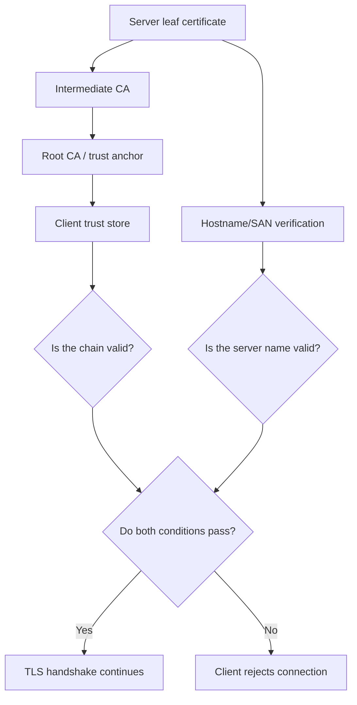

# Client Trust Certificates

## Lesson Objectives

In **SPRING_GRPC**, before sending requests over TLS, the client must verify that the server certificate is signed by a CA the client trusts and that the certificate represents the exact hostname of the endpoint. For public CAs, trust roots may already be in the JVM's default trust store. For private PKI or internal environments, the application needs to distribute and configure appropriate trust certificates.

This lesson focuses on **client trust certificates**: understanding trust anchors and certificate chains, choosing a trust store, configuring a gRPC Java channel with PEM trust roots, integrating the channel into Spring, distinguishing server trust from client identity in mTLS, and testing both trusted and rejected cases.

After this lesson, you will be able to:

1. Distinguish between a trust certificate, server certificate, intermediate CA, and private key.
2. Explain how a client builds and verifies a certificate path to a trust anchor.
3. Choose between the JVM default trust store, a custom trust store, and per-channel trust roots.
4. Configure a gRPC Java channel to trust a private CA while still verifying the hostname.
5. Distinguish a trust manager from a key manager in mTLS.
6. Manage CA rotation and trust anchor revocation systematically.
7. Diagnose unknown CA, incomplete chain, hostname mismatch, and certificate expiry errors.

> **Scope:** Examples use gRPC Java, Spring gRPC, and Java TLS. Specific APIs must match the project's gRPC Java/transport version. The focus is on client-side trust; server certificate configuration is covered in the lesson on creating server credentials.

## 1. What Is a Client Trust Certificate?

When a client connects to a gRPC server over TLS, the server sends its certificate chain. The client needs a set of **trust anchors** to decide which certificate chains are accepted. A trust anchor is usually a root CA certificate installed in the JVM's trust store or supplied specifically to the channel.

A trust certificate is not a private key and is not the client's identity certificate. It is a public certificate used by the client as a point of trust when verifying signatures along the certificate path.

| Component | Role on the Client Side | Needs to Be Kept Secret? |
| --- | --- | --- |
| **Trust anchor / root CA certificate** | Point of trust for verifying the server's chain | No, but integrity and distribution source must be controlled |
| **Intermediate CA certificate** | Links the leaf certificate to the root CA | No; usually sent by the server in the chain |
| **Server leaf certificate** | Contains the server's public key and SAN | No; sent by the server during the TLS handshake |
| **Client private key** | Proves the client owns the identity when mTLS requires it | **Yes**; must be protected as a secret |
| **Client certificate** | Public identity presented by the client to the server in mTLS | Can be public, but lifecycle must be managed |

**The client trust certificate answers the question "Which CA do I trust to issue server identities?"** Hostname verification answers the question "Does that certificate represent the exact server I intend to connect to?" Both must succeed.

## 2. How Does Certificate Path Validation Work?

Suppose the server presents:

1. Leaf certificate for `grpc.internal.example.com`.
2. Intermediate CA certificate that signed the leaf.
3. Root CA certificate as the trust anchor already trusted by the client.

The client verifies the signatures and constraints of each certificate along the path, then checks conditions such as validity period, key usage/EKU, algorithms, and path policy. Clients normally do not need the server to send the root CA; the root is already installed in the trust store. The server needs to send the necessary intermediates so the client can build the chain.



The trust store specifies which CAs the client accepts as trust roots. It does not fix an invalid chain, add a missing SAN, or make an expired certificate valid.

### 2.1. Trust Roots and Intermediates Are Not the Same

In typical PKI:

- A Root CA is a trust anchor distributed out-of-band through a trusted channel.
- An Intermediate CA is signed by the root or a higher-level CA and is usually sent by the server alongside the leaf certificate.
- A Leaf certificate represents the server endpoint and has a SAN containing the hostname/IP.

Do not arbitrarily add every intermediate or leaf certificate to the trust store. If you directly trust a leaf certificate, the client is enforcing a stricter form of pinning and must have a clear certificate replacement plan. The standard CA trust model allows the CA to reissue leaf certificates without updating every client, provided the chain and identity remain valid.

## 3. Choosing a Trust Source for the gRPC Client

There are three common deployment approaches:

| Approach | When Suitable | Characteristics |
| --- | --- | --- |
| **JVM default trust store** | Server uses a public CA or a CA already installed in the system/JVM trust store | Client uses the runtime's default trust configuration |
| **Custom JVM trust store** | Multiple clients in the same process need to trust a shared set of CAs | Configures trust at the JVM/process level; affects TLS clients using that configuration |
| **Per-channel trust roots** | A gRPC client needs to trust a specific private CA independently of other clients | Trust scope is narrowed to the channel; easy to separate environments/services |

Choose the smallest trust scope that meets your architecture. If a channel only calls one private service, per-channel trust roots reduce the risk of accidentally expanding the set of CAs trusted by the entire process.

### 3.1. Using the JVM Default Trust Store

If the server certificate is signed by a public CA trusted by the JVM, the client typically only needs to enable TLS transport:

```java
ManagedChannel channel = ManagedChannelBuilder
        .forAddress("grpc.example.com", 9090)
        .useTransportSecurity()
        .build();
```

The gRPC Java transport uses the TLS provider's default trust configuration according to the version/runtime. There is no need to embed the CA certificate in the application if the default trust store already contains the appropriate CA.

If the server uses a private CA, the default trust store may not contain that CA. In that case, the client may report errors such as unknown CA or unable to find valid certification path.

### 3.2. Using a Custom JVM Trust Store

You can create a trust store containing an internal root CA using keytool:

```bash
keytool -importcert \
  -alias company-grpc-root \
  -file certs/company-root-ca.pem \
  -keystore certs/grpc-truststore.p12 \
  -storetype PKCS12
```

Then configure the JVM properties before initializing the TLS client:

```text
-Djavax.net.ssl.trustStore=certs/grpc-truststore.p12
-Djavax.net.ssl.trustStoreType=PKCS12
-Djavax.net.ssl.trustStorePassword=<secret-from-runtime>
```

Do not put real passwords in committed scripts or shared command histories. Supply secrets through your runtime's secret management mechanism.

A custom JVM trust store has process-wide scope for components using the JSSE default context. This can affect HTTP clients or other TLS connections in the same process. If each downstream service has its own trust policy, consider per-channel trust roots.

### 3.3. Using Per-Channel Trust Roots for a gRPC Channel

gRPC Java has credential APIs to create TLS channel credentials from a CA certificate. The example below reads a PEM root CA and configures it for a single channel:

```java
import io.grpc.ChannelCredentials;
import io.grpc.Grpc;
import io.grpc.ManagedChannel;
import io.grpc.TlsChannelCredentials;

import java.io.InputStream;
import java.nio.file.Files;
import java.nio.file.Path;

ChannelCredentials credentials;
try (InputStream roots =
        Files.newInputStream(Path.of("certs/internal-root-ca.pem"))) {
    credentials = TlsChannelCredentials.newBuilder()
            .trustManager(roots)
            .build();
}

ManagedChannel channel = Grpc.newChannelBuilder(
        "dns:///grpc.internal.example.com:9090",
        credentials)
        .build();
```

In this example:

1. The PEM contains the public certificate of the CA trusted by the client.
2. `trustManager(roots)` configures trust roots for the TLS channel.
3. The target uses a stable DNS name that the server certificate must represent.
4. The gRPC client still verifies the hostname; custom trust roots do not disable SAN verification.

Method names/overloads must match the project's gRPC Java version. If the CA bundle contains multiple trust certificates, check that the API/provider supports PEM bundles in the way you are using it. Do not put the server private key into the client trust file.

## 4. Integrating the Channel into a Spring Application

In Spring, a channel is typically a shared resource per endpoint. Create the channel once as a bean, inject it into client adapters/stub factories, and shut it down when the ApplicationContext stops.

Example configuring a channel that trusts a private CA:

```java
@Configuration(proxyBeanMethods = false)
public class InventoryGrpcClientConfiguration {

    @Bean(destroyMethod = "shutdown")
    ManagedChannel inventoryChannel(
            @Value("${grpc.clients.inventory.target}") String target,
            @Value("${grpc.clients.inventory.ca-file}") Resource caFile)
            throws IOException {

        ChannelCredentials credentials;
        try (InputStream roots = caFile.getInputStream()) {
            credentials = TlsChannelCredentials.newBuilder()
                    .trustManager(roots)
                    .build();
        }

        return Grpc.newChannelBuilder(target, credentials)
                .build();
    }

    @Bean
    InventoryGrpc.InventoryBlockingStub inventoryStub(
            ManagedChannel inventoryChannel) {
        return InventoryGrpc.newBlockingStub(inventoryChannel);
    }
}
```

Externalized configuration outside source code:

```yaml
grpc:
  clients:
    inventory:
      target: dns:///inventory.internal.example.com:9090
      ca-file: file:/run/secrets/company-root-ca.pem
```

This is an illustrative example; the property names are application-defined, not built-in Spring gRPC properties. You can use async/future stubs instead of blocking stubs depending on the use case. If the application has multiple downstream services with different trust roots, create separate channel beans for each trust policy.

`destroyMethod = "shutdown"` initiates the channel's graceful shutdown process. If the application needs to wait for in-flight RPCs to complete within a deadline before forcing shutdown, use a lifecycle owner with `awaitTermination` and `shutdownNow` according to a grace period. Do not create a new channel on every method call and do not shut down the channel after every RPC.

## 5. Trust Roots Do Not Replace Hostname Verification

A client may trust the CA and still have to reject the server certificate if the SAN does not match the target hostname. For example:

- Client connects to `inventory.internal.example.com`.
- The trust store contains the right root CA.
- The server presents a leaf certificate containing only `DNS:pricing.internal.example.com`.

The chain may be valid, but the identity is wrong so the TLS handshake must fail.

Do not use a custom hostname verifier that always returns true, do not disable endpoint identification, and do not arbitrarily override authority to evade mismatches. If the endpoint is accessed via a DNS alias, the certificate must have a SAN for that alias or the client must use the canonical hostname designed in the architecture.

### 5.1. Distinguishing Trust Errors and Hostname Errors

| Error | What Is Failing | How to Fix |
| --- | --- | --- |
| Unknown CA / PKIX path building failed | Cannot build a chain to a trust anchor | Install the right root CA or fix the intermediate chain |
| Certificate expired | Certificate is no longer valid by time | Issue/deploy a new certificate and check the clock |
| SAN/hostname mismatch | Certificate does not represent the target identity | Fix the DNS target or issue a certificate with the right SAN |
| Certificate purpose/key usage invalid | Extensions do not fit TLS server authentication | Use a valid serverAuth certificate profile |
| TLS protocol/ALPN error | Incompatible TLS/HTTP2 negotiation | Check TLS version, ciphers, ALPN h2, and transport |

Do not change the trust store when the actual error is a hostname mismatch; adding a CA will not solve the wrong server name.

## 6. mTLS: Trusting the Server and Presenting Client Identity

In one-way TLS, the client verifies the server certificate. In mutual TLS (mTLS), the server also requires the client to present a certificate to authenticate the client's identity.

The two configurations have different roles:

- **Trust manager:** CAs the client trusts to verify the server certificate.
- **Key manager:** client certificate chain and private key that the client presents to the server.

Example client credentials for mTLS:

```java
TlsChannelCredentials.Builder builder =
        TlsChannelCredentials.newBuilder()
                .trustManager(serverRootCaInputStream)
                .keyManager(
                        clientCertificateChainInputStream,
                        clientPrivateKeyInputStream);

ChannelCredentials credentials = builder.build();
```

`trustManager` is still needed for the client to verify the server. `keyManager` supplies the client identity. Do not put the client private key into the trust store, and do not confuse the CA used to verify the server with the CA the server uses to verify clients.

The server must configure client authentication and trust roots dedicated to client certificates. The client certificate needs an identity/EKU appropriate for client authentication per TLS policy. After the handshake, the application still needs authorization: a valid certificate does not automatically grant permission to call every RPC.

## 7. Inspecting CA Certificates and Trust Stores

Before deploying, verify that the CA certificate comes from a trusted source. Do not rely solely on the filename or subject text; the fingerprint must be verified through a trusted distribution channel.

View subject, issuer, validity, and fingerprint:

```bash
openssl x509 -in certs/internal-root-ca.pem -noout \
  -subject -issuer -dates -fingerprint -sha256
```

View CA extensions:

```bash
openssl x509 -in certs/internal-root-ca.pem -noout \
  -ext basicConstraints -ext keyUsage
```

A standard root CA has basic constraints `CA:TRUE`. The CA certificate must satisfy the organization's PKI profile and policy. Do not trust a certificate just because the file is named root-ca.pem.

You can list the contents of a PKCS#12 trust store:

```bash
keytool -list -v \
  -keystore certs/grpc-truststore.p12 \
  -storetype PKCS12
```

Check the alias, subject, issuer, fingerprint, and validity. The trust store should only contain CAs approved for that client's exact scope.

## 8. Testing gRPC Connections with Trust Roots

### 8.1. Checking the Handshake with OpenSSL

Use the root CA to verify the server and specify the hostname explicitly:

```bash
openssl s_client \
  -connect 10.20.0.15:9090 \
  -servername inventory.internal.example.com \
  -verify_hostname inventory.internal.example.com \
  -alpn h2 \
  -CAfile certs/internal-root-ca.pem \
  -verify_return_error \
  -showcerts
```

Results to confirm:

- The server sends the necessary leaf and intermediate chain.
- The chain builds to the specified root CA.
- The hostname in the SAN matches inventory.internal.example.com.
- ALPN negotiates h2 for gRPC over HTTP/2.
- The certificate is still valid.

OpenSSL is a useful independent check; integration tests with a gRPC client are still required to confirm channel credentials and actual RPCs.

### 8.2. Positive and Negative Integration Tests

Use dedicated test CAs and certificates, never production key material. Cases that should be tested:

1. Client trusts the right root CA and target hostname matches SAN: handshake and RPC succeed.
2. Client uses an unrelated CA: handshake fails due to trust path.
3. Client trusts the right CA but target hostname is wrong: hostname verification fails.
4. Server is missing a required intermediate: verify whether the client can build the chain based on the server's sent chain and provider.
5. Certificate is expired or not yet valid: client rejects it.
6. With mTLS, a client without a certificate or with a certificate outside the trust policy: server rejects the handshake.

In Spring tests, create the channel with the fixture trust roots, invoke the generated stub, and assert status/handshake failure. Ensure negative tests genuinely fail at the TLS handshake, not because the port is closed or the service method is wrong.

## 9. CA Rotation and Trust Management

Trust anchors have a separate lifecycle from server leaf certificates. When a root CA is nearing expiration or the organization migrates to a new CA, clients must have their trust configuration updated systematically.

An overlap procedure typically includes:

1. Distribute the new root CA to clients through a trusted channel while the old CA is still trusted.
2. Verify fingerprints and install a trust bundle containing both the old and new roots.
3. Switch server certificates to the new chain.
4. Monitor handshake successes/failures from clients and environments.
5. Once no servers/clients need the old CA, remove the old root per the change plan.
6. Test rollback and ensure trust bundles are updated consistently.

Do not remove the old root before all servers/endpoints have switched chains. Also do not keep an old CA indefinitely if the CA has been compromised or is no longer authorized to be trusted; during a security incident, revocation may need to be urgent and connection disruption accepted.

If channel credentials read the CA from a file at initialization, replacing the file on disk may not update an already-created trust manager. Know whether the transport supports reload; if not, recreate the channel or perform a controlled client restart/rollout.

## 10. Common Mistakes

| Symptom | Cause | Resolution |
| --- | --- | --- |
| Client reports unknown CA | Root CA is not in the trust store or wrong CA bundle | Verify fingerprint and install the proper trust anchor |
| PKIX path building failed | Missing intermediate or invalid server chain | Fix the chain sent by the server and the trust roots |
| Trust is right but hostname mismatch | SAN does not match the target hostname | Fix the DNS target or certificate SAN |
| Client uses test CA but still fails to connect | Channel still uses default trust store or reads wrong CA file | Verify credentials are attached to the right channel and trust file |
| All TLS clients in the JVM are affected | Modified the process-wide JVM trust store | Use per-channel trust roots if policies are separate |
| mTLS does not work | Has trust manager without client key manager, or server does not trust client CA | Configure client certificate/key and server client trust separately |
| CA rotation disrupts RPCs | Client removed old root before server switched chains | Deploy an overlapping trust bundle before removing the old root |
| Replaced CA file but client ignores changes | Channel/TLS context already loaded trust material earlier | Recreate the channel or use a supported reload mechanism |
| Arbitrarily adding many CAs | Expands the set of server identities the client accepts | Only trust CAs necessary for the endpoint and use case |
| TLS test fails without clear reason | Not distinguishing handshake failures from RPC/service failures | Use OpenSSL and integration tests with separate assertions per layer |

## 11. Hands-on Exercises

1. Create a test private root CA and issue a server certificate for `inventory.internal.test`.
2. Create a PEM trust bundle containing only the root CA; configure a gRPC Java channel using `TlsChannelCredentials`.
3. Call an RPC using a target hostname matching the SAN and verify the handshake succeeds.
4. Replace trust roots with a different CA; verify the client rejects the chain.
5. Keep the CA but change the target to a hostname not in the SAN; verify hostname verification fails.
6. Create a custom PKCS#12 trust store with keytool and compare it with per-channel trust roots.
7. Configure mTLS: add a client certificate/key, configure the server to trust the client CA, and test all three cases: valid client certificate, missing certificate, and untrusted certificate.
8. Practice CA rotation with a trust bundle containing old and new CAs; switch the server chain and then remove the old CA after the rollout completes.

### Self-Check Questions

- How does a trust anchor differ from a server leaf certificate?
- Why do clients normally not need the server to send the root CA?
- How does certificate chain validation differ from hostname verification?
- When should you use the JVM default trust store versus per-channel trust roots?
- What are the responsibilities of `trustManager` and `keyManager` in mTLS?
- Why does adding a CA to the trust store not fix a hostname mismatch?
- How do you verify a CA's fingerprint before trusting it?
- Why might replacing a trust bundle file not update a running channel?
- How do you roll out CA rotation so both old and new clients continue connecting?
- Why should you avoid using a trust-all verifier or disabling hostname verification?

## References

- [gRPC — Authentication](https://grpc.io/docs/guides/auth/): TLS, trust, and authentication for gRPC.
- [gRPC Java — TlsChannelCredentials](https://grpc.github.io/grpc-java/javadoc/io/grpc/TlsChannelCredentials.html): configuring trust managers and client key managers.
- [gRPC Java — ManagedChannelBuilder](https://grpc.github.io/grpc-java/javadoc/io/grpc/ManagedChannelBuilder.html): creating client channels and configuring transport.
- [Java Security — JSSE Reference Guide](https://docs.oracle.com/en/java/javase/17/security/java-secure-socket-extension-jsse-reference-guide.html): trust stores, key stores, and TLS in the JVM.
- [Java keytool](https://docs.oracle.com/en/java/javase/17/docs/specs/man/keytool.html): managing certificates and trust stores.
- [OpenSSL — verify](https://docs.openssl.org/3.0/man1/openssl-verify/): verifying certificate paths.
- [OpenSSL — s_client](https://docs.openssl.org/3.0/man1/openssl-s_client/): inspecting TLS handshakes and trust.
- [RFC 5280 — Internet X.509 PKI Certificate and CRL Profile](https://www.rfc-editor.org/rfc/rfc5280): certificate paths and trust anchors.

**Expected Outcome:** Learners can configure a gRPC client to trust the right CA certificate, verify the certificate chain and server hostname, distinguish a trust manager from a client key manager in mTLS, manage overlapping CA rotation, and test both valid connections and rejected trust/identity cases.
