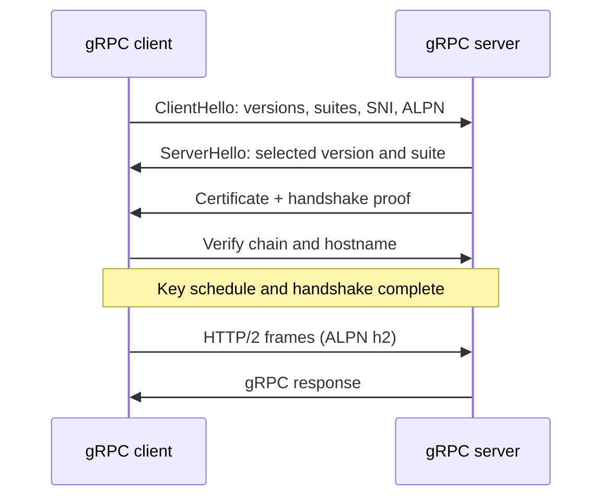

# TLS Versions and Cipher Policies

## Lesson Objectives

In **SPRING_GRPC**, gRPC runs over HTTP/2 and typically uses TLS to protect the transport. Enabling TLS is only the first step: the server and client must also agree on the TLS version, cipher suite, key exchange groups, and signature algorithms that both support. A policy that is too weak may allow outdated algorithms; a policy that is too strict may prevent legitimate clients from completing the handshake.

This lesson focuses on **TLS versions and cipher policies**: choosing TLS 1.2/1.3, understanding cipher suites and their security properties, restricting protocols/ciphers in gRPC Java, integrating the policy into Spring-managed servers/clients, and verifying what is actually negotiated at runtime.

After this lesson, you will be able to:

1. Explain the roles of TLS version, cipher suite, key exchange, and signature scheme.
2. Choose TLS 1.3 as the primary option and retain TLS 1.2 when compatibility is required.
3. Select modern cipher suites with AEAD and forward secrecy for TLS 1.2.
4. Distinguish how cipher suites are specified in TLS 1.2 versus TLS 1.3.
5. Configure protocol/cipher policies for gRPC Java servers and channels.
6. Understand the impact of RSA/ECDSA certificates, the JDK, and the TLS provider on negotiation.
7. Inspect the negotiated protocol/cipher and ALPN h2, and diagnose handshake failures.

> **Scope:** Examples use gRPC Java, Spring gRPC, JSSE/Netty, and OpenSSL. Specific configuration APIs depend on the gRPC Java version, server factory, and TLS provider. When Spring manages the server, apply the policy through the mechanism supported by your Spring gRPC version on the exact listener serving RPCs.

## 1. What Do TLS Versions and Cipher Suites Solve?

The TLS handshake agrees on a set of security parameters before transmitting RPCs:

- **TLS version:** protocol version, such as TLS 1.2 or TLS 1.3.
- **Cipher suite:** set of algorithms protecting data, primarily defining symmetric encryption and hash/AEAD construction.
- **Key exchange:** how both sides establish a shared secret, such as ECDHE or the corresponding TLS 1.3 mechanism.
- **Signature scheme:** signature algorithm used to authenticate the handshake/certificate, such as RSA-PSS or ECDSA.
- **Certificate:** server identity (and client identity if using mTLS), along with public key and SAN.
- **ALPN:** application protocol negotiation; gRPC over HTTP/2 requires `h2`.

These elements are related but cannot substitute for one another. A valid certificate does not guarantee a strong cipher policy; modern cipher suites also do not fix a hostname mismatch or an untrusted CA.



Client and server can only choose from the intersection of capabilities that are supported, enabled, and permitted by the TLS provider. If there is no common protocol/cipher, the handshake fails before any RPC handler runs.

## 2. Choosing a TLS Version

### 2.1. TLS 1.3 Is the Preferred Choice

TLS 1.3 removes many legacy mechanisms, shortens the handshake, and uses only AEAD-based cipher suites. Common suites include:

- `TLS_AES_128_GCM_SHA256`
- `TLS_AES_256_GCM_SHA384`
- `TLS_CHACHA20_POLY1305_SHA256`

TLS 1.3 decouples cipher suites from key exchange and signature schemes. Suite names no longer encode certificate/key-exchange types the way many TLS 1.2 suites do.

### 2.2. Retaining TLS 1.2 When Compatibility Is Needed

TLS 1.2 can still be configured securely if only modern cipher suites are enabled. Common suites include:

- `TLS_ECDHE_RSA_WITH_AES_128_GCM_SHA256`
- `TLS_ECDHE_RSA_WITH_AES_256_GCM_SHA384`
- `TLS_ECDHE_ECDSA_WITH_AES_128_GCM_SHA256`
- `TLS_ECDHE_ECDSA_WITH_AES_256_GCM_SHA384`
- `TLS_ECDHE_RSA_WITH_CHACHA20_POLY1305_SHA256`
- `TLS_ECDHE_ECDSA_WITH_CHACHA20_POLY1305_SHA256`

`ECDHE` uses ephemeral key exchange, providing forward secrecy. `AES_GCM` and `CHACHA20_POLY1305` are AEAD constructions, providing both confidentiality and integrity in a single authenticated mechanism.

TLS 1.2 may be necessary when a client or runtime does not yet support TLS 1.3. Use TLS 1.2 as an intentional compatibility floor while tracking legacy clients so you can plan their deprecation when no longer needed.

### 2.3. Do Not Enable Obsolete Protocols

In general, you should not allow:

- SSLv3.
- TLS 1.0.
- TLS 1.1.

These protocols are obsolete and unsuitable for new services. Do not configure an overly broad protocol list just to "support every client." If a client can only connect with TLS 1.0/1.1, upgrade the runtime/client instead of weakening the entire server's policy.

### 2.4. Sample Policy

A common policy for a modern service is:

| Attribute | Recommended Policy |
| --- | --- |
| TLS versions | TLS 1.3 preferred; TLS 1.2 when compatibility is required |
| TLS 1.3 cipher suites | AES-GCM or ChaCha20-Poly1305 |
| TLS 1.2 cipher suites | ECDHE combined with AES-GCM or ChaCha20-Poly1305 |
| Key exchange | Ephemeral key exchange with groups supported by the TLS provider |
| Certificate signature | Modern algorithms/signatures supported by both client and server |
| ALPN | Require h2 negotiation for gRPC HTTP/2 |
| Legacy algorithms | Disable SSLv3, TLS 1.0/1.1, RC4, 3DES, NULL, EXPORT, and weak suites |

The actual policy must consider the JDK, TLS provider, certificate type, proxies/load balancers, and supported clients. Do not copy a cipher list without testing it on the deployment runtime.

## 3. Understanding Cipher Suites Before Configuring

A TLS 1.2 cipher suite name encodes multiple components. For example:

```text
TLS_ECDHE_RSA_WITH_AES_128_GCM_SHA256
```

- `ECDHE`: ephemeral Elliptic Curve Diffie-Hellman key exchange.
- `RSA`: certificate/server authentication uses RSA in this suite.
- `AES_128_GCM`: AEAD encryption using AES-GCM with a 128-bit key.
- `SHA256`: hash associated with the PRF/handshake suite per the TLS 1.2 specification.

For a TLS 1.3 suite:

```text
TLS_AES_128_GCM_SHA256
```

The suite name describes the AEAD and hash. Key exchange groups and signature schemes are negotiated separately. Therefore, you cannot assume TLS 1.3 uses RSA key exchange just because the server certificate has an RSA public key.

### 3.1. Properties to Prioritize

- **AEAD:** use AES-GCM or ChaCha20-Poly1305; avoid unauthenticated ciphers or legacy constructions.
- **Forward secrecy:** with TLS 1.2, prefer ECDHE over static RSA key exchange.
- **Certificate compatibility:** TLS 1.2 suites have an RSA/ECDSA suffix matching the certificate type and signature capability.
- **Provider support:** the cipher must exist in the JDK/Netty/OpenSSL provider in use.
- **HTTP/2 compatibility:** gRPC over HTTP/2 requires an HTTP/2-compatible TLS profile; with TLS 1.2, avoid non-AEAD suites and suites forbidden by HTTP/2.

Do not use legacy suites such as RC4, 3DES, NULL, EXPORT, anonymous DH, static RSA key exchange, or CBC suites that no longer fit modern HTTP/2 policies.

### 3.2. RSA and ECDSA Certificates

An RSA certificate can use TLS 1.2 suites of the form `ECDHE_RSA`; an ECDSA certificate corresponds to `ECDHE_ECDSA`. If the policy only allows ECDHE_ECDSA while the server only has an RSA certificate, the two sides may fail to find a compatible authentication method.

TLS 1.3 separates cipher suites from signature schemes, but certificate key types and signature algorithms must still be compatible. When rolling out a cipher policy, check the deployed certificates, the signature schemes supported by the JDK/provider, and client capabilities.

## 4. Configuring Protocols and Ciphers in gRPC Java

gRPC Java provides credential builders for TLS servers and clients. Versions that support protocol/cipher configuration on credentials can use `protocols(...)` and `ciphers(...)`.

### 4.1. Server Credentials

Example configuring a server to allow only TLS 1.3 and TLS 1.2, with modern suites:

```java
List<String> protocols = List.of("TLSv1.3", "TLSv1.2");

List<String> cipherSuites = List.of(
        "TLS_AES_128_GCM_SHA256",
        "TLS_AES_256_GCM_SHA384",
        "TLS_CHACHA20_POLY1305_SHA256",
        "TLS_ECDHE_RSA_WITH_AES_128_GCM_SHA256",
        "TLS_ECDHE_RSA_WITH_AES_256_GCM_SHA384",
        "TLS_ECDHE_ECDSA_WITH_AES_128_GCM_SHA256",
        "TLS_ECDHE_ECDSA_WITH_AES_256_GCM_SHA384",
        "TLS_ECDHE_RSA_WITH_CHACHA20_POLY1305_SHA256",
        "TLS_ECDHE_ECDSA_WITH_CHACHA20_POLY1305_SHA256"
);

ServerCredentials credentials = TlsServerCredentials.newBuilder()
        .keyManager(serverCertificateChain, serverPrivateKey)
        .protocols(protocols)
        .ciphers(cipherSuites)
        .build();
```

This is an illustrative policy list. Each TLS provider has a different set of supported suites; if a suite is absent in the provider, the server may reject the configuration or ignore the suite depending on the implementation. Verify runtime capabilities before putting the list into production.

If the server uses mTLS, add a trust manager and client authentication policy as needed. Client CA trust does not alter protocol/cipher selection; that is a separate client identity verification concern.

### 4.2. Client Channel Credentials

The client can also restrict protocols/ciphers on its channel credentials:

```java
ChannelCredentials credentials = TlsChannelCredentials.newBuilder()
        .trustManager(serverRootCa)
        .protocols(List.of("TLSv1.3", "TLSv1.2"))
        .ciphers(cipherSuites)
        .build();

ManagedChannel channel = Grpc.newChannelBuilder(
        "dns:///grpc.example.com:9090",
        credentials)
        .build();
```

The client policy must intersect with the server policy. If the client only enables TLS 1.3 while the server only enables TLS 1.2, the handshake fails. If both sides enable the same version but their cipher lists have no suite in common, the handshake also fails.

### 4.3. Credential API and TLS Providers

Builder methods and support levels depend on the gRPC Java version, transport, and provider (JSSE or Netty/OpenSSL). Some deployments configure TLS via an SSL context/server factory instead of passing a credential builder directly. Consult the API of the exact dependency you are running and verify the server actually uses those credentials.

Do not assume HTTPS servlet/Tomcat properties automatically apply to a native gRPC listener. TLS configuration for the HTTP web server and the gRPC transport may be two separate listeners, two SSL contexts, and two separate policies.

## 5. Integrating the Policy into Spring gRPC

In Spring gRPC, the server factory manages the listener, service registration, and lifecycle. When applying a TLS policy:

1. Identify the actual server factory/transport (native Netty, servlet, or whichever transport the project selected).
2. Identify where to configure SSL/TLS credentials supported by your Spring gRPC version.
3. Apply the protocol and cipher policy to the exact server listener.
4. Keep the certificate chain/private key and service definitions bound to that server.
5. Inspect server startup logs or the negotiated session to confirm the policy took effect.
6. Test both compatible clients and clients rejected by the policy.

Do not invent a generic Spring property such as `spring.grpc.server.ssl.ciphers` without verifying it exists in the version in use. Property names, SSL bundles, and customization hooks can vary across starters/transports. If a custom server factory is needed, use the extension point published in that version's documentation.

### 5.1. Distinguishing Native gRPC and HTTP Server TLS

A Spring Boot application may simultaneously have:

- An HTTP server for REST/Actuator.
- A native gRPC server listening on a separate port.

Configuring ciphers on the web server does not mean the native gRPC server received the policy. Conversely, configuring gRPC TLS does not automatically secure the management HTTP endpoint. Verify each listener and each port in the deployment environment.

## 6. JVM Security Policy and Scope of Impact

Java provides security properties such as `jdk.tls.disabledAlgorithms` to exclude disallowed protocols, ciphers, key sizes, or signature algorithms. This is a JSSE/JVM policy layer that can affect multiple TLS connections in the process, not just a single gRPC channel.

Distinguish between them:

| Mechanism | Scope |
| --- | --- |
| `TlsServerCredentials.protocols/ciphers` | Specific credential/server transport if supported by the provider |
| `TlsChannelCredentials.protocols/ciphers` | Specific channel/client transport if supported by the provider |
| SSLContext/SSLParameters | TLS connections using that context/parameters |
| `jdk.tls.disabledAlgorithms` | Runtime/JVM-level JSSE security policy |
| TLS policy at proxy/load balancer | Listener or TLS hop at that proxy |

Do not modify `jdk.tls.disabledAlgorithms` just to fix one failing gRPC connection without evaluating its impact on the entire process. Also do not assume `https.protocols` or HTTP client-specific properties automatically govern the Netty gRPC transport.

With Netty using the native OpenSSL provider, the actual set of ciphers/protocols can differ from JSSE. Verify the active provider and check handshake results on the exact listener.

## 7. TLS 1.2/1.3 and HTTP/2 gRPC

gRPC uses HTTP/2 framing. When running over TLS, ALPN negotiates the application protocol h2. A successful TLS handshake where ALPN did not select h2 is not sufficient to prove the endpoint can serve gRPC.

Items to verify:

- TLS version is within the allowed policy.
- Selected cipher suite is in the approved list.
- Certificate chain and hostname are valid.
- ALPN selects h2.
- HTTP/2 connection is established and RPC methods are dispatched.

With TLS 1.2, HTTP/2 requires cipher suites meeting a secure profile; non-AEAD suites or suites lacking forward secrecy are unsuitable. Use ECDHE + AES-GCM/ChaCha20-Poly1305 for a better-compatible profile. TLS 1.3 has its own AEAD cipher suites.

Do not confuse cipher suites with compression. TLS compression is obsolete and should be disabled; HTTP/2 also has its own header compression rules (HPACK), which are not TLS cipher policy.

## 8. Checking the Negotiated Protocol and Cipher

### 8.1. Using OpenSSL to Test TLS 1.2

OpenSSL uses the `-cipher` option for TLS 1.2 cipher lists. Example forcing a client to test TLS 1.2 with the ECDHE + AEAD group:

```bash
openssl s_client \
  -connect grpc.example.com:9090 \
  -servername grpc.example.com \
  -alpn h2 \
  -tls1_2 \
  -cipher 'ECDHE+AESGCM:ECDHE+CHACHA20' \
  -CAfile certs/root-ca.pem \
  -verify_hostname grpc.example.com \
  -verify_return_error
```

### 8.2. Using OpenSSL to Test TLS 1.3

TLS 1.3 uses the `-ciphersuites` option instead of `-cipher`:

```bash
openssl s_client \
  -connect grpc.example.com:9090 \
  -servername grpc.example.com \
  -alpn h2 \
  -tls1_3 \
  -ciphersuites 'TLS_AES_128_GCM_SHA256:TLS_AES_256_GCM_SHA384:TLS_CHACHA20_POLY1305_SHA256' \
  -CAfile certs/root-ca.pem \
  -verify_hostname grpc.example.com \
  -verify_return_error
```

Inspect the output to confirm the protocol, cipher, certificate verification, and ALPN. If forcing TLS 1.3 when the server only enables TLS 1.2, the handshake must fail; that is an intentional policy test. The OpenSSL client does not replace a generated gRPC call, but it helps isolate TLS negotiation.

### 8.3. Observing the SSL Session on the Server

When a gRPC Java transport provides the SSL session attribute, a server interceptor can read the negotiated protocol and cipher:

```java
SSLSession session =
        call.getAttributes().get(Grpc.TRANSPORT_ATTR_SSL_SESSION);

if (session != null) {
    String protocol = session.getProtocol();
    String cipherSuite = session.getCipherSuite();

    // Record normalized metrics/logs; do not log secrets or key material.
}
```

This snippet belongs in a server interceptor. It helps verify the actual TLS session of an RPC. If the transport does not provide the SSL session attribute, use the observability/API of the provider or proxy where TLS is terminated.

Do not log the full SSL session, private certificate material, or sensitive data. Log only the protocol, cipher suite, listener, and permitted connection details.

## 9. Testing Compatibility and Negative Cases

A policy test suite should demonstrate both valid connections and rejected configurations:

| Test | Client Policy | Server Policy | Expected Result |
| --- | --- | --- | --- |
| Normal TLS 1.3 | TLS 1.3 + approved suites | TLS 1.3 + approved suites | Handshake and RPC succeed |
| TLS 1.2 compatibility | TLS 1.2 + ECDHE/AEAD | TLS 1.2 enabled | Succeeds if a common suite exists |
| Disallowed protocol | TLS 1.0/1.1 only | TLS 1.2/1.3 | Handshake fails |
| No common cipher | Suites outside allowlist only | Modern allowlist suites | Handshake fails |
| Incompatible certificate key type | Only ECDSA-compatible suites/auth | Server only has RSA cert | May have no common suite/signature in TLS 1.2 |
| ALPN without h2 | Client does not negotiate h2 | gRPC server requires HTTP/2 | TLS may succeed but gRPC fails to operate properly |
| Certificate wrong hostname | Compatible cipher/version | Server cert SAN differs from target | Client rejects identity |
| Invalid mTLS client | Missing/invalid client certificate | Server requires mTLS | Handshake fails |

Test with a gRPC integration client after verifying TLS with OpenSSL. Capture the negotiated protocol/cipher from the server session or TLS provider to prove the result, rather than relying only on the channel being created.

### 9.1. Compatibility Matrix

Before rollout, build a matrix of supported client types:

- JDK/runtime version.
- gRPC Java version.
- Netty/Native OpenSSL or JSSE provider.
- Operating system/crypto provider.
- TLS 1.2/1.3 support.
- Certificate key type and signature scheme.
- Supported cipher suites.
- ALPN h2 support.

Test against representative runtimes. When removing a legacy suite, know which clients will lose connectivity and have a clear upgrade plan.

## 10. Rollout and Operating Cipher Policies

Do not change the policy across the entire fleet at once without testing compatibility. A safe rollout can include:

1. Collect current protocols/ciphers from server/proxy telemetry.
2. Identify legacy clients and the suites they are using.
3. Enable TLS 1.3 alongside modern TLS 1.2 in staging.
4. Test the client matrix and mTLS.
5. Roll out via canary/rolling deployment.
6. Monitor handshake failures, protocol distribution, cipher distribution, and RPC error rates.
7. Remove legacy suites/protocols after clients have upgraded.
8. Have a controlled policy rollback plan if legitimate clients are found to be incompatible.

Recommended metrics:

- TLS handshake successes/failures.
- Protocol version distribution.
- Cipher suite distribution.
- ALPN negotiation failures.
- Certificate expiry and trust failures.
- Permitted, privacy-preserving client/runtime fingerprints.
- gRPC RPC status/latency after the handshake.

Do not look solely at RPC UNAVAILABLE and conclude a cipher failed; the cause could be DNS, TCP, certificate, ALPN, or service registration. Combine TLS diagnostics with gRPC metrics to distinguish failure layers.

## 11. Common Mistakes

| Symptom | Cause | Resolution |
| --- | --- | --- |
| Old clients cannot connect after rollout | Client only supports removed protocols/ciphers | Identify the runtime and upgrade; retain a compatibility suite only if approved |
| No common cipher suite | Allowlists on both sides do not intersect | Compare client/server/provider capabilities and adjust policy |
| TLS 1.3 is not negotiated | JDK/provider/transport or one side lacks support | Inspect actual runtimes and protocol lists |
| TLS 1.2 fails despite version being enabled | Suite forbidden by HTTP/2, lacks AEAD, or incompatible with certificate | Choose ECDHE + AEAD and check RSA/ECDSA certificate |
| Cipher configuration has no effect | Configured wrong listener or property not used by transport | Check the exact server factory and negotiated session |
| Web HTTPS ciphers changed but gRPC did not | REST and native gRPC use separate listeners/SSL contexts | Configure the gRPC transport separately |
| OpenSSL test passes but RPC fails | TLS handshake passes but ALPN/service/RPC has errors | Verify h2 and call a generated stub |
| Java test differs from OpenSSL | Different TLS provider, trust store, or cipher naming | Check providers/runtimes on both sides |
| mTLS fails after policy change | Client cert signature/key type no longer compatible or trust differs | Test client certificates, signature schemes, and trust roots |
| Sudden spike in handshake failures | Policy rollout removed a suite clients are using | Canary, per-cipher/version telemetry, and controlled rollback |

## 12. Hands-on Exercises

1. Build a TLS 1.3 and TLS 1.2 allowlist for a service, specifying cipher suites, key exchange, and compatible certificate types.
2. Configure gRPC Java server credentials to enable only TLS 1.2/1.3 and provider-supported AEAD cipher suites.
3. Configure a compatible client channel, then test a client restricted to TLS 1.2 only and one restricted to TLS 1.3 only.
4. Use OpenSSL `s_client` with `-tls1_2 -cipher` and `-tls1_3 -ciphersuites`; verify the negotiated protocol/cipher.
5. Add a server interceptor that records protocol/cipher metrics from the SSL session.
6. Verify ALPN `h2` and call a generated stub to confirm RPCs actually work.
7. Try removing a suite from the allowlist and observe which clients can no longer connect; explain why based on runtime/certificate.
8. Write a rollout plan with a compatibility matrix, canary, telemetry, and rollback for deprecating TLS 1.2 or legacy ciphers.

### Self-Check Questions

- How does a TLS version differ from a cipher suite?
- Why do TLS 1.3 cipher suites not encode key exchange/authentication like TLS 1.2 suites?
- What properties do AEAD and forward secrecy protect?
- Why must TLS 1.2 suites be compatible with RSA/ECDSA certificate types?
- Why does gRPC over HTTP/2 require ALPN h2?
- Why should TLS 1.0/1.1 not be enabled just to support one legacy client?
- How does `-cipher` differ from `-ciphersuites` in OpenSSL?
- Why does configuring HTTPS servlet TLS not necessarily affect a native gRPC server?
- What is the scope of impact of `jdk.tls.disabledAlgorithms`?
- How do you verify the negotiated protocol/cipher instead of merely reading configuration?

## References

- [RFC 8446 — TLS 1.3](https://www.rfc-editor.org/rfc/rfc8446): TLS 1.3 protocol, cipher suites, and handshake.
- [RFC 5246 — TLS 1.2](https://www.rfc-editor.org/rfc/rfc5246): TLS 1.2 protocol and cipher suites.
- [RFC 9113 — HTTP/2](https://www.rfc-editor.org/rfc/rfc9113): TLS and ALPN requirements for HTTP/2.
- [gRPC — Authentication](https://grpc.io/docs/guides/auth/): transport security and TLS in gRPC.
- [gRPC Java — TlsServerCredentials](https://grpc.github.io/grpc-java/javadoc/io/grpc/TlsServerCredentials.html): protocol/cipher and server credentials.
- [gRPC Java — TlsChannelCredentials](https://grpc.github.io/grpc-java/javadoc/io/grpc/TlsChannelCredentials.html): protocol/cipher and client credentials.
- [Java Security — JSSE Reference Guide](https://docs.oracle.com/en/java/javase/17/security/java-secure-socket-extension-jsse-reference-guide.html): TLS providers, cipher suites, and JSSE.
- [OpenSSL — s_client](https://docs.openssl.org/3.0/man1/openssl-s_client/): forcing protocol/cipher and observing handshakes.

**Expected Outcome:** Learners can design a modern TLS policy for gRPC by restricting to TLS 1.2/1.3 and appropriate cipher suites, understand the differences between TLS 1.2/1.3 ciphers, maintain HTTP/2 ALPN h2 compatibility, apply the configuration to the right Spring-managed gRPC listener, and verify the actual negotiated protocol/cipher through handshakes and integration tests.
