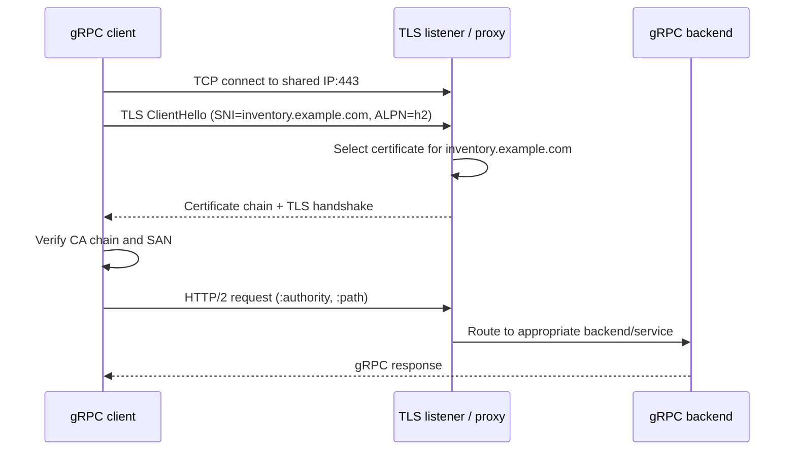
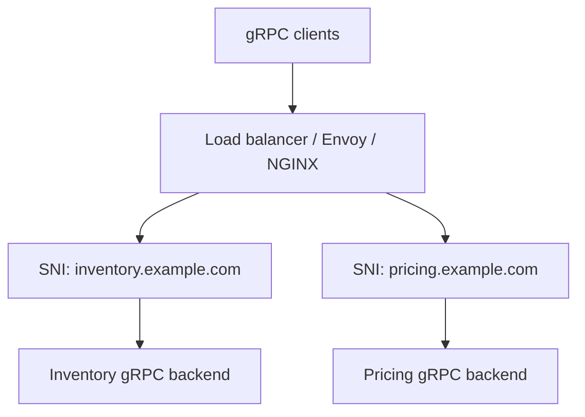

# SNI and Multiple Hostnames

## Lesson Objectives

A gRPC server may be accessed via multiple hostnames, such as `inventory.example.com` and `pricing.example.com`. When multiple hostnames point to the same IP and TLS port, the server needs to know which name the client wants to connect to in order to select the appropriate certificate. TLS solves this with **Server Name Indication (SNI)**: the client sends the intended hostname in the TLS ClientHello before the server presents its certificate.

This lesson focuses on **SNI and multiple hostnames** in SPRING_GRPC: understanding SNI, relating SNI to DNS, certificate SANs, hostname verification, and HTTP/2 authority; choosing between a single multi-SAN certificate and multiple certificates selected by SNI; configuring the gRPC client; integrating TLS termination or a custom server factory in Spring; and testing multi-hostname scenarios.

After this lesson, you will be able to:

1. Explain where SNI is sent and how it helps the server choose a virtual host/certificate.
2. Distinguish between SNI, certificate SAN, channel target, and HTTP/2 authority.
3. Choose between a single multi-SAN certificate or multiple certificates selected by SNI.
4. Understand the limitations of a single-certificate server credential configuration and when a TLS terminator or SNI-aware provider is needed.
5. Configure a gRPC client to use the correct hostname even when DNS resolves to the same IP.
6. Design multi-hostname routing while keeping TLS identity and HTTP/2 routing consistent.
7. Test certificate selection, hostname verification, ALPN h2, and SNI errors.

> **Scope:** Examples use gRPC Java, Spring gRPC, OpenSSL, and HTTP/2 proxies. Integration details depend on the server factory/transport of the version in use. SNI selects the TLS identity during the handshake; routing RPCs to services/methods remains the responsibility of the gRPC server or proxy.

## 1. What Problem Does SNI Solve?

The TLS handshake starts before the client sends an HTTP/2 request. When multiple hostnames share an IP address and port, the server cannot yet read the HTTP/2 authority to learn the request's hostname because the TLS handshake has not finished. SNI lets the client send the DNS name right inside ClientHello so the server can select the appropriate certificate or virtual host configuration.

For example, one listener serves:

- `inventory.example.com`
- `pricing.example.com`
- `orders.example.com`

DNS for all three names can point to the same load balancer and port 443. The client sends the SNI matching the hostname it intends to connect to. The TLS terminator selects a certificate with a matching SAN, completes the handshake, and then the HTTP/2 request carries the authority and gRPC path for further routing.



SNI is an extension in TLS ClientHello, typically containing the DNS hostname in plaintext in a standard handshake. SNI is not an authentication secret and does not replace certificate validation. A client can declare any SNI; the server must still present a valid certificate and the client must verify the identity it intends to connect to.

## 2. Distinguishing SNI, SAN, Target, and Authority

These values are often identical in simple setups but serve different roles:

| Component | Protocol Layer | Meaning |
| --- | --- | --- |
| **Channel target hostname** | gRPC client/name resolver | Name the client uses to locate the endpoint; DNS resolver may map to one or more IPs |
| **SNI** | TLS ClientHello | Name the client sends so the server selects the TLS certificate/virtual host |
| **Certificate SAN** | X.509 certificate | The DNS/IP identities represented by the certificate |
| **HTTP/2 :authority** | HTTP/2 request headers | Request authority, typically consisting of host and optionally port |
| **gRPC :path** | HTTP/2 request headers | Method path, in the form `/package.Service/Method` |

For example, a call to `inventory.example.com` may have:

- Target hostname: `inventory.example.com`.
- SNI: `inventory.example.com`.
- Server certificate SAN: `DNS:inventory.example.com`.
- HTTP/2 authority: `inventory.example.com:443`.
- gRPC path: `/commerce.v1.Inventory/GetStock`.

SNI helps select the certificate during the handshake. SAN is used by the client to verify whether the certificate represents the right hostname. Authority can be used by a proxy to route requests after the handshake. The gRPC path selects the service and method.

Do not use client-declared metadata as a basis of trust for TLS identity. SNI and authority are routing data; server identity must still be verified by the client using the trust chain and SAN.

## 3. Two Ways to Serve Multiple Hostnames

### 3.1. One Certificate with Multiple SANs

If the hostnames belong to the same endpoint and share an operational identity, a single certificate can be issued with multiple DNS SANs:

```text
X509v3 Subject Alternative Name:
    DNS:inventory.example.com,
    DNS:pricing.example.com,
    DNS:orders.example.com
```

This approach is simple: one certificate chain and private key serve all three hostnames. Regardless of which name the client uses to connect, the certificate remains valid if that name is in the SAN and the chain is trusted by the client.

Advantages:

- Simple server configuration, suited to a single certificate/key pair.
- No need to select a key manager based on SNI.
- Easy to deploy with basic gRPC Java server credentials.

Limitations:

- All hostnames share the same private key and rotation cycle.
- Cannot separate certificate ownership between teams/tenants.
- The certificate must be reissued whenever the SAN list changes.
- A key management mistake affects every hostname in the certificate.

Only include hostnames in the SAN that truly belong to the endpoint and are approved by the CA. Do not bundle unrelated tenant or application hostnames just to reduce the number of certificates.

### 3.2. Multiple Certificates Selected by SNI

If each hostname needs its own certificate/key, the TLS terminator must support selecting certificates based on SNI:

| SNI Sent by Client | Certificate Presented by Server |
| --- | --- |
| `inventory.example.com` | Inventory Certificate |
| `pricing.example.com` | Pricing Certificate |
| `orders.example.com` | Orders Certificate |

This approach separates private keys and lifecycles across hostnames. It fits cases where hostnames belong to different tenants, operations teams, or trust domains.

Certificate selection occurs at the TLS layer before gRPC service dispatch. A simple gRPC server builder that accepts only one certificate chain/key pair does not automatically become an SNI router just because there are multiple `@GrpcService` beans.

Common deployment options:

- Terminate TLS at Envoy, NGINX, or a load balancer that supports SNI and HTTP/2.
- Use a TLS provider/server transport with an SNI-aware key manager or an appropriate Netty SNI handler/SSL context.
- Use separate listeners when certificate, network policy, or tenant isolation requirements are strong enough.

## 4. Issuing Certificates for Multiple Hostnames

The certificate must have SANs containing the exact hostnames clients use. If using one multi-SAN certificate, ask the CA to issue all approved names. If using multiple certificates, each certificate has the SAN corresponding to its own hostname.

Example OpenSSL CSR configuration for a shared certificate:

```ini
[ req ]
prompt = no
distinguished_name = subject
req_extensions = server_extensions

[ subject ]
CN = grpc.example.com

[ server_extensions ]
subjectAltName = @server_names
extendedKeyUsage = serverAuth

[ server_names ]
DNS.1 = inventory.example.com
DNS.2 = pricing.example.com
DNS.3 = orders.example.com
```

Generate the key and CSR:

```bash
openssl genpkey -algorithm RSA -pkeyopt rsa_keygen_bits:3072 -out grpc-key.pem
openssl req -new -key grpc-key.pem -out grpc.csr -config grpc-san.cnf
```

A CSR only requests the CA to issue SANs. The CA may apply its policy and issue a certificate different from the request. After receiving the certificate, inspect its actual contents:

```bash
openssl x509 -in grpc-chain.pem -noout -subject -issuer -dates -ext subjectAltName -ext extendedKeyUsage
```

With multiple separate certificates, create independent keys/CSRs/chains for each hostname or group of hostnames. Do not share the same private key if the goal of separating certificates is identity and revocation isolation.

### 4.1. Wildcard Certificates

A wildcard such as `DNS:*.example.com` can represent single-level hostnames like `inventory.example.com` and `pricing.example.com`. It does not represent `example.com` or `a.inventory.example.com`. A wildcard is not a substitute for SNI: the server still needs to know which virtual host the client requests if there are multiple certificates or differing policies.

Wildcard certificates reduce the number of SANs but broaden the scope of identities that one private key represents. Use them only when PKI policy permits and the domain scope is controlled.

## 5. Configuring the gRPC Client to Send the Right Hostname

The client should use the service's DNS target rather than direct backend IPs. A DNS resolver can resolve the hostname to a load balancer IP, while the logical target preserves the hostname needed for TLS identity and routing.

Example:

```java
ManagedChannel channel = ManagedChannelBuilder
        .forAddress("inventory.example.com", 443)
        .useTransportSecurity()
        .build();
```

If using a custom trust root:

```java
ChannelCredentials credentials = TlsChannelCredentials.newBuilder()
        .trustManager(serverRootCa)
        .build();

ManagedChannel channel = Grpc.newChannelBuilder(
        "dns:///inventory.example.com:443",
        credentials)
        .build();
```

In typical configurations, the gRPC client uses the target's logical server name for TLS hostname verification and SNI according to the transport. The server certificate must include `DNS:inventory.example.com` in its SAN and the chain must be trusted by the client.

### 5.1. When the Connection Address Is an IP While the Identity Is DNS

Some environments need to connect to a specific IP while still verifying a logical hostname. You can use a DNS resolver pointing the hostname to the IP, or intentionally configure an authority override:

```java
ManagedChannel channel = ManagedChannelBuilder
        .forAddress("10.20.0.15", 443)
        .overrideAuthority("inventory.example.com")
        .useTransportSecurity()
        .build();
```

`overrideAuthority` changes the authority used by the channel; its exact effect on TLS name/SNI depends on the gRPC transport and version. Use it only after verifying implementation behavior, certificate SAN, SNI, and HTTP/2 authority. Prefer a normal DNS target whenever possible.

Do not override authority with arbitrary caller-supplied data. Doing so can cause the client to verify a different identity from the endpoint the system intended to connect to, or cause a proxy to route to the wrong virtual host.

## 6. Server Certificate Selection by SNI

### 6.1. TLS Termination at a Proxy

This is usually the easiest approach to operate when multiple separate certificates are needed. The proxy accepts the TLS connection, reads SNI, chooses the matching certificate, completes the handshake, and forwards the HTTP/2/gRPC request to the backend.



Proxy configuration must ensure:

- The TLS listener has SNI-based certificate mapping.
- ALPN negotiates `h2`.
- The proxy supports HTTP/2 upstream when forwarding gRPC.
- Authority/path is routed to the right backend/service.
- If the proxy connects upstream over TLS, the upstream certificate is also verified against the right hostname.
- gRPC timeouts, flow control, trailers, and statuses are properly supported by the proxy.

TLS termination means the proxy decrypts TLS at the edge. If the proxy-to-backend hop also needs encryption, configure TLS/mTLS separately for upstream. The client-facing SNI and the SNI the proxy sends upstream can be two different values; explicitly design which backend hostname is verified.

### 6.2. TLS Passthrough

With passthrough, the load balancer routes the TCP connection based on SNI without decrypting TLS. The backend receives the original ClientHello and completes the handshake itself using its own certificate.

This preserves end-to-end TLS to the backend, but routing capability depends on a proxy/L4 load balancer supporting reading SNI from ClientHello. Once encrypted, a passthrough proxy cannot read the HTTP/2 authority or gRPC path to route individual methods. It typically selects backends at the hostname/connection level.

### 6.3. SNI-Aware TLS Provider in the Server

If you want a single JVM server to directly select multiple key pairs by SNI, the TLS stack must support SNI-aware certificate selection, such as a custom JSSE X509ExtendedKeyManager or an appropriate Netty SNI handler/SSL context. Then the Spring gRPC server factory must allow installing this SSL context/transport customization.

Do not assume basic `TlsServerCredentials.keyManager(chain, key)` automatically recognizes multiple hostnames and selects multiple certificates. If your project version's server factory does not expose the necessary hook, use a TLS terminator proxy or separate listeners instead of creating a second manual server alongside the Spring-managed server.

## 7. SNI Is Not gRPC Service Routing

A server can use the same certificate for multiple hostnames and still route RPCs to different services. These two decisions happen at different layers:

1. **TLS certificate selection:** based on SNI in ClientHello.
2. **HTTP/2/gRPC routing:** based on authority, path, and proxy/server configuration.

Example:

| Hostname | SNI Certificate | HTTP/2 Authority | gRPC Path |
| --- | --- | --- | --- |
| `inventory.example.com` | Inventory cert or shared SAN | `inventory.example.com` | `/commerce.v1.Inventory/GetStock` |
| `pricing.example.com` | Pricing cert or shared SAN | `pricing.example.com` | `/commerce.v1.Pricing/GetPrice` |

If both hostnames point to the same gRPC server and the same multi-SAN certificate, the server can still dispatch by service path. If routing by hostname is required, configure virtual hosts at the proxy or the corresponding application routing policy; do not assume gRPC Java splits services by SNI automatically.

Do not use SNI as authorization. A client can set SNI arbitrarily; access control must rely on verified authentication and method/resource authorization policies.

## 8. Testing SNI and Certificate Selection

### 8.1. Using OpenSSL

Test the Inventory hostname:

```bash
openssl s_client \
  -connect 10.20.0.15:443 \
  -servername inventory.example.com \
  -verify_hostname inventory.example.com \
  -alpn h2 \
  -CAfile certs/root-ca.pem \
  -verify_return_error \
  -showcerts
```

Test the Pricing hostname:

```bash
openssl s_client \
  -connect 10.20.0.15:443 \
  -servername pricing.example.com \
  -verify_hostname pricing.example.com \
  -alpn h2 \
  -CAfile certs/root-ca.pem \
  -verify_return_error \
  -showcerts
```

Compare the leaf certificate, SAN, issuer, fingerprint, and ALPN. If the two hostnames use separate certificates, the server must present the exact certificate matching the SNI. If using a multi-SAN certificate, the same leaf certificate may be valid for both.

Try omitting SNI or sending an unconfigured hostname to verify the default certificate/fallback behavior. Avoid letting fallback present an unrelated certificate that clients might mistake for a valid endpoint.

### 8.2. Testing RPCs After TLS

After the handshake succeeds, call a generated stub for each hostname and verify the RPC reaches the right service. If reflection is enabled, grpcurl can be used to discover services; otherwise, use proto/descriptor sets.

A passing TLS test only proves connectivity and certificate negotiation. It does not prove authority/path routing reaches the right service. Integration tests must verify the response of each RPC as well.

## 9. Testing Multiple Hostnames

The test suite should include both positive and negative cases:

| Test | Configuration | Expected Result |
| --- | --- | --- |
| Inventory hostname | Inventory SNI and target, matching SAN | Correct certificate, handshake and RPC succeed |
| Pricing hostname | Pricing SNI and target, matching SAN | Correct certificate, handshake and RPC succeed |
| Multi-SAN certificate | One certificate containing both DNS SANs | Both hostnames verify successfully |
| Unknown SNI | Client sends an unconfigured hostname | Fallback/default policy applies; client does not accept wrong identity |
| SAN missing hostname | Pricing SNI/target but certificate only has Inventory SAN | Hostname verification fails |
| Untrusted CA | Right SNI but client does not trust issuer | Chain validation fails |
| Wrong authority/path | TLS succeeds but HTTP/2 authority or gRPC path is misrouted | RPC is misrouted or returns corresponding status |
| ALPN missing h2 | TLS listener does not negotiate HTTP/2 | gRPC call fails to operate properly |

In Spring gRPC integration tests, start the exact server/proxy topology used in the deployment environment. Create a channel for each hostname, use test trust roots, call the corresponding method, and verify both the certificate and route. Do not test only one hostname and assume every SNI mapping works.

## 10. Operating Certificates and Hostnames

Multiple hostnames increase the number of mappings to manage across DNS, certificates, listeners, and backends. Maintain an inventory with clear ownership:

| Field | Example |
| --- | --- |
| Hostname | `inventory.example.com` |
| DNS target | Load balancer address |
| SNI certificate | Inventory certificate |
| SAN | `DNS:inventory.example.com` |
| TLS termination point | Edge proxy |
| Upstream target | `inventory-grpc.internal:9090` |
| Certificate expiry | Expiration date per certificate |
| Owner | Service operations team |

When adding or changing a hostname:

1. Register DNS and define the listener/route.
2. Issue a certificate with the right SAN or update the SNI certificate mapping.
3. Distribute necessary trust roots to clients if the CA changes.
4. Configure proxy/target/authority and upstream TLS if applicable.
5. Verify SNI, SAN, ALPN h2, and RPC routes in staging.
6. Roll out mapping/certificate changes in a controlled manner; monitor handshake failures.
7. Retire old hostnames/certificates after clients have migrated.

Monitor handshake success/failure metrics per listener and hostname as permitted, certificate expiry, SNI mismatches, ALPN negotiation, and gRPC status/latency. Avoid logging sensitive data; hostnames are usually not secrets but can reveal internal topology.

## 11. Common Mistakes

| Symptom | Cause | Resolution |
| --- | --- | --- |
| Every hostname gets the same certificate, some clients fail | Certificate lacks sufficient SANs | Add SANs or use separate certificates per SNI |
| SNI is right but server returns default certificate | SNI mapping mismatch or TLS terminator has not loaded cert | Check listener virtual host and reload certificate |
| Certificate is right but RPC hits wrong backend | Authority/path routing is wrong after TLS | Check HTTP/2 authority, gRPC path, and proxy route |
| DNS points to right IP but hostname verification fails | Target uses IP or an alias not in SAN | Use logical DNS target or issue appropriate SAN |
| Added `@GrpcService` without getting a separate certificate | Service beans do not control TLS certificate selection | Configure an SNI-aware TLS layer or proxy |
| Passthrough proxy cannot route by method | TLS payload is not decrypted | Route by SNI/connection or use TLS termination when path routing is needed |
| gRPC fails after proxy terminates TLS | Upstream does not use HTTP/2/gRPC properly | Enable upstream HTTP/2 and inspect trailers/statuses |
| New SNI works while old hostname fails | Certificate rotation/mapping removed old SAN too early | Use overlap and ordered rollout |
| No SNI sent by client | Legacy client/transport or target lacks DNS identity | Inspect client target and use a safe fallback policy |
| Using overrideAuthority causes verification failures | Logical authority does not match certificate or proxy route | Align target, authority, SNI, and SAN; do not bypass verification |

## 12. Hands-on Exercises

1. Create a certificate with SANs inventory.example.test and pricing.example.test; verify both hostnames with OpenSSL.
2. Use the same gRPC listener with the multi-SAN certificate and call two services through two different channel targets.
3. Create two separate certificates and configure an SNI-aware proxy to select the certificate by ClientHello hostname.
4. Use OpenSSL s_client to send Inventory and Pricing SNI; verify the selected leaf certificate/fingerprint.
5. Test an unknown SNI and omitting SNI; record the default certificate policy and hostname verification outcome.
6. Configure HTTP/2 authority/path routing for two services; demonstrate that TLS certificate selection does not automatically determine gRPC method routing.
7. Compare TLS passthrough and TLS termination; evaluate routing capabilities by hostname, authority, and path.
8. Write integration tests for valid hostname, wrong SAN, untrusted CA, unknown SNI, and ALPN without h2.
9. Build a hostname/certificate/owner/expiry inventory and a process to add, rotate, and retire hostnames.

### Self-Check Questions

- Why does a server need SNI when multiple hostnames share an IP and port?
- At what stage of a TLS connection is SNI sent?
- How does SNI differ from SAN and HTTP/2 authority?
- How can one multi-SAN certificate serve multiple hostnames?
- When should multiple certificates selected by SNI be used?
- Why do multiple `@GrpcService` beans not automatically create multiple TLS certificates?
- How does TLS passthrough differ from TLS termination?
- When can a proxy route by SNI and when must it inspect HTTP/2 authority/path?
- How can `overrideAuthority` affect identity/routing?
- How do you test both certificate selection and gRPC service routing together?

## References

- [RFC 6066 — TLS Extensions: Server Name Indication](https://www.rfc-editor.org/rfc/rfc6066): definition of SNI in TLS ClientHello.
- [RFC 8446 — TLS 1.3](https://www.rfc-editor.org/rfc/rfc8446): TLS handshake and certificate authentication.
- [RFC 9525 — Service Identity in TLS](https://www.rfc-editor.org/rfc/rfc9525): hostname/server identity verification.
- [gRPC — Authentication](https://grpc.io/docs/guides/auth/): TLS transport and authentication in gRPC.
- [gRPC Java — ManagedChannelBuilder](https://grpc.github.io/grpc-java/javadoc/io/grpc/ManagedChannelBuilder.html): client channel target and authority.
- [gRPC Java — TlsServerCredentials](https://grpc.github.io/grpc-java/javadoc/io/grpc/TlsServerCredentials.html): server certificate credentials.
- [OpenSSL — s_client](https://docs.openssl.org/3.0/man1/openssl-s_client/): sending SNI and inspecting certificates/ALPN.
- [Envoy — TLS](https://www.envoyproxy.io/docs/envoy/latest/intro/arch_overview/security/ssl): TLS termination and certificate selection in proxies.

**Expected Outcome:** Learners can design gRPC endpoints serving multiple hostnames using multi-SAN certificates or SNI-based certificate selection, configure clients to preserve logical hostnames, distinguish TLS identity from HTTP/2/gRPC routing, properly integrate TLS termination/server factories in Spring, and test both certificates and RPC routes for each hostname.
