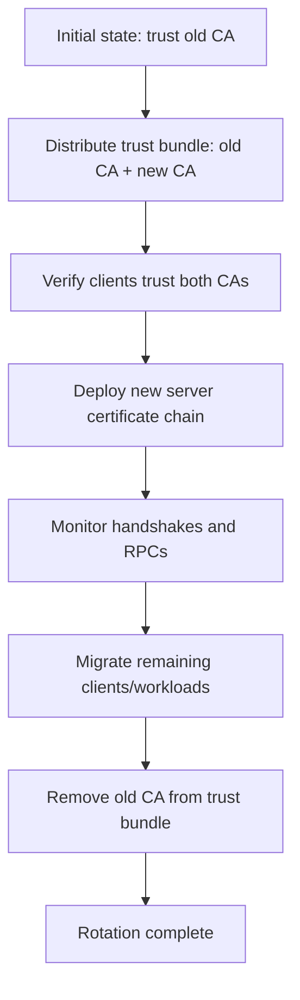

# Trust Managers and Certificate Rotation

## Lesson Objectives

In **SPRING_GRPC**, TLS does not only require certificates and private keys. Each side also needs a component that decides whether the peer's certificate is trusted. In Java, this role is typically handled by a `TrustManager`; the trust manager validates the certificate chain against trust anchors and PKI policies. When certificates or CAs change, the application must update trust material and credentials through a rotation procedure so new connections continue operating securely.

This lesson focuses on **trust managers and certificate rotation**: understanding `X509TrustManager` and `TrustManagerFactory`, distinguishing a trust store from a key store, applying trust roots for gRPC clients and mTLS servers, understanding that hostname verification is a separate step, and planning rotation of leaf certificates, client certificates, and CAs with a controlled overlap period.

After this lesson, you will be able to:

1. Explain the role of the trust manager in TLS clients and servers.
2. Create a trust manager from a trust store using `TrustManagerFactory`.
3. Distinguish between a trust manager, key manager, trust store, and key store.
4. Configure trust roots for gRPC channels and mTLS servers.
5. Recognize how trust chain validation differs from hostname verification.
6. Rotate leaf certificates, private keys, and CAs without unplanned downtime.
7. Determine when a channel/server must be recreated and how to test rotation.

> **Scope:** Examples use Java JSSE, gRPC Java, and Spring gRPC. TLS configuration APIs depend on the gRPC Java version and transport. For Spring-managed servers, apply credentials/SSL material through the extension point of the server factory in use; do not assume every starter shares the same reload properties.

## 1. What Does a Trust Manager Do?

TLS peer authentication requires verifying the certificate chain presented by the other side. Java provides trust manager interfaces to perform this task.

- **Trust manager** decides whether a peer's certificate is trusted based on trust anchors and verification policies.
- **Key manager** selects the certificate and private key that the local side presents to the peer when requested.
- **Trust store** contains CA certificates or trust anchors trusted by the application.
- **Key store** typically contains the private key along with its corresponding certificate chain owned by the application.

In one-way TLS:

- The client uses a trust manager to verify the server certificate.
- The server presents the server certificate and proves ownership of the private key via its key manager/credentials.

In mTLS:

- The client still verifies the server with its trust manager while presenting its client certificate/private key via its key manager.
- The server uses its trust manager to verify the client certificate while presenting its server certificate/private key.

| Component | Client | Server |
| --- | --- | --- |
| Trust manager | Verifies server certificate | Verifies client certificate in mTLS |
| Key manager | Presents client certificate in mTLS | Presents server certificate |
| Trust store | CA that issued server certificate | CA that issued client certificate |
| Key store/secret | Client identity key material | Server identity key material |

Do not confuse a peer's certificate with a trust anchor. Normally, the trust store holds approved root CAs; the peer sends the leaf and intermediate chain during the handshake. The client/server builds a path from the leaf up to the trust anchor.

## 2. X509TrustManager and TrustManagerFactory

### 2.1. X509TrustManager

`X509TrustManager` is the trust manager for X.509 certificates. Core methods include:

- `checkServerTrusted(chain, authType)`: verifies the chain presented by the server to the client.
- `checkClientTrusted(chain, authType)`: verifies the chain presented by the client to the server.
- `getAcceptedIssuers()`: returns the CA certificates accepted by the trust manager per configuration.

`X509ExtendedTrustManager` extends verification capabilities by also accepting a `Socket` or `SSLEngine`. This connection context allows implementations to apply transport/context-appropriate policies. When writing a custom trust manager, prefer delegating to the standard JSSE implementation first and then adding narrow policies; do not reimplement PKIX algorithms yourself unless there is a specialized requirement.

### 2.2. Creating a Trust Manager from a Trust Store

Example loading a PKCS#12 trust store containing an internal CA:

```java
KeyStore trustStore = KeyStore.getInstance("PKCS12");

try (InputStream input =
        Files.newInputStream(Path.of("certs/grpc-truststore.p12"))) {
    trustStore.load(input, trustStorePassword);
}

TrustManagerFactory trustManagerFactory =
        TrustManagerFactory.getInstance(
                TrustManagerFactory.getDefaultAlgorithm());

trustManagerFactory.init(trustStore);

X509TrustManager trustManager = Arrays.stream(
        trustManagerFactory.getTrustManagers())
        .filter(X509TrustManager.class::isInstance)
        .map(X509TrustManager.class::cast)
        .findFirst()
        .orElseThrow(() ->
                new IllegalStateException("No X509TrustManager found"));
```

`TrustManagerFactory` creates a trust manager using the JVM's default provider and algorithm, backed by the loaded trust store. In real applications:

- Retrieve the trust store password from a secret provider.
- Verify the CA fingerprint over a trusted channel before importing.
- Add only CAs approved for that specific client/server.
- Close streams and never log passwords or private material.

If calling `trustManagerFactory.init((KeyStore) null)`, JSSE typically uses the default trust store based on runtime/system properties. Exact behavior depends on the provider and JVM configuration; verify the deployment environment rather than assuming a fixed trust store.

### 2.3. A Trust Manager Does Not Automatically Verify Hostname

Trust chain validation and endpoint identity verification are two distinct checks:

1. The trust manager verifies signatures, path, validity, CA constraints, and PKI conditions of the certificate chain.
2. TLS endpoint identification verifies that the leaf certificate's SAN matches the hostname the client intends to connect to.

A chain may be valid while the certificate belongs to a different hostname. Do not write a custom trust manager that only checks the issuer and skips standard verification steps. For gRPC clients, keep default hostname verification enabled and use the target DNS name represented by the certificate.

## 3. Trust Stores and Key Stores in gRPC Configuration

### 3.1. Client Trusting the Server Certificate

With gRPC Java, `TlsChannelCredentials` can accept PEM CA certificates to create the trust configuration for a channel:

```java
ChannelCredentials credentials;

try (InputStream serverRoots =
        Files.newInputStream(Path.of("certs/server-root-ca.pem"))) {
    credentials = TlsChannelCredentials.newBuilder()
            .trustManager(serverRoots)
            .build();
}

ManagedChannel channel = Grpc.newChannelBuilder(
        "dns:///inventory.internal.example.com:9090",
        credentials)
        .build();
```

`trustManager(serverRoots)` provides trust roots for the TLS channel. It does not disable hostname verification. The server certificate must still have a SAN containing `inventory.internal.example.com`.

This is gRPC Java's PEM trust roots configuration style, not passing an arbitrary `X509TrustManager` instance. If a custom JSSE trust manager or custom Netty SSL context is needed, use the transport extension point corresponding to your running dependency and Spring gRPC version.

### 3.2. Server Verifying Client Certificates in mTLS

The server needs to trust the CA issuing client certificates and require clients to present certificates:

```java
ServerCredentials credentials;

try (InputStream serverChain =
         Files.newInputStream(Path.of("certs/server-chain.pem"));
     InputStream serverKey =
         Files.newInputStream(Path.of("secrets/server-key.pem"));
     InputStream clientRoots =
         Files.newInputStream(Path.of("certs/client-ca-bundle.pem"))) {

    credentials = TlsServerCredentials.newBuilder()
            .keyManager(serverChain, serverKey)
            .trustManager(clientRoots)
            .clientAuth(TlsServerCredentials.ClientAuth.REQUIRE)
            .build();
}
```

In this example:

- `keyManager` supplies the server certificate chain and private key.
- `trustManager` supplies CA roots to verify client certificates.
- `ClientAuth.REQUIRE` requires clients to send a valid certificate during the TLS handshake.

For a one-way TLS server, the server still needs key material but does not need to require client certificates. Only enable mTLS when the architecture requires client authentication at the transport layer.

### 3.3. Integrating with Spring gRPC

In Spring applications, channels and servers are typically managed by beans/factories:

- Client channels can be created from `ChannelCredentials` containing dedicated trust roots for the downstream service.
- The server factory needs server key material and, if mTLS is used, the client CA trust bundle along with the client-auth policy.
- `@GrpcService` beans remain bound to the Spring-managed server instance.
- If a custom `SSLContext` or Netty `SslContext` is needed, use the customization hook published in the documentation for the exact transport version.

Do not assume embedded servlet server TLS properties automatically apply to a native gRPC listener. Also do not create a secondary gRPC server manually to load a trust manager if the starter already owns the serving server.

## 4. When Is a Custom Trust Manager Needed?

The default trust manager from `TrustManagerFactory` is usually the best choice. Only build a custom implementation when there is a clear requirement such as:

- Using different trust anchors per endpoint/tenant.
- Applying additional policies for issuers, certificate pinning, or certificate attributes.
- Integrating internal PKI with specialized verification rules.
- Performing CRL/OCSP revocation checking if required by the provider and system policy.

If additional policy is needed, wrap/delegate to the default PKIX trust manager first, then check the extra required conditions. Structural example, not a complete implementation:

```java
final class PolicyTrustManager extends X509ExtendedTrustManager {

    private final X509ExtendedTrustManager delegate;

    PolicyTrustManager(X509ExtendedTrustManager delegate) {
        this.delegate = delegate;
    }

    @Override
    public void checkServerTrusted(
            X509Certificate[] chain,
            String authType,
            SSLEngine engine) throws CertificateException {
        delegate.checkServerTrusted(chain, authType, engine);
        verifyApprovedIssuerAndPolicy(chain);
    }

    // The checkClientTrusted/checkServerTrusted overloads for Socket
    // and the basic overloads must also delegate completely.
    // getAcceptedIssuers() returns the delegate's issuers.
}
```

In a real implementation, override all overloads required by the interface, delegate accurately by context, handle empty/null chains, and test both valid and invalid certificates. Never return unconditionally as trusted. A "trust-all" trust manager disables TLS authentication and creates server/client spoofing vulnerabilities.

### 4.1. Certificate Pinning Does Not Arbitrarily Replace PKI

Pinning a leaf certificate or public key can restrict accepted peers, but introduces additional rotation responsibilities. If pinning, you need:

- Both a current pin and a next pin for overlap.
- A secure out-of-band mechanism to update pins.
- A recovery plan if a key is compromised.
- Hostname verification and required certificate checks still enabled.

Merely comparing issuer/subject text is not cryptographic identity verification. Use certificate/public key fingerprints or a clearly defined PKI policy.

## 5. Types of Certificate Rotation

"Certificate rotation" can refer to several different changes. Determine which material is changing before planning:

| Rotation Type | Material Changing | Does the Trust Store Need to Change? |
| --- | --- | --- |
| Leaf certificate renewal, same CA | Server/client leaf certificate, possibly the key | Usually no, if the chain still leads to a trusted CA and identity/policy remain valid |
| Private key rotation, same CA | New key pair and leaf certificate | Usually no; deploy the key/cert pair together |
| Intermediate CA rotation | Intermediate chain | Possibly no if the root trust anchor stays unchanged and the new chain is valid |
| Root CA rotation | Trust anchor and chains issued by the new CA | Yes; the trust bundle must be updated in phases |
| Client CA rotation for mTLS | CA the server uses to verify clients | The server-side trust manager must trust the new CA during transition |
| Server CA rotation | CA the client uses to verify servers | The client-side trust manager must trust the new CA during transition |

If a leaf certificate is reissued by the same CA, clients do not need to import each leaf certificate when using standard CA trust. If switching root CAs, the trust bundle must change. Do not add leaf certificates into the trust store just to work around a missing intermediate; fix the chain sent by the server.

## 6. Overlapping Rotation to Avoid Downtime

For routine CA rotation, do not replace trust roots and server certificates across the entire system at once without a transition phase.



Typical workflow:

1. **Inventory:** identify issuer, serial, SAN, EKU, expiration date, where trust/key material is loaded, and owner of each certificate.
2. **Preload trust:** distribute the new CA to clients (when the server CA changes) or to servers (when the mTLS client CA changes), keeping the old CA in the trust bundle.
3. **Verify:** check the fingerprint, chain, and validity period of the new CA before trusting it.
4. **Deploy new identity:** deploy the new leaf certificate/private key on servers or clients per workload.
5. **Probe:** open new connections, verifying handshake, hostname, mTLS, and RPCs.
6. **Observe:** monitor handshake failures, clients still using the old issuer, and RPC error rates.
7. **Retire:** remove the old CA only when no valid workloads need it and the rollback window has closed.

For server certificate rotation under the same CA, the new certificate can be deployed via rolling restart/replacement of server instances. Client trust stores do not need changes if the CA and identity policy remain valid.

### 6.1. Rotating Client Certificates in mTLS

When a client rotates its leaf certificate while keeping the same CA, the server can still trust the new chain without changing its trust manager. If the client CA changes, the server must trust both old and new CAs during the overlap period.

Client certificates can be rotated per workload. Do not keep an existing channel carrying the old identity and expect a replaced key file to apply automatically. Create a new channel/credentials with the new client certificate, shift traffic to the new channel, then drain and shut down the old channel.

### 6.2. Compromises Requiring Emergency Handling

Overlap is not an absolute rule. If a private key or CA is compromised, continuing to trust the old CA just to preserve compatibility sustains exposure. Apply incident response: block/revoke the exposed identity, urgently update trust policies, rotate keys/certificates, and accept connection rejections for workloads not yet updated.

Revocation checking is not enabled identically by default across all JDKs/providers. If CRL/OCSP is required, configure PKIX revocation per TLS provider and test actual behavior; do not assume gRPC queries revocation services automatically by default.

## 7. When Must a Channel or Server Be Recreated?

One of the most common operational mistakes is replacing a certificate file on disk and expecting running TLS contexts to reload it automatically.

- **Client channel:** credentials/trust material are typically created when configuring the channel. Replacing PEM files afterward does not guarantee a running channel reloads trust roots or client keys. For reliable rotation, create a new channel from the new material, verify connectivity, shift traffic, drain, and shut down the old channel.
- **Server:** the server factory typically loads certificate/key/trust material when creating the SSL context or starting the server. Reloading occurs only if the transport/server factory has a supported reload mechanism. Otherwise, deploy new server instances or perform a rolling restart.
- **TLS terminator proxy:** reload semantics depend on the proxy. Check documentation and verify the certificate presented on new connections after reloading.

Already-established TLS connections do not automatically swap certificates/keys just because source files change. Rotation primarily affects new handshakes; therefore, verify using new connections after each step.

### 7.1. Replacing Channels Without Disrupting Callers

A client manager can hold the current channel reference, build the new channel first, verify health/RPCs, then route new calls to the new channel. The old channel is drained with a bounded grace period before closing.

If the application uses generated stubs, create new stubs from the new channel at the same time the channel is published. Do not publish new stubs before the channel is ready. Handle failures when the new channel cannot connect: retain the old channel if the old certificate is still secure and trusted.

## 8. Testing Trust Managers and Rotation

### 8.1. Checking the Trust Store Before Deployment

Use OpenSSL to inspect the CA's fingerprint and validity:

```bash
openssl x509 -in new-root-ca.pem -noout \
  -subject -issuer -dates -fingerprint -sha256
```

List the Java trust store:

```bash
keytool -list -v -keystore grpc-truststore.p12 -storetype PKCS12
```

Compare the fingerprint against the value distributed by the CA/platform team through a trusted channel. Never import a CA solely based on filename or subject.

### 8.2. Positive and Negative Tests

The test suite should include:

| Case | Expected Result |
| --- | --- |
| Server chain to trusted CA, valid hostname | TLS and RPC succeed |
| Server chain to untrusted CA | Handshake fails |
| Valid chain but wrong hostname | Client rejects identity |
| Missing intermediate | Validation fails if client cannot build a valid path |
| New leaf under old CA | Connects successfully without changing trust root |
| New leaf issued by new CA, new CA preloaded | Connects successfully |
| New CA not yet preloaded | Handshake fails |
| New client certificate in mTLS, client CA already trusted by server | Handshake and RPC succeed |
| Client certificate issued by CA not trusted by server | mTLS handshake fails |
| Old CA removed after migration | Certificate chain relying solely on old CA is rejected |

Test both the handshake and RPCs using a generated stub. For mTLS, verify both the case where the handshake fails before the interceptor and the case where a valid certificate whose identity lacks permission returns `PERMISSION_DENIED`.

### 8.3. Verifying New Connections After Rotation

After replacing a certificate or trust bundle:

1. Create a new channel or open a new connection to the server.
2. Verify the protocol, issuer, serial/fingerprint, and SAN of the presented certificate.
3. Verify the trust chain and hostname.
4. Call a representative RPC over HTTP/2.
5. Check handshake failure logs/metrics and gRPC statuses.
6. Retire old material only after confirming all clients/servers have migrated.

Do not use an existing old connection to conclude that the new certificate has been loaded.

## 9. Observing and Operating Certificates

Track the following non-sensitive information:

- Time remaining until expiry of server/client certificates.
- Normalized issuer, serial, or fingerprint per audit policy.
- Handshake success/failure counts and cause categories.
- Number of clients still using the old CA/certificate during overlap.
- Number of channels/server instances switched to new credentials.
- RPC latency/status after successful TLS handshakes.

Do not log PEM private keys, passwords, secret mount contents, or full TLS sessions. When investigating, log fingerprints/issuers/serials and correlation IDs per security policy.

A solid rotation has a clear rollback plan: know until when the old certificate/key remains valid, how the old trust bundle can be restored, and under what conditions rollback must be halted (e.g., if the old key has been compromised).

## 10. Common Mistakes

| Symptom | Cause | Resolution |
| --- | --- | --- |
| Unknown CA after deploy | Trust manager lacks the new root | Preload the new CA and verify its fingerprint |
| New certificate valid but hostname mismatch | SAN does not include target hostname | Issue certificate with right SAN; do not disable hostname verification |
| Replaced CA file but channel still reports unknown CA | Channel retains trust material loaded at creation | Create a new channel or use a supported reload mechanism |
| Server still presents old certificate | Server SSL context has not reloaded | Rolling restart or reload per server factory/transport |
| Leaf rotation under same CA breaks clients | Key/certificate pair mismatch or chain missing intermediate | Check public key digest and chain |
| Removed old CA too early | Some clients/servers have not migrated certificates | Restore trust overlap if old CA is still safe; finish rollout |
| Custom trust manager accepts wrong certificates | Delegate bypassed or policy too permissive | Delegate to standard PKIX and add narrow policy |
| mTLS server does not verify clients | Wrongly used server CA trust roots or client auth not enabled | Configure client CA trust and REQUIRE per policy |
| Revoked certificate still connects | CRL/OCSP/revocation policy not enabled or updated | Configure and test revocation checking or denylist |
| Rotation causes UNAVAILABLE spike | Uncoordinated channel/server credential swap or no overlap | Deploy in order, canary, and monitor handshakes |

## 11. Hands-on Exercises

1. Create a PKCS#12 trust store containing a test root CA and build an `X509TrustManager` via `TrustManagerFactory`.
2. Explain which certificate chain the trust manager validates on a one-way TLS client and on an mTLS server.
3. Configure a gRPC Java client with `TlsChannelCredentials.trustManager` using a test CA; verify hostname is still checked.
4. Configure a Spring gRPC mTLS server with server key material and a client CA trust bundle.
5. Issue a new leaf server certificate from the same CA; verify existing clients connect without changing their trust root.
6. Create a new CA, preload both old and new CAs into the trust bundle, switch the server certificate to the new CA, and remove the old CA after rollout.
7. Create a new channel with a new client certificate, shift traffic, drain the old channel, and verify in-flight RPCs.
8. Try a custom trust manager that delegates to PKIX and adds an issuer policy; verify certificates outside the policy are rejected.
9. Write tests for unknown CA, hostname mismatch, missing intermediate, leaf rotation, and CA rotation.
10. Simulate a compromised private key and explain why emergency revocation may be necessary instead of overlap.

### Self-Check Questions

- How do a trust manager and a key manager differ?
- On which side does `X509TrustManager` verify the server certificate?
- Where does `TrustManagerFactory` get its trust anchors?
- Does trust chain validation replace hostname verification?
- When does leaf certificate rotation not require changing the trust store?
- When the root CA changes, why should the new CA be preloaded before replacing the server certificate?
- Why might replacing a PEM file not update a running channel or server?
- When must a new channel be created and the old channel drained?
- Why should a custom trust manager delegate to the PKIX validator?
- When a private key is compromised, why might a normal overlap procedure be inappropriate?

## References

- [Java — X509TrustManager](https://docs.oracle.com/en/java/javase/17/docs/api/java.base/javax/net/ssl/X509TrustManager.html): verifying peer certificate chains.
- [Java — X509ExtendedTrustManager](https://docs.oracle.com/en/java/javase/17/docs/api/java.base/javax/net/ssl/X509ExtendedTrustManager.html): Socket/SSLEngine context-aware trust validation.
- [Java — TrustManagerFactory](https://docs.oracle.com/en/java/javase/17/docs/api/java.base/javax/net/ssl/TrustManagerFactory.html): creating trust managers from a trust store.
- [Java Security — JSSE Reference Guide](https://docs.oracle.com/en/java/javase/17/security/java-secure-socket-extension-jsse-reference-guide.html): trust stores, key stores, and TLS.
- [gRPC Java — TlsChannelCredentials](https://grpc.github.io/grpc-java/javadoc/io/grpc/TlsChannelCredentials.html): trust roots and client credentials.
- [gRPC Java — TlsServerCredentials](https://grpc.github.io/grpc-java/javadoc/io/grpc/TlsServerCredentials.html): server key material and client trust in mTLS.
- [Spring gRPC — GRPC Server](https://docs.spring.io/spring-grpc/reference/server.html): server and service bean integration in Spring.
- [OpenSSL — verify](https://docs.openssl.org/3.0/man1/openssl-verify/): inspecting certificate paths and purposes.
- [RFC 5280 — Internet X.509 PKI Certificate and CRL Profile](https://www.rfc-editor.org/rfc/rfc5280): certificate paths, CA constraints, and CRLs.

**Expected Outcome:** Learners can configure appropriate trust managers for gRPC clients and mTLS servers, distinguish trust chains from hostname verification, design overlapping leaf certificate and CA rotation procedures, know when channels/servers must be recreated, and verify rotation via handshakes and RPC integration tests.
