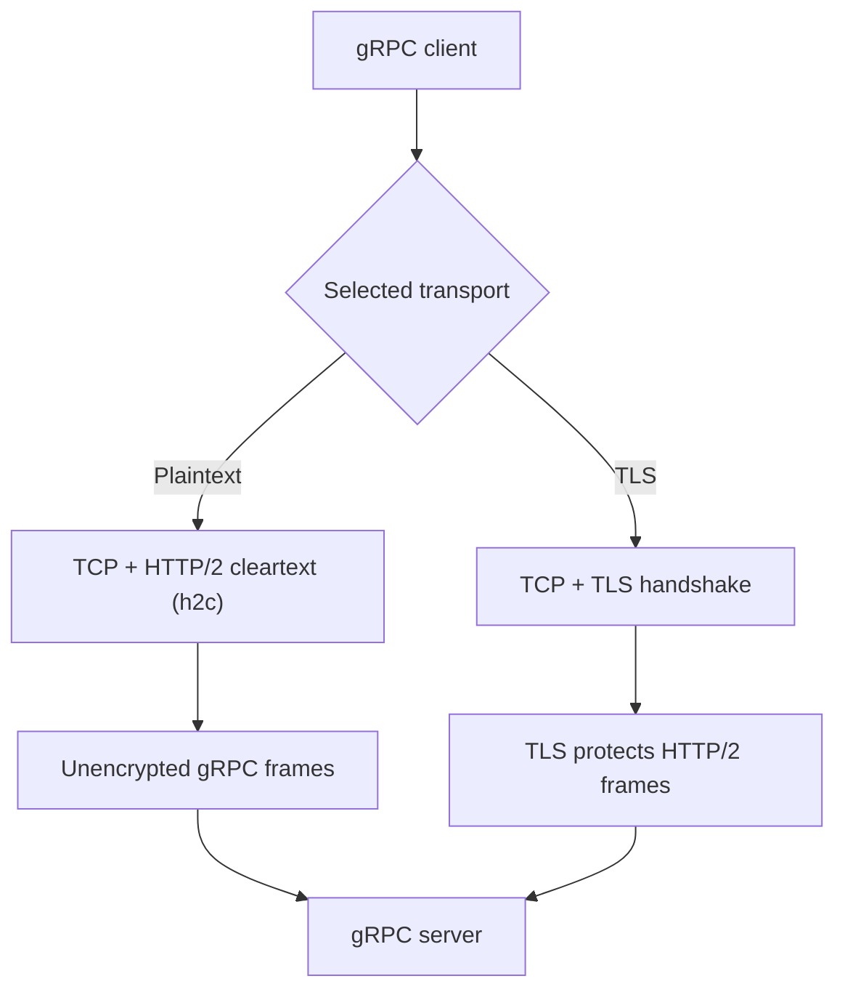
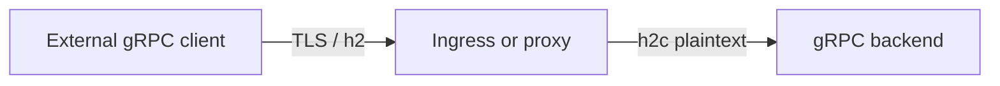
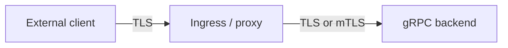

# Using Plaintext Only in Appropriate Environments

## Lesson Objectives

In **SPRING_GRPC**, gRPC can run over HTTP/2 with TLS or over an unencrypted (plaintext) connection. Plaintext is often referred to as h2c: HTTP/2 cleartext. It is useful for local testing, in-process communication, or a network hop already isolated and protected by another layer. However, plaintext does not authenticate peer identity and does not protect data from eavesdropping or tampering in transit.

This lesson focuses on **when plaintext is appropriate and how to limit risks when using it**. Learners distinguish in-process transport, loopback, and network plaintext; configure gRPC Java clients/servers; understand TLS boundaries when traversing proxies/service meshes; and test to ensure plaintext is enabled only where intended.

After this lesson, you will be able to:

1. Explain how plaintext gRPC and h2c differ from TLS gRPC.
2. Evaluate a connection by its network trust boundary rather than relying solely on the label "internal."
3. Choose plaintext for in-process, loopback, or isolated test environments when appropriate.
4. Configure gRPC Java clients/servers to use plaintext and integrate properly with a Spring-managed server.
5. Identify risks when transmitting tokens, metadata, or sensitive data over plaintext.
6. Analyze each hop when TLS is terminated at a proxy or service mesh.
7. Test for protocol mismatches and verify production environments still use TLS/mTLS per policy.

> **Scope:** Examples use gRPC Java and Spring gRPC. Server factories, transports, and properties vary by version. Standalone examples illustrate gRPC Java APIs; if Spring manages the server, configure the transport through the extension point supported by your project's version rather than starting a secondary server.

## 1. What Is Plaintext gRPC?

gRPC uses HTTP/2 framing to transmit requests, responses, metadata, and statuses. Without TLS, the client opens a TCP connection and exchanges HTTP/2 cleartext (h2c). There is no TLS handshake, certificate exchange, encryption, or TLS peer authentication.

| Characteristic | Plaintext (h2c) | TLS gRPC |
| --- | --- | --- |
| HTTP/2 framing | Yes | Yes |
| TLS handshake | No | Yes |
| Hop data encryption | No | Yes |
| Integrity against tampering in transit | Not protected by TLS | Protected by TLS |
| Server authentication via certificate | No | Yes |
| Transport-layer client authentication | No mTLS | Can use mTLS |
| ALPN | Not negotiated via TLS | Typically negotiates h2 |
| Used when | In-process, loopback, testing, or appropriately protected hops | Networks observable/controllable by others and standard production environments |

Plaintext does not mean gRPC drops HTTP/2 or its status mechanism. RPCs still use service/method paths, metadata, deadlines, cancellation, and status codes. The difference lies in transport protection.



With TLS, ALPN typically selects h2 during the handshake. With h2c, there is no ALPN because there is no TLS handshake; both ends must be configured to exchange HTTP/2 cleartext according to the transport's supported mechanism.

## 2. Protections Lost When Using Plaintext

When a gRPC connection runs over plaintext, any party capable of observing or intercepting the network path can read or modify the traffic.

Key risks:

- **Confidentiality:** protobuf payloads, metadata, headers, and trailers are transmitted unencrypted. Sensitive contents can be read via packet capture or compromised network devices.
- **Integrity:** an intermediary can alter or inject data. TCP checksums are not a cryptographic authentication mechanism.
- **Server identity:** the client does not verify a certificate/hostname, so there is no TLS proof that the endpoint is the intended server.
- **Client identity:** the server does not receive a client certificate from TLS. Network source IPs or self-declared metadata are not cryptographic proof of identity.
- **Credential exposure:** bearer tokens, API keys, or cookies sent in metadata can be eavesdropped and replayed.
- **Compliance:** many environments require encryption in transit; plaintext may violate policy even when traffic stays on an internal network.

Application authentication/authorization can still be implemented at the RPC layer, but sending credentials over plaintext exposes those credentials on the network. Network ACLs, firewalls, or private subnets can reduce the access surface, yet do not provide confidentiality and integrity equivalent to TLS.

Do not send bearer tokens, passwords, private data, or data classified as sensitive over a plaintext network connection. If the application needs workload authentication, use TLS/mTLS or an architecturally approved hop protection mechanism.

## 3. When Is Plaintext Appropriate?

Evaluate based on where traffic travels, who can access the path, and what data is transmitted.

| Environment | Assessment | Conditions |
| --- | --- | --- |
| gRPC in-process transport | Suitable for testing/communication within the same process | No network socket; do not use to infer production TLS configuration |
| Loopback on the same host | Can be suitable for local development or a sidecar hop | Both endpoints reside on the same host/network namespace; port is not exposed to other interfaces |
| Integration tests on developer machine/CI | Can be suitable | Isolated test network, dummy data, no production credentials |
| Same-host containers | Only suitable when network boundaries are verified | Container network and port exposure must be restricted; a container is not automatically a trust boundary |
| Kubernetes cluster/VPC/private subnet | Not suitable by default | Traffic may traverse nodes, overlays, shared networks, or other tenants; requires explicit policy and hop protection |
| Proxy-to-backend in a private segment | Can be suitable in an approved architecture | Isolated segment, access-controlled, carrying no data/credentials requiring confidentiality on that hop |
| Internet or untrusted networks | Unsuitable | Use TLS; consider mTLS for service-to-service |

### 3.1. In-Process Transport

gRPC Java provides an in-process transport so clients and servers communicate within the same process without opening a TCP socket. This is a strong choice for unit/integration tests when you want to verify generated stubs and service behavior quickly.

```java
String serverName = InProcessServerBuilder.generateName();

Server server = InProcessServerBuilder
        .forName(serverName)
        .directExecutor()
        .addService(new InventoryGrpcEndpoint())
        .build()
        .start();

ManagedChannel channel = InProcessChannelBuilder
        .forName(serverName)
        .directExecutor()
        .build();
```

This example illustrates a test transport; close the channel and server during teardown. In-process is not network plaintext: there is no TCP socket or packet traversing the network. It also does not prove that TLS configuration, HTTP/2 network negotiation, or certificate validation works.

### 3.2. Loopback on the Same Host

A local client can connect to 127.0.0.1 or ::1 if the server binds strictly to the loopback interface. This restricts the listener to that host within the corresponding network namespace.

Do not confuse host loopback with container loopback. 127.0.0.1 inside a container only points to that container. If the client and server are in two different containers, they normally require a network interface/bridge; at that point, re-evaluate the boundary.

In development, use dummy data and do not expose ports to LAN/public interfaces. In containers, bind the appropriate interface for the service to function, but restrict reachability via network policies/firewalls and do not treat a private bridge as encryption.

## 4. Configuring a Plaintext Client with gRPC Java

With gRPC Java, a client channel uses `usePlaintext()` to select a non-TLS transport:

```java
ManagedChannel channel = ManagedChannelBuilder
        .forAddress("127.0.0.1", 9090)
        .usePlaintext()
        .build();

try {
    InventoryGrpc.InventoryBlockingStub stub =
            InventoryGrpc.newBlockingStub(channel);

    StockReply reply = stub
            .withDeadlineAfter(500, TimeUnit.MILLISECONDS)
            .getStock(GetStockRequest.newBuilder()
                    .setSku("SKU-LOCAL-01")
                    .build());
} finally {
    channel.shutdown();
    if (!channel.awaitTermination(5, TimeUnit.SECONDS)) {
        channel.shutdownNow();
    }
}
```

Key points to note:

- `usePlaintext()` is a channel transport selection; it does not merely disable certificate validation—it removes TLS from the connection.
- The target must point to a listener that accepts h2c.
- Deadlines and channel lifecycle still need management just like any other client.
- Do not create a new channel per RPC.
- Do not send production tokens/secrets in the metadata of a plaintext channel.

In a Spring application, the channel can be managed as a bean for the local/test profile. The property names below are application-defined configuration, not built-in properties applicable to every Spring gRPC version:

```yaml
grpc:
  clients:
    inventory:
      target: 127.0.0.1:9090
      transport: plaintext
```

The production profile needs separate configuration and testing to ensure the channel uses TLS credentials. Do not let a default plaintext property be accidentally inherited into production.

## 5. Configuring a Plaintext Server

With gRPC Java APIs supporting credential-based server builders, a plaintext server can use `InsecureServerCredentials`:

```java
Server server = Grpc.newServerBuilderForPort(
        9090,
        InsecureServerCredentials.create())
        .addService(new InventoryGrpcEndpoint())
        .build()
        .start();
```

The example above illustrates a gRPC Java server without TLS enabled. This listener should only be bound to loopback or an evaluated, protected network segment. Credential/transport APIs must match the project's gRPC Java version.

### 5.1. Spring-Managed Server

In a Spring gRPC application, services are typically declared with `@GrpcService` and the server factory manages registration/lifecycle. If plaintext is needed for local/test:

- Choose the right server transport and local/test profile.
- Configure the server factory via the plaintext mechanism supported by your Spring gRPC version.
- Restrict the listener/port to an appropriate network scope.
- Do not create a standalone `ServerBuilder` if the starter already manages the server.
- Verify the server actually accepts h2c and no other TLS terminator sits in front of the listener.

Do not invent a property like `spring.grpc.server.plaintext=true` without verifying it exists in the running version. Native gRPC servers and servlet/HTTP servers may have different TLS/HTTP2 configurations. Read the exact documentation for the starter/transport in use before deploying.

## 6. TLS Termination and Plaintext Between Hops

A system may have multiple connection hops. TLS at the edge does not automatically encrypt hops behind it.

Example:



In this topology, client-to-proxy is protected by TLS; proxy-to-backend is plaintext. The internal hop can only use plaintext when the architecture has evaluated that network segment, restricted access, and accepted the remaining risk.

If the proxy and backend run on separate hosts/network namespaces, or traffic traverses shared nodes/networks, consider upstream TLS/mTLS:



A service mesh can automatically encrypt the hop between sidecar proxies. Clearly determine whether the app-to-sidecar segment is plaintext, where the sidecar terminates/originates TLS, and which policies are enforced. Do not conclude "the mesh has mTLS" means every byte from one process to another is encrypted.

## 7. Authentication and Metadata Over Plaintext

gRPC supports metadata and application authentication, but plaintext does not protect metadata in transit.

Example authorization metadata:

```text
authorization: Bearer <token>
x-request-id: 9f2...
```

If the connection is plaintext network traffic, the bearer token can be read and replayed. Therefore:

- Do not send production bearer tokens, session cookies, or API keys over plaintext.
- Do not treat an IP allowlist as strong enough peer authentication for sensitive workloads.
- Do not use client-declared metadata such as `x-client-name` as a verified identity.
- If authentication between workloads is required, use TLS/mTLS or an identity mechanism protecting the entire hop.
- Method/resource authorization still needs to be applied even when the transport already uses mTLS.

Plaintext can be suitable for tests using non-sensitive fixture identities or local dummy data. Do not use this test shortcut to conclude the production auth flow is secure.

## 8. Common Misconceptions

**"On an internal network, data is automatically safe."** A private subnet may reduce exposure from the Internet, but does not prevent nodes, workloads, administrators, packet captures, or compromised components from reading traffic.

**"We have a firewall, so TLS isn't needed."** Firewalls control reachability; TLS protects content and verifies peers. The two mechanisms serve different goals.

**"We have an authentication interceptor, so plaintext is safe."** An interceptor can validate a token, but the token still travels unencrypted and can be stolen before reaching the interceptor.

**"There is only one service, so plaintext is fine."** The number of services does not define the trust boundary. Even a single service still needs TLS if traffic crosses an untrusted network.

**"TLS terminates at ingress, so the backend is always safe."** Only the client-to-ingress hop is protected by TLS. Ingress-to-backend must be evaluated separately.

**"A plaintext client only ignores certificate errors."** `usePlaintext()` removes the TLS handshake altogether. It does not validate certificates more loosely; the connection switches to a non-TLS protocol.

**"gRPC compression protects data."** Compression is not encryption and does not authenticate peers. Do not use compression in place of TLS.

## 9. Testing and Verifying Transport Mode

The test suite should explicitly verify that client and server use the same transport mode:

| Client | Server | Expected Result |
| --- | --- | --- |
| Plaintext | Plaintext h2c | RPCs work if HTTP/2 cleartext is supported |
| TLS | TLS with valid certificate/trust | Handshake and RPC succeed |
| Plaintext | TLS-only listener | Connection fails |
| TLS | Plaintext-only listener | Handshake fails |
| TLS with wrong CA | TLS | Client rejects certificate |
| TLS with wrong hostname | TLS | Hostname verification fails |
| In-process channel | In-process server | Tests service behavior; does not test network/TLS |

### 9.1. Checking a Plaintext Endpoint

You can use grpcurl in plaintext mode:

```bash
grpcurl -plaintext 127.0.0.1:9090 list
```

The command requires server reflection or appropriate descriptor/proto inputs. `-plaintext` tells grpcurl to use h2c; if the server only accepts TLS, the connection will fail. Do not use this command as a production health check if the endpoint requires TLS.

### 9.2. Checking a TLS Endpoint

For a TLS endpoint, use grpcurl with the appropriate CA trust:

```bash
grpcurl -cacert certs/root-ca.pem grpc.example.com:9090 list
```

If the server does not enable reflection, supply a proto/descriptor set. Verify hostname and CA trust remain enabled; do not switch to `-insecure` to make tests pass.

### 9.3. Integration Tests in Spring

For Spring gRPC tests:

- Use in-process transport for unit/service behavior when sockets do not need testing.
- Use a dedicated loopback plaintext test if h2c needs verification.
- Use TLS integration tests with certificate fixtures to verify trust/hostname.
- Call a generated stub over the right channel to prove RPCs actually work.
- Close the channel/server in teardown and do not share test ports outside the test scope.

Do not let plaintext tests be the only tests for a service that will run in production over TLS/mTLS.

## 10. Managing Profiles and Preventing Plaintext from Reaching Production

Make the transport mode explicit per profile/environment rather than inheriting it implicitly from an obscure default.

One way to organize configuration:

```yaml
# application-local.yml
grpc:
  clients:
    inventory:
      target: 127.0.0.1:9090
      transport: plaintext

# application-prod.yml
grpc:
  clients:
    inventory:
      target: dns:///inventory.internal.example.com:9090
      transport: tls
      trust-bundle: file:/run/secrets/server-ca.pem
```

This is an example application configuration schema. When initializing clients/servers, validate values against the profile and fail fast if production selects plaintext outside allowed policy.

Recommended controls:

1. Production profiles do not use `usePlaintext()` for networked endpoints.
2. CI checks deployment configurations do not enable plaintext outside an allowlist.
3. Network policies/firewalls open only required ports for authorized workloads.
4. Production secrets/tokens are not injected into plaintext clients.
5. Observe TLS handshakes and RPC errors to detect protocol mismatches.
6. Document which hops terminate TLS and which hops remain plaintext.
7. Maintain an owner, rationale, scope, and expiration date for every plaintext exception.

If an exception permits plaintext on an internal hop, record the data classification, network boundary, access controls, threat model, monitoring, and conditions for retiring the exception.

## 11. Common Mistakes

| Symptom | Cause | Resolution |
| --- | --- | --- |
| Plaintext client cannot connect to server | Server only accepts TLS or transport lacks h2c support | Confirm listener mode and HTTP/2 cleartext support |
| TLS client reports handshake failure against plaintext server | Client sends TLS ClientHello to an h2c listener | Use matching channel credentials and server transport |
| Plaintext client fails calling a TLS endpoint | Client does not perform a TLS handshake | Use TLS credentials; do not downgrade production server to plaintext |
| Local tests pass but production fails | Tests only used in-process/h2c while production requires TLS | Add TLS integration tests with trust roots/certificates |
| Token appears in packet capture | Credentials sent over plaintext | Revoke/rotate exposed token and move hop to TLS |
| Proxy receives TLS but backend traffic is exposed | Upstream hop uses plaintext across a wide network boundary | Enable upstream TLS/mTLS or isolate hop per policy |
| Container client cannot reach loopback server | Loopback refers to a different network namespace | Use service DNS/container network and evaluate hop protection |
| Changed profile but transport did not change | Bean/channel created from different config or profile inactive | Verify active profile and actual channel/server config |
| Have a firewall but still worry about sniffing | Firewalls do not encrypt payloads | Use TLS to protect confidentiality/integrity |
| Reflection works on a public plaintext port | Port is unrestricted, unintentionally exposing schema | Limit exposure; use TLS/auth and proper reflection policy |

## 12. Hands-on Exercises

1. Create a gRPC in-process test and explain why it does not test network TLS.
2. Start an h2c gRPC Java server on loopback, call it using a `usePlaintext()` channel and a generated stub.
3. Try calling a plaintext client against a TLS-only server and a TLS client against a plaintext-only server; observe the handshake/protocol errors.
4. Create a local Spring profile using plaintext with dummy data and a production profile using a TLS trust bundle.
5. Use grpcurl `-plaintext` to inspect a local h2c endpoint, then use `-cacert` to inspect a TLS endpoint.
6. Draw a topology where ingress terminates TLS and the backend uses h2c; mark the trust boundary of each hop.
7. Add a network policy/firewall restricting the plaintext hop to required workloads and verify out-of-scope workloads cannot connect.
8. Write a CI check that fails when a production profile configures plaintext outside an allowlist.
9. Create a TLS integration test verifying CA/hostname to avoid relying solely on plaintext tests.
10. Write an exception record for a plaintext hop: purpose, data classification, owner, access control, monitoring, and review date.

### Self-Check Questions

- Does plaintext gRPC use HTTP/2 cleartext (h2c) or HTTP/1.1?
- Why does plaintext not have ALPN h2 negotiation?
- Which protections provided by TLS are lost with plaintext?
- When is in-process transport appropriate and how does it differ from h2c?
- Is loopback inside a container the same as loopback on the host?
- Why is a private subnet not automatically a sufficient trust boundary?
- What happens to a bearer token sent over plaintext?
- Which hops does TLS termination at ingress protect?
- When can proxy-to-backend plaintext be acceptable?
- How do you ensure a local plaintext profile does not leak into production?

## References

- [gRPC — Core Concepts](https://grpc.io/docs/what-is-grpc/core-concepts/): transport, channels, servers, and RPC lifecycle.
- [gRPC — Authentication](https://grpc.io/docs/guides/auth/): TLS and authentication for gRPC.
- [gRPC Java — ManagedChannelBuilder](https://grpc.github.io/grpc-java/javadoc/io/grpc/ManagedChannelBuilder.html): configuring client channels, including plaintext transport.
- [gRPC Java — InsecureServerCredentials](https://grpc.github.io/grpc-java/javadoc/io/grpc/InsecureServerCredentials.html): non-TLS server credentials.
- [gRPC Java — InProcessServerBuilder](https://grpc.github.io/grpc-java/javadoc/io/grpc/inprocess/InProcessServerBuilder.html): in-process server transport.
- [gRPC Java — InProcessChannelBuilder](https://grpc.github.io/grpc-java/javadoc/io/grpc/inprocess/InProcessChannelBuilder.html): in-process client channels.
- [grpcurl](https://github.com/fullstorydev/grpcurl): tool for invoking and inspecting gRPC endpoints.
- [RFC 9113 — HTTP/2](https://www.rfc-editor.org/rfc/rfc9113): HTTP/2 protocol and framing.

**Expected Outcome:** Learners can distinguish plaintext h2c, in-process transport, and TLS gRPC; choose plaintext only for environments/hops with clear trust boundaries; avoid transmitting credentials or sensitive data over unencrypted networks; properly configure Spring gRPC clients/servers; and test transport modes so plaintext never accidentally appears in production.
