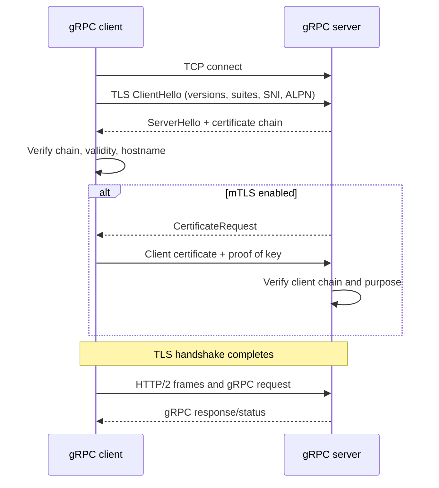
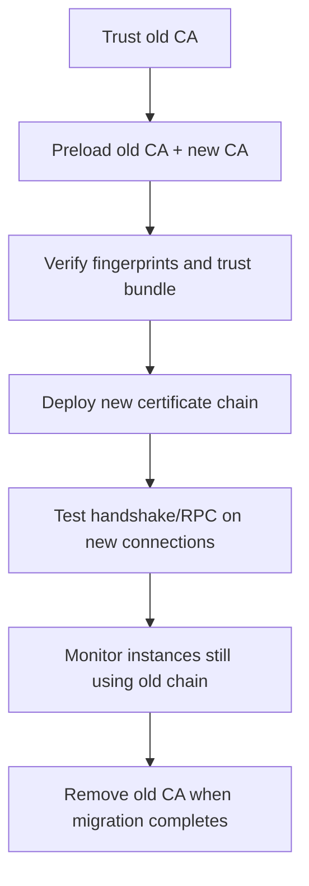

# Handshake Failures and Expired Certificates

## Lesson Objectives

In **SPRING_GRPC**, TLS protects gRPC connections over HTTP/2 and verifies peer identity before RPCs are processed. A connection can fail right during the TLS handshake due to an expired certificate, a not-yet-valid certificate, a missing intermediate CA, a hostname mismatch, a wrong trust store, or an incompatible TLS policy. When using mutual TLS (mTLS), failures can also originate from the client-side certificate.

This lesson focuses on **handshake failures and expired certificates**: identifying at which stage the handshake stops, inspecting certificate chain and validity details, diagnosing errors from both client/server sides, verifying with OpenSSL and Java, fixing the exact root cause, and establishing expiry monitoring and zero-downtime renewal/rotation procedures.

After this lesson, you will be able to:

1. Distinguish TLS handshake errors from gRPC errors occurring after the connection is established.
2. Identify expired certificates, not-yet-valid certificates, and system clock issues.
3. Diagnose trust chain, hostname/SAN, SNI, EKU, key mismatch, and mTLS issues.
4. Inspect the certificate actually being presented by the listener.
5. Use OpenSSL and Java TLS diagnostics to isolate failures.
6. Renew and rotate certificates with overlap, verifying reload/restart semantics.
7. Set up expiry alerts and integration tests for critical TLS failures.

> **Scope:** Examples use gRPC Java, Spring gRPC, Java JSSE, and OpenSSL. TLS configuration/reload behavior depends on the gRPC Java version, transport, and Spring server factory. The lesson focuses on diagnosis and operations; do not assume a single common TLS property across all starters.

## 1. At Which Stage Does the Handshake Fail?

When a gRPC client connects to a TLS server, the transport must complete the TLS handshake before sending HTTP/2 frames and RPC messages. The client sends ClientHello with supported protocols/ciphers, SNI, and ALPN; the server selects parameters, presents its certificate chain, and proves private key ownership. The client verifies the chain and hostname. With mTLS, the server also requests a client certificate and verifies it.



If certificate validation or TLS negotiation fails, RPC handlers and server interceptors usually have not been invoked yet. The client may observe a connection/channel error, often surfaced as `UNAVAILABLE` or a transport/TLS error depending on timing and implementation. Do not infer the specific root cause solely from the gRPC status; inspect the exception root cause, transport logs, and independent TLS check results.

If the handshake succeeded but the RPC returns `UNAUTHENTICATED`, `PERMISSION_DENIED`, `UNIMPLEMENTED`, or a business error, investigate the RPC/authentication/authorization/service routing layer. That is a different class of issue from a certificate handshake failure.

## 2. Common Certificate Causes

| Cause | Symptom | What to Verify |
| --- | --- | --- |
| Expired certificate | certificate has expired, expired certificate | notAfter of the leaf and every intermediate in the chain |
| Certificate not yet valid | not yet valid, validity check failed | notBefore and client/server clocks |
| Untrusted CA | unknown CA, PKIX path building failed | Trust anchor, fingerprint, and chain |
| Missing intermediate | Unable to build certification path | Intermediates sent by the server and chain issued by the CA |
| Hostname mismatch | No subject alternative DNS name matching | DNS/IP SAN and target hostname |
| Wrong certificate purpose | Key usage/EKU validation failure | Appropriate serverAuth or clientAuth |
| Certificate/key mismatch | Server fails to start or handshake does not complete | Public key in the certificate compared to loaded key pair |
| SNI selects wrong certificate | One hostname works, another fails | SNI, virtual host mapping, and certificate presented by listener |
| Incompatible protocol/cipher | handshake_failure, protocol_version, no cipher suites in common | TLS version, cipher allowlist, provider, and certificate key type |
| mTLS client certificate error | Server rejects client at handshake | Client chain, EKU, expiry, CA trust, and private key |

A single failure can have multiple simultaneous causes. For instance, the leaf certificate is not expired while an intermediate has expired; or the chain is trusted while the SAN does not match the hostname. Check each layer in order instead of just changing the trust store or disabling verification.

## 3. Checking Certificate Validity Periods

### 3.1. Understanding notBefore and notAfter

An X.509 certificate has a validity window:

- `notBefore`: timestamp when the certificate becomes valid.
- `notAfter`: timestamp when the certificate expires.

The TLS validator checks the machine's current time against these bounds. A certificate can be rejected before its expiration date if the system clock is significantly fast/slow or if the certificate has not yet reached `notBefore`.

Check the entire chain, not only the leaf certificate. A still-valid leaf can fail verification if its intermediate CA or root CA has expired or is no longer trusted by policy.

### 3.2. Viewing Validity and SAN with OpenSSL

```bash
openssl x509 -in server.pem -noout \
  -subject -issuer -dates -ext subjectAltName -ext extendedKeyUsage
```

Check whether the certificate has expired or will expire within 30 days (2,592,000 seconds):

```bash
openssl x509 -in server.pem -noout -checkend 2592000
```

- Exit code `0`: the certificate does not expire within the checked timeframe.
- Non-zero exit code: the certificate has expired or will expire within that timeframe.

`-checkend` checks only the specified certificate. Repeat for each intermediate or verify the full chain using an appropriate PKI tool.

### 3.3. Checking System Clocks

If an unexpected `not yet valid` or `expired` error occurs:

1. Compare UTC time across the client, server, containers, and node hosts.
2. Check NTP/time synchronization.
3. Timezone is only for display; certificate validity is evaluated at absolute instants.
4. Check for clock drift after VM/container suspension or node desynchronization.
5. Reissue a certificate only once system time is accurate and the certificate's dates are genuinely wrong.

Do not extend certificate acceptance by disabling validity checks. Incorrect clocks can also affect token expiry, deadlines, log correlation, and many other security mechanisms.

## 4. Inspecting the Certificate Actually Presented by the Server

Do not only read the certificate file on disk. The listener may still be using an old certificate because the TLS context was created earlier, a proxy holds its own certificate, or SNI selects a different certificate.

Test the live endpoint:

```bash
openssl s_client \
  -connect grpc.example.com:9090 \
  -servername grpc.example.com \
  -alpn h2 \
  -CAfile certs/root-ca.pem \
  -verify_hostname grpc.example.com \
  -verify_return_error \
  -showcerts
```

Inspect this information:

- The actual leaf certificate sent by the server.
- Subject, issuer, SAN, serial/fingerprint, and validity.
- Whether all necessary intermediate certificates are sent.
- Whether the trust chain verifies to the specified root CA.
- Whether the hostname matches the SAN.
- Whether ALPN negotiates `h2`.

You can obtain the fingerprint of the local file and compare it with the certificate the endpoint is presenting:

```bash
openssl x509 -in server.pem -noout -fingerprint -sha256
```

If the fingerprints differ, the server/proxy may be using a different certificate, a reload did not succeed, or SNI is selecting a different virtual host. Test each hostname if the listener uses multiple certificates.

## 5. Diagnosing Trust Chain and Hostname Issues

### 5.1. Trust Chain

The client must trust the root CA that issued the server certificate. The server normally sends the leaf and intermediate chain; the root CA is usually installed in the client's trust store rather than sent again.

Verify the chain offline:

```bash
openssl verify \
  -CAfile certs/root-ca.pem \
  -untrusted certs/intermediate-ca.pem \
  -verify_hostname grpc.example.com \
  server.pem
```

If the chain fails:

- Verify the root CA fingerprint via a trusted distribution channel.
- Check that intermediates have the right issuer and order.
- Check validity, CA constraints, and key usage.
- Verify the server listener sends the required intermediates.
- Check the trust store actually used by that specific gRPC client/Java process.

Do not add leaf certificates or CAs of unclear origin to the trust store just to "make the connection work." Expanding trust anchors can cause the client to accept unintended server identities.

### 5.2. Hostname/SAN

A valid chain does not mean the hostname is valid. If the client connects to `grpc.example.com`, the leaf certificate must have a matching DNS SAN. If the client uses an IP literal, a corresponding IP SAN is needed.

Check SNI and hostname simultaneously with OpenSSL. Do not override authority or disable endpoint identification just to bypass a SAN mismatch; fix the target DNS, certificate SAN, or SNI mapping per design.

## 6. Diagnosing Client-Side mTLS Errors

When the server requires mTLS, the server also verifies the client certificate. Common errors:

- Client sends no certificate even though the server requires one.
- Client certificate is expired or not yet valid.
- Client certificate is not accepted by a CA trusted by the server.
- Missing intermediate in the client chain.
- EKU/key usage unsuitable for client authentication.
- Client private key does not match the leaf certificate.
- Client uses a certificate from a different workload/tenant than the authorized identity.

Inspect the client certificate:

```bash
openssl x509 -in client-chain.pem -noout \
  -subject -issuer -dates -ext subjectAltName -ext extendedKeyUsage

openssl verify -purpose sslclient \
  -CAfile client-root-ca.pem \
  -untrusted client-intermediate.pem \
  client-chain.pem
```

Compare the public key digests of the certificate and private key:

```bash
openssl x509 -in client-chain.pem -pubkey -noout \
  | openssl pkey -pubin -outform DER \
  | openssl dgst -sha256

openssl pkey -in client-key.pem -pubout -outform DER \
  | openssl dgst -sha256
```

Both digests must be identical. Do not print the private key to the terminal/logs; compare only the public key digests.

Distinguish handshake rejection from authorization failure: an invalid client certificate is rejected before an RPC is dispatched; a valid certificate whose identity is not allowed to call a method may receive `PERMISSION_DENIED` from the application/interceptor.

## 7. Checking Protocols, Ciphers, and ALPN

Not every `handshake_failure` is caused by an expired certificate. The two sides may lack a common TLS version/cipher suite, the certificate key type may be incompatible with the signature scheme, or ALPN may fail to negotiate HTTP/2.

Test TLS 1.2:

```bash
openssl s_client \
  -connect grpc.example.com:9090 \
  -servername grpc.example.com \
  -alpn h2 \
  -tls1_2 \
  -CAfile certs/root-ca.pem \
  -verify_hostname grpc.example.com \
  -verify_return_error
```

Test TLS 1.3:

```bash
openssl s_client \
  -connect grpc.example.com:9090 \
  -servername grpc.example.com \
  -alpn h2 \
  -tls1_3 \
  -CAfile certs/root-ca.pem \
  -verify_hostname grpc.example.com \
  -verify_return_error
```

If the TLS handshake succeeds but ALPN does not select `h2`, the endpoint may still fail to serve gRPC over HTTP/2 properly. Check the negotiated protocol, cipher, certificate verification, and ALPN in the output. Then invoke a generated stub to confirm RPCs actually work.

## 8. Diagnosing from Java and Spring gRPC

### 8.1. Read the Root Cause, Not Just the Final Status

On the client, TLS errors may be wrapped in exceptions/channel statuses. Record:

- gRPC status code and description.
- Root cause exception class/message.
- Configured target hostname and port (do not log secrets).
- Time of failure, correlation ID, and runtime/transport versions.
- Server/proxy listener the client actually connected to.

On the server, check logs from the TLS provider, server factory, and proxy. If the handshake is rejected before an RPC is dispatched, business interceptors do not have enough information to explain the cause.

### 8.2. Enabling Limited Java TLS Debug Logging

When investigating JSSE, you can run a test process with:

```text
-Djavax.net.debug=ssl,handshake,trustmanager
```

Debug output can generate huge log volumes and include hostnames, certificate metadata, and environment details. Only enable it in controlled environments for a limited time, protect the logs, and turn it off after collecting sufficient evidence. Some transports use native Netty/OpenSSL rather than JSSE; in that case, JSSE debug output may not reflect the gRPC listener's handshake.

### 8.3. Checking the Exact Listener Managed by Spring

A Spring Boot application may have an HTTP server and a native gRPC server on separate ports. Configuring/reloading certificates for the servlet container does not necessarily affect the native gRPC listener.

With Spring gRPC:

1. Identify the actual transport and server factory.
2. Verify certificate/key/trust material is loaded into the exact listener.
3. Check that service beans remain bound to that server.
4. Verify the certificate via a new connection to the gRPC port, not merely by reading configuration.
5. If TLS terminates at a proxy, check both the client-to-proxy and proxy-to-backend TLS hops.

Do not assume every server factory automatically reloads certificates when files change. If no reload hook is supported by the documentation, use a rolling restart or controlled server instance replacement.

## 9. Renewing and Rotating Certificates Before Expiration

Certificate renewal should occur before `notAfter`, leaving enough lead time to catch issuance, distribution, and reload failures.

### 9.1. Leaf Certificate Renewal Workflow

1. Inventory hostname, issuer, serial, SAN, EKU, expiry, listener, and owner.
2. Generate a new key if policy requires key rotation; otherwise follow the approved key-protection procedure.
3. Create a CSR with proper SAN/EKU; submit to the CA for issuance.
4. Inspect the new certificate: chain, validity, SAN, EKU, and key pair.
5. Place the new certificate/key into a protected secret store or mount.
6. Deploy to staging/canary; verify handshakes and RPCs using a new connection.
7. Reload/restart the server or proxy via the supported mechanism.
8. Monitor handshake failures and the presented certificate fingerprint/serial.
9. Remove old keys/certificates after the rollback window closes and no instances still use them.

### 9.2. Overlapping CA Rotation

If changing the root CA, clients/servers need a trust bundle containing both the old and new CAs during transition:



Do not remove the old CA before all required endpoints have switched to the new chain. If the old CA/private key is compromised, prioritize incident response and emergency revocation instead of keeping an overlap just to maintain compatibility.

### 9.3. Reload Semantics

Replacing a PEM file does not guarantee a running TLS context automatically loads the new content:

- Client channels typically retain credentials/trust material loaded at creation. Create a new channel with new credentials, verify connectivity, shift traffic, drain, and shut down the old channel.
- Servers may only load key/trust material when initializing the server/SSL context. Use a supported reload mechanism or rolling restart.
- Proxies have their own reload semantics; verify the certificate presented on new connections after reloading.

Already-established TLS connections do not automatically switch certificates just because source files change. Always verify with a new handshake.

## 10. Monitoring Expiry and Handshake Failures

A solid operational workflow does not wait for client errors to discover an expired certificate.

Monitor at a minimum:

- Days remaining on leaf and intermediate certificates.
- Certificate expiry per hostname/listener.
- Handshake successes/failures grouped by cause.
- Unknown CA, hostname mismatch, expired/not-yet-valid, and mTLS rejections.
- TLS version, cipher, and ALPN negotiation failures.
- Normalized certificate issuer/serial/fingerprint per audit policy.
- Count of instances that picked up the new certificate vs. instances still presenting the old certificate.

Do not log private keys, trust store passwords, or secret contents. Use fingerprints/serials and non-sensitive status details for investigation.

Set multiple alert thresholds based on real renewal lead time, such as 30 days, 14 days, and 7 days before expiry. Thresholds must account for CA lead time, approvals, deployment, and rollback. For short-lived certificates, choose thresholds proportional to the issuance cycle.

## 11. Testing Handshake Failures and Expiry

Use dedicated CA/certificate fixtures for tests. Never put production certificates/private keys in repositories or test artifacts.

| Test | Configuration | Expected Result |
| --- | --- | --- |
| Valid certificate | Trusted chain, matching SAN, within validity | TLS handshake and RPC succeed |
| Expired leaf | notAfter in the past | Client rejects certificate |
| Not-yet-valid leaf | notBefore in the future | Client rejects certificate |
| Expired intermediate | Leaf valid, intermediate expired | Chain validation fails |
| Untrusted CA | Root missing from trust store | Unknown CA/path validation failure |
| Hostname mismatch | Valid chain, SAN differs from target | Hostname verification fails |
| Missing intermediate | Server omits required intermediate | Path validation fails if no fallback source exists |
| Expired mTLS client | Server REQUIRE, client leaf expired | Server rejects handshake |
| Client key mismatch | Certificate and private key not paired | Client fails to prove key possession |
| Incompatible TLS version | Client/server have no common protocol | Handshake fails |
| ALPN without h2 | Listener does not negotiate HTTP/2 | gRPC fails to operate properly even if TLS completes |

Negative tests must prove the failure occurs at the exact expected layer. For example, a hostname mismatch test must not pass merely because the port is closed; mTLS rejection must not be confused with authorization `PERMISSION_DENIED`.

### 11.1. Testing Expiry Alerts

You can test alerting jobs with a certificate fixture having an upcoming expiration date, or mock the clock in expiry calculation logic. Verify:

- Alerts fire ahead of expiration according to thresholds.
- New certificates after rotation clear old alerts.
- Each hostname/instance is tracked separately.
- Intermediates and mTLS client certificates are also checked.
- Failures to send alerts do not leak secrets or silently halt the monitoring job.

## 12. Common Mistakes and Troubleshooting

| Symptom | Possible Cause | Resolution |
| --- | --- | --- |
| Connections suddenly fail on certificate expiry day | Renewal failed to run or server still presents old leaf | Check endpoint fingerprint/expiry, renew, and reload the right listener |
| New certificate file is valid but clients still report expired | Server/proxy is presenting old certificate or intermediate expired | Check the chain via the live endpoint and each certificate in the chain |
| Certificate reports not yet valid | Clock drift or notBefore issued in the future | Synchronize time and inspect validity |
| PKIX path building failed | Wrong trust root or missing intermediate | Verify fingerprint, trust store, and chain sent by server |
| Hostname mismatch | SAN lacks target hostname | Fix DNS/target or reissue certificate with exact SAN |
| Server fails to start when loading TLS | Malformed PEM, key mismatch, or file permissions | Check PEM, public key digest, and secret read permissions |
| mTLS fails despite valid server certificate | Client cert expired/wrong CA/wrong EKU or key mismatch | Check client chain, clientAuth purpose, and key pair |
| One hostname fails, another passes | SNI mapping presents a different certificate | Check SNI, virtual host, and certificate per hostname |
| TLS passes but RPC fails | ALPN, HTTP/2, authority/path, or service registration error | Verify h2 then call a generated stub |
| Still using old certificate after restart | Restarted wrong process/listener or secret mount not updated | Verify instance, mount version, and certificate presented by endpoint |
| Java logs lack handshake details | Transport uses native Netty/OpenSSL | Use provider/proxy diagnostics and OpenSSL against the listener |
| Expiry alert does not trigger | Monitoring scans only leaf or wrong timezone/target | Scan full chain, mTLS client certs, and verify clock/job |

## 13. Hands-on Exercises

1. Use OpenSSL to inspect notBefore, notAfter, SAN, and EKU of a server certificate and its intermediate.
2. Use `-checkend` to generate a check alerting for certificates expiring within 30 days.
3. Start a test server with a valid certificate; verify handshake, hostname, and ALPN h2.
4. Swap in an expired certificate fixture; verify the client rejects it before any RPC handler runs.
5. Test a not-yet-valid certificate and simulate a skewed clock in a controlled test.
6. Reproduce unknown CA, missing intermediate, and hostname mismatch errors; record their distinct root causes.
7. With mTLS, test an expired client certificate, wrong EKU, and mismatched private key.
8. Configure expiry alerts for leaf, intermediate, and client certificates; verify 30/14/7-day thresholds.
9. Practice same-CA leaf renewal and overlapping CA rotation; verify the certificate via a new connection after reload.
10. Write a runbook classifying TLS handshake errors, specifying check commands, listener/owner, and rollback conditions.

### Self-Check Questions

- Why do TLS handshake failures usually occur before a gRPC interceptor runs?
- What do notBefore and notAfter represent?
- Why can a chain still be rejected even when the leaf certificate is not expired?
- How do you distinguish an expired certificate from an unknown CA and a hostname mismatch?
- How does `openssl s_client` help verify which certificate is actually presented by the listener?
- Why must client/server clocks be checked when encountering `not yet valid`?
- In mTLS, where is an expired client certificate detected?
- Does replacing a PEM file guarantee that a running channel/server loads the new certificate?
- When does CA rotation require trust overlap and when does it require emergency revocation?
- How do you prove an error is a handshake failure rather than an RPC error?

## References

- [RFC 5280 — Internet X.509 PKI Certificate and CRL Profile](https://www.rfc-editor.org/rfc/rfc5280): certificate validity, path validation, and CA constraints.
- [RFC 8446 — TLS 1.3](https://www.rfc-editor.org/rfc/rfc8446): TLS handshake and certificate authentication.
- [RFC 9525 — Service Identity in TLS](https://www.rfc-editor.org/rfc/rfc9525): verifying server identity and hostnames.
- [gRPC — Authentication](https://grpc.io/docs/guides/auth/): TLS and mTLS in gRPC.
- [gRPC Java — TlsChannelCredentials](https://grpc.github.io/grpc-java/javadoc/io/grpc/TlsChannelCredentials.html): trust roots and client certificate credentials.
- [gRPC Java — TlsServerCredentials](https://grpc.github.io/grpc-java/javadoc/io/grpc/TlsServerCredentials.html): server key material and client authentication.
- [Java — X509Certificate](https://docs.oracle.com/en/java/javase/17/docs/api/java.base/java/security/cert/X509Certificate.html): validity, SAN, and certificate metadata.
- [Java Security — JSSE Reference Guide](https://docs.oracle.com/en/java/javase/17/security/java-secure-socket-extension-jsse-reference-guide.html): trust managers, TLS diagnostics, and JSSE.
- [OpenSSL — x509](https://docs.openssl.org/3.0/man1/openssl-x509/): inspecting certificate validity and extensions.
- [OpenSSL — s_client](https://docs.openssl.org/3.0/man1/openssl-s_client/): inspecting TLS handshakes, chains, SNI, and ALPN.

**Expected Outcome:** Learners can diagnose TLS handshake errors and expired certificates on both client and server sides, properly verify chains/hostnames/validity/mTLS, distinguish transport errors from RPC errors, and operate certificate renewal/rotation alongside expiry alerting to prevent gRPC service outages.
