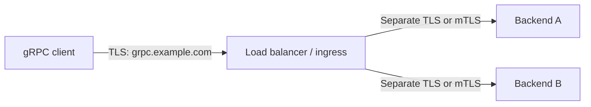

# Do Not Skip Hostname Verification in Production

TLS truly protects a connection only when the client verifies that the server it is connecting to is the endpoint it intends to call. A certificate signed by a trusted CA is not enough: the certificate must also represent the exact hostname of the service. If hostname verification is skipped, the client could accept a valid certificate belonging to another system and establish an encrypted connection to the wrong endpoint or an imposter server.

In **SPRING_GRPC**, clients typically connect via a DNS name, service discovery, or load balancer. Keep the service's logical hostname consistent across address resolution, TLS configuration, and testing. Do not disable endpoint identification, do not use a trust-all manager in production, and do not use authority override to hide an incorrect certificate. The certificate must have a Subject Alternative Name (SAN) matching the name the client verifies.

## 1. Trust Chain and Hostname Verification Are Two Distinct Checks

When a gRPC client establishes TLS, two security questions must be answered:

1. **Is the certificate trusted?** The certificate must build a trust chain to a CA trusted by the client, be within its validity period, and pass other certificate checks.
2. **Does the certificate belong to the exact server the client wants to call?** The endpoint's DNS name or IP address must match a SAN in the certificate according to hostname/IP verification rules.

These two checks do not substitute for one another:

| Trust Chain | Hostname Verification | Outcome |
| --- | --- | --- |
| Valid | Matches | Client can verify the right server and proceed with TLS |
| Valid | Mismatch | Must reject; certificate is trusted but belongs to another endpoint name |
| Invalid | Matches | Must reject; name matches but issuer/certificate is untrusted |
| Invalid | Mismatch | Must reject |

For example, the client calls grpc.orders.example.com. The certificate is signed by an internal CA but only has SAN DNS:grpc.billing.example.com. A valid trust chain does not make that certificate valid for grpc.orders.example.com.

Hostname verification prevents the client from accepting a certificate merely because it was signed by a trusted CA. It is an endpoint identity verification layer independent of the fact that channel data is encrypted.

## 2. SAN Is the Source of Hostname/IP Identity

The server certificate should declare endpoints in the **Subject Alternative Name (SAN)** extension:

- dNSName for hostnames, such as DNS:grpc.example.com.
- iPAddress for IP addresses, such as IP:10.20.0.15.

Modern clients must rely on SAN to verify endpoints. Do not design new certificates relying solely on Common Name (CN); CN is no longer a reliable substitute for SAN in modern hostname verification.

Example certificate for a DNS service:

```text
X509v3 Subject Alternative Name:
    DNS:grpc.example.com
    DNS:grpc.internal.example.com
```

Example certificate for an endpoint called directly by IP:

```text
X509v3 Subject Alternative Name:
    IP Address:10.20.0.15
```

If the client calls grpc.example.com, the SAN must have the corresponding DNS name. If the client calls 10.20.0.15 directly, the certificate needs an IP address-type SAN. A SAN of the form DNS:10.20.0.15 is not equivalent to an iPAddress-type SAN.

### 2.1. Wildcard Certificates Have Limited Scope

A wildcard SAN like DNS:*.example.com normally matches a single label at the wildcard position, such as grpc.example.com. It does not automatically match grpc.internal.example.com or example.com.

Use wildcards only when the name scope is clearly governed. A broadly scoped wildcard certificate increases the impact if the private key is compromised. For critical services, a certificate with specific SANs helps limit the identities the key represents.

## 3. Hostname, SNI, and IP Address in gRPC

Three related concepts with distinct roles:

- **Target/hostname:** name the client uses to identify the target service, such as grpc.example.com.
- **SNI (Server Name Indication):** hostname the client sends in TLS ClientHello so the server or TLS proxy chooses the appropriate certificate when one address serves multiple hostnames.
- **Hostname verification:** the client checks whether the server certificate represents the hostname the client intends to call.

SNI helps the server choose a certificate; it does not replace client-side certificate verification. A server may return a certificate based on SNI, yet the client must still check the trust chain and SAN.

When a DNS resolver resolves grpc.example.com to one or more load balancer/backend IPs, the client must still preserve the logical identity grpc.example.com. Do not inadvertently replace the service hostname with a backend IP and cause TLS to check the certificate against a different name.

### 3.1. DNS Aliases and Service Discovery

Suppose the client calls grpc.example.com, and DNS returns 10.20.0.11 and 10.20.0.12. Those addresses are merely routing results. The certificate presented to the client must represent the logical hostname grpc.example.com that the client uses.

With gRPC name resolvers, load balancing, and service discovery, distinguish:

- The service name the client uses as target.
- The IP addresses returned by the resolver.
- The authority/SNI used in TLS and HTTP/2.
- The SAN advertised by the server certificate.

If changing resolvers or switching to direct IP connections, re-verify identity semantics. Never fix mismatch errors by disabling hostname verification.

## 4. Configuring a gRPC Java Client with TLS

For a DNS endpoint with a valid certificate whose CA is already in the JVM default trust store, the client can enable transport security:

```java
ManagedChannel channel = ManagedChannelBuilder
    .forAddress("grpc.example.com", 8443)
    .useTransportSecurity()
    .build();
```

The hostname passed to forAddress is a crucial part of endpoint identity. When using a DNS resolver or target URI, ensure the target preserves the exact service name represented by the certificate.

If the service uses a private CA, the client must trust that CA. Example with Netty gRPC transport and a separately managed CA certificate:

```java
SslContext sslContext = GrpcSslContexts.forClient()
    .trustManager(new File("config/trust/service-ca.pem"))
    .build();

ManagedChannel channel = NettyChannelBuilder
    .forAddress("grpc.example.com", 8443)
    .sslContext(sslContext)
    .build();
```

This example uses gRPC Netty APIs and requires the corresponding dependency. trustManager configures the trusted CA; it is not a reason to skip hostname verification. Keep the DNS endpoint accurate and let the TLS client verify the certificate against the corresponding authority.

### 4.1. Managing ManagedChannel in Spring

In Spring applications, channels are typically created and managed via bean lifecycle:

```java
@Configuration
class GrpcClientConfiguration {

    @Bean(destroyMethod = "shutdown")
    ManagedChannel ordersChannel() {
        return ManagedChannelBuilder
            .forAddress("grpc.orders.example.com", 8443)
            .useTransportSecurity()
            .build();
    }

    @Bean
    OrderServiceGrpc.OrderServiceBlockingStub orderStub(
            ManagedChannel ordersChannel) {
        return OrderServiceGrpc.newBlockingStub(ordersChannel);
    }
}
```

This is standard gRPC Java configuration managed as Spring beans. With a specific Spring gRPC starter, the application may use dedicated properties, channel factories, or customizers; property names depend on the version/library. Regardless of how the channel is created, the target hostname and trust configuration must be kept accurate. Never create channels using plaintext or trust-all just to avoid certificate errors in production.

## 5. Using Authority Override Properly

gRPC Java provides overrideAuthority on the channel builder to specify an authority different from the connection address. This feature can be useful in testing, proxies, or virtual-host routing, but authority also relates to the identity the TLS client verifies.

Example connecting to an IP address while the service identity is a DNS name:

```java
ManagedChannel channel = NettyChannelBuilder
    .forAddress("10.20.0.15", 8443)
    .overrideAuthority("grpc.example.com")
    .useTransportSecurity()
    .build();
```

Use such configuration only when grpc.example.com is a confirmed service identity, the certificate has a matching SAN, and the proxy/server is configured to serve that hostname. This is not a valid way to accept an arbitrary certificate.

Do not:

- Set authority to an arbitrary hostname just to make the handshake succeed.
- Use another service's hostname whose certificate happens to be trusted.
- Deploy authority override to production without configuration controls and testing.
- Treat changing authority as a fix for a certificate missing a SAN.

If the target and certificate identity do not match, fix DNS, the resolver, the certificate SAN, or the virtual host configuration per the intended architecture. Do not weaken identity verification to mask mismatches.

## 6. Certificates for Load Balancers, Ingress, and Proxies

When gRPC traverses a load balancer or ingress, where TLS terminates determines which certificate the client sees:



If TLS terminates at the load balancer:

- The client verifies the load balancer's certificate against the service hostname.
- The load balancer is responsible for verifying backends on upstream connections if upstream uses TLS.
- Upstream TLS needs its own trust store and hostname/authority verification.

If TLS passthrough is used:

- The backend or final proxy performs the TLS handshake with the client.
- The presented certificate must match the hostname the client uses.

Do not assume the backend's certificate is automatically verified by the client when TLS terminates at ingress. Each TLS hop has its own peer identity. With mTLS, the client certificate verifies the client's identity on the server side; it does not replace server hostname verification on the client side.

## 7. Do Not Disable Hostname Verification in Production

The following practices weaken or remove parts of TLS protection:

- Using plaintext transport for production connections that require TLS.
- Using a trust manager that accepts every certificate.
- Disabling endpoint identification/hostname verification.
- Bypassing certificate mismatch errors by arbitrarily changing authority.
- Using self-signed certificates without explicitly managed trust anchors.

Some online examples use InsecureTrustManagerFactory or a custom trust manager that always reports certificates as valid. Those approaches can be useful in an isolated experiment to diagnose a handshake, but must never enter production. Trust-all skips trust chain verification; if hostname verification is also disabled, the client performs virtually no server identity verification.

usePlaintext is also not a way to handle certificate mismatches. It removes TLS from the transport, leaving data and metadata unprotected by TLS.

If a certificate is valid but the hostname is wrong, fix the certificate or the endpoint name. If the certificate is signed by an internal CA, install that CA properly into the trust store. Never trade away identity verification just to get a deployment starting.

## 8. Certificate Management and Rotation

Hostname verification only operates reliably when the certificate lifecycle is managed:

1. Issue certificates with SANs containing the actual DNS/IP used by clients.
2. Issue certificates from a CA trusted by clients.
3. Monitor expiration, issuer, SAN, and key usage.
4. Install new certificates before old certificates expire.
5. During a CA transition, update trust bundles using a safe overlap procedure.
6. Reload/restart the TLS component according to the server/proxy's capabilities.
7. Test handshakes after rotation from the client's actual network path.
8. Revoke or retire old certificates/keys per procedure.

Do not only check that a certificate is unexpired. An unexpired certificate with the wrong SAN must still be rejected. Likewise, a certificate with the right SAN whose chain is untrusted must also be rejected.

### 8.1. Changing a Service Hostname

When changing a hostname, such as from grpc-old.example.com to grpc.example.com, coordinate DNS, certificates, SNI, load balancers, client targets, and rollout timing:

- Issue certificates containing both the old and new hostnames during the transition period if needed.
- Update client endpoints via a controlled rollout.
- Maintain the old hostname for the announced compatibility window.
- Verify both hostnames from real clients before retiring the old name.
- Do not temporarily switch targets to an IP to evade mismatches.

## 9. Inspecting Certificates and SANs During Diagnosis

You can view a certificate's SAN with OpenSSL:

```bash
openssl x509 -in server.crt -noout -subject -issuer -ext subjectAltName
```

To inspect the certificate presented by an endpoint, you can use:

```bash
openssl s_client \
  -connect grpc.example.com:8443 \
  -servername grpc.example.com \
  -showcerts
```

This command helps observe the certificate and handshake from a machine with OpenSSL. It does not replace testing with the application's actual gRPC Java client, trust store, and resolver. When diagnosing, check:

- Which target hostname the client actually uses.
- Whether SNI sends the expected hostname.
- Whether the certificate returned by the server has the matching SAN.
- Whether the certificate chain includes all intermediate certificates.
- Whether the JVM/container trust store contains the required CA.
- Whether the system clock is accurate for checking the validity period.
- Whether a proxy/load balancer presents a different certificate than the expected backend.

Do not send private keys or secrets to logs/diagnostics. Public certificates can be inspected, but manage endpoint details according to your environment's policy.

## 10. Testing Hostname Verification

A meaningful TLS test must use a real TCP/TLS transport. In-process transport does not perform a TLS handshake, so it does not prove hostname verification works.

Prepare a dedicated test CA and test certificates with different SANs:

| Certificate | Client Target | Expected Result |
| --- | --- | --- |
| Trusted CA, SAN DNS:grpc.example.test | grpc.example.test | Handshake succeeds |
| Trusted CA, SAN DNS:other.example.test | grpc.example.test | Handshake fails due to hostname mismatch |
| Untrusted CA, SAN matches hostname | grpc.example.test | Handshake fails due to trust chain |
| Trusted CA, SAN IP:10.0.0.8 | Connect by IP 10.0.0.8 | Succeeds if IP identity is configured appropriately |
| Trusted CA, only DNS SAN while client calls IP | IP 10.0.0.8 | Must not treat DNS SAN as IP SAN |
| Expired certificate | Matching hostname | Handshake fails |

### 10.1. Positive Test

Start the gRPC server over TCP with a test certificate signed by the test CA. The client trusts the right CA and calls using a hostname included in the SAN. The RPC should complete successfully; this verifies trust configuration and endpoint identity in the test environment.

### 10.2. Negative Test for Hostname Mismatch

Keep the trusted CA, but issue a server certificate whose SAN only lists a different hostname. The client still calls the expected hostname. The handshake must fail before the business RPC is processed.

The test should verify that the call fails and the server handler is not executed. Do not depend on a specific exception message string because TLS providers and gRPC transports may wrap errors differently. You can inspect the cause chain to confirm an SSL/certificate mismatch error category while keeping the primary assertion that the connection is not accepted.

### 10.3. Separating Hostname Mismatch from Untrusted CA

Two separate negative tests isolate each verification layer:

- Trusted certificate with wrong SAN: hostname verification must reject it.
- Certificate with right SAN but untrusted issuer: trust-chain verification must reject it.

If you only test a certificate with both a wrong SAN and an untrusted issuer, you cannot tell which check the test is proving.

## 11. TLS Handshake Errors Seen from the gRPC Client

The TLS handshake happens before the server dispatches the RPC to an application handler. Therefore, a hostname mismatch is usually observed by the client as a connection/handshake error, sometimes wrapped by gRPC as UNAVAILABLE with the SSL cause in the cause chain. The client does not necessarily receive a gRPC status sent by the business server, because the RPC may never have reached the handler.

This differs from UNAUTHENTICATED at the application layer:

| Scenario | Handling Layer | Typical Outcome |
| --- | --- | --- |
| Certificate hostname mismatch | TLS handshake | Connection rejected; client sees SSL/transport error |
| Untrusted CA | TLS handshake | Connection rejected |
| TLS succeeds but Bearer token missing | Application authentication | UNAUTHENTICATED |
| TLS succeeds, valid token but insufficient permissions | Application authorization | PERMISSION_DENIED |

Do not fix hostname mismatch errors by changing application statuses or loosening interceptors. Address it at the exact TLS identity layer.

## 12. Integrating with Spring gRPC and Deployment Environments

When bringing TLS configuration into a Spring application, manage:

- Target hostnames via controlled environment configuration, avoiding hard-coded test hostnames in production.
- Trust bundles/CA certificates via secrets or a secure configuration distribution mechanism.
- Lifecycle of ManagedChannel and TLS contexts.
- Resolver/load balancer configuration to preserve the right service authority.
- Server certificates at ingress or backend matching the published hostname.
- Rotation and reload according to starter/transport capabilities.
- Test profiles isolated from production configuration; never let test trust-all leak into deployment artifacts.

If using a Spring gRPC starter, check the documentation for your exact version to see how client channels and customizers are declared. Do not copy properties from a different starter or an older version. Whether configured via properties or Java beans, the security invariants remain identical: the trust chain is verified, the hostname is verified, and the certificate SAN matches the service identity.

## 13. Common Configuration Mistakes

| Mistake | Consequence | Resolution |
| --- | --- | --- |
| Certificate has only CN, lacking a matching SAN | Modern clients may reject the hostname | Reissue certificate with DNS/IP SAN |
| Client calls by IP while certificate only has DNS SAN | Identity mismatch | Use DNS target or issue appropriate IP SAN |
| DNS resolver returns IP and client accidentally uses IP as authority | Hostname verification checks the wrong name | Keep logical service authority stable |
| Trust CA is right but SAN is wrong | Connection to the wrong endpoint could be mistaken as trusted | Keep hostname verification enabled |
| Using a trust-all manager | Server chain is not verified | Install the right CA in the trust store |
| Disabling endpoint identification | Client fails to verify exact server identity | Keep hostname verification enabled/default |
| Arbitrarily overriding authority | May verify the wrong identity | Override only per confirmed service identity |
| Testing only with in-process transport | Does not test TLS handshake | Use TCP/TLS integration tests |
| TLS terminates at proxy but only checking backend cert | Misses the identity the client actually sees | Inspect certificates on each TLS hop |

## 14. Production Checklist

Before releasing or modifying a gRPC TLS configuration, confirm:

1. **Target:** clients call the exact published DNS name/IP for the service.
2. **SAN:** the certificate has the matching DNS SAN or IP SAN.
3. **Trust:** the chain is complete and the CA is in a managed trust store.
4. **Hostname verification:** endpoint identity verification is not disabled.
5. **SNI/authority:** resolver, SNI, and authority align with the service identity.
6. **Load balancing:** backend DNS/IP resolution does not alter the service's logical identity.
7. **Proxy:** every TLS termination/upstream hop verifies the right peer identity.
8. **Override:** overrideAuthority is not used to mask an invalid certificate.
9. **Lifecycle:** certificate expiry, rotation, CA overlap, and channel reload are planned.
10. **Tests:** positive, wrong-SAN, untrusted-CA, and expired-certificate tests exist.
11. **Configuration:** trust-all/plaintext can exist only in isolated fixtures, never in production profiles.
12. **Observability:** handshake failures are recorded without logging private keys, tokens, or secrets.

## 15. Takeaways

Hostname verification verifies that the server certificate represents the exact endpoint the gRPC client intends to call. The trust chain only proves the certificate was signed by a trusted CA; SAN defines which DNS names or IP addresses the certificate represents. SNI helps the server select a certificate, whereas hostname verification is a client-side check and cannot be replaced by SNI.

In Spring gRPC, keep the service hostname consistent across target, resolver, authority, and SAN. If using an internal CA, install the CA into the trust store; if the certificate has the wrong hostname, reissue the SAN or fix the endpoint. Never use a trust-all manager, never disable endpoint identification, and never arbitrarily override authority in production. Test TLS over TCP with both matching and mismatching hostnames; in-process tests do not prove handshakes. When a TLS handshake fails, the error usually happens before application authentication, so diagnose it at the transport layer.

### References

- [gRPC – Authentication](https://grpc.io/docs/guides/auth/)
- [gRPC – TLS](https://grpc.io/docs/guides/auth/#tls)
- [gRPC Java – Security](https://grpc.io/docs/languages/java/)
- [RFC 9525 – Service Identity in TLS](https://www.rfc-editor.org/rfc/rfc9525)
- [RFC 6125 – Service Identity](https://www.rfc-editor.org/rfc/rfc6125)
- [Java – X509Certificate](https://docs.oracle.com/en/java/javase/21/docs/api/java.base/java/security/cert/X509Certificate.html)
