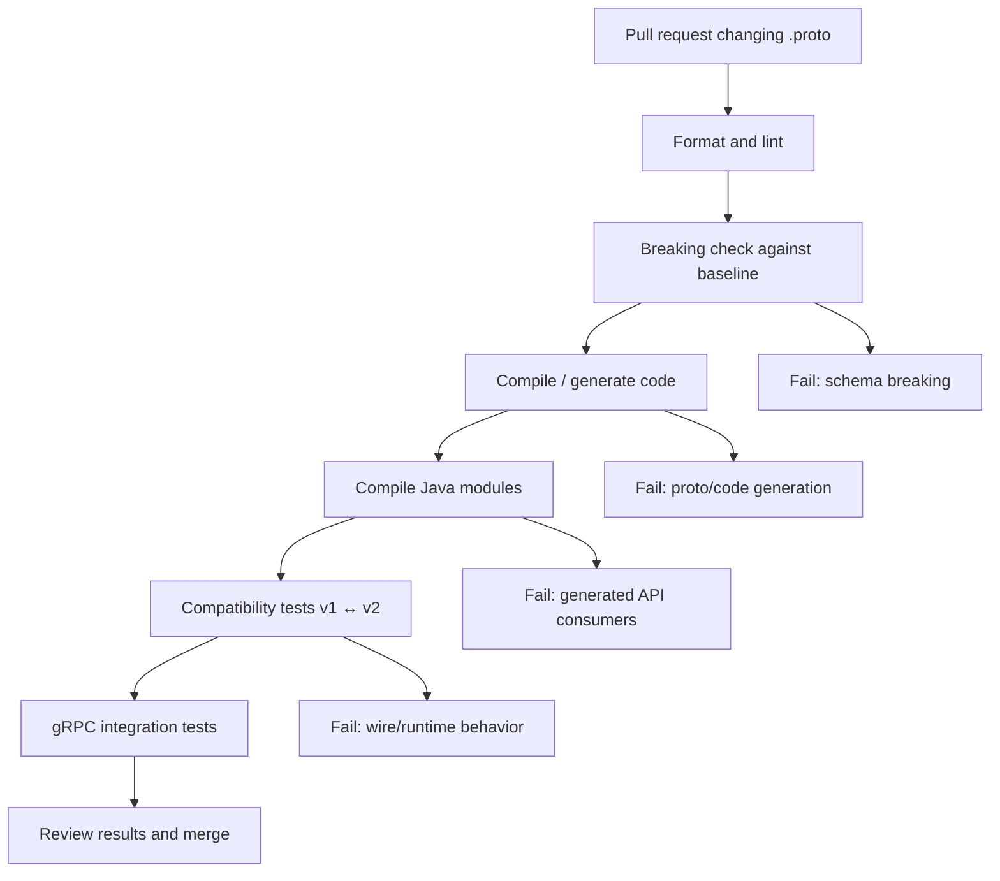

# Breaking-Change Checks in CI

## 1. Why Check Schemas in CI?

In **SPRING_GRPC**, `.proto` files are the shared contract between clients, servers, and integrated components. A schema change can affect binary wire formats, JSON mappings, generated Java APIs, or business logic. Teams may deploy on independent schedules, so a change that compiles cleanly can still cause running clients to fail when talking to a new server.

A **breaking change check** compares a proposed schema against an accepted or released baseline schema. CI automatically detects changes that risk breaking compatibility and blocks merges or releases when policies are violated.

This lesson focuses on building a reliable verification gate: choosing the right baseline; using Buf lint and breaking checks; selecting an appropriate compatibility level; combining schema checks with generated-code compilation and runtime tests; handling intentional exceptions; and integrating checks into pull request and release pipelines.

## 2. Breaking Changes Have Multiple Layers

There is no single definition across all systems. A change can preserve the binary wire format while still breaking source code or JSON APIs.

| Compatibility layer | What must be protected | Example changes that may affect it |
| --- | --- | --- |
| Binary wire | Clients/servers parse the same payload properly | Changing field numbers, wire types, or deleting active fields |
| Protobuf JSON | JSON consumers continue reading/writing keys and values | Renaming fields changes default JSON keys |
| Source/generated API | Generated Java code remains compile-time compatible with consumers | Renaming fields changes getters/setters |
| Behavioral/semantic | Parties share the same business meaning | Changing enum or field meaning without altering wire encoding |

A schema compatibility tool can verify structure and certain source/JSON surfaces, yet cannot infer full business semantics. For instance, changing `int32` to `sint32` may still use the varint wire type while encoding negative numbers differently. Adding an enum value may parse cleanly, yet old clients still need safe handling for unknown values.

Therefore, CI should have multiple verification layers, each answering a specific question.

## 3. The Baseline Must Represent the Accepted Schema

Breaking checks are meaningful only when you know which version is being compared against. The baseline must not be an arbitrary file on a developer's machine; it must represent the contract the system is committed to supporting.

Common options:

- **Target branch:** when checking a pull request, compare the current branch's schema against the target branch such as `main`.
- **Release tag:** when preparing to release a contract, compare against the latest released tag.
- **Published registry/version:** if using Buf Schema Registry (BSR), compare against the published module version used by consumers.
- **Schema snapshot:** store an immutable descriptor/schema artifact of a release for CI usage.

For pull requests, comparing against the target branch catches schema-breaking changes entering the integration branch. For releases, compare against the previous release baseline or the contract version currently consumed in production. If `main` already contains unreleased changes, it may not represent the production contract; choosing the wrong baseline can produce false warnings or miss real breaking changes.

Baselines must be managed as versioned artifacts:

1. Record the commit/tag or registry version.
2. Retain change history and approvers.
3. Never silently overwrite the baseline just to turn CI green.
4. When intentionally bumping a major contract version, update the baseline through an explicit release process.

## 4. Using Buf Lint and Breaking Checks

Buf provides two commonly used check suites:

- `buf lint`: verifies style, naming, structure, and configured schema rules.
- `buf breaking`: compares the current schema against a baseline to detect changes considered breaking under the selected rule set.

Example pull request check commands:

```bash
buf lint
buf breaking --against ".git#branch=main"
```

The Git reference syntax is a common example; CI must fetch sufficient Git history and configure the right Protobuf directory/module. If schemas sit in a subdirectory or use BSR, adjust inputs/references to match your repository layout and pinned Buf version.

Illustrative Buf v2 configuration:

```yaml
version: v2

lint:
  use:
    - STANDARD

breaking:
  use:
    - FILE
```

Rule categories such as `FILE`, `PACKAGE`, `WIRE_JSON`, and `WIRE` let you choose different inspection scopes, ranging from wire-level compatibility to source/file surfaces. `FILE` is a strict choice when protecting file-scoped source compatibility. Match the rule set to your Buf version and consumer policy; do not choose the weakest level merely to reduce CI failures.

### Selecting Rule Sets by Consumer

- If only binary gRPC consumers exist and generated code is managed synchronously, `WIRE` can be a starting point.
- If Protobuf JSON, REST transcoding, or gateways exist, verify JSON compatibility too, such as `WIRE_JSON` or stricter.
- If multiple applications compile directly against the generated Java API, consider `PACKAGE` or `FILE`.
- If the contract is consumed across multiple languages and tools, stricter rule sets catch name/package/file changes early.

Stricter rule sets may flag source-level changes that do not break binary wire compatibility. That is often desirable when generated APIs form a public contract. If a change is accepted, document which surfaces are affected and the consumer update plan.

## 5. Changes CI Should Detect

A schema check should detect at least the following categories of changes, according to your chosen compatibility policy:

| Change category | Risk | Typical remediation |
| --- | --- | --- |
| Removing a field | Old payloads may lose data on read; source API disappears | Retain field or remove in controlled phases, reserving number/name |
| Reusing a field number | Old payloads get misinterpreted as the new field | Never reuse; keep `reserved` |
| Changing field number/type | Parsers and semantics can diverge | Add a new field with a new number and migrate |
| Renaming a field | JSON keys and generated APIs change | Keep wire number; consider `json_name`, reserve old name |
| Removing/renumbering enum value | Old numeric values may take on different meanings | Preserve numbers, reserve removed values |
| Adding an enum value | Old clients may encounter unknown values | Implement safe fallbacks and test old clients |
| Changing `oneof` | `METHOD_NOT_SET`, lost members, or selection shifts | Test multi-member payloads and enforce rollout order |
| Changing package/service/RPC | Full method names and generated stubs change | Version the API/service systematically |

Not every change in the table is considered breaking by every rule set. Adding a new field with an unused number is generally compatible at the binary level; renaming a field may preserve the wire while breaking source/JSON. CI must reflect the chosen policy rather than treating all changes identically.

## 6. reserved and Breaking Checks Complement Each Other

When removing a field, add both its number and name to `reserved` inside the exact message. For enums, reserve the numeric value and name inside the enum declaration.

Example:

```proto
message Invoice {
  string invoice_id = 1;
  int64 amount_cents = 5;

  reserved 4;
  reserved "legacy_label";
}
```

`protoc` can reject declaring a new field using a reserved number or name. However, if a developer deletes a field and forgets to add a reservation, the compiler has no knowledge that the field ever existed historically.

This is why breaking checks against a baseline are necessary: the comparison tool detects that a field disappeared relative to the old schema. Combined with lint/review rules for reservations, CI catches both field deletions and future reuse risks.

Distinguish two findings:

- **Field deletion detected:** the new schema removed a previously existing field; policy may require keeping the field or executing a migration.
- **Reserved declaration present:** the new schema locked the old number/name to prevent future reuse.

Having `reserved` does not make every field deletion safe; it only stops the number/name from being reassigned. Deciding to remove a field still requires evaluating active consumers and historical data.

## 7. Layered CI Pipeline

A practical pipeline validates everything from schema structure through generated code and runtime behavior:



An illustrative shell sequence:

```bash
buf lint
buf breaking --against ".git#branch=main"
buf generate
```

In pull request CI, formatting should be checked in non-mutating mode; if a pipeline runs auto-formatting that edits files, ensure diffs are reflected back into the PR. Generation and build commands must continue using the project's pinned toolchain and versions.

Each step plays a distinct role:

1. **Format/lint:** catches non-compliant or hard-to-maintain schemas.
2. **Breaking check:** compares against the baseline to block incompatible structural changes.
3. **Code generation:** verifies `protoc`/plugins generate code cleanly.
4. **Compile consumers:** detects changed getters, types, or generated APIs.
5. **Compatibility tests:** verifies old/new bytes and fallback paths.
6. **Integration tests:** verifies gRPC methods, serialization, and end-to-end behavior.

## 8. Runtime Tests Remain Essential

Static breaking checks do not replace testing with old generated code. Store contract fixtures or generated artifacts for at least all currently supported versions.

Important tests:

- Message v1 serialize then v2 parse.
- Message v2 serialize then v1 parse.
- Old client calling new server.
- New client calling old server if rollout can produce that pairing.
- Unknown enums, new `oneof` members, absent/default fields, and boundary values.
- Payloads stored in databases/event logs read with the new schema.
- JSON printers/parsers and gateways if Protobuf JSON is used.

Example checking an old message with a new generated class:

```java
// ProductV1 is generated from the released contract.
ProductV1 oldMessage = ProductV1.newBuilder()
    .setSku("SKU-100")
    .setDisplayName("Keyboard")
    .build();

byte[] payload = oldMessage.toByteArray();

// ProductV2 is generated from the proposed schema.
ProductV2 newMessage = ProductV2.parseFrom(payload);

assertEquals("SKU-100", newMessage.getSku());
// If the field was renamed while preserving number/type,
// generated API v2 reads the value via the new getter.
assertEquals("Keyboard", newMessage.getLabel());
```

This is a message-level example; v1/v2 fixtures must live in separate modules or artifacts to prevent colliding fully qualified Java class names. Integration tests should complement this with real RPCs, because successful message parsing alone does not verify service paths, TLS, interceptors, or business mappings.

## 9. Baselines, Branches, and Releases Must Stay Consistent

A common CI mistake is comparing schemas against the wrong baseline.

Examples:

- PR compares against `main`, but `main` already contains an unreleased breaking change.
- Release candidate compares against a development branch instead of the schema version running in production.
- CI checks out shallow history so Buf cannot locate the Git reference.
- Monorepo contains multiple Protobuf modules, yet the command only checks one module.
- Baseline registry is updated before consumers are confirmed.

To avoid these:

1. Pull requests use the PR's actual target branch.
2. Releases use the tag or registry version of the latest released contract.
3. Pin versions of Buf, `protoc`, and codegen plugins.
4. Explicitly specify root/module paths when running commands.
5. Check all modules and dependent schemas.
6. Record check results alongside the commit and baseline used for reproducibility.

Never update the baseline solely to make a pipeline pass. If an intentional contract change is needed, create a separate version/major migration, document affected consumers, and obtain appropriate approvals.

## 10. Handling Intentional Breaking Changes

Some changes are genuinely necessary, such as altering semantics or retiring old APIs. Never disable breaking checks repository-wide to accommodate one such change.

A controlled exception process:

- Identify the exact violated rule and file/field.
- Document which consumers still rely on the old contract.
- Propose a path to add new fields, dual-read/write, migrate, and deprecate.
- Set a timeline/conditions for removing the old field.
- Reserve numbers/names after removal.
- Run tests with old generated clients and persisted payloads.
- Record approval from contract/API owners.
- Use narrow ignores/exclusions only with clear technical justification and a review expiration.

If the new schema is a major contract version, the baseline and module identity must reflect that versioning. Never treat changing a package or creating a new file as automatically guaranteeing compatibility; consumers must be migrated to the new endpoint/artifact on schedule.

## 11. Reading CI Errors and Finding Root Causes

When a breaking check fails, work through it in order:

1. Identify the file, message, field, or enum cited in the report.
2. Read the violated rule and the compatibility layer it protects.
3. Compare the current schema against the baseline, not just the PR diff.
4. Determine whether this is a wire, JSON, source, or semantic issue.
5. Pick a fix: keep the field, add a new field number, reserve identifiers, keep `json_name`, or version the API.
6. Re-run lint, breaking checks, generation, compilation, and relevant tests.

| Symptom | Investigation direction |
| --- | --- |
| Field removed | Identify consumers still reading the field; add reservation if retiring |
| Field number/type changed | Check wire encoding and historical payloads |
| Enum value removed/renumbered | Check numeric values and unknown-enum handling |
| Field name changed | Check JSON keys, generated getters, and `FieldMask` |
| Package/service changed | Check full gRPC method names and generated stubs |
| CI cannot find baseline | Check Git history, refs, registry versions, and module paths |

A passing report only proves the configured rules passed. It does not prove business logic is correct, guarantee old clients have adequate fallbacks, or confirm historical data has been migrated.

## 12. Checklist for Adding Breaking Checks to CI

- Baseline represents the released contract or proper target branch.
- Versions of Buf, `protoc`, and codegen plugins are pinned.
- `buf lint` runs across every module that needs checking.
- `buf breaking` uses a rule set aligned with wire, JSON, and generated-source consumers.
- CI never silently overwrites baselines or bypasses all breaking rules.
- Schemas removing fields/enums include properly scoped reservations.
- Generated Java code is built and compiled against relevant consumers.
- Fixtures/generated artifacts from old schemas exist for bidirectional compatibility tests.
- Tests cover unknown enums, `oneof`, defaults/presence, and stored payloads where applicable.
- JSON/gateways/`FieldMask` are tested if part of the contract.
- Exceptions have narrow scope, clear justification, and explicit approval.
- Release checks compare against the schema version actively used by consumers.

With **SPRING_GRPC**, breaking-change checks in CI act as the gatekeeper for Protobuf contracts before new schemas are merged or released. Accurate baselines and well-chosen rule sets catch wire, JSON, and source changes; generated-code compilation and compatibility tests verify actual behavior. Semantic changes and data migrations still require dedicated review and testing and cannot be inferred solely from static tool output.
