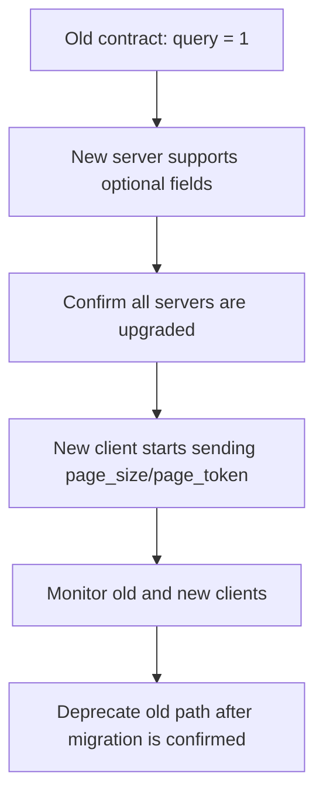

# Changing RPC Requests Without Breaking Callers

## 1. Objectives

A gRPC API may be used by multiple client versions at the same time. In the Spring ecosystem, a service can be deployed before, after, or independently of the services that call it. Therefore, changing a request structure in a Protocol Buffers file must account for old clients, new clients, and servers running different versions.

The goal of **API evolution** is to extend or change a contract in a way that keeps existing callers working during the transition period. Compatibility is not just about parsing the message: the new server must also preserve business semantics for old requests.

After this lesson, you will be able to:

- Explain Protocol Buffers wire compatibility and the role of field numbers.
- Add request fields compatibly, handling defaults and field presence.
- Identify dangerous changes such as changing tags, changing wire types, reusing field numbers, or tightening validation.
- Migrate old fields to new fields in phases.
- Implement a server that supports both old and new clients during rollout.
- Test the old client/new server and new client/old server matrix.

## 2. Protobuf Requests Are Contracts on the Wire

In gRPC, a client invokes a method with a stable full name, such as `catalog.v1.CatalogService/Search`. The Protobuf request is serialized into fields with a **field number** and wire type. Java variable names are generated from field names, but the binary wire format identifies fields by number.

Initial contract:

```proto
syntax = "proto3";

package catalog.v1;
option java_package = "dev.example.catalog.v1";
option java_multiple_files = true;

service CatalogService {
  rpc Search(SearchRequest) returns (SearchResponse);
}

message SearchRequest {
  string query = 1;
}

message SearchResponse {
  repeated string product_ids = 1;
}
```

An old client sends `query` with tag `1`. The server reads the message according to the descriptor of the version it is running. If you only add fields with new tags and the server treats those fields as optional, the old client still sends valid messages.

Distinguish three layers of compatibility:

| Layer | Question | Example |
|---|---|---|
| **Wire compatibility** | Can the parser read the bytes from the other version? | Old fields keep the same tag and wire type |
| **Source/API compatibility** | Does the generated Java code still compile? | Renaming a field can change accessors |
| **Behavioral compatibility** | Do old requests still produce the same results as before? | The new server must not require fields that old clients do not send |

A change can be wire-compatible yet still break source or behavior. In real-world deployments, all three layers must be evaluated.

## 3. Common Safe Change: Adding Optional Fields

Suppose Catalog needs to support pagination. We want to add a page size and page token without forcing existing clients to upgrade immediately.

Old contract:

```proto
message SearchRequest {
  string query = 1;
}
```

New contract:

```proto
message SearchRequest {
  string query = 1;
  optional int32 page_size = 2;
  string page_token = 3;
}
```

Adding fields with never-used tags is generally compatible at the wire layer:

- Old clients only send `query = 1`. The new server reads the query; the new fields are absent.
- New clients additionally send tags `2` and `3`. Old servers do not recognize these tags and ignore them when parsing.
- The new server must define sensible behavior when the new fields are not sent.

**Important condition:** the new server must not treat the new fields as required immediately upon deployment. If the server requires `page_size` or `page_token` from every caller, old clients will stop working even though the message can still be parsed.

### Example of Server Handling Defaults

```java
@Override
public void search(
        SearchRequest request,
        StreamObserver<SearchResponse> observer) {
    int pageSize = request.hasPageSize()
            ? request.getPageSize()
            : DEFAULT_PAGE_SIZE;

    if (pageSize <= 0 || pageSize > MAX_PAGE_SIZE) {
        observer.onError(Status.INVALID_ARGUMENT
                .withDescription("page_size is out of range")
                .asRuntimeException());
        return;
    }

    String pageToken = request.getPageToken();
    // An empty token means the first page.
    // Execute the query with query, pageSize, and pageToken.
}
```

This snippet assumes the `page_size` field is declared as proto3 `optional` so the generated Java code has `hasPageSize()`. The limit constants and query execution are application logic to be implemented.

If a proto3 scalar is declared without `optional`, a default value like `0` does not tell you for sure whether the caller explicitly sent 0 or omitted the field entirely. Use `optional` when you need to distinguish **absent** from **present but default-valued**. For message fields, oneofs, and some other types, presence has its own rules; check the API generated from your actual schema.

## 4. Defaults Must Preserve Old Client Behavior

Wire compatibility only allows the server to read the message. The server must also assign meaning to missing fields.

| New Field | When Old Client Does Not Send It | Compatible Behavior |
|---|---|---|
| `page_size` | Absent or default | Choose the published default page size |
| `page_token` | Empty string | Start from the first page |
| `locale` | Absent/default | Use the previous default locale |
| `include_archived` | False/absent | Keep the previous behavior of excluding archived items |
| `sort_order` | Default enum | Use the old sort order |

Do not choose a new default that alters the result of old requests unless that is an intentionally approved behavioral change. For example, adding `include_archived` and defaulting it to true could cause old clients to unexpectedly receive extra data.

When default values need to be clearly distinguished, declare explicit presence or use an appropriate message/oneof. Do not infer the caller's intent solely from a default scalar value.

## 5. Adding New Fields Does Not Mean Old Servers Support New Features

When a new client sends `page_size` to an old server, the old server may ignore the unknown tag. The request still parses, but the old server does not paginate as requested. Therefore:

- **Old client → new server:** usually works if the new server accepts absent fields and keeps the old defaults.
- **New client → old server:** may parse, but the old server does not execute the semantics of the new field.

This is the difference between wire compatibility and feature compatibility. If a new client depends on new semantics, there must be a rollout plan or capability negotiation.

### Safe Rollout Order

1. **Deploy the compatible server first:** the new server understands the new fields while still accepting old requests.
2. **Confirm all server instances are upgraded:** prevent the load balancer from routing new clients to old servers that do not support the feature yet.
3. **Deploy new clients:** clients start sending the new fields once the target supports them.
4. **Observe usage:** measure the ratio of requests containing the new fields and validation errors.
5. **Keep the fallback during the transition period:** old clients can continue operating.
6. **Only remove the old path after verifying callers:** deprecation is a separate planned API change.



In a rolling deployment environment, old and new servers can coexist simultaneously. If a new client sends a field that an old server ignores, the request may succeed while producing unexpected results. Complete the server rollout or use version/capability routing before enabling the feature on clients.

## 6. Field Numbers Are Long-Term Identifiers

Field numbers are the most important part of wire identity. When removing a field, **never reuse its tag number for another field**.

Schema with an old field:

```proto
message SearchRequest {
  string query = 1;
  string legacy_category = 2;
}
```

After removing the field:

```proto
message SearchRequest {
  string query = 1;
  reserved 2;
  reserved "legacy_category";
}
```

`reserved` helps the compiler catch accidental reuse of removed tags or names. You can reserve multiple numbers, a range of numbers, or multiple names:

```proto
message SearchRequest {
  reserved 2, 5 to 8;
  reserved "legacy_category", "old_filter";
}
```

Do not delete and reuse tag `2` for `page_size`. An old client might still serialize `legacy_category` with tag `2`; the new server would interpret those bytes as the new field, causing corrupted data or parse errors.

Field names should also be reserved when removed. Names do not determine binary wire identity, but they can affect generated source code, JSON mapping, TextFormat, and FieldMask.

## 7. Changes to Avoid

The following changes can break wire compatibility, source compatibility, or semantics:

| Change | Risk | How to Handle |
|---|---|---|
| Changing field number | New parser reads old bytes as a different/unknown field | Keep the same tag; create a new field if needed |
| Reusing a removed tag | Old data is misinterpreted | Reserve both tag and name |
| Incompatible wire type change | Old bytes fail to parse correctly | Add a new field with a new tag |
| Renaming a field | Generated accessors, JSON/TextFormat/FieldMask may change | Keep the name or run a deliberate migration |
| Changing scalar to message or vice versa | Wire encoding and semantics change | Add a new field |
| Converting singular to repeated | Data interpretation and generated API change | Create a new field |
| Moving an existing field into a oneof | Changes presence and mutual exclusion | Design a new oneof with a separate plan |
| Changing business defaults | Old requests may yield different results | Keep old defaults or version semantics |
| Making a new field required | Old clients not sending the field will be rejected | Deploy optional/fallback first |

Some Protobuf types share the same wire type yet are **not safe to swap**. For example, `int32` and `sint32` both use varint but apply different number encodings; switching between them can cause values to be read incorrectly. `string` and `bytes` both use length-delimited wire type but differ in UTF-8 rules and semantics. Do not compare wire types alone to conclude that a change is compatible.

## 8. Renaming or Replacing Request Fields in Phases

Suppose the old request uses `customer_id`, but the new contract wants to represent a more general identifier named `customer_ref`. Renaming directly might preserve the tag and wire bytes, but it breaks caller compilation because the generated accessors change. JSON clients or FieldMask can also be affected.

A safer path is to add a new field with a new tag and temporarily support both:

```proto
message GetCustomerRequest {
  string customer_id = 1 [deprecated = true];
  string customer_ref = 2;
}
```

The server normalizes the two representations:

```java
private String resolveCustomerRef(GetCustomerRequest request) {
    String oldId = request.getCustomerId();
    String newRef = request.getCustomerRef();

    if (!oldId.isBlank() && !newRef.isBlank()
            && !oldId.equals(newRef)) {
        throw Status.INVALID_ARGUMENT
                .withDescription("customer_id and customer_ref conflict")
                .asRuntimeException();
    }

    if (!newRef.isBlank()) {
        return newRef;
    }
    if (!oldId.isBlank()) {
        return oldId;
    }
    throw Status.INVALID_ARGUMENT
            .withDescription("customer reference is required")
            .asRuntimeException();
}
```

Precedence rules and errors when the two fields conflict must be clearly documented. Do not silently pick one value if both fields are sent with different values.

Migration path:

1. Deploy a server that accepts both `customer_id` and `customer_ref`.
2. Measure requests using the old field; log caller/version if possible.
3. Deploy new clients sending `customer_ref`. During the period when old servers must still be supported, you can dual-write both fields if semantics match and old servers only understand the old field.
4. Confirm all servers serving new clients understand the new field.
5. Migrate remaining clients and monitor usage of the old field.
6. Once no old callers remain, stop reading the old field on the server in a planned release; remove the field from the schema and reserve both its tag and name.

Note: dual-write is only a transition tactic when both fields have the exact same meaning. If the two identifiers have different semantics, do not copy values between them to create an illusion of compatibility.

## 9. Field Presence and Schema Choices

Regular proto3 scalars have implicit presence. For example:

```proto
message UpdateProfileRequest {
  string display_name = 1;
  bool marketing_opt_in = 2;
}
```

On the server, `getMarketingOptIn()` returns false both when the caller omits the field and when the caller sends false. If you need to distinguish “no change requested” from “explicitly turned off”, use presence:

```proto
message UpdateProfileRequest {
  optional string display_name = 1;
  optional bool marketing_opt_in = 2;
}
```

Generated Java includes presence-checking methods such as `hasMarketingOptIn()`. When the field is absent, the server can keep the current value; when the field is present and false, the server updates it to false.

For update APIs, using `FieldMask` is also a way to specify exactly which fields the caller wants to update:

```proto
import "google/protobuf/field_mask.proto";

message UpdateProfileRequest {
  Profile profile = 1;
  google.protobuf.FieldMask update_mask = 2;
}
```

FieldMask has its own semantics: the server must validate allowed paths, handle absent fields, and define how default values are applied. Adding FieldMask to an existing API does not automatically guarantee behavioral compatibility; you must design a migration and test old callers.

## 10. Enums and Oneofs as Requests Evolve

### Adding Enum Values

Adding an enum value with a new number generally preserves wire compatibility:

```proto
enum SortOrder {
  SORT_ORDER_UNSPECIFIED = 0;
  SORT_ORDER_RELEVANCE = 1;
  SORT_ORDER_NEWEST = 2;
  SORT_ORDER_PRICE_ASC = 3;
}
```

Old clients may receive an unknown numeric value. How generated Java represents unknown enums depends on the API/runtime; caller code should have a default branch and not assume every value is in the known list. When adding an enum value, old servers/clients may fall back or reject according to defined semantics, but must not crash due to a missing default branch.

Do not change the number of a published enum value. When removing a value, reserve both its number and name to prevent reuse.

### Oneof

`oneof` helps represent mutually exclusive options:

```proto
message SearchFilter {
  oneof filter {
    string category = 1;
    string brand = 2;
  }
}
```

Adding a new option to a oneof requires considering old callers: old callers do not know about the new option, and old servers do not understand the new tag. Do not move an existing field into a new oneof in the same change without evaluating the impact on presence and generated APIs. This change is not equivalent to adding an independent field.

## 11. Changing a Request vs. Changing an RPC Method

Adding fields to a request message usually keeps the gRPC method path unchanged if the service and method remain the same. However, the following changes are larger API changes:

- Changing the Protobuf package can change the full method name.
- Changing the service or method name changes the RPC path.
- Changing the request/response types of a method can break generated stubs and wire contracts.
- Converting unary to client/server/bidirectional streaming changes the invocation model.

Do not use adding request fields to implicitly alter the communication model. If a new RPC with different semantics is needed, consider adding a new method or a versioned service while keeping the old method during migration.

Example:

```proto
service CatalogService {
  rpc Search(SearchRequest) returns (SearchResponse);
  rpc SearchV2(SearchV2Request) returns (SearchResponse);
}
```

A new method may be appropriate when semantics cannot be expressed with optional fields or when compatible changes become overly complex. In return, both methods must be maintained, usage must be measured, and a plan must exist to retire the old method.

## 12. Compatibility Testing

Do not merely compile the new server against the new proto. You must test actual version pairs:

| Client | Server | Question to Answer |
|---|---|---|
| Old | Old | Baseline behavior before the change |
| Old | New | Does the new server accept requests missing the new fields and preserve old defaults? |
| New | New | Does the new feature work properly? |
| New | Old | Are new fields ignored; does the client handle fallback? |

Tests should include:

1. **Golden wire test:** serialize a request with old generated classes, parse with new classes, and verify old fields.
2. **Unknown-field test:** serialize a new request with new fields, parse with old classes; verify the parser does not error and note that new fields are not applied by the old server.
3. **Default/presence test:** test absent, explicit zero/false, and valid values.
4. **Behavior test:** old requests to the new server yield the same business results as before.
5. **Validation test:** out-of-range new fields return an appropriate status without breaking old callers.
6. **Migration test:** both old and new fields sent; test duplicate and conflicting cases.
7. **Rollout test:** run multiple server versions behind a load balancer to confirm when new clients can be enabled.

Example of testing presence:

```java
SearchRequest oldStyle = SearchRequest.newBuilder()
        .setQuery("keyboard")
        .build();

assertFalse(oldStyle.hasPageSize());

SearchRequest newStyle = SearchRequest.newBuilder()
        .setQuery("keyboard")
        .setPageSize(20)
        .build();

assertTrue(newStyle.hasPageSize());
assertEquals(20, newStyle.getPageSize());
```

This test assumes `page_size` is declared as `optional int32`. When testing compatibility between generated classes from two schema versions, compile separate fixtures or use versioned proto artifacts; do not let two definitions with the same package/class name overwrite each other in one source set.

You can add schema breaking-change checks in CI. Tools help detect dangerous descriptor changes, but they do not replace semantics, rollout, and real-caller testing.

## 13. Common Pitfalls

| Symptom | Cause | How to Fix |
|---|---|---|
| Old clients get `INVALID_ARGUMENT` after deploy | New server requires newly added fields | Keep fields optional with old fallback |
| New clients call old server but pagination doesn't work | Old server ignores unknown fields | Roll out servers first or use capability/version routing |
| Field values are read incorrectly | Changed/reused tag or changed to a type with different semantics | Keep tags, reserve removed fields, add new tags |
| Caller Java code fails to compile | Renamed field or changed message shape | Keep old accessors during migration |
| Update API cannot distinguish omitted vs. false/zero | Scalar implicit presence | Use `optional` or FieldMask |
| Old and new fields conflict | Dual-write without rules | Define validation/precedence and measure callers |
| Client crashes on receiving a new enum | Missing unknown/default branch | Write a default branch and define fallback |
| JSON gateway no longer maps request | Changed field name/json_name | Evaluate JSON mapping alongside wire compatibility |
| New server returns different results for old requests | Business defaults changed | Preserve old semantics or version intentionally |

## 14. Hands-On Exercise

**Scenario:** The Catalog API currently has `SearchRequest` containing only `query = 1`. The team wants to add pagination and locale filtering. Multiple versions of Spring services are running rolling deployments; some old clients cannot upgrade in the same release.

Perform the following:

1. Extend the request with `optional int32 page_size`, `string page_token`, and an appropriate locale field; do not change old tags.
2. Implement the new server using compatible defaults when fields are absent; validate page size when the caller provides it.
3. Test old client/new server and confirm old results remain unchanged.
4. Test new client/old server; confirm new fields are ignored and identify necessary fallback/capability handling.
5. Design a server-first rollout, then enable clients to send the new fields.
6. Practice replacing `customer_id` with `customer_ref` by adding a new field, controlled dual-read/dual-write, and reserving the old tag at completion.
7. Add golden wire tests and schema checks in CI.
8. Document the criteria for removing the old field: callers migrated, metrics show zero legacy traffic, and support window for old server versions has expired.

**Completion criteria:** old clients continue calling the new server; new fields have defined presence/defaults; tags are never reused; new clients only enable features after server support; compatibility is verified at both wire and behavioral layers.

## 15. Key Takeaways

When changing RPC requests, preserve old field numbers and semantics, add new fields with unused tags, handle absent fields with compatible defaults, and use presence when you need to distinguish absent from default values. The new server must continue accepting old clients; new clients should only rely on new semantics after the server supports them. When replacing a field, keep both old and new paths through the migration phase, measure callers, then delete and reserve the old tag/name. Wire compatibility is a necessary condition; source compatibility, behavioral compatibility, and rollout determine whether a change truly avoids breaking callers.
