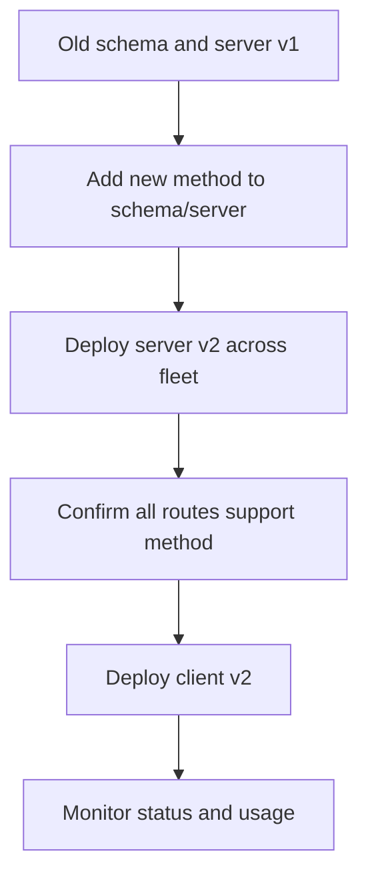

# Adding New Methods

## 1. Objectives

When a service needs to offer a new business operation, we typically extend the Protobuf service with a new RPC method. For example, Catalog already has `Search` and now needs to add `GetRecommendations`. This change allows new clients to use the new capability while existing clients continue calling the old method.

In the Spring gRPC ecosystem, clients and servers can be deployed independently, and multiple server versions may even coexist during a rolling deployment. Therefore, adding a method must account for the contract, generated code, service registration, status codes when mistakenly calling an old server, and rollout ordering.

After this lesson, you will be able to:

- Add an RPC method to an existing Protobuf service while keeping old methods intact.
- Understand full method paths and how gRPC routes calls.
- Design dedicated request/response messages for the new operation.
- Implement the new method in a Spring gRPC server and call it from a client.
- Analyze compatibility between old/new clients and old/new servers.
- Handle `UNIMPLEMENTED` and roll out servers before clients.
- Test the new method via generated stubs and real transport.

## 2. An RPC Method Is Part of the Service Contract

gRPC identifies a method by package, service name, and method name. For the service:

```proto
package catalog.v1;

service CatalogService {
  rpc Search(SearchRequest) returns (SearchResponse);
}
```

The full method path on the wire has the form:

```text
/catalog.v1.CatalogService/Search
```

The method name is part of the public API. Client generated stubs invoke this exact path; the server registers the service descriptor to route requests to the corresponding handler.

When adding a method, we add a new entry to the service descriptor. Old methods keep the exact same name, request/response types, and semantics:

```proto
service CatalogService {
  rpc Search(SearchRequest) returns (SearchResponse);
  rpc GetRecommendations(GetRecommendationsRequest)
      returns (GetRecommendationsResponse);
}
```

The new method has the path:

```text
/catalog.v1.CatalogService/GetRecommendations
```

Adding a new method additively is generally compatible with old clients: old clients do not call the new method and continue using existing methods. However, a new client calling the new method against an old server may receive `UNIMPLEMENTED`, because that server has not registered the method.

## 3. Designing Request and Response for the New Method

For example, Catalog needs to recommend products for a customer. Define dedicated messages for the operation:

```proto
syntax = "proto3";

package catalog.v1;
option java_package = "dev.example.catalog.v1";
option java_multiple_files = true;

service CatalogService {
  rpc Search(SearchRequest) returns (SearchResponse);
  rpc GetRecommendations(GetRecommendationsRequest)
      returns (GetRecommendationsResponse);
}

message SearchRequest {
  string query = 1;
}

message SearchResponse {
  repeated string product_ids = 1;
}

message GetRecommendationsRequest {
  string customer_id = 1;
  int32 limit = 2;
}

message GetRecommendationsResponse {
  repeated Recommendation items = 1;
}

message Recommendation {
  string product_id = 1;
  double score = 2;
  string reason = 3;
}
```

Dedicated request/response messages allow the new method to evolve according to its own needs without forcing old methods to change. When designing them, determine:

- **Required inputs:** customer identifier, data scope, and query conditions.
- **Optional inputs:** result count, filters, or locale; new fields must have compatible defaults.
- **Output:** data the caller actually needs, avoiding returning entire internal entities.
- **Validation:** limit bounds, ID format validation, and access permissions.
- **Error semantics:** choose stable statuses such as `INVALID_ARGUMENT`, `NOT_FOUND`, `PERMISSION_DENIED`, or `UNAVAILABLE`.
- **Performance:** result limits, deadlines, and caching capability if appropriate.

Do not reuse another method's request/response just to save a few schema lines if the two operations have different semantics. Separate messages make the contract easier to understand and reduce coupling when one operation needs additional fields.

## 4. Do Not Change the Types of Published Methods

When a different operation is needed, add a new method instead of changing an existing method from unary to streaming or altering its request/response types in place.

For example, if `GetRecommendations` is currently unary:

```proto
rpc GetRecommendations(GetRecommendationsRequest)
    returns (GetRecommendationsResponse);
```

and later you need to push updates continuously, consider a new method:

```proto
rpc WatchRecommendations(WatchRecommendationsRequest)
    returns (stream Recommendation);
```

Unary, server streaming, client streaming, and bidirectional streaming have different invocation models. Changing the cardinality of a published method alters the generated API and wire contract; old clients cannot treat it as the same operation.

Similarly, do not change the package, service name, or method name when you only want to add capabilities. Those components form the full method path. If semantics change so drastically that compatibility cannot be maintained, design a new method/service version and plan a migration path.

## 5. Implementing the New Method in a Spring gRPC Server

The Protobuf plugin generates a base class for the service. With a Spring gRPC starter providing the `@GrpcService` annotation, the server can extend the base class and let Spring register the bean:

```java
package dev.example.catalog.server;

import dev.example.catalog.v1.CatalogServiceGrpc;
import dev.example.catalog.v1.GetRecommendationsRequest;
import dev.example.catalog.v1.GetRecommendationsResponse;
import io.grpc.Status;
import io.grpc.stub.StreamObserver;
import org.springframework.grpc.server.service.GrpcService;

@GrpcService
public class CatalogGrpcService
        extends CatalogServiceGrpc.CatalogServiceImplBase {

    private final RecommendationService recommendationService;

    public CatalogGrpcService(
            RecommendationService recommendationService) {
        this.recommendationService = recommendationService;
    }

    @Override
    public void getRecommendations(
            GetRecommendationsRequest request,
            StreamObserver<GetRecommendationsResponse> observer) {
        if (request.getCustomerId().isBlank()) {
            observer.onError(Status.INVALID_ARGUMENT
                    .withDescription("customer_id is required")
                    .asRuntimeException());
            return;
        }

        if (request.getLimit() < 1 || request.getLimit() > 50) {
            observer.onError(Status.INVALID_ARGUMENT
                    .withDescription("limit must be between 1 and 50")
                    .asRuntimeException());
            return;
        }

        try {
            GetRecommendationsResponse response =
                    recommendationService.recommend(
                            request.getCustomerId(), request.getLimit());
            observer.onNext(response);
            observer.onCompleted();
        } catch (CustomerNotFoundException ex) {
            observer.onError(Status.NOT_FOUND
                    .withDescription("customer was not found")
                    .asRuntimeException());
        } catch (RuntimeException ex) {
            observer.onError(Status.INTERNAL
                    .withDescription("recommendation request failed")
                    .asRuntimeException());
        }
    }
}
```

The annotation package name and service registration mechanism depend on the Spring gRPC starter/version in use. The example above illustrates the `@GrpcService` model; if your project's starter uses a different annotation or registration mechanism, follow that starter's integration API. Do not manually create another `Server` on the same port when the starter already owns the server.

Generated Java methods typically use lower camel case (`getRecommendations`) even though the RPC name in `.proto` is `GetRecommendations`. The handler must terminate the call exactly once with either `onCompleted()` or `onError()`. Never call both for the same RPC.

Place business logic in a separate Spring service so the handler focuses on request conversion, validation, and status mapping. Do not return stack traces, SQL, or internal details in `Status.description`; log details in controlled logs and return a safe description to the caller.

## 6. Calling the New Method from a Spring Client

After the build generates code from the new schema, the client has the corresponding method on the generated stub:

```java
@Component
public class CatalogGateway {
    private final CatalogServiceGrpc.CatalogServiceBlockingStub stub;

    public CatalogGateway(
            @Qualifier("catalogChannel") ManagedChannel channel) {
        this.stub = CatalogServiceGrpc.newBlockingStub(channel);
    }

    public GetRecommendationsResponse recommendations(
            String customerId, int limit) {
        GetRecommendationsRequest request =
                GetRecommendationsRequest.newBuilder()
                        .setCustomerId(customerId)
                        .setLimit(limit)
                        .build();

        return stub.withDeadlineAfter(800, TimeUnit.MILLISECONDS)
                .getRecommendations(request);
    }
}
```

The channel is still reused per dependency; adding a method does not mean creating a new channel. Deadlines are set per RPC to fit the latency budget of the recommendation operation. If the method needs retries, idempotency semantics and a dedicated retry policy must be defined; do not unconditionally retry every error.

For client streaming or asynchronous stubs, invocation syntax differs, yet they still share the same channel. Choosing a blocking stub in the example is solely to illustrate a unary call; do not call a blocking stub on the event loop of a reactive application.

## 7. What Happens When a New Client Calls an Old Server?

Suppose server version 1 only registers `Search`, while client version 2 has generated stubs that also include `GetRecommendations`.

When the new client calls the new method against the old server:

1. The client sends an RPC to the full method path `/catalog.v1.CatalogService/GetRecommendations`.
2. The old server has no handler for that method.
3. gRPC typically terminates the RPC with status `UNIMPLEMENTED`.
4. The client must decide whether to surface the error, use an equivalent fallback, or require the caller to upgrade.

`UNIMPLEMENTED` is a useful signal, though it does not have only one cause. It can appear because the method does not yet exist on the server, the service/path is not registered, or the server intentionally marks the operation as unsupported. Do not automatically interpret every `UNIMPLEMENTED` as “old server version”.

Example of deliberate handling:

```java
try {
    return stub.withDeadlineAfter(800, TimeUnit.MILLISECONDS)
            .getRecommendations(request);
} catch (StatusRuntimeException ex) {
    if (ex.getStatus().getCode() == Status.Code.UNIMPLEMENTED) {
        // Only fall back if the old approach has equivalent semantics.
        return recommendationFallback(request);
    }
    throw ex;
}
```

A fallback is only safe when it preserves business semantics, access permissions, and data boundaries. If no equivalent exists, return a clear error or refrain from enabling the new feature until servers have upgraded. Do not fall back on other statuses such as `UNAVAILABLE`, `PERMISSION_DENIED`, or `DEADLINE_EXCEEDED`; they represent different situations.

## 8. Rolling Out Servers Before Clients

During a rolling deployment, a load balancer can send requests to old and new servers simultaneously. If a new client calls the new method while old replicas remain, some requests may succeed while others return `UNIMPLEMENTED`.

Safe deployment order:

1. **Update the schema and server:** add the new method while preserving old methods.
2. **Build and test the server:** confirm the new handler is registered and fulfills the contract.
3. **Deploy all server instances:** wait for the rollout to finish and confirm no old replicas still receive traffic from new clients.
4. **Verify capability:** use endpoint/version metadata or a well-designed capability RPC if you need to confirm server support for the method.
5. **Deploy new clients:** only begin calling the new method once targets support it across all relevant routing paths.
6. **Observe:** monitor call counts, `UNIMPLEMENTED` statuses, latency, validation errors, and fallback rates.



If all servers cannot be upgraded at once, you can use versioned endpoints, capability-based routing, or keep new clients from calling the new method yet. Relying solely on server reflection is insufficient if reflection is disabled, blocked, or does not represent the actual endpoint the RPC traverses.

## 9. Adding New Methods May Require New Policies

New methods often need to be added to operational policies:

| Area | What to Check |
|---|---|
| Authentication/authorization | Which callers are allowed to invoke the new method? |
| Interceptor | Are dedicated auditing, tracing, or metadata needed? |
| Rate limit/quota | Is the method more expensive than old methods? |
| Deadline | Does the latency budget fit the new operation? |
| Retry | Is the method idempotent and does it have a retry budget? |
| Metrics | Are metrics tracked by service/method/status? |
| Logging | Are request IDs and outcomes logged without exposing sensitive payloads? |
| API documentation | Are request, response, statuses, and semantics published? |

If authorization/interceptors use an allowlist by full method name, the new method may be rejected even though the handler is registered. Check policies in the gateway, service mesh, interceptors, and server. Do not assume the new method automatically inherits the exact permissions of old methods.

## 10. Adding Streaming Methods When Data Streams Are Needed

A new operation may require streaming instead of unary. For example, a client wants to receive recommendation updates continuously:

```proto
message WatchRecommendationsRequest {
  string customer_id = 1;
}

service CatalogService {
  rpc Search(SearchRequest) returns (SearchResponse);
  rpc GetRecommendations(GetRecommendationsRequest)
      returns (GetRecommendationsResponse);
  rpc WatchRecommendations(WatchRecommendationsRequest)
      returns (stream Recommendation);
}
```

The new streaming method has its own full path and does not alter invocations of `Search` or `GetRecommendations`. When implementing it, clearly define:

- Stream termination conditions and how the client cancels.
- Deadlines or subscription duration limits.
- Backpressure/flow control and message limits.
- Resume cursor/sequence if the client needs to continue after a disconnect.
- Authorization for the lifetime of the stream.

Do not turn a published unary method into a streaming method under the same name. Adding a separate method lets old clients keep using the original contract.

## 11. Compatibility and Behavioral Testing

Minimum matrix:

| Client | Server | Expected Outcome |
|---|---|---|
| Old | Old | Old methods work as baseline |
| Old | New | Old methods still work; old clients are not required to know the new method |
| New | New | New method works according to contract |
| New | Old | New method returns `UNIMPLEMENTED` or deliberate fallback |

Tests should include:

1. **Descriptor test:** the service descriptor contains the new method with the right request/response types and full method name.
2. **Server integration test:** call the new method over a channel to a real server, verifying response and status.
3. **Old method regression:** existing methods retain their behavior and paths.
4. **Old server test:** new client calls the new method against an old server and handles `UNIMPLEMENTED` as designed.
5. **Authorization test:** authorized callers are permitted; unauthorized callers receive the appropriate status.
6. **Deadline test:** the new method stays within its latency budget; the server handles cancellation when the client deadline expires.
7. **Rollout test:** simulate multiple server versions or routes to detect unsupported replicas.

Example integration test with a stub:

```java
@Test
void getRecommendationsReturnsItems() {
    GetRecommendationsRequest request =
            GetRecommendationsRequest.newBuilder()
                    .setCustomerId("customer-42")
                    .setLimit(5)
                    .build();

    GetRecommendationsResponse response =
            CatalogServiceGrpc.newBlockingStub(channel)
                    .withDeadlineAfter(2, TimeUnit.SECONDS)
                    .getRecommendations(request);

    assertFalse(response.getItemsList().isEmpty());
}
```

The test requires a server fixture that has registered `CatalogGrpcService`; do not use a mock stub to conclude the handler is properly registered on the transport. To test `UNIMPLEMENTED`, start a fixture server with only the old descriptor or a server that does not register the new service/method.

## 12. Common Pitfalls

| Symptom | Cause | How to Fix |
|---|---|---|
| New client receives `UNIMPLEMENTED` | Old server or unregistered handler | Deploy supporting server first; check service registration |
| Some requests succeed, others return `UNIMPLEMENTED` | Old replicas remain in rolling deployment | Wait for rollout or route by capability |
| Generated stub lacks the new method | Client built from old proto artifact | Update dependency/schema and run code generation |
| Server never reaches handler | Bean not registered or full method path differs | Check annotation, package, service name, and descriptor |
| New method gets `PERMISSION_DENIED` | Authorization allowlist not updated | Add policy for the right caller/method |
| Fallback returns semantically different results | Used a non-equivalent old method | Only fall back when contract and data are equivalent |
| Changing unary to streaming breaks old clients | Changed invocation model of a published method | Add a new method with its own cardinality |
| New method causes heavy load | Missing quota, deadline, or output limits | Design resource budget and metrics before rollout |

## 13. Hands-On Exercise

**Scenario:** Catalog currently has the `Search` RPC. The product team needs to add a `GetRecommendations` operation to return a list of products tailored to a customer. Spring client/server services are deployed independently using rolling deployments.

Perform the following:

1. Add `GetRecommendationsRequest`, `GetRecommendationsResponse`, and the new RPC to `CatalogService`; keep `Search` unchanged.
2. Generate Java code and verify the generated descriptor has the right full method path.
3. Implement the handler in the Spring gRPC server, validate inputs, and map errors to gRPC statuses.
4. Register the handler using the mechanism of your Spring gRPC starter.
5. Create a client gateway reusing the existing channel, setting a dedicated deadline for the new method.
6. Test old client with new server and new client with new server.
7. Test new client with old server; verify `UNIMPLEMENTED` and decide fallback/capability behavior.
8. Add authorization, metrics, and auditing for the new method.
9. Roll out servers before clients and verify no routes still lead to unsupported servers.

**Completion criteria:** the new method has its own path and message contract; old methods are unchanged; the Spring server registers the handler; the client calls it with a deadline; mismatched client/server versions have defined behavior; integration tests verify both compatibility and statuses.

## 14. Key Takeaways

Adding a new method is the additive way to evolve a Protobuf service: keep existing packages, services, methods, and semantics unchanged; add an RPC with new request/response messages and a new full method path. The Spring server must register the handler and update related policies; the client needs the new generated stub, a deadline, and `UNIMPLEMENTED` handling. Because new clients can encounter old servers during rolling deployments, deploy supporting servers first, verify all routes, and then enable clients. If the invocation model or semantics differ, add a separate method instead of modifying the type of a published method.
