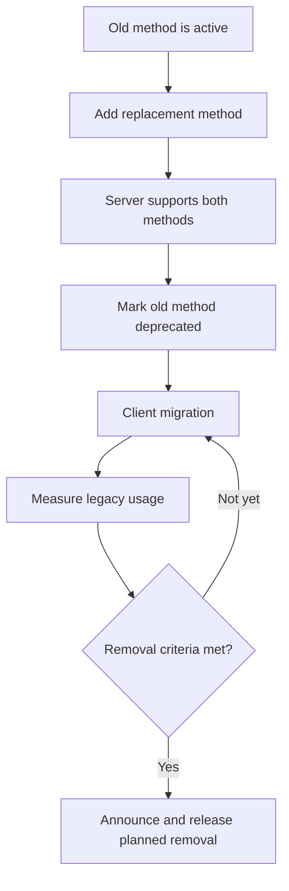

# Deprecating Old Methods

## 1. Objectives

When a gRPC API gets a new method replacing an old operation, the old method usually cannot be deleted immediately. Many released clients may still call that method; Spring services may also be upgraded at different times. If the server stops registering the old method too early, unmigrated clients will receive `UNIMPLEMENTED` errors.

**Deprecation** is the process of announcing that an API is no longer recommended for use and guiding callers to switch to a replacement API. During the deprecation period, the old method is typically retained and served to protect existing callers.

After this lesson, you will be able to:

- Mark an old RPC method as deprecated in the Protobuf contract.
- Distinguish deprecation from disabling or removing a method.
- Keep the old method working by adapting requests to the new business logic.
- Announce migrations, measure remaining callers, and set a support window.
- Deploy servers/clients in the proper order when multiple versions coexist.
- Define removal criteria for the old method and test compatibility.

## 2. What Does Deprecation Mean?

Suppose Catalog initially provides `SearchLegacy`, which takes a search string and returns a list of IDs. The new API needs filters, pagination, and ranking details. We add a new method with clearer request/response messages while marking the old method as no longer recommended.

```proto
syntax = "proto3";

package catalog.v1;
option java_package = "dev.example.catalog.v1";
option java_multiple_files = true;

service CatalogService {
  rpc SearchLegacy(LegacySearchRequest) returns (SearchResponse) {
    option deprecated = true;
  }

  rpc Search(SearchRequest) returns (SearchResponse);
}

message LegacySearchRequest {
  string query = 1;
}

message SearchRequest {
  string query = 1;
  optional int32 page_size = 2;
  string page_token = 3;
  string category = 4;
}

message SearchResponse {
  repeated string product_ids = 1;
  string next_page_token = 2;
}
```

`option deprecated = true` is metadata in the RPC method's descriptor. It declares that the method is no longer the recommended choice; it **does not automatically**:

- Remove the method from the service descriptor.
- Prevent clients from calling the method.
- Unregister the handler on the server.
- Migrate callers to the new method.
- Guarantee that every compiler/plugin produces the exact same Java warning or annotation.

Generators and tools may surface deprecation as warnings or metadata. Check your generated code and project toolchain. If application-written Java wrapper APIs need compile-time warnings, you can mark those wrappers with `@Deprecated`; do not assume every version of the gRPC Java generator automatically adds that annotation to every stub method.

## 3. Deprecation vs. Removal

| State | Meaning | Old Callers |
|---|---|---|
| Active | Method is supported and recommended for use | Continue calling normally |
| Deprecated | Method is no longer recommended; replacement exists | Can still call while the server continues supporting it |
| Disabled/unsupported | Server no longer executes the method's logic | May receive `UNIMPLEMENTED` or a published status |
| Removed | Method is no longer in the released contract/implementation | Old callers cannot rely on this method |

Marking a method deprecated is not a reason for the server to start returning errors immediately. During the migration window, the server should continue serving the old method per its published contract, unless a security or operational issue requires an emergency stop.

If the old handler is no longer registered, gRPC usually returns `UNIMPLEMENTED`. Callers cannot infer that merely switching to the new method means all semantics are equivalent; request and response structures may have changed.

## 4. Keeping the Old Method and Forwarding to Shared Business Logic

A practical implementation is to have both old and new handlers call the same application service. The old handler translates the legacy request into the current domain model, then maps the result back to the old response.

```java
@GrpcService
public class CatalogGrpcService
        extends CatalogServiceGrpc.CatalogServiceImplBase {

    private final CatalogSearchService searchService;
    private final LegacySearchMapper legacyMapper;

    public CatalogGrpcService(
            CatalogSearchService searchService,
            LegacySearchMapper legacyMapper) {
        this.searchService = searchService;
        this.legacyMapper = legacyMapper;
    }

    @Override
    public void search(
            SearchRequest request,
            StreamObserver<SearchResponse> observer) {
        try {
            SearchCriteria criteria = SearchCriteria.builder()
                    .query(request.getQuery())
                    .pageSize(request.hasPageSize()
                            ? request.getPageSize() : 25)
                    .pageToken(request.getPageToken())
                    .category(request.getCategory())
                    .build();

            SearchResult result = searchService.search(criteria);
            observer.onNext(toResponse(result));
            observer.onCompleted();
        } catch (IllegalArgumentException ex) {
            observer.onError(Status.INVALID_ARGUMENT
                    .withDescription("invalid search request")
                    .asRuntimeException());
        } catch (RuntimeException ex) {
            observer.onError(Status.INTERNAL
                    .withDescription("search failed")
                    .asRuntimeException());
        }
    }

    @Override
    @SuppressWarnings("deprecation")
    public void searchLegacy(
            LegacySearchRequest request,
            StreamObserver<SearchResponse> observer) {
        try {
            SearchCriteria criteria =
                    legacyMapper.toCurrentCriteria(request);
            SearchResult result = searchService.search(criteria);
            observer.onNext(legacyMapper.toLegacyResponse(result));
            observer.onCompleted();
        } catch (RuntimeException ex) {
            observer.onError(Status.INTERNAL
                    .withDescription("legacy search failed")
                    .asRuntimeException());
        }
    }
}
```

This is an illustrative skeleton: `CatalogSearchService`, mapper, `SearchCriteria`, and `SearchResult` are application types to be implemented. Java method names are generated from the RPC names in the schema. `@SuppressWarnings("deprecation")` is only used if the compiler actually emits a warning there; it can be omitted if unnecessary.

Benefits of forwarding:

- Search logic lives in a single application service, avoiding maintaining two copies of the algorithm.
- The old method preserves the request/response contract that existing clients use.
- The new method can accept additional filters and pagination.
- Legacy traffic can be measured separately to know when migration is complete.

Do not call the server's own RPC stub from the old handler just to redirect to the new method. Call the shared application service directly; looping over the network adds another hop, deadline overhead, and recursion risk.

## 5. Request Translation Is Not Always Equivalent

Adapting from the old method to the new business logic is only valid when semantics can be mapped without surprising callers.

| Old Request | Mapping to New Request/Criteria |
|---|---|
| `query` | Preserve the query normalized according to old rules |
| No page size | Use a default limit compatible with old results |
| No category | Apply no category filter |
| Response has only product IDs | Return only the fields promised to old callers |

If the new method changes sort order, authorization rules, handling of archived data, or query semantics, do not automatically route the old method to the new semantics without evaluating impact.

When equivalence cannot be preserved:

1. Maintain a separate legacy implementation during the support window; or
2. Return an intentional error if the old contract cannot be executed safely; or
3. Design a versioned API and dedicated migration for major semantic changes.

Do not mechanically return the new method's response if that response contains extra sensitive data or alters the meaning of old fields.

## 6. Deprecating Methods in Protobuf and API Documentation

Mark the method in the proper place:

```proto
service CatalogService {
  rpc SearchLegacy(LegacySearchRequest) returns (SearchResponse) {
    option deprecated = true;
  }

  rpc Search(SearchRequest) returns (SearchResponse);
}
```

This is deprecation of an **RPC method**. It differs from deprecation of a field:

```proto
message LegacySearchRequest {
  string old_query = 1 [deprecated = true];
}
```

Deprecating a field does not mean deprecating the entire RPC; a method can contain a legacy field while other fields remain in active use. Conversely, deprecating a method does not automatically mark every message/field of that method as deprecated.

API documentation should clearly state:

- The replacement method and full method path.
- Why the old method was deprecated.
- Request/response or semantic differences.
- How to migrate for Java clients and other clients.
- The deprecation start date and expected support end date.
- How to reach out or proceed if a caller cannot migrate on time.

Simply adding `deprecated = true` without providing a replacement method, migration guide, or support timeline leaves callers unsure what to do next.

## 7. Tracking Callers Still Using the Old Method

Do not delete a method based solely on assumptions that teams have upgraded. Measure usage by full method name.

Signals to collect:

| Signal | Purpose |
|---|---|
| RPC count per method | Know how often `SearchLegacy` is still called |
| Caller identity/client version | Identify teams or versions that have not migrated |
| RPC status | Distinguish successful calls from errors |
| Last-seen timestamp | Know which callers have been inactive for a long time |
| Deadline/latency | Detect whether the legacy method behaves differently from the new one |
| Owner and migration status | Track upgrade accountability |

A server interceptor can read the full method name from `ServerCall.getMethodDescriptor().getFullMethodName()` and increment a counter:

```java
public final class MethodUsageInterceptor implements ServerInterceptor {
    private final MeterRegistry registry;

    public MethodUsageInterceptor(MeterRegistry registry) {
        this.registry = registry;
    }

    @Override
    public <ReqT, RespT> ServerCall.Listener<ReqT> interceptCall(
            ServerCall<ReqT, RespT> call,
            Metadata headers,
            ServerCallHandler<ReqT, RespT> next) {
        String method = call.getMethodDescriptor().getFullMethodName();
        registry.counter("grpc.server.method.calls",
                "method", method).increment();
        return next.startCall(call, headers);
    }
}
```

This example only counts call starts. To track status and latency, wrap the listener/call or use existing gRPC/Micrometer instrumentation in the application. Do not register an interceptor that duplicates existing instrumentation.

Method name is a low-cardinality dimension when the schema is stable; do not put request IDs, user IDs, tokens, or payloads into metric labels. If caller identification is needed, use authenticated service identity/client version and appropriate data protection policies.

## 8. Time-Bound Migration Plan

A deprecation can be managed in phases:

1. **Publish the replacement method:** finalize the new contract and mapping documentation.
2. **Release a compatible server:** register both old and new methods; the old method delegates or adapts per old semantics.
3. **Mark deprecated:** update the Protobuf descriptor, generated artifacts, and documentation.
4. **Notify callers:** identify owners, client versions, migration deadlines, and support channels.
5. **Release new clients:** switch calls to the new method; do not create a new channel just because the method changed.
6. **Measure usage:** track the legacy method by caller/version and status.
7. **Send reminders before deadline:** contact active callers; handle external integrations and infrequently deployed clients.
8. **Decide removal:** only when usage meets published criteria and is approved per the API release process.



The deprecation timeline must fit callers' upgrade capabilities. For internal clients managed by the same team, the window can be shorter; for public SDKs, mobile apps, or external partners, a longer support window and formal announcements are needed.

## 9. Compatibility Across Client and Server Versions

Matrix to consider:

| Client | Server | Expected Outcome |
|---|---|---|
| Old calling old method | New server supporting both | Calls continue succeeding during deprecation period |
| New calling new method | New server | New calls succeed |
| New with fallback calling old method | New server | Only use fallback when semantics are equivalent and within support window |
| New calling new method | Old server lacking new method | May receive `UNIMPLEMENTED`; rollout must prevent this or client handles it explicitly |
| Old calling old method | Server after removal | No longer compatible; may receive `UNIMPLEMENTED` |

When new clients must run in an environment where old servers still exist, you can:

- Upgrade servers before enabling new clients.
- Use versioned endpoints or capability-based routing.
- Maintain a time-bound fallback if the old method is still supported by servers.

Do not call the new method, get `UNIMPLEMENTED`, and fall back indefinitely without measuring. That approach can hide faulty rollouts and prevent the old method from ever being retired.

## 10. Criteria for Removing Old Methods

Before deleting a method, gather evidence:

- No supported callers invoke the old method over the defined observation window.
- Internal clients/SDKs have migrated to the replacement method.
- Partners and external callers have been notified, completed migration, or reached the end of the support window.
- The new method meets the semantics, permissions, latency, and reliability callers need.
- Dashboards/alerts track legacy usage and show no unexplained traffic.
- A rollback or emergency support plan exists in case an overlooked caller is discovered.

Afterward, remove the handler and method from the schema in an intentional release. Removing an RPC method is a contract change: old clients may still send the full method path, while the new server no longer has a handler and usually returns `UNIMPLEMENTED`. Do not reuse the old method name for another operation; published path names should be treated as spent.

If a wire endpoint must still be kept for a specific group of callers, keep the method and handler or move to an explicit versioned service. Do not delete it from the schema while quietly keeping an implementation outside the generated descriptor without tests and documentation.

## 11. Testing Deprecation and Removal

Tests should include:

1. **Descriptor test:** the old method has `deprecated = true`; the new method is declared.
2. **Legacy behavior test:** old requests yield compatible results and statuses during the support window.
3. **New method test:** the replacement method handles new requests per contract.
4. **Adapter test:** mapping from old requests to the domain model does not lose semantics.
5. **Usage metric test:** calls to the old method are recorded under the right full method name.
6. **Client migration test:** new clients call the new method; fallback only runs when enabled and justified.
7. **Mixed-version test:** old and new clients/servers are tested across the rollout matrix.
8. **Removal test:** after the removal release, old clients receive the expected status and new clients no longer reference the old method.

Example descriptor test:

```java
Descriptors.MethodDescriptor legacyMethod =
        LegacySearchRequest.getDescriptor()
                .getFile()
                .findServiceByName("CatalogService")
                .findMethodByName("SearchLegacy");

assertNotNull(legacyMethod);
assertTrue(legacyMethod.getOptions().getDeprecated());
```

`LegacySearchRequest.getDescriptor()` retrieves the file descriptor from the generated message; from there you can look up the service and method in the Protobuf schema. `MethodDescriptor` here is Protobuf's descriptor (`Descriptors.MethodDescriptor`), not `io.grpc.MethodDescriptor`. Generated class names can vary depending on `java_outer_classname` and code generation configuration; use a message class belonging to that `.proto` file.

Do not only test option metadata. Test that the server actually still registers the legacy handler during the support window and that new clients can call the replacement method over transport.

## 12. Common Pitfalls

| Symptom | Cause | How to Fix |
|---|---|---|
| Old clients receive `UNIMPLEMENTED` right after deploy | Old handler was deleted at the same time the new method was added | Keep the old handler during the support window |
| `deprecated` option present but callers do not migrate | No communication, no usage metrics, or no deadline | Assign owners, dashboards, and a migration plan |
| Old and new methods return different results | Adapter alters semantics | Write contract mappings and regression tests |
| New clients calling old servers get `UNIMPLEMENTED` | Server rollout incomplete | Deploy servers first or route by capability |
| Fallback masks rollout errors | Automatic fallback with no metrics | Time-box, record fallback metrics, and alert |
| Generated Java shows no deprecation warning | Generator/version does not emit the expected annotation | Inspect descriptor and mark wrapper APIs if needed |
| Method removed while external callers still exist | Only measured internal traffic | Identify SDKs, partners, and low-frequency clients |
| Old method name reused | Treating method names as reusable resources | Create a new method/version with its own path |

## 13. Hands-On Exercise

**Scenario:** Catalog currently exposes `SearchLegacy(LegacySearchRequest)`. The new API `Search(SearchRequest)` supports category filtering and pagination. Multiple versions of Spring services call Catalog; some partner clients only upgrade quarterly.

Perform the following:

1. Add `Search` with appropriate request/response messages and keep `SearchLegacy` intact.
2. Set `option deprecated = true` on `SearchLegacy` in the Protobuf service.
3. Implement both handlers in the Spring gRPC server; have the legacy handler translate requests into the shared application service when semantics allow.
4. Write regression tests proving the old method's responses retain committed behavior.
5. Update internal clients to `Search`; do not create a new channel just because the method changed.
6. Record metrics by full method name and identify callers/versions still using `SearchLegacy`.
7. Publish the deprecation deadline, migration guide, and partner support plan.
8. Simulate old server/new client and new server/old client; verify `UNIMPLEMENTED` and controlled fallback.
9. Propose removal criteria based on actual usage, not just a release date.

**Completion criteria:** the old method is marked deprecated yet continues working during the support window; the new method has its own contract and handler; callers have a migration path; usage is measured; removal happens only with compatibility evidence and a release plan.

## 14. Key Takeaways

Deprecating an RPC method announces that callers should move to a replacement method; it does not delete the method or stop clients from calling it. Keep the old handler during the support window, forward requests to shared business logic when semantics are equivalent, publish guidance, and measure usage by full method name. Deploy servers supporting both methods before migrating clients; only remove the old method after confirming old callers have completed migration and handling any stragglers. `deprecated = true` is useful metadata, while actual compatibility depends on handlers, rollout, behavior, and disciplined API support.
