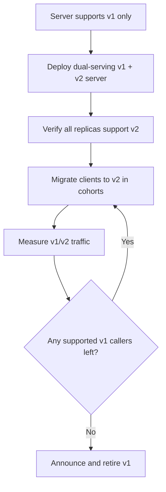

# Keeping Old Services During Transition

## 1. Objectives

When a gRPC contract undergoes major changes, it is sometimes impossible to keep the old service simply by adding fields or methods. For example, Catalog v1 returns a simple list of IDs, whereas Catalog v2 requires filters, pagination, and ranking details with different semantics. Internal clients, SDKs, and partners cannot upgrade simultaneously.

In such cases, you can release a new service version and **keep the old service running in parallel during the transition period**. The new server registers both v1 and v2 services; callers migrate gradually; v1 is only removed after verifying no supported traffic remains.

After this lesson, you will be able to:

- Distinguish old/new service versions via Protobuf packages and full method paths.
- Register v1 and v2 services side-by-side in a Spring gRPC server.
- Share application/domain logic while keeping separate contracts.
- Plan server-first rollouts and client migrations.
- Handle new clients encountering old servers, rollbacks, and version-based routing.
- Monitor usage of the old service and define retirement criteria.
- Test compatibility when multiple client/server versions coexist.

## 2. Why Keep the Old Service?

Suppose Catalog v1 is already called by many applications. V1 has a `Search` method whose request only contains a query and whose response returns only product IDs. V2 needs filters, pagination, and scores. This change can alter requests, responses, and semantics significantly.

Instead of modifying the v1 package or contract in place, create a separate v2 service:

```proto
// catalog-v1.proto
syntax = "proto3";

package catalog.v1;
option java_package = "dev.example.catalog.v1";
option java_multiple_files = true;

service CatalogService {
  rpc Search(SearchRequest) returns (SearchResponse);
}

message SearchRequest {
  string query = 1;
}

message SearchResponse {
  repeated string product_ids = 1;
}
```

```proto
// catalog-v2.proto
syntax = "proto3";

package catalog.v2;
option java_package = "dev.example.catalog.v2";
option java_multiple_files = true;

service CatalogService {
  rpc Search(SearchRequest) returns (SearchResponse);
}

message SearchRequest {
  string query = 1;
  string category = 2;
  optional int32 page_size = 3;
  string page_token = 4;
}

message SearchResponse {
  repeated Product items = 1;
  string next_page_token = 2;
}

message Product {
  string product_id = 1;
  double score = 2;
}
```

Both services share the short name `CatalogService`, yet because their packages differ, their full method paths differ:

```text
/catalog.v1.CatalogService/Search
/catalog.v2.CatalogService/Search
```

A server can register both services on the same gRPC server because their full service names differ. V1 clients keep calling the v1 path; v2 clients call the v2 path. There is no need to spin up a separate process or port just because the contract has a new version, unless deployment or security requirements dictate otherwise.

## 3. Versioning Services in the Protobuf Contract

When creating a new version, clearly decide the scope of the version:

- **Package version:** `catalog.v1`, `catalog.v2` create distinct namespaces and full method paths.
- **Java package:** `dev.example.catalog.v1`, `dev.example.catalog.v2` prevent generated class name collisions in the same application.
- **Request/response:** each version has messages tailored to its contract.
- **Semantics:** clearly document differences in filtering, sorting, defaults, validation, and statuses.

Do not change the package of an already published service and treat it as a transparent upgrade. Changing the package changes the full method path; old clients continue sending the old path and are not automatically routed to the new path.

Do not reuse the same Java message name in a single package for two different schemas. Use separate `java_package` declarations so code generated from v1 and v2 coexists without conflict.

A new version does not have to change every message. Shared messages can be reused if contracts and semantics are truly identical, but do not share them merely to avoid writing schema definitions. A shared data type couples two versions together; later changes may force both versions to release together.

## 4. Registering Old and New Services Side-by-Side in Spring

With a Spring gRPC starter providing the `@GrpcService` annotation, each service adapter can be a separate bean. Both adapters delegate to a shared application service.

Example v1 adapter:

```java
package dev.example.catalog.server;

import dev.example.catalog.v1.CatalogServiceGrpc;
import dev.example.catalog.v1.SearchRequest;
import dev.example.catalog.v1.SearchResponse;
import io.grpc.Status;
import io.grpc.stub.StreamObserver;
import org.springframework.grpc.server.service.GrpcService;

@GrpcService
public class CatalogV1GrpcService
        extends CatalogServiceGrpc.CatalogServiceImplBase {

    private final CatalogSearchUseCase searchUseCase;

    public CatalogV1GrpcService(CatalogSearchUseCase searchUseCase) {
        this.searchUseCase = searchUseCase;
    }

    @Override
    public void search(
            SearchRequest request,
            StreamObserver<SearchResponse> observer) {
        try {
            SearchCriteria criteria = SearchCriteria.legacy(
                    request.getQuery());
            SearchResult result = searchUseCase.search(criteria);

            SearchResponse response = SearchResponse.newBuilder()
                    .addAllProductIds(result.productIds())
                    .build();
            observer.onNext(response);
            observer.onCompleted();
        } catch (IllegalArgumentException ex) {
            observer.onError(Status.INVALID_ARGUMENT
                    .withDescription("invalid search request")
                    .asRuntimeException());
        } catch (RuntimeException ex) {
            observer.onError(Status.INTERNAL
                    .withDescription("catalog search failed")
                    .asRuntimeException());
        }
    }
}
```

V2 adapter:

```java
package dev.example.catalog.server;

import dev.example.catalog.v2.CatalogServiceGrpc;
import dev.example.catalog.v2.SearchRequest;
import dev.example.catalog.v2.SearchResponse;
import dev.example.catalog.v2.Product;
import io.grpc.Status;
import io.grpc.stub.StreamObserver;
import org.springframework.grpc.server.service.GrpcService;

@GrpcService
public class CatalogV2GrpcService
        extends CatalogServiceGrpc.CatalogServiceImplBase {

    private final CatalogSearchUseCase searchUseCase;

    public CatalogV2GrpcService(CatalogSearchUseCase searchUseCase) {
        this.searchUseCase = searchUseCase;
    }

    @Override
    public void search(
            SearchRequest request,
            StreamObserver<SearchResponse> observer) {
        try {
            int pageSize = request.hasPageSize()
                    ? request.getPageSize() : 25;
            SearchCriteria criteria = SearchCriteria.v2(
                    request.getQuery(),
                    request.getCategory(),
                    pageSize,
                    request.getPageToken());
            SearchResult result = searchUseCase.search(criteria);

            SearchResponse.Builder response = SearchResponse.newBuilder()
                    .setNextPageToken(result.nextPageToken());
            result.products().forEach(item ->
                    response.addItems(Product.newBuilder()
                            .setProductId(item.id())
                            .setScore(item.score())
                            .build()));
            observer.onNext(response.build());
            observer.onCompleted();
        } catch (IllegalArgumentException ex) {
            observer.onError(Status.INVALID_ARGUMENT
                    .withDescription("invalid search request")
                    .asRuntimeException());
        } catch (RuntimeException ex) {
            observer.onError(Status.INTERNAL
                    .withDescription("catalog search failed")
                    .asRuntimeException());
        }
    }
}
```

This example illustrates parallel registration; `CatalogSearchUseCase`, `SearchCriteria`, `SearchResult`, and the `Product` model belong to the application layer to be defined in the project. Annotation packages and service registration mechanisms depend on the Spring gRPC starter version. If your project's starter uses a different registration API, follow that API; do not manually create an extra `Server` on the same port when the framework owns the server.

Crucially, the two adapters do not call each other's RPCs over the network. They translate version-specific requests into application models and call the same use case. This keeps transport contracts independent and avoids extra hops, deadline consumption, or recursion risks.

## 5. Share Business Logic, Do Not Force Contracts to Be Identical

Services v1 and v2 can share:

- Application use cases.
- Domain models and business rules.
- Repositories and transaction boundaries.
- Business-layer authorization policies.
- Appropriate observability, tracing, and auditing logic.

Yet each adapter remains responsible for:

- Parsing and validating requests per contract version.
- Converting requests to the application model.
- Converting domain results to the corresponding response version.
- Mapping errors to committed statuses.
- Preserving old semantics in v1.

For instance, if v1 always returns a list of IDs ordered by relevance without pagination, the v1 adapter must preserve that interpretation. Do not automatically apply v2's page size or new sorting to v1 if that alters results for old callers.

If v2 changes semantics so much that a shared use case cannot preserve v1 results, keep a separate business branch during the support window. Only merge them when you can prove both contracts share the same business rules.

## 6. How Do Clients Choose a Service Version?

V1 clients use generated stubs from the v1 package:

```java
@Component
public class CatalogV1Gateway {
    private final dev.example.catalog.v1.CatalogServiceGrpc
            .CatalogServiceBlockingStub stub;

    public CatalogV1Gateway(
            @Qualifier("catalogChannel") ManagedChannel channel) {
        this.stub = dev.example.catalog.v1.CatalogServiceGrpc
                .newBlockingStub(channel);
    }

    public List<String> search(String query) {
        var request = dev.example.catalog.v1.SearchRequest.newBuilder()
                .setQuery(query)
                .build();
        var response = stub.withDeadlineAfter(1, TimeUnit.SECONDS)
                .search(request);
        return response.getProductIdsList();
    }
}
```

V2 clients use stubs and messages from the v2 package. Both can share the same `ManagedChannel` if they share the same target and transport/security configuration; a different service path version does not require a separate channel.

If you want clients to select versions via configuration, create an explicit gateway or factory. Avoid determining the version by trying v2 on every request and catching `UNIMPLEMENTED` to call v1, as that creates extra failed RPCs, increases latency, and masks incomplete rollouts.

## 7. Compatibility When Clients and Servers Have Mismatched Versions

During transition, anticipate these pairs:

| Client | Server | Outcome |
|---|---|---|
| Client v1 | Server with v1 only | Works per old contract |
| Client v1 | Server with v1 and v2 | V1 continues working |
| Client v2 | Server with v1 and v2 | V2 works |
| Client v2 | Server with v1 only | V2 typically receives `UNIMPLEMENTED` |
| Client v1 | Server with v2 only | V1 typically receives `UNIMPLEMENTED` |

A dual-serving server (registering both v1 and v2) is an essential bridge. It lets you deploy new servers first while clients upgrade on their own schedule.

Do not assume a v2 server automatically understands v1 requests if the v1 method path has been removed. gRPC routes by full method path; the server must continue registering the v1 service to keep old callers working.

## 8. Safe Rollout Order

A typical workflow:

1. **Define v2:** create the new package, messages, and service; preserve the v1 schema.
2. **Upgrade servers:** deploy both v1 and v2 adapters together on every new instance.
3. **Complete server rollout:** verify all replicas/routes serving v2 clients support v2.
4. **Release v2 clients:** migrate callers by cohort, configuration, or release.
5. **Monitor:** track v1/v2 requests, errors, latency, caller versions, and migration progress.
6. **Keep v1 through the support window:** continue serving un-upgraded clients.
7. **Announce retirement:** publish deadlines, owners, and handling for remaining callers.
8. **Remove v1 in a separate release:** only perform once retirement criteria are verified.



Do not enable v2 clients while the load balancer can still route to replicas supporting only v1. If servers cannot be upgraded simultaneously, use versioned endpoints, capability-based routing, or keep v2 clients disabled until the entire path supports v2.

## 9. Rollback Once V2 Clients Exist

Rollback is an often-overlooked point. After v2 clients are released, rolling servers back to a v1-only build will cause v2 clients to receive `UNIMPLEMENTED`.

Safe options:

- Roll back v2 clients to v1 first, if clients can be rolled back independently.
- Keep dual-serving in rollback server builds; do not roll back to a v1-only server while v2 clients remain active.
- Use routing/capabilities to send v2 clients only to servers supporting v2.
- Have a bounded fallback if v1 is genuinely equivalent and still supported.

Do not treat fallback as the default rollback solution. If v2 has new semantics like filters or pagination, calling v1 can return different data. Any fallback must be measured, time-boxed, and strictly conditioned.

## 10. Observing Usage of the Old Service

Before retirement, you need to know precisely who is still calling v1. Record the full method name to distinguish versions:

```text
catalog.v1.CatalogService/Search
catalog.v2.CatalogService/Search
```

Signals to monitor:

| Signal | Purpose |
|---|---|
| RPC count by full method name | Compare v1 and v2 usage |
| Caller/service identity | Identify systems still calling v1 |
| Client version | Find unmigrated SDK or service versions |
| Status code | Detect errors during version migration |
| Latency and deadline | Compare performance of the two contracts |
| Last-seen timestamp | Know if a caller is active or only runs periodically |
| Migration owner | Track upgrade responsibility |

A server interceptor can extract the full method name:

```java
String fullMethodName =
        call.getMethodDescriptor().getFullMethodName();
```

Use dependency/service/method names as low-cardinality metric labels. Do not place request IDs, user IDs, tokens, or payloads in metric labels. If caller identification is needed, use authenticated identities and follow data protection policies.

Zero traffic over a few hours is not necessarily enough to prove the old service has no callers: batch jobs, mobile apps, or partners may only call weekly or monthly. The observation window must match caller activity cycles.

## 11. Security and Policies for Both Versions

Registering v2 does not automatically ensure v2 has proper authorization. Check:

- Authentication and authorization by full method name.
- Method allowlists in interceptors, API gateways, or service meshes.
- Separate quotas/rate limits if v2 cost differs from v1.
- Auditing and data classification for new fields.
- TLS/mTLS and service identity on connections.
- Deadlines, retries, and message size limits per version.

If v2 additionally returns scores, prices, or personal data, do not assume callers are authorized to read it just because they could call v1. Policies must be evaluated against the data and actions of the new contract.

You can share the same authentication infrastructure while enforcing different authorization rules for v1 and v2. Never let keeping v1 alive become an excuse to skip security patches or new policies.

## 12. Criteria for Retiring the Old Service

Only remove v1 with evidence and a plan:

- Internal callers have migrated to v2.
- External partners/SDKs have been notified and either completed migration or passed the support deadline.
- Metrics show zero v1 traffic over an appropriate observation window.
- No batch jobs, low-frequency clients, or hidden integrations remain unidentified.
- V2 meets the semantics, permissions, latency, and reliability callers require.
- Runbooks, dashboards, alerts, and rollback plans are updated.
- A dedicated release removes the v1 adapter, v1 service descriptor, and schema artifacts per retention policy.

After removing v1, clients still calling `/catalog.v1.CatalogService/Search` will usually receive `UNIMPLEMENTED`. Do not reuse the `catalog.v1` package or old full method path for a different contract.

If a group of callers needs extra time, you can extend the support window or provide a dedicated endpoint/version. Document the exception, owner, and end date; avoid keeping v1 indefinitely without an operational decision.

## 13. Testing Coexistence

Integration tests must prove a single Spring server can serve both service descriptors simultaneously:

1. Start the server with both v1 and v2 adapters on the same server instance.
2. Create v1 and v2 clients pointing to the same target.
3. Call the v1 method and verify the response matches the old contract.
4. Call the v2 method and verify the response matches the new contract.
5. Disable a dependency or induce an error in the v2 branch; confirm v1 is unaffected beyond known shared resources.
6. Verify metrics record the exact full method paths.
7. Start a v1-only fixture; verify v2 clients receive `UNIMPLEMENTED`.
8. Test shutdown and rollout/rollback across expected server versions.

Example testing two gateways:

```java
@Test
void serverSupportsBothCatalogVersions() {
    assertEquals(List.of("p-1", "p-2"),
            catalogV1Gateway.search("keyboard"));

    SearchV2Result result =
            catalogV2Gateway.search("keyboard", "electronics", 10);
    assertFalse(result.items().isEmpty());
}
```

This is a test skeleton; the two gateways must use their corresponding generated stubs and the server fixture must register both adapters. Do not merely mock the application service and conclude gRPC routing works.

### Test Matrix

| Server Fixture | Client | What to Verify |
|---|---|---|
| V1 only | V1 | Works per baseline |
| V1 + V2 | V1 | Preserves v1 semantics |
| V1 + V2 | V2 | V2 method works |
| V1 only | V2 | `UNIMPLEMENTED` is handled deliberately |
| V2 only | V1 | `UNIMPLEMENTED`; acceptable only after retirement |

Also test authorization, deadlines, retries, streaming, and sensitive data if the two versions have different policies.

## 14. Common Pitfalls

| Symptom | Cause | How to Fix |
|---|---|---|
| V1 clients fail right after v2 deploy | Server removed the v1 service | Keep v1 adapter and descriptor during support window |
| V2 clients randomly receive `UNIMPLEMENTED` | Fleet still has v1-only replicas | Complete server rollout or route by capability |
| Generated classes collide between versions | Shared Java package/class name | Set distinct `java_package` for each version |
| V1 and v2 logic drift unintentionally | Maintaining two independent implementations | Share use cases when semantics match |
| V1 returns different results after delegating | Adapter applies v2 defaults/semantics | Keep v1 mappings and regression tests |
| Server rollback breaks v2 clients | Rollback build no longer registers v2 | Keep dual-serving or roll back clients first |
| Unknown who still calls v1 | Only measuring total RPCs or missing full method path | Measure usage by version and caller identity |
| Retirement breaks a partner integration | Overlooked low-frequency/batch clients | Use a long observation window and formal notices |
| V2 exposes data outside caller permissions | Reused v1 authorization without re-evaluation | Review policies per method and new data |

## 15. Hands-On Exercise

**Scenario:** Catalog v1 currently serves multiple Spring services and several partners. The team needs Catalog v2 with pagination, category filters, and product scores. Not all callers can upgrade on the same day.

Perform the following:

1. Keep `catalog.v1.CatalogService` intact and create `catalog.v2.CatalogService` with its own messages.
2. Generate Java code into two separate packages and verify full method paths do not collide.
3. Implement both Spring gRPC adapters on the same server, calling a shared application use case where semantics permit.
4. Write regression tests ensuring v1 retains its exact results and old defaults.
5. Create a v2 client using the existing channel; do not create a new channel just because the service version changed.
6. Deploy the dual-serving server first, verify all replicas support v2, and only then migrate clients.
7. Record metrics by full method name and caller identity; list owners still using v1.
8. Simulate server and client rollbacks; confirm no v2 clients are routed to a v1-only server.
9. Propose a support window, retirement criteria, and tests for when v1 is removed.

**Completion criteria:** the new server serves v1/v2 concurrently; old clients experience no disruption; new clients only call v2 once all routes support it; business logic is shared while each contract's semantics remain clear; usage, rollback, and retirement have verifiable evidence.

## 16. Key Takeaways

When an old contract cannot be evolved compatibly, publish a new service version with a distinct package and full method path while keeping the old service running on the server through a support window. In Spring, register v1 and v2 adapters side-by-side; share application/domain logic where semantics align while keeping request/response mappings separate. Deploy dual-serving servers first, migrate clients in cohorts, measure traffic by full method name, and ensure rollbacks do not send new clients back to v1-only servers. Only retire the old service once callers have migrated and a sufficiently long observation window proves no supported demand remains.
