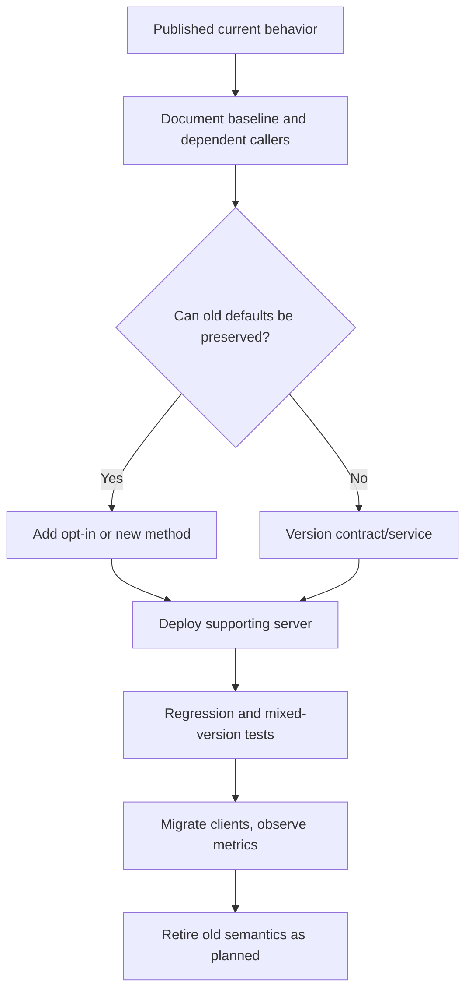

# Changing Semantics Is Not Just Changing Schema

## 1. Objectives

A Protobuf schema can remain completely unchanged yet still break an API if the server changes the meaning of requests, responses, or returned errors. For example, `Search` previously sorted by relevance, but after a deployment it sorts by newest date. The request still parses and generated stubs still compile, yet callers may display wrong results or suffer unstable pagination.

**Semantics** are how an API actually behaves as observable by callers: the meaning of each field, defaults, success conditions, statuses, result ordering, side effects, idempotency, access permissions, and timing/consistency guarantees.

In Spring gRPC, API evolution must protect both the schema contract and the behavioral contract. After this lesson, you will be able to:

- Distinguish wire/schema compatibility from behavioral compatibility.
- Identify semantic changes that can break callers even when `.proto` is unchanged.
- Specify RPC preconditions, postconditions, defaults, and side effects.
- Preserve old behavior using separate adapters/policies when releasing new semantics.
- Choose between opt-in extensions and RPC/service versioning.
- Test behavior across multiple client/server versions before rollout.

## 2. Compatible Schema Does Not Mean Compatible Behavior

Consider three layers:

| Compatibility Layer | What Is Protected | Examples of Breaking Changes |
|---|---|---|
| Wire compatibility | Both versions can serialize/parse messages | Changing field numbers or wire types |
| Source/API compatibility | Generated Java APIs and callers still compile | Renaming fields, changing stub types |
| Behavioral compatibility | Callers receive results and side effects promised by the contract | Changing default sorting or status codes |

Adding an optional field can be wire-compatible, yet if the new server automatically applies a new rule to old requests, it is still a behavioral breaking change. Conversely, an unchanged schema does not guarantee caller safety if the server alters how it interprets fields.

For example, `SearchRequest` still only contains `query`, yet the server changes string normalization, default category, sort order, or empty query handling. Old clients cannot detect these changes from generated code.

**Rule:** evaluate an API by what callers observe and rely upon, not solely by the Protobuf descriptor.

## 3. What Does a Behavioral Contract Consist Of?

For each RPC, minimally define:

| Component | Question to Answer |
|---|---|
| Precondition | Which requests are valid? What permissions does the caller need? |
| Field meaning | What unit or meaning do ID, amount, timestamp, limit, or filters have? |
| Default | When a field is absent, empty, or zero, what does the server do? |
| Postcondition | What does success guarantee? |
| Result shape | How are empty lists, missing items, or null data represented? |
| Ordering | By what criteria are results sorted? What is the tie-breaker? |
| Error semantics | When are `NOT_FOUND`, `INVALID_ARGUMENT`, `FAILED_PRECONDITION` returned? |
| Side effect | Does the RPC write data, create transactions, or emit events? |
| Idempotency | Does retrying the same request produce additional side effects? |
| Consistency | As of what point in time do results reflect data? |
| Security | Which data can the caller view/modify? |
| Time/resource | What are the deadline, page limit, and response size limits? |

Not every RPC needs lengthy documentation. However, aspects that affect caller logic must be clearly documented and backed by tests.

## 4. Semantic Changes That Commonly Cause Breakages

### 4.1 Changing Defaults

An old request omits `sort_order`. Previously the server defaulted to `RELEVANCE`; after deploy the server defaults to `NEWEST`. The schema and bytes did not change, yet callers see a different result order.

Defaults should be treated as part of the contract:

- Sort order.
- Page size or result limit.
- Locale/time zone.
- Record statuses included.
- Behavior when filters are absent.
- Rounding policies or default units.

When adding new options, keep old defaults for existing callers. If callers need new semantics, let them opt in via a new field/method and enable it only after servers support it.

### 4.2 Changing the Meaning of Values

Suppose `amount` is an `int64` and previously represented cents. The new server interprets the same value as whole dollars. The wire type is still `int64` and the schema is unchanged, yet business values are off by two orders of magnitude.

Similar cases:

- Timestamps changing from seconds to milliseconds.
- `limit` changing from “maximum number of results” to “exact number of results”.
- `customer_id` changing from an internal ID to a global ID.
- `distance` changing units from kilometers to meters.
- `query` changing from literal search to expression syntax.

Do not implicitly change units, formats, or ID namespaces inside an already published field. If new semantics differ, add a clearly named new field/method or release a new version.

### 4.3 Changing Empty Results and Errors

For example, `GetProduct` previously returned `NOT_FOUND` when no product existed; the new server returns `OK` with an empty response. One caller might rely on `NOT_FOUND` to render a 404 page, while another relies on a successful response to create a default record.

Changes to watch carefully:

| Previously | After Change | Potential Impact |
|---|---|---|
| `NOT_FOUND` | `OK` with empty message | Caller no longer executes error-handling branch |
| Empty list | `NOT_FOUND` | Caller treats a valid query as an error |
| `INVALID_ARGUMENT` | `FAILED_PRECONDITION` | Retry/validation handlers may behave differently |
| Ignore invalid field | Reject entire request | Old callers may start failing |
| Return partial results | Roll back completely | Changes expectations around partial success |

gRPC statuses are part of the behavioral contract. Do not change statuses just because server code is refactored; keep the published mapping or version the API if semantics genuinely change.

### 4.4 Changing Ordering and Pagination

If `Search` uses pagination, result ordering must be deterministic. Simply changing sort order can cause items to repeat or be skipped across pages. When a sort key is not unique, a stable tie-breaker such as `product_id` is required.

Page tokens are typically opaque tokens. Callers should not parse their internal structure; the server must still ensure tokens of the current version uphold documented semantics. If algorithm or sort-key changes render old tokens unusable, handle old tokens intentionally and provide clear migration/expiry rules.

### 4.5 Changing Side Effects and Idempotency

A `CreateOrder` RPC previously guaranteed that repeated requests with the same idempotency key created only one order. If the new server ignores the key and creates a new order every time, the schema may look identical, yet callers retrying after a timeout will create duplicate transactions.

Semantics to preserve:

- How many side effects a request can produce.
- How long idempotency keys are retained and their uniqueness scope.
- Ordering of data commits and event emission.
- Behavior when a client cancels an RPC after the server has committed.
- Which statuses callers can retry and under what conditions.

Do not alter idempotency or atomicity merely as an internal optimization. These are business guarantees directly impacting money, orders, and data integrity.

### 4.6 Changing Authorization or Returned Data

A method previously returned only public fields, and after deploy also returns email addresses or internal data. The new schema may have only added fields, yet old callers could receive data they are not authorized to view.

Conversely, tightening permissions can cause previously legitimate callers to receive `PERMISSION_DENIED`. Policies must be evaluated by principal, tenant, resource, and method; do not treat authorization as an implementation detail outside the API contract.

## 5. Example: Preserving Old Semantics for Search

Suppose `catalog.v1.Search` previously committed to:

- Queries normalized according to old rules.
- Results ordered by descending relevance.
- Ties in relevance score broken by `product_id`.
- Valid queries with no matches returning an empty list with status `OK`.
- Absent page size equivalent to 25.

The team wants to release a new search mode with category filtering and chronological sorting. You can add a new method/version instead of changing v1's defaults.

```proto
package catalog.v1;

service CatalogService {
  rpc Search(SearchRequest) returns (SearchResponse);
}

message SearchRequest {
  string query = 1;
}
```

```proto
package catalog.v2;

service CatalogService {
  rpc Search(SearchRequest) returns (SearchResponse);
}

message SearchRequest {
  string query = 1;
  string category = 2;
  optional int32 page_size = 3;
  string page_token = 4;
  SortOrder sort_order = 5;
}

enum SortOrder {
  SORT_ORDER_UNSPECIFIED = 0;
  SORT_ORDER_RELEVANCE = 1;
  SORT_ORDER_NEWEST = 2;
}
```

V1 keeps its relevance default and old error mapping. V2 can support the new sort order while defining `UNSPECIFIED`, tie-breakers, page tokens, and statuses. Versioning only helps when the server truly preserves two distinct behaviors; changing the package while having both handlers share the same new policy still breaks v1 semantics.

## 6. Separating Transport Adapters from Application Semantics in Spring

A helpful design is to have each gRPC adapter translate its version-specific request into a command with an explicit policy. The application service should not guess the version from absent fields or package names.

```java
public enum SearchPolicy {
    LEGACY_RELEVANCE,
    V2_EXPLICIT_SORT
}
```

The application service accepts the policy:

```java
@Service
public class CatalogSearchUseCase {
    public SearchResult search(
            SearchCriteria criteria,
            SearchPolicy policy) {
        return switch (policy) {
            case LEGACY_RELEVANCE ->
                    searchLegacy(criteria);
            case V2_EXPLICIT_SORT ->
                    searchWithV2Rules(criteria);
        };
    }

    private SearchResult searchLegacy(SearchCriteria criteria) {
        // Preserve v1 normalization, defaults, ordering, and empty-result behavior.
        return legacySearchEngine.execute(criteria);
    }

    private SearchResult searchWithV2Rules(SearchCriteria criteria) {
        // Apply filtering, sorting, and pagination published for v2.
        return currentSearchEngine.execute(criteria);
    }
}
```

This is an illustrative skeleton; the engines and criteria belong to the project's application layer. The key point is that the policy is passed explicitly and can be tested independently. Do not use a vague boolean like `newBehavior=true` when multiple distinct semantics must be chosen.

The v1 adapter always selects the old policy:

```java
SearchCriteria criteria = SearchCriteria.fromLegacy(request);
SearchResult result = useCase.search(
        criteria, SearchPolicy.LEGACY_RELEVANCE);
```

The v2 adapter determines the policy from the v2 contract:

```java
SearchCriteria criteria = SearchCriteria.fromV2(request);
SearchResult result = useCase.search(
        criteria, SearchPolicy.V2_EXPLICIT_SORT);
```

Both adapters can share repositories, transactions, and domain services; yet request/response mappings and semantics remain clearly separated. If v2 has different semantics, never let v1 accidentally inherit them via a shared default.

## 7. Extending Semantics via Opt-In

Not every change requires a new service version. If new behavior can be explicitly enabled while preserving old behavior when callers omit the option, you can extend the request:

```proto
enum SearchMode {
  SEARCH_MODE_UNSPECIFIED = 0;
  SEARCH_MODE_LEGACY = 1;
  SEARCH_MODE_SEMANTIC_V2 = 2;
}

message SearchRequest {
  string query = 1;
  optional SearchMode search_mode = 2;
}
```

The new server can apply:

```java
SearchMode mode = request.hasSearchMode()
        ? request.getSearchMode()
        : SearchMode.SEARCH_MODE_LEGACY;
```

Only use this approach when:

- Old semantics remain the default for callers not sending the field.
- Mode values are clearly defined and will not change meaning later.
- New callers only opt in once the target server supports that mode.
- Authorization, metrics, and rollbacks distinguish the active mode.

Old servers will ignore the new field. Consequently, a client sending `SEARCH_MODE_SEMANTIC_V2` to an old server may receive results computed with old semantics without realizing the option was ignored. Server-first rollout or capability negotiation/routing is required. If two modes differ too greatly in request/response or semantics, a versioned RPC/service is usually easier to manage.

## 8. Safe Workflow for Changing Semantics

Before modifying behavior, create a behavioral change record:

1. **Document baseline:** describe current valid requests, defaults, responses, statuses, ordering, side effects, and retry behavior.
2. **Identify dependent callers:** find clients, services, SDKs, and business workflows relying on that behavior.
3. **Classify the change:** additive opt-in, compatible default adjustment, or breaking semantic change.
4. **Choose evolution strategy:** preserve old behavior, add an opt-in field/method, or publish a new service version.
5. **Design adapters:** map each contract into the application model with an explicit policy.
6. **Write regression tests:** prove old callers still receive old results and side effects.
7. **Deploy supporting servers first:** do not enable new clients while some replicas still run old semantics unaware of the new option.
8. **Migrate callers and observe:** monitor versions, modes, statuses, latency, and business outcomes.
9. **Retire as planned:** only drop old behavior after callers have migrated and the support window closes.



Do not change defaults first and wait for callers to report errors. Callers may not crash while silently processing wrong data, so contract tests and proactive observability are essential.

## 9. Testing Behavioral Compatibility

Schema tests only verify descriptors or serialize/parse. To test semantics, verify results and side effects at the RPC/application layer.

| Test Category | What to Verify |
|---|---|
| Characterization test | Current v1 behavior is captured before changes |
| Golden request/response | Old request examples still yield promised responses |
| Default test | Absent, empty, zero, and explicit values carry exact meaning |
| Ordering/pagination | Deterministic ordering; no duplicates/skips across pages |
| Status test | Each scenario returns the exact gRPC status |
| Idempotency test | Retrying with the same key creates no duplicate side effects |
| Authorization test | Callers only view/modify permitted data |
| Mixed-version test | Old and new clients/servers behave predictably |
| Rollback test | Reverting server/client to prior version does not break semantics |

Example regression test for v1 ordering:

```java
@Test
void legacySearchKeepsRelevanceOrdering() {
    SearchResult result = useCase.search(
            SearchCriteria.legacy("keyboard"),
            SearchPolicy.LEGACY_RELEVANCE);

    assertEquals(
            List.of("product-a", "product-c", "product-b"),
            result.productIds());
}
```

Test fixtures must fix data and relevance scores so outcomes are deterministic. Include a tie case where two products share the same score to verify the `product_id` tie-breaker.

Example status test for not-found cases:

```java
StatusRuntimeException error = assertThrows(
        StatusRuntimeException.class,
        () -> gateway.getProduct("missing-id"));

assertEquals(Status.Code.NOT_FOUND,
        error.getStatus().getCode());
```

If the contract promises an empty list with `OK`, test for an empty response instead of asserting `NOT_FOUND`. What matters is that tests match the published semantics of each version.

## 10. Observing Behavior After Rollout

Do not merely count successful RPCs. For semantic changes, observe:

- RPC counts by full method name and client version.
- Active mode/policy being applied.
- Status codes and error rates per method.
- Distribution of item counts, page sizes, and empty-result rates.
- Retry counts, idempotency conflicts, and duplicate side effects.
- Latency, deadline exceeded, and cancellations.
- Reconcilable business outcomes, such as orders created or records updated.

Metric labels must have low cardinality: service, method, version, mode, and status are appropriate dimensions when their value sets are bounded. Never use customer IDs, request IDs, tokens, or payloads as labels. Correlation IDs belong in controlled traces/logs.

For a short window, you can run shadow comparisons: compute the same input using both old and new policies, returning only the result of the active policy. Compare results in a safe environment to detect differences before migrating callers. Never run side-effecting operations in parallel without guarantees that only one branch commits.

## 11. Common Pitfalls

| Symptom | Cause | How to Fix |
|---|---|---|
| Client compiles fine yet results change | Only checked schema/source compatibility | Add behavioral regression tests |
| Old requests change result ordering | Changed default sort or missing tie-breaker | Preserve old ordering for v1 |
| Money/time values off by orders of magnitude | Changed units while keeping field type | Define units; use a new field/version |
| Callers hit wrong error branches | Changed gRPC status | Preserve error mapping or version the API |
| Retries create duplicate side effects | Changed idempotency semantics | Preserve idempotency keys and test retries |
| New clients assume old server applies new mode | Unknown fields ignored by old server | Server-first rollout or capability routing |
| V1 accidentally uses v2 policy | Application service picks a shared default | Pass explicit policy/version from adapters |
| Authorization unexpectedly broadened | Reused policy without evaluating new data | Audit permissions per principal/resource/method |
| Shadow comparison creates duplicate data | Executed both side-effecting branches | Only shadow read-only paths or isolate side effects |

## 12. Hands-On Exercise

**Scenario:** Catalog `Search` is already used by multiple Spring services. Its current contract has been unchanged for years: an empty query returns an empty list, default sorting is by relevance, maximum page size is 25, and tied products are sorted by ID. The team wants new semantics: empty queries return `INVALID_ARGUMENT`, default sorting is by newest date, and default page size is 50.

Perform the following:

1. Write a behavioral baseline for the current RPC: defaults, empty results, ordering, tie-breakers, statuses, and limits.
2. List callers that may depend on each behavior, including batch jobs and low-frequency clients.
3. Design how to release the new semantics: opt-in mode or `catalog.v2` with a clear contract.
4. Keep the v1 adapter using the old policy; have the new adapter apply the new policy.
5. Write regression tests for v1 requests and dedicated tests for the new semantics.
6. Test absent/empty queries, page sizes, tie ordering, pagination tokens, and statuses.
7. Deploy a server supporting both behaviors before migrating clients; simulate rollback.
8. Monitor usage by version/mode and define retirement criteria for the old behavior.

**Completion criteria:** can explain why an unchanged schema can still break callers; behavioral contract is documented; old semantics are preserved during migration; new version/mode has opt-in and dedicated tests; rollout, observability, and retirement are backed by evidence.

## 13. Key Takeaways

API compatibility does not stop at whether Protobuf messages still parse or Java clients still compile. Callers also depend on defaults, field meanings, ordering, statuses, side effects, idempotency, authorization, and consistency. Before changing behavior, document the baseline and dependent callers; preserve the old policy for existing clients; use opt-in or versioned services when new semantics are not equivalent. In Spring gRPC, separate adapters by contract and pass explicit policies to the application layer. Test results, statuses, and side effects across multiple versions; only retire old semantics after rollout and migration are verified.
