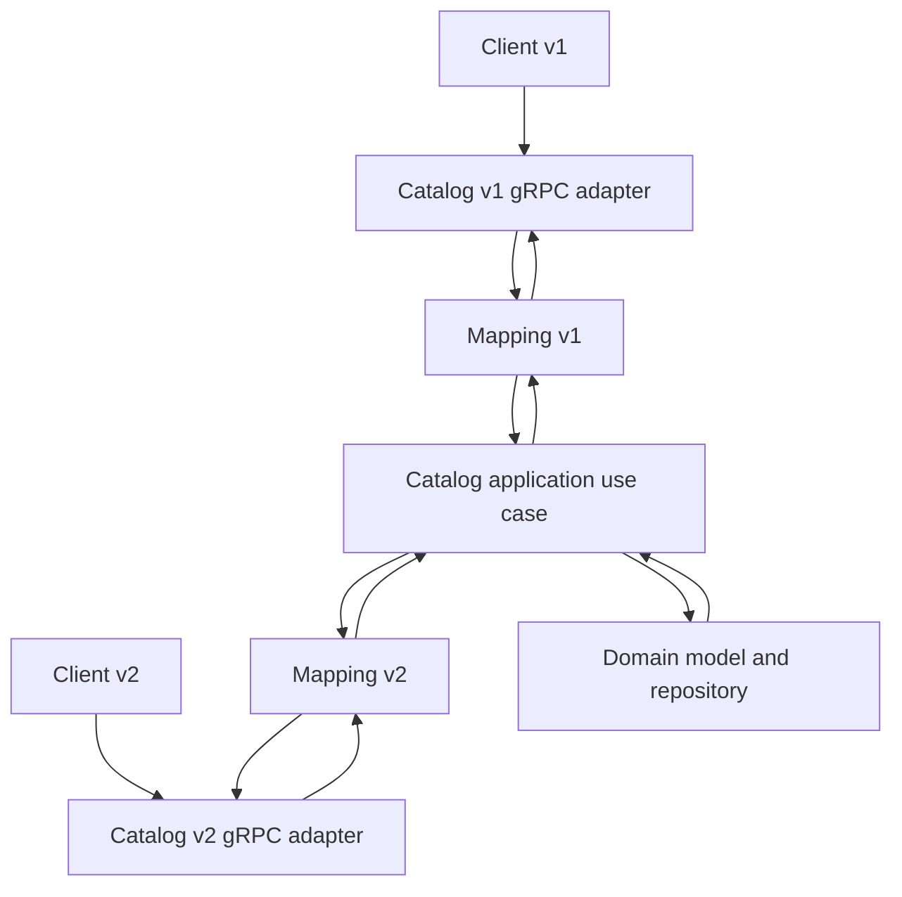
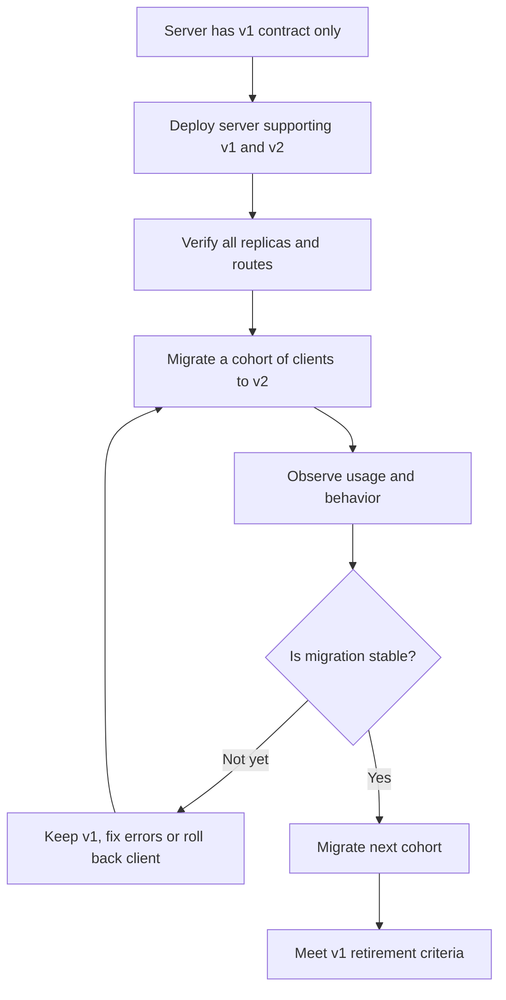

# Running New and Old Contracts in Parallel

## 1. Objectives

In a Spring gRPC system, clients and servers are typically released independently. An internal service might upgrade in minutes, whereas SDKs, mobile apps, or partners need weeks to transition. When a new contract alters request/response structures or semantics, you cannot assume every caller switches at the same moment.

**Running new and old contracts in parallel** means keeping multiple contracts callable simultaneously during a transition window. The server continues serving callers on the old contract while accepting callers that have moved to the new contract. Both contracts can share application/domain logic, yet each contract must uphold the exact semantics promised to its callers.

After this lesson, you will be able to:

- Choose between additive evolution on one contract and running two separate versions.
- Organize Protobuf packages, services, and messages so two contracts coexist.
- Build adapters translating version-specific requests/responses to a shared application model.
- Avoid duplicating business logic and side effects when two contracts hit the same backend.
- Implement a server supporting old and new contracts concurrently in Spring gRPC.
- Migrate clients in cohorts, monitor usage, and prepare for rollbacks.
- Test compatibility when clients and servers are on different versions.

## 2. A Contract Is More Than a .proto File

A gRPC contract can be viewed through its components:

| Component | Example | Impact When Changed |
|---|---|---|
| Full method path | `/catalog.v1.CatalogService/Search` | Determines which handler receives the RPC |
| Request/response schema | `SearchRequest`, `SearchResponse` | Determines what data can be serialized/parsed |
| Field semantics | `page_size` is the max result count | Determines how the server interprets values |
| Status contract | Missing item returns `NOT_FOUND` | Determines how callers handle errors |
| Behavior | Default sorting by relevance | Determines the results callers observe |
| Operational policy | Deadlines, quotas, authorization | Determines limits and calling permissions |

Two different `.proto` files are not necessarily independent contracts if they produce the same full method path and semantics. Conversely, two contracts can serve the same business capability while having different packages, paths, requests/responses, and mappings.

Before deploying in parallel, explicitly document:

- Which callers are using the old contract.
- What the new contract changes and why the change is needed.
- Which semantics must remain unchanged for old callers.
- Which data/domain operations can be shared.
- Criteria for ending the coexistence phase.

## 3. Choosing the Right Parallel Strategy

Not every change needs two service versions. Choose the strategy based on the magnitude of change:

| Scenario | Strategy | Characteristics |
|---|---|---|
| Only adding optional fields, keeping old semantics when absent | Additive evolution on current service | Single method path; new server supports old and new callers |
| Adding a new method while old method retains distinct meaning | Two methods in the same service | Different method paths; old handler can remain |
| Request/response or semantics change significantly | Versioned service/package | E.g. `catalog.v1` and `catalog.v2` with separate full method paths |
| Two versions need separate release cycles, security, or infrastructure | Separate endpoint/deployment | Stronger operational isolation, at higher cost |

If you are only adding a compatible field, creating an entire v2 service can unnecessarily multiply the number of contracts to maintain. However, if v2 changes units, defaults, ordering, statuses, or data structures, cramming both semantics into one method path makes the server hard to reason about and callers hard to test.

The examples in this lesson use `catalog.v1` and `catalog.v2` to illustrate two contracts with different requests and responses.

## 4. Defining Two Separate Protobuf Contracts

Contract v1 only supports searching by query and returning a list of IDs:

```proto
// catalog-v1.proto
syntax = "proto3";

package catalog.v1;
option java_package = "dev.example.catalog.v1";
option java_multiple_files = true;

service CatalogService {
  rpc Search(SearchRequest) returns (SearchResponse);
}

message SearchRequest {
  string query = 1;
}

message SearchResponse {
  repeated string product_ids = 1;
}
```

Contract v2 supports category, pagination, and scores:

```proto
// catalog-v2.proto
syntax = "proto3";

package catalog.v2;
option java_package = "dev.example.catalog.v2";
option java_multiple_files = true;

service CatalogService {
  rpc Search(SearchRequest) returns (SearchResponse);
}

message SearchRequest {
  string query = 1;
  string category = 2;
  optional int32 page_size = 3;
  string page_token = 4;
}

message SearchResponse {
  repeated Product items = 1;
  string next_page_token = 2;
}

message Product {
  string product_id = 1;
  double score = 2;
}
```

Even though the short service and method names match, the full method paths differ:

```text
/catalog.v1.CatalogService/Search
/catalog.v2.CatalogService/Search
```

Both services can be registered on the same gRPC server. Separate `java_package` settings keep generated Java classes from colliding. Preserve the published v1 package and path; do not change v1 to v2 in place and expect old clients to route themselves.

Only share Protobuf messages between two versions when schemas and semantics are genuinely identical. If v2 needs to evolve independently, separate messages prevent a v2 change from inadvertently forcing v1 clients to upgrade.

## 5. Separating Contract Adapters from the Application Model

The domain layer should not depend directly on generated v1 or v2 classes. Each contract gets its own adapter:



The application model represents business concepts without depending on how wire contracts package data:

```java
public record SearchCriteria(
        String query,
        String category,
        int pageSize,
        String pageToken,
        SearchPolicy policy) {
}

public enum SearchPolicy {
    LEGACY_RELEVANCE,
    V2_PAGINATED
}

public record ProductSummary(
        String productId,
        double relevanceScore) {
}

public record SearchResult(
        List<ProductSummary> products,
        String nextPageToken) {
}
```

This is an illustrative model belonging to the application layer. It is not a Protobuf message and should not be serialized directly as a gRPC response. Adapters are responsible for:

- Validating requests per contract version.
- Applying defaults appropriate to that version.
- Translating the request to `SearchCriteria`.
- Calling the use case.
- Mapping `SearchResult` back to the corresponding response.
- Translating domain errors to committed gRPC statuses.

## 6. Keeping Distinct Semantics While Sharing Business Logic

Two contracts can call the same use case without accidentally receiving the same policy when behaviors must differ.

Example v1 adapter:

```java
@GrpcService
public class CatalogV1GrpcService
        extends dev.example.catalog.v1.CatalogServiceGrpc
                .CatalogServiceImplBase {

    private final CatalogSearchUseCase useCase;

    public CatalogV1GrpcService(CatalogSearchUseCase useCase) {
        this.useCase = useCase;
    }

    @Override
    public void search(
            dev.example.catalog.v1.SearchRequest request,
            StreamObserver<dev.example.catalog.v1.SearchResponse> observer) {
        try {
            SearchCriteria criteria = new SearchCriteria(
                    request.getQuery(),
                    null,
                    25,
                    "",
                    SearchPolicy.LEGACY_RELEVANCE);
            SearchResult result = useCase.search(criteria);

            var response =
                    dev.example.catalog.v1.SearchResponse.newBuilder()
                            .addAllProductIds(result.products().stream()
                                    .map(ProductSummary::productId)
                                    .toList())
                            .build();
            observer.onNext(response);
            observer.onCompleted();
        } catch (IllegalArgumentException ex) {
            observer.onError(Status.INVALID_ARGUMENT
                    .withDescription("invalid search request")
                    .asRuntimeException());
        } catch (RuntimeException ex) {
            observer.onError(Status.INTERNAL
                    .withDescription("catalog search failed")
                    .asRuntimeException());
        }
    }
}
```

The v2 adapter passes new fields and selects the v2 policy:

```java
@GrpcService
public class CatalogV2GrpcService
        extends dev.example.catalog.v2.CatalogServiceGrpc
                .CatalogServiceImplBase {

    private final CatalogSearchUseCase useCase;

    public CatalogV2GrpcService(CatalogSearchUseCase useCase) {
        this.useCase = useCase;
    }

    @Override
    public void search(
            dev.example.catalog.v2.SearchRequest request,
            StreamObserver<dev.example.catalog.v2.SearchResponse> observer) {
        try {
            int pageSize = request.hasPageSize()
                    ? request.getPageSize() : 25;
            SearchCriteria criteria = new SearchCriteria(
                    request.getQuery(),
                    request.getCategory(),
                    pageSize,
                    request.getPageToken(),
                    SearchPolicy.V2_PAGINATED);
            SearchResult result = useCase.search(criteria);

            var response =
                    dev.example.catalog.v2.SearchResponse.newBuilder()
                            .setNextPageToken(result.nextPageToken());
            result.products().forEach(item ->
                    response.addItems(
                            dev.example.catalog.v2.Product.newBuilder()
                                    .setProductId(item.productId())
                                    .setScore(item.relevanceScore())
                                    .build()));
            observer.onNext(response.build());
            observer.onCompleted();
        } catch (IllegalArgumentException ex) {
            observer.onError(Status.INVALID_ARGUMENT
                    .withDescription("invalid search request")
                    .asRuntimeException());
        } catch (RuntimeException ex) {
            observer.onError(Status.INTERNAL
                    .withDescription("catalog search failed")
                    .asRuntimeException());
        }
    }
}
```

These examples use `@GrpcService` to illustrate a Spring gRPC starter supporting this annotation; the annotation package and registration mechanism depend on your project's starter/version. `CatalogSearchUseCase` must be implemented and keep v1/v2 policies distinct. Do not create an extra `Server` on the same port when the Spring starter already manages the server.

You do not necessarily need two copies of the algorithm. Repositories, domain services, and transactions can be shared, while mappings and policies clearly express each contract's semantics. If v1 defaults to relevance and v2 supports pagination, do not let the v1 adapter accidentally pick up a new page size or default sort.

## 7. Avoiding Dual-Write and Duplicate Side Effects

Running two contracts in parallel does not mean executing business operations twice. A v1 client and a v2 client might both request creating or updating a resource. If the server implements two adapters and each writes to a separate table or system, data can drift out of sync.

Principles:

- Both adapters invoke the same application use case for the same business action when semantics are equivalent.
- Only one place owns the transaction and commit decision.
- Use idempotency keys if callers may retry after timeouts.
- Never call both v1 and v2 RPCs for the same request just to “stay in sync”.
- If dual-write is required during data migration, design dedicated outbox/retry/reconciliation flows; never place duplicate side effects inside gRPC handlers.

For instance, `CreateOrder` v1 and v2 may have different requests yet create the same `CreateOrderCommand`. Adapters translate both to the common command; the use case executes once and returns the result. If v2 adds a required shipping address field, define how v1 callers are handled per old semantics rather than inventing data for missing fields.

## 8. Changing Persistence via Expand-Migrate-Contract

Sometimes a new contract requires data not yet present in the database. Do not deploy v2 clients first and expect old servers or the database schema to understand new fields automatically.

A controlled data migration approach:

1. **Expand:** add new columns/tables/indexes in a way that does not break currently running code.
2. **Deploy compatible readers:** code can read both old and new representations, with clear fallbacks.
3. **Migrate data:** backfill old data into the new representation; verify row counts and integrity.
4. **Enable new writers:** write the new representation only after readers and storage are ready.
5. **Verify:** reconcile data, errors, and business invariants.
6. **Contract:** delete old columns/representations only after no code or caller needs them.

This is a persistence-layer workflow, decoupled from Protobuf versioning. Contract v1 can continue operating through its adapter while the database already uses the new representation. The v1 adapter maps new data back to the old response; the v2 adapter exposes the new fields.

If two representations must be written temporarily, define the source of truth, partial-failure handling, and reconciliation processes. Never treat two independent writes as atomic.

## 9. Which Contract Does the Client Choose?

V1 clients use generated stubs from package v1; v2 clients use stubs from package v2. Both can reuse the same `ManagedChannel` when target, TLS identity, and transport policies match:

```java
ManagedChannel channel = channelProvider.catalogChannel();

var v1Stub = dev.example.catalog.v1.CatalogServiceGrpc
        .newBlockingStub(channel);
var v2Stub = dev.example.catalog.v2.CatalogServiceGrpc
        .newBlockingStub(channel);
```

Do not create a new channel merely because the package version differs. A channel represents the connection to a dependency/target; generated stubs represent the service contract and method paths.

In Spring, you can provide separate v1/v2 gateways and select via configuration or dependency injection. The selection should be explicit per caller/feature rollout. Avoid trying v2 first on every request and catching `UNIMPLEMENTED` to call v1: this increases latency, hides faulty rollouts, and can cause inconsistent side effects if errors occur after server processing.

## 10. Rollout Order

Servers must support the new contract before clients depend on it:

1. **Publish v2 schema/artifacts:** keep v1 artifacts and v1 full method paths intact.
2. **Deploy dual-contract servers:** every new instance registers both v1 and v2.
3. **Verify the fleet:** confirm all replicas and routes v2 clients might hit support v2.
4. **Migrate clients in cohorts:** enable v2 callers via config, releases, or feature flags.
5. **Monitor outcomes:** compare usage, statuses, latency, and business data.
6. **Expand migration:** move remaining cohorts once metrics stabilize.
7. **Keep v1 during the support window:** continue serving callers that cannot upgrade yet.
8. **Retire v1 as planned:** only after meeting published criteria.



If simultaneous deployment is impossible, use capability-based endpoints/routing or keep v2 clients disabled until the entire path supports it. Do not rely on a single upgraded replica.

## 11. Rollback and the Limits of Fallback

Once v2 clients are released, rolling servers back to a v1-only build causes v2 clients to receive `UNIMPLEMENTED`. A rollback plan must account for both sides:

- Can v2 clients be rolled back to v1?
- Does the server rollback build still register v2?
- Can v2 clients be routed solely to a v2-capable fleet?
- Can data written in the new representation still be read by old code?
- Are there irreversible side effects once v2 has executed?

Keep dual-contract support in server rollback builds if v2 clients remain active. If v2 clients wrote new data that old server code does not understand, a naive code rollback can break data reads. That is why expand-migrate-contract and storage compatibility are needed before enabling features.

Falling back from v2 to v1 is only appropriate if the old operation has equivalent semantics and does not lose data requested by the caller. Never fall back unconditionally on `UNIMPLEMENTED`, `UNAVAILABLE`, or `DEADLINE_EXCEEDED`; these statuses have different causes and fallback can generate duplicate requests or mask infrastructure failures.

## 12. Security and Policies per Contract

Two contracts serving the same domain do not imply identical permissions. Check:

- Authentication and authorization by full method path.
- Whether new fields expose sensitive data or broaden read scope.
- Separate quotas/rate limits per version if resource costs differ.
- Audit events and data classification for new operations.
- Dedicated deadlines, retries, and message limits if semantics differ.
- Whether interceptors, gateways, and service mesh allowlists recognize both paths.

Do not grant callers higher privileges just because they call v2. Authorization must rely on principal, tenant, resource, and action; the version only identifies the requested contract.

## 13. Observing and Deciding When to End Coexistence

Record usage separately by full method name:

```text
catalog.v1.CatalogService/Search
catalog.v2.CatalogService/Search
```

Signals to monitor:

| Signal | Purpose |
|---|---|
| RPC count by version/method | Know usage level of each contract |
| Caller identity and client version | Identify unmigrated cohorts |
| Status code | Detect compatibility and authorization errors |
| P95/P99 latency | Compare v1/v2 performance |
| Business result metrics | Catch unexpected semantic shifts |
| Data reconciliation | Verify old/new representations stay consistent |
| Last-seen timestamp | Avoid missing batch jobs or low-frequency callers |

Never use user IDs, request IDs, tokens, or payloads as metric labels due to cardinality and data exposure risks. Use controlled traces/logs to investigate specific requests.

Only retire the old contract when:

- Internal callers and SDKs have migrated.
- Partners have been notified and completed migration or passed the support window.
- Zero v1 traffic appears over an observation window matching caller activity cycles.
- The new contract meets committed semantics, security, and reliability.
- Storage no longer has code requiring the old representation.
- Dashboards, alerts, runbooks, and rollback plans are updated.

After retirement, clients calling the v1 path usually receive `UNIMPLEMENTED`. Never reuse the v1 package or full method path for a different contract.

## 14. Testing Coexistence

An integration test should run a server with both adapters on the same gRPC server:

1. Start the Spring context with both v1 and v2 adapters.
2. Create v1 and v2 clients pointing to the same target/channel.
3. Call the v1 RPC and verify the response and old semantics.
4. Call the v2 RPC and verify filters, pagination, and new responses.
5. Verify both adapters invoke the proper application use case/policy.
6. Test that v1 remains unaffected when v2 features are enabled.
7. Test authorization, statuses, deadlines, and idempotency per contract.
8. Start a v1-only fixture; verify v2 clients receive `UNIMPLEMENTED`.
9. Test server/client rollbacks and data reads after storage migration.

Example test:

```java
@Test
void bothContractsAreServedByOneServer() {
    var v1Request =
            dev.example.catalog.v1.SearchRequest.newBuilder()
                    .setQuery("keyboard")
                    .build();
    var v1Response = v1Stub.search(v1Request);
    assertFalse(v1Response.getProductIdsList().isEmpty());

    var v2Request =
            dev.example.catalog.v2.SearchRequest.newBuilder()
                    .setQuery("keyboard")
                    .setCategory("electronics")
                    .setPageSize(10)
                    .build();
    var v2Response = v2Stub.search(v2Request);
    assertFalse(v2Response.getItemsList().isEmpty());
}
```

This is a test skeleton; `v1Stub` and `v2Stub` use generated classes from their respective packages. The server fixture must genuinely register both services. Mocking the use case tests mapping logic, but does not replace integration tests for full method paths and service registration.

## 15. Common Pitfalls

| Symptom | Cause | How to Fix |
|---|---|---|
| V1 clients error after v2 release | Server unregistered v1 too early | Keep v1 adapter through the support window |
| V2 clients randomly get `UNIMPLEMENTED` | Fleet still has v1-only replicas | Complete server rollout or route by capability |
| Generated v1/v2 classes collide | Shared `java_package` | Separate Java packages by version |
| V1 changes results when v2 is enabled | Adapter accidentally uses new policy/default | Separate version-specific mappings and policies |
| One action creates two side effects | Handler calls both contracts or writes to two places independently | One application use case owns commits |
| Server rollback cannot read new data | Storage migration not backward-compatible | Expand first, verify readers and writers |
| Unknown which callers still use v1 | Only measuring total RPCs | Record full method path and caller identity |
| Fallback masks deployment errors | Automatically calling v1 on every v2 error | Fall back conditionally with metrics and a time limit |
| V2 exposes data outside caller permissions | Reused authorization without re-evaluation | Enforce policies per resource and method |

## 16. Hands-On Exercise

**Scenario:** Catalog v1 currently serves multiple Spring services and partners. The team wants v2 to support category filters, pagination, and product scores. Some callers can upgrade immediately, while others need several months.

Perform the following:

1. Keep `catalog.v1.CatalogService` unchanged and create `catalog.v2.CatalogService` with separate Protobuf messages.
2. Generate Java code into two distinct packages and verify full method paths.
3. Implement v1/v2 adapters in the Spring gRPC server; have both call the same application use case where semantics align.
4. Preserve v1 defaults, ordering, and statuses; write regression tests proving old behavior is unchanged.
5. Create a v2 client reusing the existing channel and toggle it via feature flags or caller config.
6. If the database needs new fields, establish an expand-migrate-contract plan before enabling v2 writers.
7. Deploy the dual-contract server first, verify the entire fleet, and only then migrate clients in cohorts.
8. Monitor v1/v2 usage, latency, statuses, and remaining callers; avoid indefinite fallbacks.
9. Write a rollback plan and define v1 retirement criteria.

**Completion criteria:** the server serves both contracts concurrently; each adapter preserves its semantics; domain operations and side effects are not duplicated; client migration is controlled; rollback and retirement are grounded in observed data.

## 17. Key Takeaways

Running new and old contracts in parallel lets callers migrate at their own pace without forcing a system-wide simultaneous upgrade. Choose additive evolution when semantics stay compatible; use versioned services/packages when requests, responses, or behaviors differ significantly. In Spring gRPC, register separate adapters per contract, translate requests to a shared application model, and keep policies and response mappings distinct. A single use case should own side effects and transactions; never dual-write simply because two contracts exist. Deploy servers supporting both before migrating clients, observe usage by full method path, plan rollbacks, and only retire old contracts once both callers and storage are ready.
