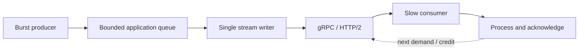

# Testing Bursts and Slow Consumers

Streaming RPCs may work fine when producer and consumer run at the same speed, yet become unstable when the producer emits a large burst or the consumer processes slowly. Queues grow continuously, latency accumulates, memory gets consumed, and deadlines can expire before messages are processed. Testing must reproduce both conditions, measure both throughput rates and pending work, and verify that the system reacts properly when hitting limits.

In Spring gRPC, a stream passes through application queues, callback executors, and gRPC/HTTP/2 flow control. These layers have different limits and behaviors. This lesson focuses on designing burst tests, simulating slow consumers, manual inbound flow control, outbound readiness, bounded queues, and assertions for messages, latency, overload, and cancellation.

## 1. Bursts and Slow Consumers Are Two Different Load Patterns

A **burst** is a large volume of messages arriving over a short interval. A **slow consumer** is a receiving side that processes each message slower than the producer generates them. When combined, the input rate exceeds the output rate and a backlog grows.

Example pipeline:



If the producer rate is 800 messages/second and the consumer processes 200 messages/second, the backlog grows by roughly 600 messages/second while the burst continues. An unbounded queue merely delays the point of failure; it does not resolve the speed mismatch.

Testing must answer:

- How many pending messages can the system hold?
- When the queue is full, does the producer experience backpressure, get rejected, or drop messages per policy?
- Are message ordering and integrity preserved?
- How high does latency climb, and does it return to normal after the burst?
- Does cancellation/deadline stop the producer and release resources?

## 2. Define the Workload Before Running Tests

A burst test can vary many factors. Record the workload explicitly so results are reproducible:

| Parameter | Example | Meaning |
| --- | --- | --- |
| Burst size | 20,000 messages | Total number of messages generated during the burst |
| Burst duration | 2 seconds | Time span over which the producer emits the burst |
| Concurrent streams | 50 | Number of concurrently active streaming RPCs |
| Payload size | 1 KB, 16 KB, 128 KB | Impacts memory and network |
| Consumer delay | 5–50 ms/message | Simulates receiving-side processing speed |
| Queue capacity | 256 messages | Backlog limit at the application layer |
| Warm-up / duration | 30 seconds / 3 minutes | Separates startup cost from steady load |

Run at least three profiles: steady state as a baseline, a single burst, and repeated bursts while the consumer still has a backlog. Test both small and large payloads; the same message count with different byte sizes can create vastly different pressure.

Set a deterministic workload for functional tests, such as sequences from 1 to N and payloads with checksums. For load tests, add size and processing-time distributions close to production. Record machine specs, JVM, transport, TLS, channel/server options, and stream counts to compare runs.

## 3. Measure Backlog and Latency, Not Just Throughput

High throughput does not prove the consumer is keeping up with the producer. Collect the following metrics:

| Metric | Interpretation |
| --- | --- |
| Offered rate | Messages per second the producer wants to send |
| Accepted rate | Messages per second accepted by the queue/stream |
| Processed rate | Messages per second finished by the consumer |
| Queue depth / high-water mark | Current backlog and peak backlog |
| Queue wait | Time from enqueueing until the consumer starts processing |
| Processing duration | Time the consumer takes to process one message |
| End-to-end latency | From message creation until processing finishes |
| Rejected/dropped count | Messages rejected or evicted per policy |
| Heap, GC, CPU, threads/queues | Resource usage and bottleneck indicators |

Measure p50, p95, and p99 of queue wait and end-to-end latency. Averages can hide a group of messages waiting far too long at the tail of a burst. With streaming, record both message counts and byte counts; large payloads increase heap, copying, and network pressure.

Distinguish application queues from gRPC/HTTP/2 buffers. `isReady()` on the sending side reflects the transport's ability to accept more data at that instant; it is not a measure of application queue depth. Manual inbound requests control how many messages are delivered to application callbacks; they also do not replace queue limits managed by the application itself.

## 4. Generating Controlled Bursts

Test producers should generate messages in sequence and intentionally emit faster than the consumer. Configure a bounded queue and record `offer` outcomes:

```java
BlockingQueue<UploadChunk> outbound =
        new ArrayBlockingQueue<>(256);

AtomicLong accepted = new AtomicLong();
AtomicLong rejected = new AtomicLong();

void produce(UploadChunk chunk) {
    if (outbound.offer(chunk)) {
        accepted.incrementAndGet();
    } else {
        rejected.incrementAndGet();
    }
}
```

This example uses non-blocking `offer` to make the full-queue policy explicit. In a real system, the policy could be bounded waiting, throttling the producer, returning `RESOURCE_EXHAUSTED`, or dropping messages if the contract allows. Never silently drop messages when business rules require complete delivery.

A single writer pulls messages from the queue and sends them through the outbound observer. With server streaming, the writer can pause when `ServerCallStreamObserver.isReady()` returns false and then be woken up by `setOnReadyHandler`. The on-ready callback should only wake that same writer; never launch multiple competing drain loops on one observer.

## 5. Simulating a Slow Consumer with Manual Inbound Flow Control

A deterministic way to slow down the receiving side is to use `ClientResponseObserver` and request only one message at a time. Only after the consumer finishes processing the current message does it grant credit for the next message:

```java
final class SlowProductConsumer
        implements ClientResponseObserver<WatchRequest, ProductEvent> {

    private final ExecutorService consumer =
            Executors.newSingleThreadExecutor();
    private final CountDownLatch processed;
    private final CountDownLatch terminal = new CountDownLatch(1);
    private final AtomicReference<Throwable> failure =
            new AtomicReference<>();
    private volatile ClientCallStreamObserver<WatchRequest> call;

    SlowProductConsumer(int expectedMessages) {
        this.processed = new CountDownLatch(expectedMessages);
    }

    @Override
    public void beforeStart(
            ClientCallStreamObserver<WatchRequest> requestStream) {
        this.call = requestStream;
        requestStream.disableAutoRequestWithInitial(1);
    }

    @Override
    public void onNext(ProductEvent event) {
        consumer.execute(() -> {
            try {
                processSlowly(event);
                processed.countDown();
                // Only request the next message after finishing processing this message.
                call.request(1);
            } catch (RuntimeException error) {
                failure.compareAndSet(null, error);
                call.cancel("slow consumer failed", error);
            }
        });
    }

    @Override
    public void onError(Throwable error) {
        failure.compareAndSet(null, error);
        terminal.countDown();
    }

    @Override
    public void onCompleted() {
        terminal.countDown();
    }

    boolean await(Duration timeout) throws InterruptedException {
        boolean ended = terminal.await(
                timeout.toMillis(), TimeUnit.MILLISECONDS);
        boolean allProcessed = processed.await(
                timeout.toMillis(), TimeUnit.MILLISECONDS);
        return ended && allProcessed && failure.get() == null;
    }

    void shutdown() {
        consumer.shutdown();
    }
}
```

`processSlowly` represents processing with a controlled delay in tests. This example uses a sequential consumer executor to preserve processing order; in real tests, shut down the executor in `finally` and check both errors and timeouts. If the server closes the stream while the consumer is still processing the final message, `onCompleted` can arrive before the final processing task finishes; therefore, wait on both the terminal latch and the processed latch.

`disableAutoRequestWithInitial(1)` disables auto inbound flow control and starts with one message credit. After each message is processed, `request(1)` permits receiving the next. This controls how many messages are delivered to application callbacks; it does not prove the transport buffers zero bytes at lower layers.

## 6. Distinguishing Inbound Demand and Outbound Readiness

Two mechanisms are frequently confused:

| Mechanism | Direction | Meaning |
| --- | --- | --- |
| `request(n)` / manual inbound flow control | Receiving side | Permits gRPC to deliver up to `n` additional messages to the application |
| `isReady()` and `setOnReadyHandler` | Sending side | Signals the transport's ability to accept more messages without excessive buffering |

Clients use `ClientCallStreamObserver` to control inbound `request` demand and readiness when sending a request stream. Servers use `ServerCallStreamObserver` to control inbound requests (if manual flow control is enabled) and readiness when sending a response stream.

Client-side slow consumer tests should measure the number of demanded messages and the number of messages currently being processed by the application. Server-side slow receiver tests should verify the writer pauses draining when the server observer is not ready and resumes when the on-ready handler wakes the writer. Never use `isReady()` as a lock; a single writer or synchronization for the observer is still required.

## 7. Burst and Slow Consumer Scenarios to Run

| Scenario | How to generate load | What to verify |
| --- | --- | --- |
| Short burst | N messages emitted over a very short window | Queue never exceeds capacity; overload policy works |
| Sustained burst | Producer maintains high rate for tens of seconds | Queue depth and latency do not grow unbounded |
| Fixed slow consumer | Identical delay per message | Backlog grows controllably; throughput matches consumer capacity |
| Variable slow consumer | Some messages take longer to process | p95/p99 and ordering remain intact |
| Paused consumer | Request no credits for a period | Producer/queue experiences backpressure or hits controlled limit |
| Multiple concurrent streams | Multiple bursts across different RPCs | State, queues, and observers are never mixed |
| Large payloads | Increase message size | Heap, GC, and byte backlog stay within budget |
| Cancel under high backlog | Cancel stream mid-burst | Producer stops, queue is cleared, no messages emitted after terminal |
| Deadline expires | Deadline shorter than backlog drain time | Call ends with proper status and dependent work stops |

Run each scenario individually first to isolate causes, then combine bursts, multiple streams, and large payloads to test interactions between queues, executors, and transport.

## 8. Assertions Required in Tests

Do not merely assert that the RPC finishes successfully. For a workload with sequences 1..N, useful assertions include:

- **Integrity:** processed message count equals accepted count if policy requires zero message loss.
- **No duplicates:** each sequence is processed only once, unless the contract allows retries/redelivery.
- **Ordering:** sequences increase in exact order if the stream requires ordered delivery.
- **Bounded backlog:** queue depth never exceeds capacity; record the high-water mark.
- **Overload behavior:** when the queue is full, producers block/reject/drop per policy with matching counters.
- **Terminal correctness:** strictly one terminal signal; zero `onNext` calls after completion/error/cancel.
- **Cancellation:** producers and workers stop within a bounded time; queues/state are released.
- **Recovery:** after the burst, queue depth returns near 0 and latency returns to baseline.

If a test permits dropping, assert exact dropped counts and verify the messages selected to drop follow policy. Do not compare `processed == offered` when the system intentionally rejects messages above capacity; in that case, distinguish offered, accepted, rejected, and processed.

## 9. Stability and Interpreting Results

A functional test should use an in-process server/channel, `CountDownLatch`, or barriers to control the consumer and verify ordering. Never use `Thread.sleep` as the primary synchronization mechanism; sleep should only simulate processing time when paired with explicit wait conditions and timeouts.

Performance tests must use transport, TLS, payloads, channel counts, and executor configurations close to production. Ramp load in steps: baseline, expected level, target burst, and intentional overload. Monitor:

- Accepted/processed throughput and rejection ratio.
- p50/p95/p99 end-to-end latency and queue wait.
- Queue depth/high-water mark per stream or pool.
- Heap, allocation rate, GC pauses, CPU, and thread counts.
- Active call counts, `RESOURCE_EXHAUSTED`, `CANCELLED`, and `DEADLINE_EXCEEDED` statuses.

If queues keep growing while processed rate trails accepted rate, the system lacks a strong enough throttling mechanism. If queues stay stable yet p99 is high, investigate consumer processing time, executor contention, and transport. If heap stays elevated after a burst finishes, check for unreleased references to messages, queues, or observers.

## 10. Testing Checklist

- [ ] Workload specifies burst size, duration, stream count, and payload size.
- [ ] Steady-state baseline exists for comparison.
- [ ] Slow consumer is simulated via delay or manual inbound demand.
- [ ] Application queues have finite capacity and a full-queue policy.
- [ ] Single writer respects outbound readiness.
- [ ] Measure offered/accepted/processed/rejected counts and byte counts.
- [ ] Measure queue depth, high-water mark, queue wait, and p95/p99 latency.
- [ ] Verify message loss, duplicates, and ordering per contract.
- [ ] Test cancellation, deadlines, and cleanup under high backlog.
- [ ] Verify queue draining and latency recovery after a burst.
- [ ] Have in-process tests for correctness and performance tests on production-like configuration.
- [ ] Do not confuse inbound `request(n)` with outbound `isReady()`.

**Self-Check**

**Question 1.** Why is throughput insufficient to evaluate a burst test?

*Answer:* Throughput does not reveal backlog or wait times. A consumer may process steadily while the queue still grows rapidly; you must measure queue depth, queue wait, and p95/p99 end-to-end latency.

**Question 2.** What does manual inbound flow control with one credit help simulate?

*Answer:* The consumer only receives the next message after the application requests more, allowing controlled slow processing and observation of how demand impacts the stream.

**Question 3.** How do `isReady()` and `request(n)` differ?

*Answer:* `request(n)` controls how many inbound messages are delivered to the application; `isReady()` reports the sending side's ability to keep writing without exceeding transport readiness.

**Question 4.** Why must queues be bounded?

*Answer:* An unbounded queue simply accumulates backlog whenever the producer outpaces the consumer, driving up heap and latency until the system overloads. Bounded queues force the application to enforce backpressure or an overload policy.

**Question 5.** After a burst, what signs show the system has recovered?

*Answer:* Queue depth drops near 0, the processed rate catches up with the accepted rate, latency returns near baseline, and resources like heap/threads stop climbing.

Burst and slow-consumer testing must prove that the system keeps backlogs bounded, applies clear overload policies, and recovers once load subsides. Combining manual inbound demand, outbound readiness, bounded queues, and latency/queue measurements helps catch consumers falling behind producers early in Spring gRPC.
