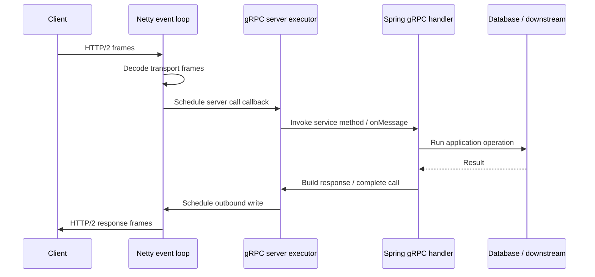

# Which Thread Executes the gRPC Handler?

**Chapter:** Thread model  
**Scope:** Spring gRPC (`SPRING_GRPC`) using Protocol Buffers contracts, generated Java code, and server/client for unary or streaming RPCs. This lesson explains which thread receives network data, which thread invokes the service handler, how executors affect callbacks, and what to keep in mind when offloading work to another thread.

## 1. There Is No Single Thread for an Entire RPC

When a client calls an RPC, the server handles several kinds of work: receiving bytes from the socket, decoding HTTP/2 and protobuf, invoking the Java handler, running business logic, and writing the response back to the network. These tasks can run on different threads.

In a Java gRPC server using Netty, you need to distinguish between:

- **Netty event-loop thread:** handles socket and HTTP/2 I/O events, such as reading frames, writing frames, and managing the transport.
- **Server application executor:** executes server call callbacks, including starting the handler and receiving request messages or half-close callbacks.
- **Application worker/executor:** threads created by the application or used from Spring to run background work, call databases, HTTP endpoints, or downstream gRPC services.

Typically, the Netty event loop is not where handler business logic runs. gRPC dispatches application callbacks to the server executor. If no custom executor is configured, gRPC Java uses a default library-managed executor; pool details and how Spring gRPC configures it depend on the starter version and server configuration.

Therefore, the practical answer to "which thread executes the handler?" is: **a thread from the server application executor currently running that RPC's callback at that moment**. Do not assume a fixed thread name or that an RPC always stays on the same physical thread.

## 2. Processing Flow from Socket to Handler

General flow:



The diagram illustrates the main roles, not every internal step or every thread switch in a specific version. The transport can continue handling I/O while the application executor runs the handler; gRPC coordinates data between both sides.

### What Does the Netty Event Loop Do?

The event loop is designed to handle many I/O connections efficiently. It reads and writes data, processes transport events, and signals when a stream has incoming data or can accept more writes. One event loop typically serves multiple channels/streams.

If a handler runs a long synchronous database query directly on the event loop, an I/O thread can be blocked. Other connections served by that same event loop can also slow down. The gRPC Java architecture separates application callbacks from the transport I/O executor to avoid coupling business logic to the event loop.

### What Does the Server Application Executor Do?

This executor runs the server call callback logic. When gRPC needs to invoke the service implementation, it submits work to the executor and executes callbacks in call order. If the application configures a custom executor via the server builder, handler callbacks run on that pool.

Example configuration at the gRPC Java level:

```java
ExecutorService grpcExecutor = new ThreadPoolExecutor(
        16,
        64,
        60,
        TimeUnit.SECONDS,
        new ArrayBlockingQueue<>(500),
        new NamedThreadFactory("grpc-app-"),
        new ThreadPoolExecutor.AbortPolicy());

NettyServerBuilder.forPort(port)
        .executor(grpcExecutor)
        .addService(service)
        .build();
```

This example uses `NettyServerBuilder` directly to illustrate the configuration point. In a Spring gRPC application, the server is typically created by auto-configuration; provide the executor via the extension point/server configurer supported by your starter rather than creating a second server alongside the Spring server.

## 3. Handlers and Callbacks of an RPC

For a unary RPC, the generated service method is typically called once per request:

```java
@Override
public void getCustomer(
        GetCustomerRequest request,
        StreamObserver<Customer> responseObserver) {
    Customer customer = applicationService.find(request.getCustomerId());
    responseObserver.onNext(toProto(customer));
    responseObserver.onCompleted();
}
```

The service method runs on the server application executor. Within this method, synchronous code normally continues running on the thread that invoked the handler until the method returns or offloads work to another executor.

For client streaming, gRPC invokes the method to create an inbound observer, then calls its callbacks according to the request lifecycle:

```java
@Override
public StreamObserver<UploadChunk> upload(
        StreamObserver<UploadReceipt> responseObserver) {
    return new StreamObserver<>() {
        @Override
        public void onNext(UploadChunk chunk) {
            acceptChunk(chunk);
        }

        @Override
        public void onError(Throwable error) {
            cleanup();
        }

        @Override
        public void onCompleted() {
            UploadReceipt receipt = finishUpload();
            responseObserver.onNext(receipt);
            responseObserver.onCompleted();
        }
    };
}
```

Inbound callbacks for the same RPC are dispatched sequentially by gRPC: `onNext` is not called concurrently with another `onNext` on the same observer, and `onCompleted` signals the end of the request direction. However, sequential dispatch does not mean every callback must run on the same physical thread. The executor may use a different thread for the next callback.

Therefore:

- You can keep per-RPC state inside the observer as long as it is accessed only from those sequential callbacks.
- Do not infer thread identity from the first callback and reuse it in later callbacks.
- If you spawn asynchronous tasks or multiple workers yourself, state must be synchronized/thread-safe accordingly.
- Do not use mutable fields of a singleton Spring service to store per-RPC state; multiple calls can run concurrently.

## 4. Executor Configuration and Load Impact

The server application executor is a finite resource. Pool size, queue capacity, and rejection policy directly affect latency and load tolerance.

| Configuration | Impact | Risk |
| --- | --- | --- |
| Pool too small | Fewer callbacks run concurrently | RPCs queue up, latency increases |
| Pool too large | More concurrent callbacks | Higher context switching, memory usage, and database pressure |
| Unbounded queue | Accepts many waiting tasks | Unbounded memory growth under overload |
| Bounded queue | Limits waiting work | Requires proper overload/rejection handling |
| Pool shared with heavy background tasks | Simple initial setup | Background tasks can starve RPC callbacks |
| Dedicated pools per workload | Load isolation | Requires managing extra threads and total resource limits |

There is no single thread count that fits every server. Base it on CPU count, handler CPU time, I/O wait time, connection pool limits, concurrent RPC count, and latency targets. If handlers mostly wait on the database, adding unlimited threads only puts heavier load on the database and queues.

### Workload Separation

You can use:

- The server executor for short RPC callbacks and request orchestration.
- Dedicated bounded worker pools for blocking or CPU-intensive tasks.
- Separate client channels/executors and connection pools per dependency when isolation is needed.

Avoid dispatching every callback to an unbounded cached thread pool. During traffic spikes, an unbounded pool can create too many threads and destabilize the system.

## 5. Handling Blocking I/O Properly

If a handler makes a synchronous JDBC call, the application executor thread is held for the entire query duration. This does not directly block the Netty event loop, but it reduces the number of RPCs the application pool can handle.

There are three common options:

1. **Keep synchronous processing on the server executor:** suitable when processing time is short, tightly bounded, and load has been measured.
2. **Offload blocking operations to a dedicated worker pool:** isolates server callback threads; requires bounding the pool and queue, propagating deadlines/cancellations, and sending the response exactly once.
3. **Use appropriate non-blocking/reactive APIs:** avoids holding threads while waiting on I/O, though concurrency, backpressure, and error handling still must be managed.

Example of offloading a JDBC/blocking service to a worker pool:

```java
@GrpcService
public class CustomerGrpcService
        extends CustomerServiceGrpc.CustomerServiceImplBase {

    private final CustomerApplicationService service;
    private final Executor customerIoExecutor;

    public CustomerGrpcService(
            CustomerApplicationService service,
            @Qualifier("customerIoExecutor") Executor customerIoExecutor) {
        this.service = service;
        this.customerIoExecutor = customerIoExecutor;
    }

    @Override
    public void getCustomer(
            GetCustomerRequest request,
            StreamObserver<Customer> responseObserver) {

        customerIoExecutor.execute(() -> {
            try {
                Customer customer =
                        service.find(request.getCustomerId());
                responseObserver.onNext(toProto(customer));
                responseObserver.onCompleted();
            } catch (CustomerNotFoundException missing) {
                responseObserver.onError(
                        Status.NOT_FOUND
                                .withDescription("Customer not found")
                                .asRuntimeException());
            } catch (Exception failure) {
                responseObserver.onError(
                        Status.INTERNAL
                                .withDescription("Internal server error")
                                .asRuntimeException());
            }
        });
    }
}
```

In this example, the response observer is called from a worker thread. This is a common pattern for an async server, but you must ensure there is a single place that terminates the call and handles cancellation/deadlines. Do not let exceptions escape the task because the initial gRPC callback has already returned; a global interceptor on the initial call stack will not automatically catch errors on the worker thread.

The executor should be a Spring bean with a clear lifecycle, a bounded queue, and a rejection policy. If `execute()` is rejected, the adapter must translate overload into an appropriate outcome instead of letting the error leak out. Do not call `onError` twice if the call has already been cancelled or completed.

## 6. The Thread Model Does Not Replace Flow Control

A pool with many threads does not mean the server can receive and process unlimited messages. Streaming RPCs are also governed by HTTP/2 flow control and gRPC readiness.

For server streaming or bidirectional streaming, use `ServerCallStreamObserver.isReady()` and `setOnReadyHandler()` to emit data only when the transport is ready:

```java
ServerCallStreamObserver<Update> call =
        (ServerCallStreamObserver<Update>) responseObserver;

call.setOnReadyHandler(() -> {
    while (call.isReady() && hasNextUpdate()) {
        call.onNext(nextUpdate());
    }
});
```

This is an outline: a real producer needs to manage state and ensure the observer is not called concurrently from multiple threads. If the producer runs on a worker thread, synchronize message emission and stop the producer on cancellation.

Flow control throttles how much data is in flight; the executor controls where callbacks run. These two mechanisms solve different problems and must be designed together.

## 7. Context and SecurityContext Across Thread Switches

gRPC `Context` typically holds the deadline, cancellation state, and per-RPC data such as the authenticated principal. While a callback is running, `Context.current()` returns the context bound to that call.

When offloading work to an arbitrary executor, do not assume the context is automatically propagated to the new thread. You can capture the current context and wrap the executor:

```java
Context callContext = Context.current();
Executor contextAwareExecutor =
        callContext.fixedContextExecutor(customerIoExecutor);

contextAwareExecutor.execute(() -> {
    AuthenticatedPrincipal principal = PRINCIPAL.get();
    Deadline deadline = Context.current().getDeadline();
    processFor(principal, deadline);
});
```

`fixedContextExecutor` attaches the captured context to the task when it executes. Another option is `Context.currentContextExecutor(delegate)`, where the current context is captured when the task is submitted. Choose the approach that matches when capture should happen; never accidentally use one RPC's context for a task belonging to another RPC.

Spring Security's `SecurityContext` is a separate context. If the application uses it in asynchronous tasks, you need the corresponding propagation mechanism (such as `DelegatingSecurityContextExecutor`) or pass the principal explicitly. Do not assume gRPC `Context` automatically copies Spring `SecurityContext` or vice versa.

## 8. Deadlines and Cancellation While Work Runs on a Worker

A client can cancel an RPC or the deadline can expire while a worker is querying the database. The client stopping its wait does not automatically stop every blocking operation on the server side.

When offloading work to a worker:

- Check `Context.current().isCancelled()` before starting expensive work.
- Register an appropriate cancellation handler with `ServerCallStreamObserver` to signal stopping.
- Propagate the remaining deadline into JDBC/HTTP/downstream gRPC timeouts.
- If using a future/task, keep a handle to cancel or interrupt it when the library supports it.
- Clean up resources and do not send a response after the call has been cancelled.

Cancellation is a cooperative signal. A JDBC driver or blocking library may not stop immediately when a thread is interrupted; timeouts at the dependency layer and transaction boundaries are still required.

## 9. Observing the Thread Model in Production

You should monitor:

- Thread names upon entering the handler and inside worker tasks.
- Active thread count, queue depth, and rejected task count for each executor.
- Queue wait time separately from execution time.
- Handler latency, database wait time, and downstream wait time.
- Number of RPCs cancelled or expired by deadline while workers are still running.
- Frequency of flow control transitioning to not-ready and how long producers are paused.

Distinct thread name prefixes such as `grpc-app-` or `customer-io-` make thread dumps easier to read. Avoid logging only the thread name and assuming an entire call uses a single thread; use a correlation ID/RPC method and traces to follow steps across multiple executors.

If latency increases:

- Server executor queue grows: callbacks are waiting to run, or the pool is too small/blocked.
- Worker queue grows: blocking/CPU workloads are overloaded.
- Database pool waits are long: adding RPC threads will not solve a database limit.
- Event loop CPU is high: check transport/I/O, TLS, serialization, and whether callbacks are accidentally running on the event loop due to custom configuration.

## 10. Testing the Thread Model

Do not write tests asserting a specific fixed thread name unless the application contract guarantees it. Instead, verify the properties you need to protect:

| Goal | How to Test |
| --- | --- |
| Handler does not run on the Netty event loop | Record thread name/type in the handler when using the Netty transport |
| Custom server executor is used | Use an executor with a distinct thread name and verify callbacks run on that pool |
| Callbacks of the same RPC are not concurrent | Use a counter/lock probe inside callbacks and assert max concurrent = 1 |
| Different RPCs can run in parallel | Use a barrier across two calls and verify both make progress |
| Context is propagated to worker | Set a Context key/deadline before submitting and verify the worker can read it |
| Cancellation stops work | Cancel the client call and verify the cancellation signal and cleanup |
| Executor overload is handled | Use a small pool/bounded queue and verify rejection is converted into a safe error |

Example callback serialization probe:

```java
AtomicInteger active = new AtomicInteger();
AtomicInteger maxActive = new AtomicInteger();

void observeCallback() {
    int current = active.incrementAndGet();
    maxActive.accumulateAndGet(current, Math::max);
    try {
        performShortTestStep();
    } finally {
        active.decrementAndGet();
    }
}
```

Run the probe inside inbound callbacks of the same RPC. If your code offloads callbacks to multiple workers itself, place the probe in that worker region to verify concurrency introduced by the application rather than attributing the result to the gRPC listener's sequential guarantee.

## 11. Self-Practice

1. Why should long JDBC queries not run on a Netty event-loop thread?
2. A server handler runs on the application executor. What happens to callbacks of the same RPC when the next callback is scheduled on a different thread?
3. A service offloads work to a worker pool. Why does a global interceptor not automatically catch exceptions thrown after the task is submitted?
4. Design how to propagate gRPC Context and deadline into a custom executor; distinguish this from Spring SecurityContext.
5. When a worker queue is full, how should the server handle rejection so it neither hangs the RPC nor invokes a terminal callback twice?

**Key takeaway:** In gRPC Java with Netty, the event loop mainly handles transport I/O; service handlers and listener callbacks run on the **server application executor**. Callbacks for the same RPC are dispatched sequentially but not necessarily on the same physical thread. When offloading to a worker pool, the application must explicitly manage context propagation, deadlines, cancellation, flow control, and terminal state.
