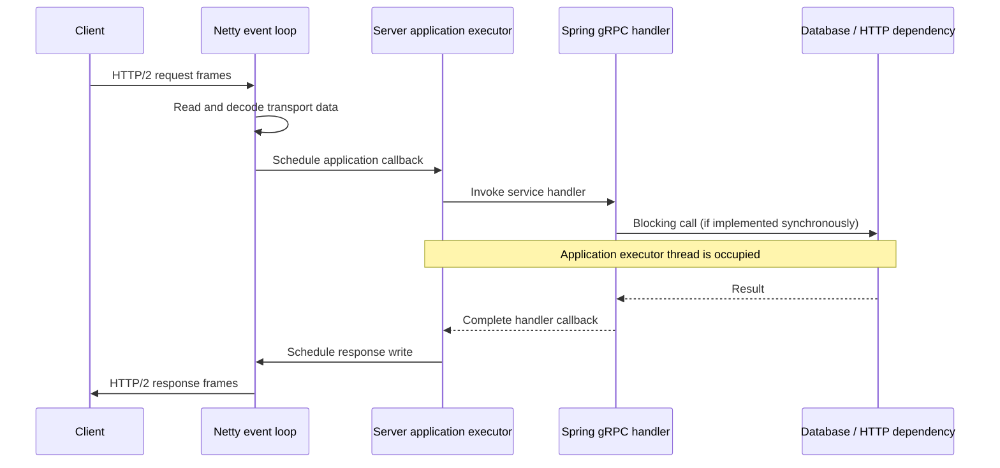

# Netty Event Loop and Blocking Work

**Chapter:** Thread model  
**Scope:** Spring gRPC (`SPRING_GRPC`) using Protocol Buffers, generated Java code, and unary or streaming RPCs. This lesson focuses on the role of the Netty event loop, why blocking work can stall the transport, and how to separate blocking work from the I/O processing thread while preserving deadlines, cancellation, and response observer safety.

## 1. What Is the Netty Event Loop Responsible For?

In a gRPC Java configuration using the Netty transport, the event loop is a group of threads dedicated to handling connection I/O events:

- Reading bytes from sockets and writing bytes to sockets.
- Processing HTTP/2 frames, stream states, and transport events.
- Coordinating data between the network channel and the gRPC layer.
- Performing non-blocking I/O operations required by the transport.

An event-loop thread typically serves multiple channels or streams. It achieves high efficiency by not stopping to wait for a slow I/O operation to complete. When an event loop is held up by a JDBC query, a synchronous HTTP call, or `Thread.sleep`, other I/O events waiting on that same event loop can also be delayed.

**Principle:** the event loop must return to processing events quickly. Do not perform long-running blocking business logic on an event-loop thread.

## 2. The Event Loop and the Application Executor Have Different Roles

gRPC Java separates transport I/O from application callbacks. With a standard Netty server, service handlers and listener callbacks are executed on the server application executor. The Netty event loop continues handling sockets and HTTP/2.



The diagram illustrates responsibility boundaries; thread-switching details may differ by transport, version, and executor configuration. In a typical setup, blocking inside a handler occupies an application executor thread. If the server is configured to run callbacks directly on the transport thread, blocking can hold the event loop itself.

### Server Application Executor

The server builder lets you configure the executor that runs application callbacks. Example with gRPC Java Netty:

```java
import com.google.common.util.concurrent.ThreadFactoryBuilder;
import java.util.concurrent.ArrayBlockingQueue;
import java.util.concurrent.ExecutorService;
import java.util.concurrent.ThreadPoolExecutor;
import java.util.concurrent.TimeUnit;

ExecutorService applicationExecutor = new ThreadPoolExecutor(
        16,
        64,
        60,
        TimeUnit.SECONDS,
        new ArrayBlockingQueue<>(500),
        new ThreadFactoryBuilder()
                .setNameFormat("grpc-app-%d")
                .build(),
        new ThreadPoolExecutor.AbortPolicy());

NettyServerBuilder.forPort(port)
        .executor(applicationExecutor)
        .addService(service)
        .build();
```

This is a direct gRPC Java configuration example. When using the Spring gRPC starter, the server is usually created by auto-configuration; provide the executor through the extension point or server customizer supported by your starter version. Do not create a second Netty server just to apply an executor to your existing Spring services.

### Be Careful with `directExecutor`

gRPC Java provides a `directExecutor()` mode. This mode runs application callbacks directly on the thread that triggers the callback instead of dispatching to a separate executor. With the Netty transport, the calling thread can be the transport/event-loop thread. It can reduce thread-switching overhead for very short callbacks, but **it is unsuitable for handlers with blocking work**.

Do not enable `directExecutor` for services that use JDBC, synchronous HTTP clients, file I/O, or operations with unbounded wait times. If used at all, it should only be applied when callbacks are genuinely short, non-blocking, and measured under load.

## 3. What Happens When Blocking on the Event Loop?

Suppose an event loop is serving multiple connections. A callback running on that thread calls:

```java
Customer customer = jdbcRepository.findById(customerId); // Blocking
```

While waiting on the database:

1. The event loop cannot continue processing events for the other channels it manages.
2. Requests and responses on those connections can be delayed even though the database call belongs to a single RPC.
3. Event queues and wait times grow.
4. Clients may hit their deadlines and retry, adding even more load.
5. When multiple event loops are blocked, transport throughput drops sharply and latency spreads across the system.

One blocked thread can affect many unrelated RPCs. This is why the event loop must not be used as a worker pool for business logic.

### Blocking on the Application Executor Still Has Limits

If the handler runs on a dedicated application executor, blocking does not directly lock the Netty event loop, but it still occupies a thread in the application pool. When every thread is waiting on the database:

- New callbacks queue up.
- Queue depth and latency increase.
- Requests can exceed their deadlines before processing even starts.
- If the pool grows without bound, the database connection pool and downstream services can become overloaded.

Separating executors isolates workload types; it does not make blocking free. Pools must be bounded and matched to dependency capacity.

## 4. Common Types of Blocking Work

| Work | Why It Blocks | Recommended Approach |
| --- | --- | --- |
| Synchronous JDBC/JPA | Waits on connection, query, and database result | Bounded worker pool or appropriate non-blocking data access API |
| Synchronous HTTP client | Waits on DNS, connect, response, or socket timeout | Use an async HTTP client or a dedicated worker pool |
| File read/write | Waits on filesystem or storage | Dedicated I/O worker pool; bound size and duration |
| Synchronous third-party SDK call | SDK may wait on network or internal locks | Isolate with a bulkhead/worker pool and timeouts |
| Encryption, compression, or heavy computation | Occupies CPU for long durations without I/O wait | Dedicated CPU executor, bounded concurrency |
| `Thread.sleep()` or lock waiting | Holds the thread without processing other callbacks | Use async coordination or eliminate synchronous waiting |

Not all slow work is blocking I/O. CPU-intensive work should be allocated differently from I/O-bound work; sharing one pool can let one workload type starve the other.

## 5. Isolating Blocking Work with a Bounded Worker Pool

A practical approach is to let the handler validate the request quickly, then offload blocking JDBC/SDK operations to a dedicated worker pool:

```java
import com.google.common.util.concurrent.ThreadFactoryBuilder;
import java.util.concurrent.ArrayBlockingQueue;
import java.util.concurrent.ExecutorService;
import java.util.concurrent.ThreadPoolExecutor;
import java.util.concurrent.TimeUnit;

@Configuration
public class GrpcWorkerConfiguration {

    @Bean(destroyMethod = "shutdown")
    public ExecutorService customerIoExecutor() {
        return new ThreadPoolExecutor(
                12,
                24,
                30,
                TimeUnit.SECONDS,
                new ArrayBlockingQueue<>(200),
                new ThreadFactoryBuilder()
                        .setNameFormat("customer-io-%d")
                        .build(),
                new ThreadPoolExecutor.AbortPolicy());
    }
}
```

Bounding the queue gives the system a clear rejection point under overload. When the executor rejects a task, the adapter must terminate the RPC with an appropriate status according to the contract, such as `RESOURCE_EXHAUSTED` if service capacity is exhausted; do not swallow the exception or leave the RPC hanging.

### Example: Offloading a Blocking Task from a Handler

```java
@GrpcService
public class CustomerGrpcService
        extends CustomerServiceGrpc.CustomerServiceImplBase {

    private final CustomerApplicationService applicationService;
    private final Executor customerIoExecutor;
    private final GrpcExceptionMapper exceptionMapper;

    public CustomerGrpcService(
            CustomerApplicationService applicationService,
            @Qualifier("customerIoExecutor") Executor customerIoExecutor,
            GrpcExceptionMapper exceptionMapper) {
        this.applicationService = applicationService;
        this.customerIoExecutor = customerIoExecutor;
        this.exceptionMapper = exceptionMapper;
    }

    @Override
    public void getCustomer(
            GetCustomerRequest request,
            StreamObserver<Customer> responseObserver) {

        ServerCallStreamObserver<Customer> serverObserver =
                (ServerCallStreamObserver<Customer>) responseObserver;
        Context callContext = Context.current();
        AtomicBoolean cancelled = new AtomicBoolean(false);
        AtomicBoolean terminated = new AtomicBoolean(false);

        serverObserver.setOnCancelHandler(() -> cancelled.set(true));

        Executor contextAwareExecutor =
                callContext.fixedContextExecutor(customerIoExecutor);

        try {
            contextAwareExecutor.execute(() -> {
                if (cancelled.get() || callContext.isCancelled()) {
                    return;
                }
                try {
                    Customer customer =
                            applicationService.findBlocking(
                                    request.getCustomerId());
                    if (cancelled.get() || callContext.isCancelled()) {
                        return;
                    }
                    if (terminated.compareAndSet(false, true)) {
                        responseObserver.onNext(toProto(customer));
                        responseObserver.onCompleted();
                    }
                } catch (Exception failure) {
                    if (!cancelled.get()
                            && terminated.compareAndSet(false, true)) {
                        responseObserver.onError(
                                exceptionMapper.map(failure));
                    }
                }
            });
        } catch (RejectedExecutionException overloaded) {
            if (terminated.compareAndSet(false, true)) {
                responseObserver.onError(
                        Status.RESOURCE_EXHAUSTED
                                .withDescription(
                                        "Server is temporarily at capacity")
                                .asRuntimeException());
            }
        }
    }
}
```

This is an illustrative pattern for a unary RPC with a single task and a single terminal response point. Add imports, beans, and mappers suitable for your application. When using streaming or multiple workers, calls to the observer must be serialized; `StreamObserver` is not thread-safe by default.

Key points to preserve:

- `Context.current()` is captured before submitting the task; `fixedContextExecutor` reattaches that context when the task runs.
- The cancellation handler sets a flag so the worker avoids starting or sending a response after the client cancels.
- `terminated` prevents two branches from terminating the same RPC.
- The queue is bounded and rejection is handled immediately.
- Blocking clients still need their own timeouts; context propagation does not automatically stop every JDBC driver or SDK when a deadline expires.

In production code, encapsulate cancellation handling, deadline propagation, executor rejection, and terminal state management in a tested helper instead of duplicating a complex block across every RPC.

## 6. Deadlines Must Be Propagated to Blocking Dependencies

A gRPC client can set a deadline for an RPC. The server should use the remaining time budget to configure timeouts for JDBC, HTTP, or downstream calls.

Example of obtaining remaining time:

```java
Deadline deadline = Context.current().getDeadline();
if (deadline == null) {
    // No deadline from caller: still apply the service's maximum timeout.
    timeoutNanos = configuredDependencyTimeoutNanos;
} else {
    long remainingNanos =
            deadline.timeRemaining(TimeUnit.NANOSECONDS);
    timeoutNanos = Math.min(
            remainingNanos,
            configuredDependencyTimeoutNanos);
}
```

Never let an RPC with a 1-second deadline invoke an HTTP client with a 30-second timeout. Once the caller has stopped waiting, the server can still keep workers and connections tied up if the dependency has no matching timeout.

Timeouts must be set at the dependency itself:

- HTTP connect/read/response timeouts.
- JDBC query timeout, transaction timeout, and connection acquisition wait limit.
- Downstream gRPC deadline using the remaining budget.
- Timeouts for SDK or filesystem operations if the API supports them.

Subtract a small buffer for transferring the result, writing the response, and cleanup. If the remaining budget is already exhausted, stop before starting new work.

## 7. Cancellation and the Limits of Interruption

When a client cancels an RPC or the deadline expires, gRPC marks the call context as cancelled and can invoke the cancellation handler. However, cancellation does not guarantee that an in-flight blocking operation will stop immediately:

- A JDBC driver might only stop on query timeout or statement cancellation.
- An HTTP client needs an appropriate cancellation API.
- Third-party SDKs may not support interruption.
- `Future.cancel(true)` only sends an interrupt; the running code must cooperate with interrupts.

Therefore, combine the cancellation signal with dependency timeouts. Workers should check cancellation state before starting subsequent expensive steps, stop producers, and release resources. Never call `onNext`, `onError`, or `onCompleted` after the call has been cancelled.

## 8. Streaming: An Executor Does Not Replace Flow Control

With server streaming or bidirectional streaming, a fast producer can generate more messages than the transport or client can handle. Moving the producer to a worker pool does not automatically solve memory pressure.

Use `ServerCallStreamObserver` readiness:

```java
ServerCallStreamObserver<Update> serverObserver =
        (ServerCallStreamObserver<Update>) responseObserver;

serverObserver.setOnReadyHandler(() -> {
    while (serverObserver.isReady() && hasNextUpdate()) {
        serverObserver.onNext(nextUpdate());
    }
});

serverObserver.setOnCancelHandler(this::stopProducer);
```

This is an outline: `hasNextUpdate`, `nextUpdate`, and `stopProducer` belong to the application's producer. If the producer runs on a worker thread, you need a serialization mechanism so only one thread emits messages to the observer at a time. `isReady()` and `onReady` regulate outbound flow; they are not mechanisms for sizing worker pools.

## 9. Choosing Pools by Workload Type and Avoiding Thread Starvation

Separate pools by workload characteristics:

| Pool | Work | Limits to Watch |
| --- | --- | --- |
| gRPC application executor | Short RPC callbacks, request orchestration | Concurrent callbacks, queue depth |
| I/O worker pool | Blocking JDBC/HTTP/SDK calls | Connection pool, timeouts, bounded queue |
| CPU executor | Encryption, compression, computation | CPU count, CPU utilization |
| Scheduled executor | Timeouts, retry delays, periodic tasks | Pending task count, cancellation |

Avoid:

- Using an unbounded cached pool for all blocking calls.
- Setting worker count far higher than the database or HTTP connection pool capacity.
- Letting a task in a worker pool wait on another task submitted to the same pool; this can cause starvation or deadlock.
- Holding locks while calling dependencies or waiting on futures.
- Hopping tiny callbacks unnecessarily across multiple executors, increasing context switching and latency.

When a queue is full, failing fast and returning a meaningful error is usually safer than accepting more work and letting latency grow without bound.

## 10. Testing and Observability

### Testing That the Event Loop Is Not Blocked

With the Netty transport, you can record the thread name/type inside the handler and inside the blocking task. Use a custom executor with a distinct thread prefix to verify blocking work runs on the worker pool. Do not check thread names alone; measure that an intentionally slow RPC does not stall other independent RPCs on the same server.

### Testing Overload and Cancellation

| Case | Expectation |
| --- | --- |
| Worker pool has capacity | Task runs on a worker thread, RPC returns a result |
| Worker queue is full | RPC terminates quickly with the defined overload status |
| Client cancels before task starts | Worker skips the task or stops early |
| Deadline expires while JDBC is running | Dependency timeout/cancel is triggered where supported; no late response sent |
| Worker throws an exception | Error is mapped to a gRPC status; RPC does not hang |
| Two competing branches terminate the call | Only one terminal callback is emitted |
| Streaming client reads slowly | Producer respects readiness/backpressure |

### Metrics to Monitor

- Active thread count, queue depth, and rejection count for each executor.
- Queue wait time separately from execution time.
- JDBC connection pool active/idle/pending counts and query latency.
- HTTP/downstream connection pool metrics and timeout rate.
- Number of RPCs whose deadline expired or were cancelled while workers were still running.
- Event-loop CPU, transport latency, and response write delay.
- Frequency of streaming producers pausing due to not-ready.

If latency rises along with worker queue depth, inspect capacity and blocking durations. If workers are idle while event-loop CPU is high, investigate transport, serialization, or custom callbacks. Never try to fix every problem simply by increasing thread counts.

## 11. Self-Practice

1. Why can a slow JDBC query on the Netty event loop affect many other RPCs?
2. When a server uses a dedicated application executor, what kind of bottleneck does a blocking handler cause if the pool runs out of threads?
3. Why is `directExecutor()` dangerous for a handler that makes synchronous HTTP calls?
4. Design a bounded worker pool for JDBC and how queue rejections map to a gRPC status.
5. A client cancels an RPC while a worker is running. How do you combine gRPC Context, a cancellation handler, and a query timeout to stop the work?

**Key takeaway:** The Netty event loop handles transport I/O and must avoid blocking. Handlers normally run on the server application executor; `directExecutor()` can cause callbacks to run directly on transport threads. Isolate blocking JDBC/HTTP work with bounded worker pools, propagate deadlines and cancellation to dependencies, handle rejections, protect observers from concurrent or duplicate terminal calls, and use flow control for streaming.
