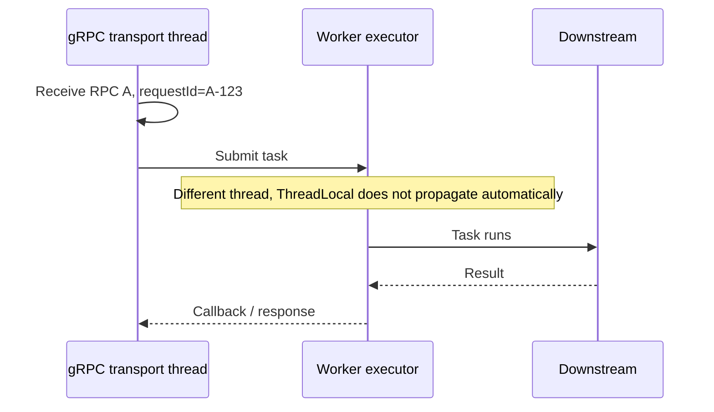

# Context Propagation Across Threads

## Lesson Objectives

In **SPRING_GRPC**, an RPC can start on a transport thread, run interceptors, move onto a thread pool to access a database or call another service, and complete via an asynchronous callback. When work switches threads, data bound to the current thread such as ThreadLocal, MDC, or the Spring Security context may no longer be present. If context is propagated improperly, logs lose correlation IDs, authorization reads the wrong principal, or data from a previous request leaks into a subsequent request on a shared thread pool.

This lesson focuses on **context propagation across threads**: understanding io.grpc.Context, passing request-scoped values through interceptors and executors, preserving deadlines/cancellation, integrating with Spring Security and MDC, and testing isolation and cleanup on thread pools.

After this lesson, you will be able to:

1. Distinguish gRPC Context from Java ThreadLocal, MDC, and Spring SecurityContext.
2. Create Context.Key and attach request data in a server interceptor.
3. Use Contexts.interceptCall, Context.wrap, and context-aware executors.
4. Propagate context safely across callbacks, Executors, and CompletableFutures.
5. Preserve deadlines/cancellation when switching threads and calling downstream gRPC services.
6. Integrate Spring Security/MDC without leaking context between requests.
7. Test context propagation, exception cleanup, cancellation, and request isolation.

> **Scope:** Examples use gRPC Java and Spring. io.grpc.Context is gRPC's context mechanism; it does not automatically replace Reactor Context or every ThreadLocal from other libraries. For application-managed executors or reactive pipelines, choose the matching propagation mechanism.

## 1. Why Is Context Lost When Switching Threads?

A ThreadLocal binds a value to one specific thread. Suppose request A runs on thread grpc-default-executor-1, writes requestId=A-123, and submits work to worker-3. Thread worker-3 does not automatically know that value. Later, when request B is processed on that same worker thread, if code fails to clean up state properly, stale data can even appear in B's logs.



Context propagation ensures the required data is attached to the task's execution scope on the target thread and restored after the task finishes. Distinguish three concepts:

- **Context propagation:** the target task sees the exact values of the request that submitted the task.
- **Context restoration:** after the task, the target thread returns to the state it had before the task ran.
- **Isolation:** request A cannot see request B's data and vice versa.

On a thread pool, restoration is just as important as propagation. Threads are reused; if a task does not clean up context, the next request may pick up the wrong data.

## 2. What Is gRPC Context?

io.grpc.Context is gRPC's execution-scoped data storage mechanism. Context can carry a request ID, verified tenant, principal, or control data such as deadlines and cancellation.

Key characteristics:

- Context is immutable in normal usage; adding a value produces a child context via withValue.
- Context.current() returns the context attached to the current thread.
- Context.Key<T> identifies a typed value.
- attach() binds the context to the current thread and returns the previous context.
- detach(previous) restores the previous context.
- wrap(...) and executor helpers attach the context while the task runs and restore it automatically.
- Context can carry the RPC's deadline and cancellation state.

Declare keys at class level so components share the exact same key:

```java
public final class RpcContextKeys {
    private RpcContextKeys() {}

    public static final Context.Key<String> REQUEST_ID =
            Context.key("request-id");

    public static final Context.Key<String> TENANT_ID =
            Context.key("tenant-id");
}
```

Key names are for diagnostics; do not create different keys for the same concept in different classes. Store only small, immutable data needed for the RPC lifecycle. Never put large request payloads, mutable objects, private keys, raw tokens, or unnecessary sensitive data into Context.

## 3. Injecting Request Context into gRPC with an Interceptor

A server interceptor is the right place to establish metadata needed across an entire RPC. The following example reads the request ID from metadata; if the client does not send one, the server generates an internal ID.

```java
public final class RequestContextInterceptor implements ServerInterceptor {

    private static final Metadata.Key<String> REQUEST_ID_HEADER =
            Metadata.Key.of(
                    "x-request-id",
                    Metadata.ASCII_STRING_MARSHALLER);

    @Override
    public <ReqT, RespT> ServerCall.Listener<ReqT> interceptCall(
            ServerCall<ReqT, RespT> call,
            Metadata headers,
            ServerCallHandler<ReqT, RespT> next) {

        String requestId = headers.get(REQUEST_ID_HEADER);
        if (requestId == null || requestId.isBlank()) {
            requestId = UUID.randomUUID().toString();
        }

        Context requestContext = Context.current()
                .withValue(RpcContextKeys.REQUEST_ID, requestId);

        return Contexts.interceptCall(
                requestContext, call, headers, next);
    }
}
```

Contexts.interceptCall binds the context for dispatching and for ServerCall.Listener callbacks, then restores the previous context. Therefore, the service and listener callbacks can read RpcContextKeys.REQUEST_ID.get() whenever a callback executes inside the RPC's execution scope.

Client-sent metadata is untrusted input. A request ID can be used for correlation after validating length and format; never use client-supplied tenant-id, role, or user-id as authorization proof. Tenant and principal must come from verified authentication or server-side policy.

### 3.1. Context in the Service

Inside the service, read values from the current context:

```java
@Override
public void getStock(
        GetStockRequest request,
        StreamObserver<GetStockResponse> responseObserver) {

    String requestId = RpcContextKeys.REQUEST_ID.get();

    log.info("Handling GetStock, requestId={}", requestId);

    // Handle the RPC within the current context.
}
```

You do not need to pass a request ID through every method parameter if it is metadata for a cross-cutting concern. However, mandatory business inputs that affect results should remain explicit parameters; never turn Context into a hiding place for business logic dependencies.

## 4. Propagating Context Through Executors

When a service submits work to an application-managed executor, never assume context follows the thread automatically. gRPC provides helpers to wrap tasks.

### 4.1. Wrapping a Runnable or Callable

```java
Context callContext = Context.current();

workerPool.execute(callContext.wrap(() -> {
    String requestId = RpcContextKeys.REQUEST_ID.get();
    processRequest(requestId);
}));
```

wrap captures the context at wrapper creation time. When the task runs, the wrapper attaches the captured context, executes the task, and detaches in a finally block. This works well when propagating a single task.

With Callable, you can use callContext.wrap(callable) to preserve context while computing and returning a result. When using CompletableFuture, supply a context-wrapped executor to async stages; do not assume every stage automatically inherits context from the previous stage.

### 4.2. Wrapping an Executor for One RPC

If a single RPC submits multiple tasks, capture the context once and create an executor fixed to that context:

```java
Context callContext = Context.current();

Executor rpcExecutor =
        callContext.fixedContextExecutor(workerPool);

rpcExecutor.execute(() -> loadInventory());
rpcExecutor.execute(() -> loadPricing());
```

fixedContextExecutor always runs tasks submitted through that wrapper in the captured context. Create the executor wrapper at the RPC or request-scoped component level; never create a single fixedContextExecutor(Context.current(), pool) at singleton bean initialization, as it would capture the startup context instead of each request's context.

### 4.3. currentContextExecutor vs. fixedContextExecutor

| Helper | Context Used | When Appropriate |
| --- | --- | --- |
| Context.currentContextExecutor(delegate) | Captures current context on every execute call | Shared executor where tasks are submitted directly from threads that hold the right context |
| context.fixedContextExecutor(delegate) | Always uses the context captured in the context variable | A group of tasks belonging to the same RPC/request |
| context.wrap(runnable) | Captures context when creating the task wrapper | A specific callback or individual task |

currentContextExecutor cannot guess the original context if a task is submitted from a thread that already lost context. For example, if an async callback without context submits a follow-up task, the helper captures that callback's empty or wrong context. When preserving the request context across multiple async layers, keep a reference to callContext and use a fixed wrapper or wrap each callback from the captured context.

## 5. Manual Attach and Detach

You can use attach/detach when an API does not support wrappers:

```java
Context captured = Context.current();

executor.execute(() -> {
    Context previous = captured.attach();
    try {
        performWork();
    } finally {
        captured.detach(previous);
    }
});
```

Always call detach(previous) in a finally block, even if the task throws an exception or returns early. Never call attach() and leave the context sitting on a worker thread. Nor should you arbitrarily detach with Context.ROOT; always restore the exact previous context so nested contexts set up by the framework are not broken.

Prefer wrap, fixedContextExecutor, or currentContextExecutor because they encapsulate attach/detach and reduce the risk of forgetting cleanup.

## 6. Deadlines and Cancellation Across Thread Switches

gRPC Context can carry the RPC's deadline and cancellation state. When offloading work to an executor using context-aware wrappers, tasks can inspect the RPC state:

```java
Context callContext = Context.current();
Executor rpcExecutor = callContext.fixedContextExecutor(workerPool);

rpcExecutor.execute(() -> {
    if (callContext.isCancelled()) {
        return;
    }

    performExpensiveStep();

    if (callContext.isCancelled()) {
        return;
    }

    continueWork();
});
```

When a client cancels an RPC or the deadline expires, the context can transition to cancelled. Check cancellation at expensive work boundaries and stop operations that are no longer needed. For running database queries or HTTP calls, propagate timeouts/cancellation down to those APIs where supported; checking context does not automatically cancel every blocking call.

When making an outbound gRPC call inside the proper context, gRPC Java can propagate deadlines and cancellation via its context propagation mechanism. Never set a downstream deadline longer than the parent request's remaining budget. If you spawn threads or tasks without preserving context, the deadline may no longer apply as expected.

### 6.1. Avoiding Sending a Response After the RPC Is Cancelled

In an async service, only one execution flow should drive terminal callbacks onError or onCompleted. If the client has already cancelled the RPC, stop work and release resources; do not continue emitting onNext or race to send multiple terminal signals. For streaming, serialize StreamObserver calls according to contract and manage backpressure/flow control separately.

Context cancellation is a control signal; it does not automatically stop a blocked thread. Use interruptible/cancellable APIs or a cancellation listener when you need to wake waiting work.

## 7. Context Propagation with CompletableFuture

Non-async stages of a CompletableFuture may run on whichever thread completed the previous stage. Async stages do not propagate context unless the executor is wrapped.

Example preserving context when building a pipeline:

```java
Context callContext = Context.current();
Executor rpcExecutor =
        callContext.fixedContextExecutor(workerPool);

CompletableFuture<Stock> result =
        CompletableFuture.supplyAsync(
                this::loadStock,
                rpcExecutor)
        .thenApplyAsync(
                this::enrichStock,
                rpcExecutor);
```

Both async stages are submitted through an executor fixed to the context. If you use thenApply without an executor, the stage may run on the thread completing the future; do not rely on that to guarantee context. Explicitly select an executor for stages that require request context.

If the pipeline transitions to a reactive library, see the Reactor Context section below. gRPC Context and Reactor Context are two separate mechanisms; integration requires an intentional bridge.

## 8. Combining with Spring Security and MDC

### 8.1. Spring SecurityContext Is Not Automatically gRPC Context

Spring Security typically stores SecurityContext in SecurityContextHolder using ThreadLocal. io.grpc.Context does not automatically copy SecurityContextHolder to worker threads. A task might see the request ID from gRPC Context while missing Spring Security authentication.

You can combine gRPC executor propagation with Spring Security:

```java
Executor grpcContextExecutor =
        Context.currentContextExecutor(workerPool);

Executor securityAndGrpcExecutor =
        new DelegatingSecurityContextExecutor(grpcContextExecutor);
```

When submitting a task from a request-handling thread, DelegatingSecurityContextExecutor captures the SecurityContext via Spring Security's mechanism; the inner executor captures gRPC Context at submission time. Verify how the executor is constructed and where submission occurs to ensure both contexts are present.

Use only verified identities. Never construct a SecurityContext from arbitrary headers. For background tasks running after the RPC ends, consider passing a minimal, time-bounded principal/authorization snapshot rather than keeping the entire security context alive long term.

### 8.2. MDC Must Be Captured and Restored

SLF4J/Logback MDC is typically ThreadLocal-based. You can use a Spring TaskDecorator to capture MDC at submission time and restore it on the worker:

```java
TaskDecorator mdcTaskDecorator = task -> {
    Map<String, String> submittedMdc = MDC.getCopyOfContextMap();

    return () -> {
        Map<String, String> previousMdc = MDC.getCopyOfContextMap();
        try {
            if (submittedMdc == null) {
                MDC.clear();
            } else {
                MDC.setContextMap(submittedMdc);
            }
            task.run();
        } finally {
            if (previousMdc == null) {
                MDC.clear();
            } else {
                MDC.setContextMap(previousMdc);
            }
        }
    };
};
```

Attach the decorator to a Spring-managed ThreadPoolTaskExecutor. If tasks also need gRPC Context, combine it with Context.wrap or a context-aware executor. Restoring the previous MDC in finally prevents subsequent requests from seeing the previous task's request ID.

Do not copy the entire MDC if it contains tokens, emails, or personal data. Place only correlation IDs and necessary operational fields into logs.

## 9. Context in Reactor and Reactive Pipelines

Reactor has its own Context, read via deferContextual and written via contextWrite. It is not io.grpc.Context and is not identical to ThreadLocal.

Reactor example:

```java
Mono.deferContextual(contextView -> {
    String requestId = contextView.get("requestId");
    return inventoryClient.load(requestId);
})
.contextWrite(context -> context.put("requestId", requestId));
```

If a gRPC handler hands off to Reactor, bridge request values from gRPC Context into Reactor Context at the subscribe/pipeline boundary. If you use Micrometer Context Propagation or Reactor automatic context propagation, verify the specific integration and version. Do not enable global propagation without understanding its impact across all tasks in the process.

When the pipeline returns to gRPC callbacks, preserve the required context and adhere to StreamObserver thread safety. Never assume a Reactor scheduler automatically maintains gRPC Context without a bridge.

## 10. What Should and Should Not Be Stored in Context

| Data | Recommendation | Reason |
| --- | --- | --- |
| Request/correlation ID | Safe to store | Supports tracing/log correlation |
| Deadline/cancellation | Use gRPC context | Controls RPC lifecycle |
| Verified tenant | Can store if needed | Cross-cutting policy, must come from a trusted source |
| Principal/authentication | Store only under clear policy | Avoid client-asserted identity and overly long-lived contexts |
| Large request payloads | Do not store | Increases memory usage and hides dependencies |
| Shared mutable maps/objects | Avoid | Race conditions and cross-thread side effects |
| Private keys, raw tokens, passwords | Do not store | Risk of leaking secrets via logs/debug/dumps |
| Required business parameters | Prefer explicit passing | Transparent API, easier to test and review |

Context should be small, immutable, and have a lifetime no longer than the request. For background tasks continuing after the RPC completes, create a separate execution context with minimal data rather than retaining the RPC's context indefinitely.

## 11. Common Pitfalls and How to Fix Them

| Symptom | Cause | Fix |
| --- | --- | --- |
| Request ID disappears in worker | Submitted plain Runnable directly to executor | Use Context.wrap or a context-aware executor |
| Request A sees B's tenant/request ID | ThreadLocal/MDC not restored or cleared | Capture/restore in finally; test on a shared pool |
| SecurityContext lost across async boundary | Spring Security ThreadLocal not propagated | Use DelegatingSecurityContextExecutor or proper integration |
| currentContextExecutor captures empty context | Task submitted from a thread that already lost context | Keep original context and use fixedContextExecutor/wrap |
| Context lingers after exception | Manual attach missing finally | Use helpers or properly detach previous context |
| RPC keeps running past deadline | Task does not check cancellation or downstream API lacks timeout | Check isCancelled, propagate timeouts, and cancel operations |
| Callback sends response twice | Multiple workers call observer concurrently | Serialize callbacks and emit only one terminal signal |
| MDC leaks across requests | Task fails to restore previous MDC | Use TaskDecorator to capture/restore in finally |
| Reactor does not see gRPC Context | Two distinct context models | Bridge explicitly at the pipeline boundary |
| Context retains objects too long | Stored context in a singleton/background task | Hold minimal data and bound lifetime |

## 12. Testing Context Propagation

Tests must use an executor whose threads are reused, because leak bugs often do not surface when every task runs on a brand-new thread.

Key tests:

1. Set a request ID in gRPC Context, submit a task to a single-thread executor, and verify the worker reads the right ID.
2. Submit two parallel requests with different IDs; verify neither request sees the other's data.
3. Make a task throw an exception; verify the previous context/MDC is restored.
4. Run a follow-up task on the same worker; verify the old request ID is gone.
5. Cancel an RPC or let the deadline expire; verify the task stops at checkpoints and downstream receives appropriate timeouts/cancellation.
6. With mTLS/Spring Security, verify the authenticated principal is propagated properly and cannot be spoofed via metadata.
7. With Reactor, verify the request ID is bridged into Reactor Context and does not leak across subscriptions.
8. With streaming RPCs, verify observer callbacks are serialized and only one terminal event occurs.

You can use Context.ROOT in tests to verify a worker has no lingering request context after a task. However, tests must verify both before and after states, not merely check a single null value in an isolated case.

## 13. Hands-On Exercises

1. Write a ServerInterceptor that reads x-request-id, validates length/format, generates an ID if missing, and puts it into a Context.Key.
2. In a service, submit two async tasks using fixedContextExecutor; verify both read the right request ID.
3. Swap the executor for a plain executor to reproduce lost context, then write a test demonstrating the difference.
4. Trigger two concurrent RPCs on a single-thread executor; verify request IDs and tenants are never mixed.
5. Integrate DelegatingSecurityContextExecutor and an MDC TaskDecorator; verify cleanup after both success and exception.
6. Build a multi-stage async CompletableFuture pipeline and ensure every stage uses a context-aware executor.
7. Cancel an RPC while a worker is processing; verify cancellation is observed and resources are released.
8. Bridge a request ID into Reactor Context, then verify subscription isolation.
9. Write a Spring gRPC integration test confirming interceptor, service, worker pool, and callbacks all preserve the right request context.

### Self-Check Questions

- Why does ThreadLocal not propagate automatically when a task moves to a worker thread?
- How does io.grpc.Context differ from SecurityContextHolder and MDC?
- How does Contexts.interceptCall ensure context is present inside listener callbacks?
- When does Context.wrap capture the context?
- How does currentContextExecutor differ from fixedContextExecutor?
- Why should you avoid creating a fixed context executor during singleton bean initialization?
- Why must manual attach/detach use try/finally?
- How are deadlines and cancellation preserved when switching executors?
- Why does Spring Security require a dedicated executor or decorator?
- Why does Reactor Context need an explicit bridge from gRPC Context?
- How do you test for context leaks on a shared thread pool?
- What kinds of data should not be stored in request context?

## References

- [gRPC Java — Context](https://grpc.github.io/grpc-java/javadoc/io/grpc/Context.html): context propagation, cancellation, deadlines, and executor helpers.
- [gRPC Java — Contexts](https://grpc.github.io/grpc-java/javadoc/io/grpc/Contexts.html): integrating context into server interceptors/listeners.
- [gRPC — Deadlines](https://grpc.io/docs/guides/deadlines/): deadline propagation and timeout handling.
- [Spring Framework — Task Execution and Scheduling](https://docs.spring.io/spring-framework/reference/integration/scheduling.html): executors and TaskDecorator.
- [Spring Security — Concurrency Support](https://docs.spring.io/spring-security/reference/servlet/integrations/concurrency.html): propagating SecurityContext across tasks/executors.
- [Project Reactor — Context](https://projectreactor.io/docs/core/release/reference/advancedFeatures/context.html): context propagation in reactive pipelines.
- [SLF4J — MDC](https://www.slf4j.org/api/org/slf4j/MDC.html): mapped diagnostic context and thread-local logging context.

**Expected outcome:** Learners can safely propagate request context across threads in Spring gRPC, preserve the right request ID/identity/deadline when running asynchronously, integrate intentionally with Spring Security, MDC, and Reactor, prevent context leaks on shared thread pools, and test isolation, cancellation, and cleanup for both unary and streaming RPCs.
