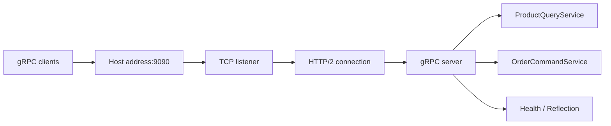

# Configuring Port and Bind Address

## 1. Port and bind address define the gRPC server listening endpoint

A gRPC server needs to open a TCP listener for clients to connect to. The listener is defined by two components:

- **Port** is the TCP port number on which the server accepts connections, for example `9090`.
- **Bind address** is the local address/interface the socket attaches to, for example `127.0.0.1` or `0.0.0.0`.

gRPC services and methods typically share a single HTTP/2 listener. You do not need to open a separate port for each service or each RPC method. The client creates a channel to the `host:port` endpoint and invokes methods by the service name defined in the protobuf contract.



For example, if the server binds to `0.0.0.0:9090`, the socket listens on all IPv4 interfaces on port `9090`. If it binds to `127.0.0.1:9090`, only processes that can access loopback in the same network namespace can connect.

Configuring port and bind address is server network configuration. It is different from the address clients use to connect, the DNS name published for service discovery, or the port a container platform exposes externally.

## 2. Configuration in Spring gRPC

With a Spring gRPC starter that supports server address and port properties, you can declare them in `application.yml`:

```yaml
spring:
  grpc:
    server:
      address: 0.0.0.0
      port: 9090
```

Or use `application.properties`:

```properties
spring.grpc.server.address=0.0.0.0
spring.grpc.server.port=9090
```

`spring.grpc.server.port` controls the gRPC server listener port; `spring.grpc.server.address` controls the local address the listener binds to. Use the exact properties supported by the Spring gRPC starter version in your project. Different versions or starters may change property names or extension points; check the metadata/configuration reference of the dependency you are using before deploying.

Do not confuse `spring.grpc.server.address` with `server.address` of the Spring Boot web server. `server.address` usually configures the embedded HTTP server (for example, Spring MVC/WebFlux). It does not automatically change a separately managed gRPC listener.

Similarly, Spring Boot's `server.port` is usually the HTTP application port. If the application runs both a REST API and a gRPC server, the two listeners can have two different ports:

```yaml
server:
  address: 0.0.0.0
  port: 8080

spring:
  grpc:
    server:
      address: 0.0.0.0
      port: 9090
```

In this example, the HTTP server listens on port `8080` and the gRPC server listens on port `9090`. Changing one configuration does not mean the other port changes as well.

## 3. Choosing an appropriate bind address

The bind address determines the scope of interfaces on which the server accepts connections:

| Bind address | Meaning | Use case |
| --- | --- | --- |
| `127.0.0.1` | IPv4 loopback; accessible only from the same network namespace | Local development, tests, or internal sidecar communication |
| `::1` | IPv6 loopback | Local IPv6 environments |
| `0.0.0.0` | All IPv4 interfaces | Containers or services that need to accept traffic from the network |
| `::` | IPv6 wildcard; dual-stack depends on OS and socket configuration | IPv6 deployment systems |
| Specific interface IP | Binds only to that interface | Multi-NIC machines, separating internal/public networks |

### Loopback

Binding to `127.0.0.1` restricts the listener to the current machine or network namespace. This is a safe choice for services only called by processes in the same environment. However, in a container, the container's loopback is not the host's loopback. A service bound to `127.0.0.1` inside a container generally cannot receive traffic sent to the container's IP from another container or from the host via port mapping.

### Wildcard address

Binding to `0.0.0.0` allows the server to accept connections on all IPv4 interfaces. This is the common choice in containers because traffic from a bridge network or Kubernetes Pod network enters through the container interface.

A wildcard bind opens the listener on every available IPv4 interface. It does not automatically create firewall rules or public routes, so it must be combined with NetworkPolicy, firewalls, security groups, and exposure policies to restrict allowed callers.

### Binding to a specific interface

On a host with multiple network interfaces, binding to a specific IP can restrict traffic to only the desired network. That address must actually be assigned to an interface in the network namespace where the server runs. If the IP does not exist yet or the interface is not ready, the server may fail to start.

Do not use a public DNS name as a bind address if it only points to a load balancer or an external machine IP. The bind address must represent a local address on which the process can open a socket. The DNS name advertised to clients is a separate concept.

## 4. Valid ports and how to choose a port

A TCP port is an integer from `0` to `65535`. For production services, choose a fixed port in a range aligned with infrastructure conventions, such as `9090`, and configure it consistently across the server, container service, and client/service discovery.

- **Port 0:** asks the operating system to allocate an available ephemeral port. Useful for tests or applications needing a dynamic port; clients must discover the actual port after the server binds successfully.
- **Fixed port:** suitable for deployments with service discovery or load balancers routing to a stable endpoint.
- **Ports below 1024:** on many Unix-like operating systems, require special privileges or appropriate capabilities. Typical Java applications should use unprivileged ports and let an ingress/proxy handle public ports if needed.
- **Port already in use:** the server cannot bind and startup fails. Do not mask this error by silently picking another port in production.

Do not assume port `9090` is always free or is the default in every starter. Declare it explicitly to avoid relying on library version defaults.

## 5. Externalizing configuration by environment

Do not hardcode ports and bind addresses in Java code. Put them into external configuration so local, test, staging, and production can use different values.

YAML example:

```yaml
spring:
  grpc:
    server:
      address: 0.0.0.0
      port: 9090
```

Spring Boot relaxed binding allows overriding property names directly using the corresponding environment variables:

```bash
SPRING_GRPC_SERVER_ADDRESS=0.0.0.0
SPRING_GRPC_SERVER_PORT=9090
```

Choose one consistent configuration convention across deployment manifests, secret/config managers, and the application. Avoid setting multiple different variables controlling the same value, as it becomes hard to tell which source has higher precedence.

You can use profiles:

```yaml
# application-local.yml
spring:
  grpc:
    server:
      address: 127.0.0.1
      port: 9090
```

```yaml
# application-prod.yml
spring:
  grpc:
    server:
      address: 0.0.0.0
      port: 9090
```

Activate the profile via deployment configuration, such as `SPRING_PROFILES_ACTIVE=prod`. Do not leave a production profile bound to loopback if clients reside in another Pod or host.

## 6. Running in Docker and Kubernetes

In a container, the server must bind to the container's interface so traffic from networks outside the container can reach it. Typically configure `0.0.0.0` and an internal port, such as `9090`.

Docker example:

```dockerfile
EXPOSE 9090
```

`EXPOSE` only documents the port the application intends to use; it does not publish the port to the host and does not change the process's bind address. When running the container, you must publish the port if you want to access it via the host:

```bash
docker run -p 9090:9090 catalog-service
```

The left side is the host port; the right side is the container port. The application inside still binds to port `9090`. You can map a different host port, such as `19090:9090`, without changing the listener port inside the container.

In Kubernetes, the Pod/container port describes the port the application listens on; the Service `targetPort` routes to that port. Example:

```yaml
apiVersion: v1
kind: Service
metadata:
  name: catalog-grpc
spec:
  selector:
    app: catalog
  ports:
    - name: grpc
      port: 9090
      targetPort: 9090
      protocol: TCP
```

`port` is the Service port used by clients inside the cluster; `targetPort` is the container's port. The two can differ. For clients outside the cluster to connect, you need an appropriate Service type or an ingress/gateway that supports gRPC and HTTP/2.

A Kubernetes Service does not make the application bind to the right interface automatically. If the server only binds `127.0.0.1` inside the Pod, traffic to the Pod IP may fail to reach the listener even when the Service selector and `targetPort` are correct.

## 7. Bind address is not advertised address

Three concepts must be kept separate:

- **Bind address:** the local address where the process opens a socket.
- **Advertised address/target:** the hostname or endpoint clients use to find and connect to the server.
- **Published port:** the port exposed by the container runtime, Kubernetes Service, load balancer, or NAT.

For example, a server inside a Pod binds to `0.0.0.0:9090`. A Kubernetes Service has the DNS name `catalog-grpc.default.svc.cluster.local` and exposes port `443` with `targetPort` `9090`. Clients call the DNS name on port `443`; the Pod still listens on port `9090`.

Do not configure the server to bind to the Kubernetes Service DNS address. A Service DNS is a virtual endpoint for clients to connect to, not a local IP assigned to the Pod.

If a load balancer or proxy terminates TLS, it must be configured with the appropriate gRPC/HTTP/2 protocol and health check. Changing the bind address does not automatically configure TLS, authority, routing, or service discovery.

## 8. TLS and listener port

Enabling TLS does not necessarily change the port or bind address. TLS is the transport security layer on the listener; the server can continue binding to the same endpoint while using the configured TLS context.

Some environments use a direct TLS listener; others terminate TLS at an ingress/proxy and forward internal traffic. Clearly identify the TLS termination point and protocol between hops. Do not send Bearer tokens or sensitive data over an unprotected hop just because the client used TLS to the ingress.

If the server uses mTLS, the listener must be configured to trust the client CA and require a client certificate. Port and bind address do not replace certificate configuration, trust stores, or authorization.

## 9. Testing port and bind address

Configuration testing should verify that the server actually listens at the expected endpoint and that clients can connect from the intended network scope.

Checks to include:

1. Start the Spring context with a defined port and address; verify that server lifecycle startup succeeds.
2. Call a unary RPC via the generated stub against the configured endpoint and verify the response.
3. Verify that connections over loopback work when bound to `127.0.0.1`; also confirm that clients from another namespace cannot reach the loopback listener.
4. For containers, verify that the listener binds to `0.0.0.0` and host/service mappings point to the right container port.
5. Test with a port already in use to ensure startup reports a clear error.
6. With port `0` in tests, obtain the actual port from the server lifecycle/test harness after binding; do not hardcode ephemeral values.

Do not rely on "check if the port is free, then start" as an absolute guarantee because another process can occupy the port between the two operations. Let the server bind and handle actual bind failures. Avoid using sleep to wait for the listener; use application lifecycle signals, readiness probes, or retries with a deadline in tests.

You can inspect sockets on a Linux machine with:

```bash
ss -ltnp
```

Or on Windows PowerShell:

```powershell
Get-NetTCPConnection -State Listen -LocalPort 9090
```

Operating system inspection commands help verify the listener address and port, but gRPC integration tests are still required to verify HTTP/2, TLS, and service handlers.

## 10. Common errors and how to diagnose them

| Symptom | Possible cause | What to check |
| --- | --- | --- |
| Server reports address already in use | Port is already bound by another process | Inspect socket listeners, change the port, or stop the process owning the port |
| Client in another Pod cannot connect | Server only binds to loopback | Bind to the Pod interface, usually `0.0.0.0` |
| Local client connects, but external host client fails | Firewall, routing, or port publishing is misconfigured | Check network path, container mapping, Service, and NetworkPolicy |
| HTTP works, but gRPC fails | Proxy/ingress does not forward HTTP/2 or gRPC config is incorrect | Check backend protocol and end-to-end HTTP/2 per architecture |
| Changing `server.port` leaves gRPC on the old port | Changed HTTP property instead of gRPC property, or property unsupported by starter | Check the exact prefix and version configuration reference |
| Server fails to start with a specific IP | IP does not exist in the network namespace | Check interfaces and local addresses of the container/host |
| Port 0 starts, but client does not know endpoint | Actual bound port not retrieved after bind | Obtain bound port from server/test lifecycle and pass it to the client |
| Connection refused even with the right port | Server did not start, bound to wrong interface, or blocked by firewall | Check listener, bind address, and network policy |

A common mistake is using `server.port` to change the gRPC port. In applications with both a web server and a gRPC server, configure each listener's own namespace; do not infer that every server in Spring Boot shares one port.

## 11. Practice exercise

Implement gRPC server configuration for three environments:

1. **Local:** bind to `127.0.0.1`, port `9090` so only local clients can connect.
2. **Container:** bind to `0.0.0.0`, port `9090`; publish host port `19090` to container port `9090`.
3. **Kubernetes:** keep container port `9090`; create a Service on port `443` with `targetPort` `9090` and a DNS endpoint for clients.

Use profiles or environment variables to select address/port without modifying code. Test a unary RPC in each environment, verify the actual listener, test a port conflict, and demonstrate that a loopback bind does not accept traffic from another namespace. Document clearly which port is the process port, the container port, and the port seen by the client.

**Self-check:** Port specifies the TCP port; bind address specifies the local interface on which the gRPC server listens. In Spring gRPC, configure the gRPC server's own properties, not the web server's `server.port`/`server.address`. Local development usually uses loopback; containers usually need a wildcard or Pod interface. Docker/Kubernetes can publish or map a port different from the internal port. Bind address, advertised endpoint, and TLS are separate configuration concerns that must be coordinated and tested.
