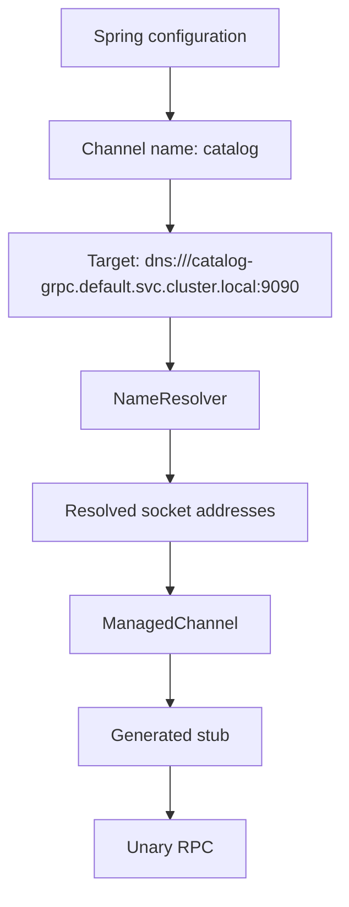

# Configuring Client Channels by Target

## 1. Channel name and target are two different concepts

In gRPC, a client creates a `ManagedChannel` to maintain a logical connection to a service. The channel manages name resolution, HTTP/2 connections, load balancing, TLS, reconnection, and connection state. Generated stubs use the channel to invoke RPCs.

When configuring a client in Spring, distinguish between:

- **Channel name** is a logical name defined by the application, such as `catalog` or `orders`. Spring uses this name to look up channel configuration and create the corresponding channel.
- **Target** is the destination address used by the gRPC resolver to locate endpoints, such as `dns:///catalog-grpc.default.svc.cluster.local:9090`.
- **Stub** is the client object generated from the protobuf service; the stub calls methods through the selected channel.

A channel name is not a hostname, and a target is not a bean name. One channel can be shared by multiple stubs calling the same server; multiple channel names can also point to the same target while having different TLS, credentials, or policy configurations.



## 2. gRPC Target URI

The target is passed to gRPC's name resolver. A target can specify a resolver scheme so gRPC knows how to locate endpoints.

Example DNS target:

```text
dns:///catalog.internal.example:9090
```

`dns` is the resolver scheme; the endpoint part is the hostname and port. Writing `dns:///` with three slashes indicates a URI without a custom authority, with the endpoint placed in the path. This is a gRPC target URI, not an HTTP URL to open in a browser.

Common examples:

| Target | Meaning |
| --- | --- |
| `dns:///catalog.internal.example:9090` | Uses the DNS resolver to resolve the hostname into connection addresses. |
| `dns:///catalog-grpc.default.svc.cluster.local:9090` | Uses Kubernetes Service DNS inside the cluster. |
| `dns:///localhost:9090` | Connects to a local service via DNS/loopback. |
| `dns:///127.0.0.1:9090` | Uses the IPv4 loopback address. |
| `unix:///var/run/catalog/grpc.sock` | Unix domain socket if supported by the transport, resolver, and platform. |

Not every resolver scheme is available in every gRPC transport. Schemes such as custom discovery or xDS require the corresponding resolver/library to be registered. If a scheme is not supported, the channel cannot resolve the target.

Do not prepend `https://` to a gRPC DNS target. TLS is configured at the channel/transport level; the target specifies the endpoint and resolver. When using TLS, the hostname in the target must match the DNS SAN of the server certificate. If the target is an IP, the certificate must have the corresponding IP SAN.

## 3. Declaring named channels in Spring

With a Spring gRPC starter that supports named client channels, you can declare targets by channel name in configuration:

```yaml
spring:
  grpc:
    client:
      channels:
        catalog:
          address: dns:///catalog-grpc.default.svc.cluster.local:9090
```

Here:

- `catalog` is the channel name referenced by the application.
- `address` holds the target URI for the name resolver.
- Hostname and port specify the endpoint the client connects to.

Property names and target syntax depend on the Spring gRPC starter version. Check the configuration metadata/reference of the exact dependency version in your project to confirm the supported prefix, field names, and resolver schemes. Do not infer that every gRPC starter uses the same namespace; different starters may have their own property structures.

Another channel can point to a different target:

```yaml
spring:
  grpc:
    client:
      channels:
        catalog:
          address: dns:///catalog-grpc.default.svc.cluster.local:9090
        orders:
          address: dns:///orders-grpc.default.svc.cluster.local:9090
```

From there, the application can use the `catalog` channel for `ProductQuery` service and the `orders` channel for `OrderCommand` service. Each channel has its own resolver, connection state, and configuration. You do not need to create a channel per RPC.

## 4. Creating stubs from a configured channel

Spring gRPC provides a factory to obtain a channel by its declared name. Example of creating a generated blocking stub:

```java
import io.grpc.ManagedChannel;
import org.springframework.context.annotation.Bean;
import org.springframework.context.annotation.Configuration;
import org.springframework.grpc.client.GrpcChannelFactory;

@Configuration
public class CatalogClientConfiguration {

    @Bean
    ProductQueryServiceGrpc.ProductQueryServiceBlockingStub productStub(
            GrpcChannelFactory channelFactory) {

        ManagedChannel channel =
                channelFactory.createChannel("catalog");

        return ProductQueryServiceGrpc.newBlockingStub(channel);
    }
}
```

`GrpcChannelFactory` is the integration point for using Spring-managed channels. The package name or factory injection style may vary by starter version; what matters is that the stub receives the channel configured under the channel name `catalog`, rather than creating a new channel on every call.

Generated stubs are immutable and can derive per-RPC variants. For example, setting a deadline for a single request:

```java
import java.util.concurrent.TimeUnit;

GetProductResponse response = productStub
        .withDeadlineAfter(500, TimeUnit.MILLISECONDS)
        .getProduct(request);
```

Channels should be reused throughout the application lifecycle. Stubs are lightweight and immutable; they can be shared or customized with deadlines/credentials per call. Never create a `ManagedChannel` inside every service method and forget to close it.

## 5. Choosing resolvers and targets by environment

The target should reflect how the client locates the server in each deployment environment.

### Local development

Client and server on the same machine can use:

```yaml
spring:
  grpc:
    client:
      channels:
        catalog:
          address: dns:///127.0.0.1:9090
```

The server must bind to loopback or an interface reachable by the client. If the server runs in a container, `127.0.0.1` on the client host is not the container's loopback; use the published host port or an appropriate service address.

### Docker Compose

Within the same Docker network, clients typically connect using the service name and internal port:

```yaml
spring:
  grpc:
    client:
      channels:
        catalog:
          address: dns:///catalog:9090
```

The name `catalog` must be resolved by Docker network DNS to the server container. Use the container port, not the published host port by default.

### Kubernetes

Within the same namespace, clients can use the short Service DNS:

```yaml
spring:
  grpc:
    client:
      channels:
        catalog:
          address: dns:///catalog-grpc:9090
```

Or use the FQDN:

```yaml
spring:
  grpc:
    client:
      channels:
        catalog:
          address: dns:///catalog-grpc.default.svc.cluster.local:9090
```

The Service DNS is the endpoint the client resolves; the server Pod binds to the container port. The client does not need to know Pod IPs when a Kubernetes Service provides a stable endpoint.

### Multi-endpoint environments

A resolver can return multiple socket addresses. gRPC's load balancing policy decides how endpoints are selected from the resolved list. A DNS target by itself does not guarantee round-robin; the outcome depends on the resolver, service config, and supported policies. If you need to distribute requests across multiple backends, verify that the resolver returns multiple addresses and configure an appropriate load balancing policy.

## 6. Configuring multiple targets and separation of concerns

An application may call multiple gRPC services. Create one channel name for each logical connection configuration, for example:

| Channel name | Target | Role |
| --- | --- | --- |
| `catalog` | `dns:///catalog-grpc.default.svc.cluster.local:9090` | Product lookup |
| `orders` | `dns:///orders-grpc.default.svc.cluster.local:9090` | Creating and querying orders |
| `inventory` | `dns:///inventory-grpc.default.svc.cluster.local:9090` | Checking inventory |

Channel names should remain stable and meaningful in code. Targets can vary across local, staging, and production via profile/environment configuration without modifying generated stubs or business services.

Do not create channel names per user or per request. Each channel maintains a resolver and connection resources; creating too many channels increases sockets, threads, memory usage, and reconnection overhead.

## 7. TLS and credentials attached to a channel

The target only specifies where to connect. Connection security must be configured separately:

- A TLS channel needs trust material to verify the server certificate and hostname.
- mTLS adds a client certificate/private key so the server can verify the client workload.
- Bearer tokens or application credentials are typically attached per RPC using `CallCredentials`.
- Deadlines and retry policies configure call behavior, not the target URI.

Never pass access tokens, passwords, or private keys in the target string. The target can appear in logs, exceptions, or metrics; it must contain only the non-sensitive endpoint address.

When using TLS, the hostname in the target must match the server certificate's SAN. If the target goes through a load balancer/proxy, the certificate and authority must match the endpoint verified by the client. Do not disable hostname verification to work around a mismatched target.

Example stub with credentials and a deadline:

```java
ProductQueryServiceGrpc.ProductQueryServiceBlockingStub securedStub =
        productStub.withCallCredentials(bearerTokenCredentials);

GetProductResponse response = securedStub
        .withDeadlineAfter(500, TimeUnit.MILLISECONDS)
        .getProduct(request);
```

In a Spring application, TLS and channel credentials should be attached to the channel factory/configuration using the mechanism provided by your starter version. Attach `CallCredentials` to the stub/call when identity needs to vary per RPC.

## 8. Channel lifecycle and connections

`ManagedChannel` is more than just a socket address. It manages the resolver, connections, reconnection, load balancing, and HTTP/2 state. Creating a channel does not necessarily mean a TCP connection has been established yet; the connection is typically established when an RPC is made or when the channel is explicitly asked to connect.

Usage guidelines:

1. Create channels per target configuration and reuse them.
2. Create generated stubs from those channels.
3. Use finite deadlines for RPCs according to SLAs.
4. When DNS or backends change, the resolver/channel can update addresses and reconnect according to policy.
5. Shut down channels when the application stops; if Spring manages the factory/channels, let the framework lifecycle handle it instead of closing shared channels prematurely.

If an RPC receives `UNAVAILABLE` right after application startup, check whether the target resolves, whether the server is ready, whether ports/network policies are correct, and whether the channel is using the right configuration. Do not treat creating a stub bean as proof that the server is reachable.

## 9. Testing target configuration

Test both bound configuration and real connectivity:

- Load application config per profile and verify that each channel name maps to the expected target.
- Check that the target URI has a resolver-supported scheme, valid hostname, and correct port.
- For DNS targets, verify that the hostname resolves from the client's network namespace.
- Start a test server and invoke a unary RPC using a stub created from the channel factory.
- Verify that an invalid target or unavailable server returns an appropriate connection error; do not let tests hang indefinitely.
- If a target returns multiple endpoints, verify the resolver and load balancing policy with appropriate tests.
- With TLS, verify hostname/SAN and trust store; with mTLS, verify that the client certificate is sent and the server trusts the right CA.

Unit tests can verify property binding without opening sockets. Integration tests should use a real server/channel, or an in-process channel when only testing handlers. In-process transport does not verify DNS, TCP, TLS, or resolvers for production targets.

## 10. Common errors

| Symptom | Possible cause | Resolution |
| --- | --- | --- |
| No resolver found for target | Scheme is unregistered or misspelled | Use a supported scheme such as DNS or register the appropriate resolver |
| `UNAVAILABLE` when calling RPC | DNS fails to resolve, server not running, wrong port or network policy | Check target, DNS, listener, and network path |
| Works locally, but container cannot connect | Using `localhost`/`127.0.0.1` in the wrong network namespace | Use the service name or an endpoint reachable from the container |
| TLS hostname verification fails | Target hostname does not match certificate SAN | Fix the DNS target or issue a certificate with the right SAN |
| Config changed, but client still calls old endpoint | Old channel was already created and keeps old resolver/config | Ensure channels are recreated/reloaded per lifecycle; restart or controlled refresh |
| Creating many channels increases resource usage | Channels created per request or per user | Reuse channels per logical target |
| Passing tokens in the target string | Confusing endpoint with credentials | Use `CallCredentials` or secure metadata |
| Assuming DNS target automatically round-robins | Resolver/service config does not provide the desired policy | Verify the address list and configure load balancing |

## 11. Practice exercise

Configure clients for two gRPC services:

1. Create a named channel `catalog` pointing to `dns:///catalog-grpc.default.svc.cluster.local:9090`.
2. Create a named channel `orders` pointing to `dns:///orders-grpc.default.svc.cluster.local:9090`.
3. Use `GrpcChannelFactory` to create channels and generated stubs for each service.
4. Set deadlines for unary RPCs and attach Bearer credentials per call.
5. Create a local profile pointing targets to loopback; a production profile pointing to Kubernetes Service DNS.
6. Verify that targets resolve from the right network namespace, TLS SAN matches the hostname, and servers are reachable.
7. Write tests for property binding, invalid target, unavailable server, and an integration test that calls successfully through the channel factory.

**Self-check:** A channel name is a logical configuration name in Spring; a target URI is the address and resolver scheme gRPC uses to locate the server. Use DNS targets for service discovery, separate targets from TLS and credentials, reuse channels per logical target, and manage lifecycle via Spring. Verify targets, resolvers, network namespaces, TLS hostnames, and deadlines in each environment to avoid connection errors during deployment.
