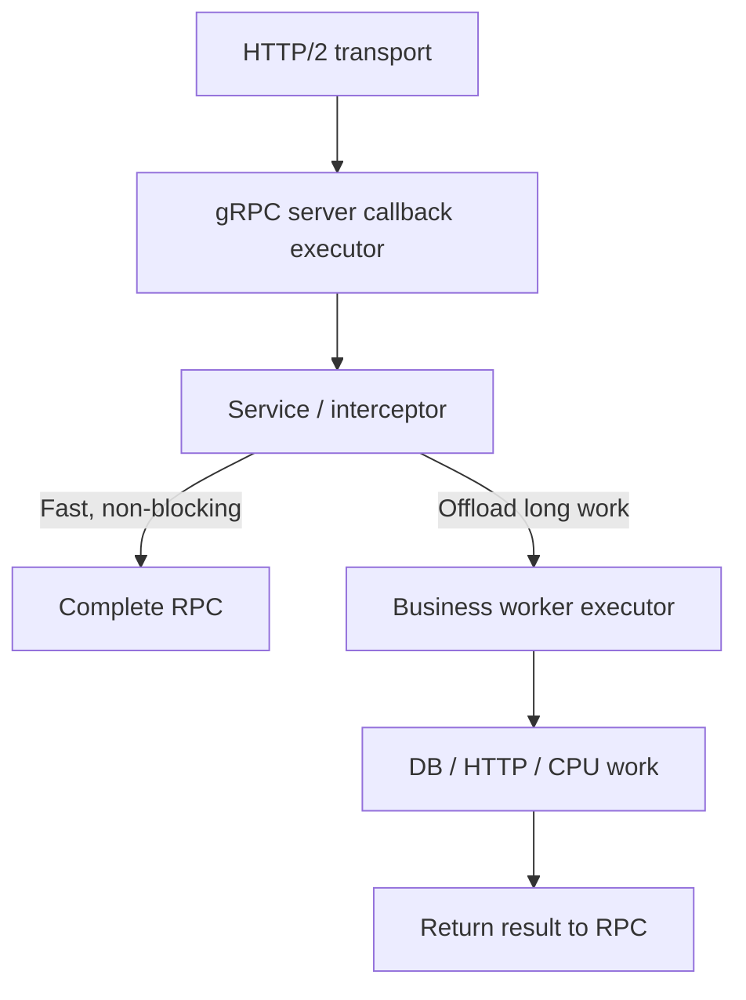

# Configuring Executors

## Lesson Objectives

In **SPRING_GRPC**, an RPC is received on a transport thread, and then gRPC dispatches the callback to the server's executor. The service can continue processing on a dedicated executor to perform blocking or CPU-intensive work. Executor configuration determines concurrency, queue wait latency, load resilience, and how the application shuts down safely.

This lesson focuses on **executor configuration** in Spring gRPC: distinguishing the gRPC server's callback executor from the business worker pool, declaring and managing thread pools with Spring, attaching an executor to the server builder via the starter's extension point, bounding queues, handling overload, preserving gRPC `Context` when offloading work, and testing shutdown/concurrency.

After this lesson, you will be able to:

1. Distinguish the transport/event loop, server application executor, and business worker executor.
2. Configure `ThreadPoolTaskExecutor` with appropriate thread limits, queue capacity, and lifecycle settings.
3. Attach an executor to the gRPC `ServerBuilder` managed by Spring gRPC.
4. Choose a dedicated pool for blocking/CPU-bound tasks and avoid blocking callback threads.
5. Design a controlled overload/rejection policy.
6. Preserve deadlines, cancellation, and request context when submitting asynchronous tasks.
7. Monitor pool metrics and test load, context propagation, and graceful shutdown.

> **Scope:** Examples use Spring Boot, Spring gRPC, and gRPC Java. The extension point name for customizing the server builder depends on the starter/transport and project version. A Spring `Executor` bean is not automatically used by gRPC; it must be wired into the server builder via the mechanism published by the version in use.

## 1. Which executors participate in handling an RPC?

Not every thread in a gRPC application has the same role. Separate at least three groups:

| Component | Role | Suitable work |
| --- | --- | --- |
| Transport/event loop | Reads/writes sockets, handles I/O and protocol | Short, non-blocking work |
| gRPC server application executor | Dispatches server callbacks/service handlers | Fast request handling, coordination, and invoking application code |
| Business worker executor | Runs tasks explicitly offloaded by the service | Blocking database/HTTP calls, heavy CPU processing, bounded background tasks |

A gRPC server can use an application-provided executor to run application callbacks. If not configured, the transport usually uses the implementation's default executor. Configuring a server executor does not turn blocking code into non-blocking code; if a service waits on a database or makes a synchronous HTTP call for a long time, the callback thread remains occupied for the entire wait.

A dedicated worker pool lets the service move blocking work off the callback executor. The two pools have different purposes and sizing, so you should not default to sharing a single pool for all work.



### 1.1. Why not use directExecutor for blocking services?

gRPC Java has a direct executor mode in which application callbacks can run directly on the thread performing dispatch/transport. This reduces thread-switching overhead for very short workloads, but a blocking handler can monopolize a thread needed for I/O or other dispatches.

Only consider `directExecutor` when handlers are proven to be short, non-blocking, not waiting on locks or I/O, and load-tested. For Spring gRPC services with synchronous database/HTTP calls, use an appropriate executor and offload blocking work.

## 2. Configuring ThreadPoolTaskExecutor in Spring

Spring provides `ThreadPoolTaskExecutor`, a bean that manages a thread pool and implements the `Executor` interface. You can configure a dedicated pool for gRPC blocking tasks:

```java
@Configuration(proxyBeanMethods = false)
public class GrpcExecutorConfiguration {

    @Bean(name = "grpcBusinessExecutor")
    public ThreadPoolTaskExecutor grpcBusinessExecutor() {
        ThreadPoolTaskExecutor executor = new ThreadPoolTaskExecutor();

        executor.setCorePoolSize(16);
        executor.setMaxPoolSize(48);
        executor.setQueueCapacity(200);
        executor.setKeepAliveSeconds(60);
        executor.setThreadNamePrefix("grpc-business-");

        executor.setWaitForTasksToCompleteOnShutdown(true);
        executor.setAwaitTerminationSeconds(30);
        executor.setRejectedExecutionHandler(
                new ThreadPoolExecutor.AbortPolicy());

        return executor;
    }
}
```

Spring manages the lifecycle of the `ThreadPoolTaskExecutor` bean and initializes it in the application context. There is no need to call `initialize` manually when the bean is managed by Spring.

The values 16/48/200 are only illustrative examples, not optimal numbers for every system. Choose them based on CPU, I/O wait time, target throughput, latency budget, and actual load.

### 2.1. Parameter meanings

| Parameter | Impact |
| --- | --- |
| corePoolSize | Number of workers maintained according to the executor policy |
| maxPoolSize | Maximum number of workers once the queue is full |
| queueCapacity | Number of tasks that can wait before the executor scales toward max or rejects |
| keepAliveSeconds | Time extra workers beyond core can remain idle before being reclaimed |
| threadNamePrefix | Helps identify the pool in thread dumps and logs |
| waitForTasksToCompleteOnShutdown | Requests waiting for accepted tasks to finish when Spring closes the context |
| awaitTerminationSeconds | Maximum time to wait for executor termination per lifecycle config |
| RejectedExecutionHandler | Policy when no more tasks can be accepted |

A queue is not an unbounded request buffer. An overly large queue increases wait times, holds requests/contexts in memory, and causes deadlines to expire before tasks even start. An overly small queue can increase rejections during traffic bursts. Choose the limit based on your latency budget and the real capacity of downstream systems.

### 2.2. Do not choose CallerRunsPolicy arbitrarily

`CallerRunsPolicy` runs a task on the thread calling `execute` when the pool is overloaded. If the calling thread is a gRPC callback/transport thread, a blocking task can stall dispatch and affect other RPCs. For a business worker pool, you can use `AbortPolicy` to reject explicitly and handle overload at the service boundary.

The rejection policy for the server callback executor requires even greater care because tasks may be submitted by the gRPC transport. Do not substitute `CallerRunsPolicy` or a handler that silently drops tasks. Verify how the transport handles `RejectedExecutionException`, load-test, and test queue-full scenarios. Apply concurrency limits, backpressure, or request rejection at the appropriate layer before the callback executor runs out of resources.

## 3. Attaching an executor to the gRPC server

gRPC Java allows configuring the executor for application callbacks via `ServerBuilder.executor(Executor)`. In principle, the server builder must receive the executor before build/start:

```java
ServerBuilder<?> serverBuilder = ServerBuilder.forPort(9090);

serverBuilder.executor(grpcServerExecutor);
serverBuilder.addService(inventoryGrpcService);

Server server = serverBuilder.build();
```

This snippet illustrates the gRPC Java configuration point. In a Spring gRPC application, the server is usually created and lifecycle-managed by the starter. Use the server builder customizer/configurer or factory extension point documented for your exact starter version to call `executor` on the builder before the server is built.

Do not create a standalone `Server` inside `@Configuration` just to attach an executor if Spring gRPC already owns the server serving traffic. Doing so can create a second listener and bypass service registration, TLS, interceptors, health/reflection, or graceful shutdown managed by the starter.

### 3.1. An Executor bean is not automatically attached to the server

Declaring a bean like this:

```java
@Bean
Executor grpcServerExecutor() {
    return Executors.newFixedThreadPool(24);
}
```

only creates an `Executor` bean in the Spring context. It does not prove the gRPC server is using that bean. Check the server factory/customizer of your project's version and verify that the builder receives the right instance.

Similarly, configuring Spring's `TaskExecutionAutoConfiguration` or properties for `@Async` does not by default configure the native gRPC listener's executor. The two mechanisms may use separate pools.

### 3.2. Do not confuse the server executor with the worker executor

You can have two separate beans:

- `grpcServerExecutor`: callback executor attached to the server builder.
- `grpcBusinessExecutor`: worker pool proactively used by services for blocking/CPU-bound tasks.

You do not need to split the two pools for every workload; decide based on actual profiling. However, if services perform blocking work or long-running tasks, separating them limits the impact of that workload on callback dispatching.

## 4. Offloading blocking work in a service

Example of a service offloading blocking work to a worker pool. The executor is injected with a qualifier to avoid confusion with other executors in Spring:

```java
@GrpcService
public class InventoryGrpcEndpoint
        extends InventoryGrpc.InventoryImplBase {

    private final Executor grpcBusinessExecutor;
    private final InventoryRepository repository;

    public InventoryGrpcEndpoint(
            @Qualifier("grpcBusinessExecutor") Executor grpcBusinessExecutor,
            InventoryRepository repository) {
        this.grpcBusinessExecutor = grpcBusinessExecutor;
        this.repository = repository;
    }

    @Override
    public void getStock(
            GetStockRequest request,
            StreamObserver<GetStockResponse> responseObserver) {

        Context callContext = Context.current();
        Executor contextualExecutor =
                callContext.fixedContextExecutor(grpcBusinessExecutor);

        contextualExecutor.execute(() -> {
            if (callContext.isCancelled()) {
                return;
            }

            try {
                Stock stock = repository.load(request.getSku());

                if (callContext.isCancelled()) {
                    return;
                }

                responseObserver.onNext(
                        GetStockResponse.newBuilder()
                                .setAvailable(stock.available())
                                .build());
                responseObserver.onCompleted();
            } catch (Exception ex) {
                responseObserver.onError(
                        Status.INTERNAL
                                .withDescription("Unable to load stock")
                                .withCause(ex)
                                .asRuntimeException());
            }
        });
    }
}
```

This illustrative snippet needs imports, repository types, and exception mapping adapted to your application. Key points:

- The service does not hold the callback thread while the repository performs I/O.
- `Context` is captured before submission so the worker still sees the request context and deadline/cancellation.
- Cancellation is checked before and after the expensive operation.
- Only one terminal signal is sent to `StreamObserver`.
- Internal exception details or sensitive data are not returned to the client.

If the repository offers a genuinely async/non-blocking API, prefer using it instead of occupying a worker thread just to wait. If a blocking task does not support cancellation, an expired deadline will not automatically stop the operation; configure timeouts at the driver/client level or use an appropriate interrupt/cancel mechanism.

## 5. Pool and queue sizing

There is no single formula suitable for every service. Start by classifying the workload:

- **CPU-bound:** processing primarily uses CPU. Worker count typically starts around the number of available cores; increasing it too much causes context switching.
- **Blocking I/O:** most time is spent waiting on database/HTTP. More workers than cores may be needed, but they must be bounded by connection pools and downstream capacity.
- **Mixed workload:** consider separating pools by work type so CPU tasks do not get stuck behind slow I/O calls.

One initial estimate for a blocking pool is a worker count near CPU count multiplied by the ratio of total time to actual CPU time. This is only a starting point; measure throughput, queue wait, and latency in a production-like environment.

For example, if a task takes 100 ms total—10 ms of CPU and 90 ms waiting on I/O—the pool may need higher concurrency than a CPU-bound workload. However, increasing workers indefinitely will overload database connection pools, downstream services, and memory.

### 5.1. Tying queue capacity to deadlines

Suppose an RPC has a 2-second deadline. If a task waits in the queue for 1.8 seconds before running, most of the budget is already gone before touching the repository. Therefore:

- Track queue wait time separately from task execution time.
- Do not use a large queue to mask insufficient capacity.
- Check deadline/cancellation before starting the task.
- Set downstream timeouts smaller than the remaining budget.
- Reject early when completion within SLA is impossible rather than holding requests too long.

Queue capacity should be sized from burst size and maximum acceptable wait time, not merely average request rate.

## 6. Handling rejection and overload

When the worker pool reaches max threads and the queue is full, the executor cannot accept more tasks. The service must handle this situation explicitly.

Example catching rejection when submitting a task:

```java
try {
    grpcBusinessExecutor.execute(contextualTask);
} catch (RejectedExecutionException ex) {
    responseObserver.onError(
            Status.RESOURCE_EXHAUSTED
                    .withDescription("System is overloaded")
                    .asRuntimeException());
}
```

In a real application, `ThreadPoolTaskExecutor` may throw `TaskRejectedException` (a Spring rejection exception) depending on the call path. Catch the exception matching the injected abstraction and keep status mapping consistent.

Choose gRPC status codes by semantics:

- `RESOURCE_EXHAUSTED`: server lacks capacity or quota to accept work.
- `UNAVAILABLE`: service is temporarily unavailable and the client may retry according to policy.
- `DEADLINE_EXCEEDED`: the RPC's time budget has expired.
- `INTERNAL`: unexpected error in server processing.

Do not automatically retry immediately on the same overloaded pool; retries can amplify load. If clients retry, use backoff/jitter, limit attempts, and only retry methods with safe semantics.

## 7. Deadlines, cancellation, and task lifecycle

A task submitted to a worker pool can continue running after the client has canceled the RPC or the deadline has expired. A context-aware executor preserves gRPC `Context` inside the task, but does not automatically abort all blocking APIs.

An operation object scoped to the RPC should own both the `Future` and the `CancellationListener`. When creating the operation:

1. Capture `Context.current()` before submitting the task and wrap the `Runnable` using `context.wrap(...)`.
2. Register a listener with `context.addListener(...)`; the listener calls `Future.cancel(true)` when the RPC is canceled.
3. Submit the task and store the `Future` in the operation object. Handle the race between cancellation and `Future` assignment by checking `context.isCancelled()` immediately after assignment.
4. When the task completes, is rejected, or the operation finishes, remove the listener via `context.removeListener(...)`.
5. Use a completion callback to send exactly one terminal signal; never block the gRPC callback with `Future.get()`.

Check whether downstream APIs respond to interrupts; some drivers require a dedicated query timeout or cancel API. `Future.cancel(true)` only sends an interrupt signal and does not guarantee a blocking API will stop immediately.

For streaming RPCs, do not let every message spawn unbounded tasks. Limit concurrent running tasks, preserve ordering if required by the protocol, and coordinate flow control/backpressure with processing speed.

## 8. Context propagation and Spring executors

Spring can create executors for `@Async`, scheduling, or application tasks. gRPC `Context` does not automatically propagate across all of these executors.

When a service submits a task, capture the current context and wrap the executor:

```java
Context callContext = Context.current();

Executor requestExecutor =
        callContext.fixedContextExecutor(grpcBusinessExecutor);

requestExecutor.execute(this::performWork);
```

If you also need to propagate MDC or Spring `SecurityContext`, configure an appropriate `TaskDecorator` or `DelegatingSecurityContextExecutor`. Do not assume gRPC `Context`, MDC, and `SecurityContextHolder` are the same mechanism. Each has its own lifecycle and capture/restore behavior.

Avoid creating `fixedContextExecutor` from `Context.current()` during singleton bean initialization; it can capture a non-request context. Create the wrapper within the RPC scope or capture context at the exact time of submission.

## 9. Graceful shutdown

When a Spring application stops, the server must stop accepting new RPCs, give in-flight RPCs a chance to finish within the grace period, and only then shut down worker pools.

The lifecycle order should be designed as follows:

1. Mark the instance as not accepting new traffic or initiate graceful server shutdown.
2. Wait for in-flight RPCs within the configured timeout.
3. Wait for already-accepted business worker tasks to complete within limits.
4. Close channels/downstream clients and related resources.
5. Once the grace period expires, cancel remaining tasks and terminate the process per policy.

`setWaitForTasksToCompleteOnShutdown(true)` tells Spring to wait for `ThreadPoolTaskExecutor` tasks, but does not by itself guarantee the gRPC server stopped accepting RPCs beforehand. Coordinate the lifecycle of the server factory and executor beans; verify dependency/destruction order and test shutdown under load.

Do not wait indefinitely. A blocking task without a timeout can prevent the process from exiting. Set timeouts on database/HTTP calls as well as an overall application grace period.

## 10. Monitoring executors in production

Metrics to monitor for each pool:

| Metric | Meaning |
| --- | --- |
| Pool size / active threads | Current available and running workers |
| Queue size / remaining capacity | Backlog level and remaining capacity |
| Task submitted/completed/rejected | Throughput and overload |
| Queue wait duration | Time tasks wait before running |
| Task execution duration | Execution duration |
| Shutdown/termination duration | Time to drain the pool during shutdown |
| gRPC in-flight calls | Number of active RPCs |
| RPC latency/status | Impact of the pool on user-facing APIs |

Do not look only at CPU. A pool with low active threads but high queue wait may indicate blocked workers or slow downstreams; high active threads together with rising rejections indicate saturation. Correlate with database connection pools, HTTP connection pools, downstream latency, and gRPC deadlines.

Use clear thread names like `grpc-business-` and `grpc-server-` so thread dumps are easy to read. Metric labels should have low cardinality; never use request IDs or arbitrary tenants as labels.

## 11. Common errors and solutions

| Symptom | Cause | Solution |
| --- | --- | --- |
| Created an `Executor` bean, but gRPC still uses another pool | Bean was not attached to the server builder | Use the customizer/factory extension point for your starter |
| RPC latency rises when database is slow | Blocking calls run on the callback executor | Offload to business worker pool and set DB timeouts |
| Queue grows continuously | Arrival rate exceeds capacity or downstream is congested | Bound queue, investigate downstream, and scale carefully |
| Rejection hangs RPC or drops callback | Rejection handler incompatible with transport/submission path | Verify rejection semantics, test saturation, and handle at service boundary |
| CPU rises without throughput gain | Too many workers causing context switching | Reduce concurrency, measure CPU/queue wait |
| Deadline expires before task runs | Queue wait consumes most of the budget | Reduce queue size, check deadline before processing, reject early |
| Context/request ID lost in worker | Executor not wrapped with gRPC Context | Use `Context.wrap` or `fixedContextExecutor` |
| Request B sees Request A's MDC | MDC not restored on shared pool | Use `TaskDecorator` to capture/restore in `finally` |
| Shutdown hangs | Blocking task without timeout or server not drained | Set timeouts, coordinate server lifecycle and executor termination |
| Streaming consumes too many threads/tasks | Unbounded task submission per message | Limit concurrency and coordinate flow control |

## 12. Testing executor configuration

Do not just verify that the bean is created. Verify that the server actually uses the intended executor and behaves properly under changing load.

Tests to include:

1. **Wiring:** call an RPC and record the thread name to verify callbacks run on the configured server executor.
2. **Offload:** create a blocking test service and verify work runs on threads with the business pool prefix.
3. **Concurrency:** send multiple concurrent unary RPCs and measure active threads/latency.
4. **Queue saturation:** slow down workers, fill the queue, and verify rejections translate into the appropriate status without blocking transport threads.
5. **Deadline/cancellation:** cancel an RPC while a task is running; verify the `Future`/downstream is canceled or times out as designed.
6. **Context:** verify request ID/deadline is preserved across the executor and does not leak between two requests.
7. **Streaming:** send a long stream, verify task limits and callback ordering.
8. **Shutdown:** send an active RPC and stop the Spring context; verify server draining and executor termination within the grace period.

Use a small test executor with clear limits to reproduce saturation. Avoid long sleeps or unbounded thread pools to make tests stable; use latches/barriers and timeouts for synchronization.

## 13. Practice exercises

1. Create a `grpcBusinessExecutor` bean using `ThreadPoolTaskExecutor` with bounded core/max/queue and a thread name prefix.
2. Attach a dedicated executor to the gRPC server builder via the extension point supported by your project's starter/transport.
3. Verify the executor bean is actually used via thread dumps or thread names in tests.
4. Write a unary service that offloads a database call to the business pool while preserving gRPC `Context`.
5. Trigger queue saturation, catch rejections, and return `RESOURCE_EXHAUSTED` per policy.
6. Set a short deadline, cancel the RPC while the worker is running, and verify cancellation.
7. Create a streaming workload, cap parallel tasks, and verify flow control.
8. Configure graceful shutdown so the server drains before the worker pool; measure shutdown duration.
9. Collect pool metrics and tune core/max/queue based on queue wait, task duration, downstream capacity, and RPC latency.

### Self-check questions

- How does the server application executor differ from the business worker executor?
- Why is `directExecutor` dangerous when a service performs blocking I/O?
- Why does declaring a `ThreadPoolTaskExecutor` bean not mean the gRPC server automatically uses it?
- How do `corePoolSize`, `maxPoolSize`, and `queueCapacity` interact?
- Why can a large queue cause deadlines to expire before a task runs?
- When should `AbortPolicy` be used, and why can `CallerRunsPolicy` stall the transport?
- How do you preserve gRPC `Context` when submitting tasks to a worker pool?
- Why does `Context` cancellation not automatically stop all blocking calls?
- In what order should Spring shutdown coordinate the server lifecycle and worker executor?
- Which metrics help distinguish pool saturation from a slow downstream?
- What tests are needed to prove executor wiring and rejection behavior are correct?

## References

- [gRPC Java — ServerBuilder](https://grpc.github.io/grpc-java/javadoc/io/grpc/ServerBuilder.html): configuring the executor for server application callbacks.
- [gRPC Java — Context](https://grpc.github.io/grpc-java/javadoc/io/grpc/Context.html): context propagation, cancellation, and executor helpers.
- [Spring Framework — Task Execution and Scheduling](https://docs.spring.io/spring-framework/reference/integration/scheduling.html): ThreadPoolTaskExecutor, TaskExecutor, and lifecycle.
- [Spring Boot — Task Execution and Scheduling](https://docs.spring.io/spring-boot/reference/features/task-execution-and-scheduling.html): auto-configuration and executors in Spring Boot.
- [gRPC — Deadlines](https://grpc.io/docs/guides/deadlines/): time budgets and deadline propagation.
- [gRPC — Cancellation](https://grpc.io/docs/guides/cancellation/): canceling RPCs and stopping unnecessary work.

**Expected outcome:** Learners can configure appropriate executors for Spring gRPC, distinguish callback executors from worker pools, bound concurrency/queues, handle overload and cancellation, preserve context when offloading work, coordinate graceful shutdown, and verify configuration using integration tests and pool metrics.
