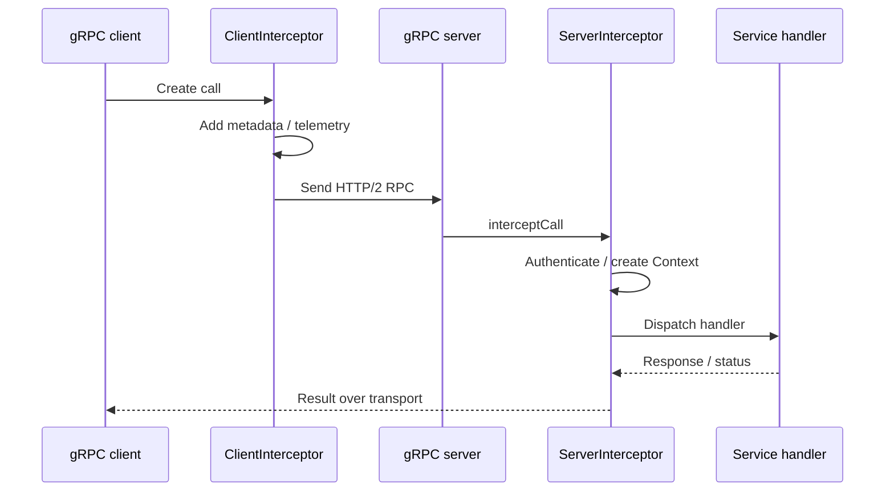

# Configuring Interceptors

## Lesson Objectives

In **SPRING_GRPC**, an interceptor is an extension point for applying shared behavior around every RPC without repeating it in each service method. On the server, interceptors typically handle correlation IDs, authentication, authorization, logging, metrics, or per-method policies. On the client, interceptors can add metadata, measure call duration, and standardize telemetry for outbound RPCs.

This lesson focuses on **configuring interceptors**: distinguishing `ServerInterceptor` from `ClientInterceptor`, choosing server-wide vs. per-service scope, registering interceptors on Spring-managed servers/channels, understanding execution ordering, propagating request context, handling errors, and testing chain behavior.

After this lesson, you will be able to:

1. Explain how interceptors participate in the client and server RPC lifecycle.
2. Write `ServerInterceptor` and `ClientInterceptor` in gRPC Java.
3. Distinguish server-wide interceptors from interceptors attached to a single service.
4. Register interceptors using Spring beans and appropriate server/channel customization.
5. Design chain ordering for tracing, authentication, authorization, and logging.
6. Use metadata and gRPC `Context` safely.
7. Test interceptors, statuses, metadata, ordering, and lifecycle.

> **Scope:** Examples use gRPC Java and Spring gRPC. Interceptor registration mechanisms depend on the starter, server factory, and transport version. A `ServerInterceptor` or `ClientInterceptor` bean is not automatically used by gRPC; the bean must be wired into the right server builder or channel.

## 1. Where do interceptors sit in the RPC lifecycle?

An interceptor wraps the creation and execution of an RPC call. It can observe the method descriptor, metadata, call options, status, and processing duration; depending on the interceptor type, it can also modify metadata or reject a call before the service runs.

| Type | Where it runs | Common responsibilities |
| --- | --- | --- |
| `ServerInterceptor` | On the server, before the service handler is dispatched | Authentication, authorization, request context, auditing, metrics |
| `ClientInterceptor` | On the client, when creating an outbound call | Correlation metadata, telemetry, client-side policy |
| `CallCredentials` | Client, attaches credentials to an RPC | Providing authorization metadata per call |
| Service implementation | Inside the service method | Business logic of the RPC |

Simple flow:



Interceptors are a cross-cutting mechanism. Do not put long business workflows or direct blocking database access inside an interceptor; doing so increases latency for every method in scope and can tie up callback threads.

## 2. ServerInterceptor and ClientInterceptor are different

`ServerInterceptor` is called when the server is about to create a listener for an RPC. It receives `ServerCall`, `Metadata`, and `ServerCallHandler`. It can inspect the method, read metadata, create a `Context`, or reject the call.

`ClientInterceptor` is called when the client creates a `ClientCall`. It receives `MethodDescriptor`, `CallOptions`, and the next `Channel` in the chain. It can wrap `ClientCall` to modify metadata at start, measure timing, or observe callbacks.

| Attribute | `ServerInterceptor` | `ClientInterceptor` |
| --- | --- | --- |
| Primary API | `interceptCall(call, headers, next)` | `interceptCall(method, callOptions, next)` |
| Incoming metadata | Metadata sent by client | Metadata client is about to send |
| Rejecting a call | Close `ServerCall` with `Status` | Can fail call via `ClientCall` wrapper |
| Context | Can attach values to gRPC `Context` | Can read current context and build call options |
| Scope | Server builder or service definition | Channel or stub |
| Security goal | Authenticate peer/caller and enforce server-side authorization | Attach appropriate credentials to outbound calls |

A client interceptor cannot replace server-side authorization. A user-controlled client can omit the interceptor or send arbitrary metadata; the server must always verify identity and permissions on its own side.

## 3. Writing a ServerInterceptor

Example of an interceptor that extracts a request ID from metadata. If the header is missing or invalid, the server generates an internal ID for correlation:

```java
public final class RequestIdServerInterceptor
        implements ServerInterceptor {

    private static final Metadata.Key<String> REQUEST_ID_HEADER =
            Metadata.Key.of(
                    "x-request-id",
                    Metadata.ASCII_STRING_MARSHALLER);

    @Override
    public <ReqT, RespT> ServerCall.Listener<ReqT> interceptCall(
            ServerCall<ReqT, RespT> call,
            Metadata headers,
            ServerCallHandler<ReqT, RespT> next) {

        String requestId = headers.get(REQUEST_ID_HEADER);

        if (requestId == null
                || requestId.isBlank()
                || requestId.length() > 128) {
            requestId = UUID.randomUUID().toString();
        }

        Context requestContext = Context.current()
                .withValue(RpcContextKeys.REQUEST_ID, requestId);

        return Contexts.interceptCall(
                requestContext, call, headers, next);
    }
}
```

For this code to work, `RpcContextKeys.REQUEST_ID` is a `Context.Key<String>` declared for shared use in the application. `Contexts.interceptCall` ensures the context is attached when gRPC dispatches listener callbacks and restored afterward.

Metadata from clients is untrusted input. A request ID should only be used for correlation after validating length/characters; never use headers such as `tenant-id`, `role`, or `user-id` as proof of authorization. Principal and tenant must come from verified credentials or server-side policy.

### 3.1. Rejecting a call before entering the service

An interceptor can reject a call immediately when authentication is missing:

```java
if (authorizationHeader == null) {
    call.close(
            Status.UNAUTHENTICATED
                    .withDescription("Missing authentication credentials"),
            new Metadata());

    return new ServerCall.Listener<>() {};
}
```

After closing the call, return an empty listener so the service handler is not dispatched. Use `UNAUTHENTICATED` when the caller cannot be authenticated; use `PERMISSION_DENIED` when the caller is authenticated but lacks permission to invoke the method/resource.

Never return tokens, credential contents, or internal validator details in the `Status` description. Log detailed reasons in redacted logs with the correlation ID.

## 4. Authentication and authorization in interceptors

An authentication interceptor can read authorization metadata, verify the token/signature via a dedicated component, and then build an authenticated principal and place it in gRPC `Context`.

The flow should be separated into steps:

1. Read the header by standardized key, such as `authorization`.
2. Check the credential scheme and structure.
3. Call the configured token verifier/JWT decoder or identity provider.
4. Verify signature, issuer, audience, expiry, and required claims.
5. Create a normalized internal principal.
6. Put the principal into `Context` for the service/authorization layer to use.
7. Return `UNAUTHENTICATED` if credentials are missing or invalid.

Authorization can live in a separate interceptor or in the service authorization layer. It needs to know the full method name and the target resource/tenant. A policy based solely on method name is often insufficient when access also depends on a resource ID in the request.

Never store raw bearer tokens in `Context` or MDC. Store normalized principal ID/roles only to the extent needed, and avoid placing sensitive information in logs. If using Spring Security, bridge `SecurityContext` using a mechanism compatible with gRPC's thread model; do not assume `ThreadLocal` propagates across executors automatically.

### 4.1. Using CallCredentials on the client

For credentials that need to be attached per RPC, gRPC Java provides `CallCredentials`. This is usually the right place to retrieve the current token and attach authorization metadata to outbound calls, rather than holding a fixed token inside a long-lived interceptor.

`ClientInterceptor` remains useful for correlation IDs, telemetry, or non-sensitive policies. Never log tokens and never share a broad-scoped token across multiple identities.

## 5. Writing a ClientInterceptor to add metadata

Example of a client interceptor adding a correlation ID to each call:

```java
public final class CorrelationClientInterceptor
        implements ClientInterceptor {

    private static final Metadata.Key<String> REQUEST_ID_HEADER =
            Metadata.Key.of(
                    "x-request-id",
                    Metadata.ASCII_STRING_MARSHALLER);

    @Override
    public <ReqT, RespT> ClientCall<ReqT, RespT> interceptCall(
            MethodDescriptor<ReqT, RespT> method,
            CallOptions callOptions,
            Channel next) {

        ClientCall<ReqT, RespT> delegate =
                next.newCall(method, callOptions);

        return new ForwardingClientCall
                .SimpleForwardingClientCall<>(delegate) {

            @Override
            public void start(
                    Listener<RespT> responseListener,
                    Metadata headers) {

                String requestId = RequestIds.currentOrCreate();
                headers.put(REQUEST_ID_HEADER, requestId);

                super.start(responseListener, headers);
            }
        };
    }
}
```

`RequestIds.currentOrCreate()` is an application helper, not a gRPC API. If the request ID comes from gRPC `Context` or a tracing context, the helper should read the active context. Avoid generating a new ID at every layer when a valid correlation ID already exists.

Do not modify metadata after `ClientCall.start` has been called. Metadata must be prepared before sending the call; never reuse the same mutable `Metadata` instance across concurrent RPCs.

## 6. Registering interceptors with the Spring gRPC server

There are two separate tasks:

- Creating interceptor beans so Spring manages their dependencies and lifecycle.
- Registering interceptors on the server builder so gRPC actually invokes them.

Example bean declarations:

```java
@Configuration(proxyBeanMethods = false)
public class GrpcInterceptorConfiguration {

    @Bean
    ServerInterceptor requestIdServerInterceptor() {
        return new RequestIdServerInterceptor();
    }

    @Bean
    ServerInterceptor authenticationServerInterceptor(
            TokenVerifier tokenVerifier) {
        return new AuthenticationServerInterceptor(tokenVerifier);
    }
}
```

A `ServerInterceptor` bean is not necessarily attached to the server automatically. The application needs to use the server builder customizer/configurer or factory extension point supported by the Spring gRPC version in use. Inside the customization hook, obtain the interceptor beans in the desired order and call `ServerBuilder.intercept(...)`.

Example of the builder registration step:

```java
void registerInterceptors(
        ServerBuilder<?> builder,
        List<ServerInterceptor> interceptors) {

    for (ServerInterceptor interceptor : interceptors) {
        builder.intercept(interceptor);
    }
}
```

This is an illustrative helper showing the gRPC Java builder operation, not a fixed Spring interface name. Connect the helper to the extension point documented for your exact starter/transport. Do not create a second `Server` in `@Configuration` if Spring gRPC already manages the listener, service registration, TLS, and lifecycle.

### 6.1. Server-wide vs. per-service interceptors

**Server-wide:** registered on `ServerBuilder` to apply to every service bound to that server. Suitable for request IDs, tracing, default authentication, metrics, and shared policies.

**Per-service:** wraps a `ServerServiceDefinition` with `ServerInterceptors` or uses a Spring gRPC extension point to attach an interceptor to a single service only. Suitable for specialized policies or legacy services.

Do not register the same interceptor twice in both global and service scopes unintentionally. If duplicated, a request may be logged/metered twice or authentication may run redundantly.

## 7. Registering ClientInterceptor with a Spring channel

A client interceptor is attached to a `Channel` using `ClientInterceptors`. Keep the underlying `ManagedChannel` to manage shutdown, while stubs use the wrapped channel:

```java
@Bean(destroyMethod = "shutdown")
ManagedChannel inventoryManagedChannel(ChannelCredentials credentials) {
    return Grpc.newChannelBuilder(
            "dns:///inventory.internal.example.com:9090",
            credentials)
            .build();
}

@Bean
InventoryGrpc.InventoryBlockingStub inventoryStub(
        ManagedChannel inventoryManagedChannel,
        ClientInterceptor correlationInterceptor) {

    Channel intercepted = ClientInterceptors.intercept(
            inventoryManagedChannel,
            correlationInterceptor);

    return InventoryGrpc.newBlockingStub(intercepted);
}
```

This example shows creating the channel once and applying the interceptor when constructing the stub. In real applications, you can expose a wrapped `Channel` bean or a factory that builds stubs per service. Ensure the original `ManagedChannel` is still closed when the Spring context stops; the wrapped `Channel` does not replace the underlying channel's lifecycle.

If there are multiple downstreams, configure interceptors per corresponding client/channel. Do not accidentally apply an Inventory-specific policy to every outbound service.

## 8. Interceptor ordering and per-layer responsibilities

An interceptor chain is nested: an outer interceptor observes the call before/after inner interceptors. Ordering affects what data authentication, authorization, tracing, and logging see.

A common conceptual order on the server:

1. **Correlation/tracing:** create or accept a format-validated trace/request ID.
2. **Authentication:** verify credentials and build the principal.
3. **Authorization:** check permission to invoke the method/resource.
4. **Metrics/logging:** record final outcome, status, and duration.

Actual registration order depends on the builder/factory API and how the framework composes interceptors. Never assume order solely from bean declaration order. Verify it with a test using interceptors that record chain entry/exit events.

Logging/metrics must wrap enough of the processing pipeline to observe the final status. If a logger is placed in the wrong position, it might only see authentication errors or miss exceptions converted into a `Status`.

### 8.1. Do not mix responsibilities

- Correlation interceptors do not authenticate users.
- Authentication interceptors do not decide all business permissions.
- Authorization interceptors should not perform unbounded blocking database calls.
- Logging interceptors do not log payloads or credentials.
- Metrics interceptors do not create high-cardinality labels from request IDs, tenants, or user IDs.

Keep each interceptor small and single-purpose. When a policy applies to only one method, consider a service authorization layer or a service-specific interceptor instead of complex server-wide conditionals.

## 9. Measuring duration and recording status with ServerInterceptor

To measure duration and final status, an interceptor can wrap `ServerCall` and observe `close`:

```java
public final class RpcMetricsInterceptor implements ServerInterceptor {

    @Override
    public <ReqT, RespT> ServerCall.Listener<ReqT> interceptCall(
            ServerCall<ReqT, RespT> call,
            Metadata headers,
            ServerCallHandler<ReqT, RespT> next) {

        long startedAt = System.nanoTime();
        String method = call.getMethodDescriptor().getFullMethodName();

        ServerCall<ReqT, RespT> wrapped =
                new ForwardingServerCall
                        .SimpleForwardingServerCall<>(call) {

            @Override
            public void close(Status status, Metadata trailers) {
                long elapsedNanos = System.nanoTime() - startedAt;
                recordRpc(method, status.getCode(), elapsedNanos);
                super.close(status, trailers);
            }
        };

        return next.startCall(wrapped, headers);
    }
}
```

This is a structural example. In a complete implementation, ensure `recordRpc` is non-blocking, never throws exceptions out of `close`, and uses low-cardinality metric labels. The full method name is a bounded set derived from the service definition; request IDs and user IDs should never be metric labels.

If an interceptor creates its own `Context`, use `Contexts.interceptCall` or ensure callbacks run in the right context. Never skip wrapping or forwarding the call when combining multiple interceptors; each layer must delegate to the next call in the chain.

## 10. Handling exceptions and gRPC Status

Interceptors should not let arbitrary exceptions leak through the transport or turn every error into `INTERNAL`. Maintain a centralized mapping policy:

| Scenario | Typically appropriate Status |
| --- | --- |
| Missing/invalid/expired credentials | `UNAUTHENTICATED` |
| Valid caller without permission | `PERMISSION_DENIED` |
| Malformed request / validation violation | `INVALID_ARGUMENT` |
| Resource does not exist | `NOT_FOUND` |
| Overload or exhausted quota | `RESOURCE_EXHAUSTED` |
| Dependency temporarily unavailable | `UNAVAILABLE` |
| Deadline expired | `DEADLINE_EXCEEDED` |
| Unexpected server-side error | `INTERNAL` |

Never send stack traces, SQL, internal hostnames, or token contents in the `Status` description. Technical details belong in redacted logs correlated by request ID. Use `StatusRuntimeException`/`StatusException` at the service boundary when returning an intentional status; keep internal causes in logs.

An interceptor can handle errors raised while setting up the chain, but it does not replace error handling in async callbacks or service methods. For errors occurring after the handler returns a listener, ensure the callback/error path closes the call exactly once.

## 11. Metadata and Context in interceptors

Metadata acts as RPC headers, suitable for short data such as authorization, correlation IDs, trace context, or version hints. ASCII metadata keys must be lowercase; binary metadata uses keys ending with the `-bin` suffix and a matching marshaller.

`Context` carries verified data across the call lifecycle:

- Read metadata in the interceptor.
- Validate and convert it into a principal/request context.
- Attach values using `Context.withValue`.
- Use `Contexts.interceptCall` to apply the context to listener callbacks.
- When offloading tasks to an executor, use `Context.wrap` or a context-aware executor.

Do not dump the entire `Metadata` into `Context` or logs. Extract only the required fields. Do not trust client-sent tenant/role headers; metadata is merely a transport carrier, not proof of origin.

## 12. Client interceptors, retries, and call lifecycle

A client interceptor can be invoked multiple times as the application makes RPCs; retry policies or hedging can also cause a single logical call to produce multiple attempts. Therefore:

- Distinguish a logical RPC from each transport attempt when recording metrics.
- Do not trigger business side effects inside an interceptor.
- Do not generate a new idempotency key on every retry if semantics require preserving the same logical operation ID.
- Do not retry infinitely or implement ad-hoc retries inside an interceptor.
- Let gRPC retry policies/`CallOptions` manage retries via explicit configuration.
- Ensure a wrapped `ClientCall` delegates `start`, `request`, `cancel`, `halfClose`, and `sendMessage` completely.

For dynamic credentials, use `CallCredentials` or a framework-supported security mechanism to fetch tokens at call time. Do not cache an expiring token inside a singleton interceptor without a refresh strategy.

## 13. Common errors and solutions

| Symptom | Cause | Solution |
| --- | --- | --- |
| Bean declared, but interceptor does not run | Bean not registered with `ServerBuilder`/`Channel` | Wire bean via the customization hook for your version |
| Interceptor runs twice | Same interceptor attached at global and service scope | Check registration list and scopes |
| Authentication does not see header | Wrong metadata key or marshaller | Use lowercase keys and the right ASCII/Binary marshaller |
| Service cannot read request ID | `Context` not attached to listener | Use `Contexts.interceptCall` |
| Authorization trusts client-supplied tenant | Using unverified metadata as principal | Derive identity from authenticated credentials |
| Logging misses final status | Measuring on entry without wrapping `ServerCall.close` | Wrap the call and record status in `close` |
| Status overridden to `INTERNAL` | Inconsistent exception mapping | Centralize error mapping and preserve intentional statuses |
| Interceptor increases latency | Blocking DB/HTTP calls or synchronous logging | Offload/use async appropriately, bound timeouts and logging |
| Token appears in logs | Logging full `Metadata` or exceptions | Redact authorization headers and log only allowed fields |
| Chain order not as expected | Relying on bean order without testing | Define explicit ordering and write chain-order tests |
| Client interceptor skipped on one stub | Stub uses an unwrapped `Channel` | Check which channel is injected when building the stub |
| Retries duplicate logs/metrics | Not distinguishing logical calls from attempts | Design metrics per call/attempt and preserve idempotency |

## 14. Testing interceptors

Interceptor tests should verify behavior through real RPCs in a test server/channel, not merely by invoking a Java method directly.

Test categories:

1. **Registration:** invoke an RPC and confirm server-wide interceptors actually run.
2. **Service scope:** verify per-service interceptors apply only to the selected service when configured per service.
3. **Metadata:** client sends a request ID; server receives the validated value.
4. **Authentication:** valid credentials succeed; missing/invalid credentials return `UNAUTHENTICATED`.
5. **Authorization:** valid principal lacking permission receives `PERMISSION_DENIED`.
6. **Context:** service reads the expected principal/request ID from `Context`.
7. **Ordering:** use test interceptors that append events to a list to verify chain entry/exit order.
8. **Status/metrics:** confirm `close` records the exact status and duration once.
9. **Client:** verify the client interceptor adds metadata and never logs tokens.
10. **Lifecycle:** close the Spring context; verify Spring-managed channels/servers shut down cleanly.

With in-process testing, you can use `InProcessServerBuilder` and `InProcessChannelBuilder` to test interceptor chains without opening a TCP port. However, in-process tests do not replace integration tests over TLS/HTTP2 when you need to verify real transport behavior.

## 15. Practice exercises

1. Write `RequestIdServerInterceptor` to read `x-request-id`, validate its value, and place it into gRPC `Context`.
2. Write `AuthenticationServerInterceptor` using a token verifier; distinguish `UNAUTHENTICATED` from `PERMISSION_DENIED`.
3. Declare the interceptors as Spring beans and register them on the server builder via the extension point for your Spring gRPC version.
4. Write a `ClientInterceptor` that adds correlation metadata; build stubs from the wrapped channel.
5. Write `RpcMetricsInterceptor` wrapping `ServerCall.close` to record method, status, and duration.
6. Define the order for tracing, authentication, authorization, and metrics; prove it with tests.
7. Write tests for missing token, invalid token, valid token without permission, and valid request.
8. Verify that interceptors never write authorization headers or payloads into logs.
9. Run tests over in-process transport plus an integration test over TLS/HTTP2.
10. Verify graceful shutdown of servers/channels when the Spring context closes.

### Self-check questions

- At which stage are `ServerInterceptor` and `ClientInterceptor` invoked?
- Why can a `ClientInterceptor` never replace server-side authorization?
- What is the difference between an interceptor bean and an interceptor registered on a builder/channel?
- When should you use a server-wide interceptor vs. a per-service interceptor?
- Why must the ordering of authentication, authorization, and logging be tested?
- What problem does `Contexts.interceptCall` solve?
- When should you use `CallCredentials` instead of attaching tokens manually in an interceptor?
- How does `UNAUTHENTICATED` differ from `PERMISSION_DENIED`?
- Why should metrics never use request IDs or tenants as labels?
- How do you verify that an interceptor chain actually runs in Spring gRPC?

## References

- [gRPC Java — ServerInterceptor](https://grpc.github.io/grpc-java/javadoc/io/grpc/ServerInterceptor.html): server-side interceptor.
- [gRPC Java — ClientInterceptor](https://grpc.github.io/grpc-java/javadoc/io/grpc/ClientInterceptor.html): client-side interceptor.
- [gRPC Java — ServerBuilder](https://grpc.github.io/grpc-java/javadoc/io/grpc/ServerBuilder.html): registering interceptors and configuring the server.
- [gRPC Java — ClientInterceptors](https://grpc.github.io/grpc-java/javadoc/io/grpc/ClientInterceptors.html): wrapping channels with client interceptors.
- [gRPC Java — ServerInterceptors](https://grpc.github.io/grpc-java/javadoc/io/grpc/ServerInterceptors.html): wrapping service definitions with server interceptors.
- [gRPC Java — Contexts](https://grpc.github.io/grpc-java/javadoc/io/grpc/Contexts.html): attaching `Context` to server call callbacks.
- [gRPC Java — CallCredentials](https://grpc.github.io/grpc-java/javadoc/io/grpc/CallCredentials.html): per-RPC credentials.
- [gRPC — Metadata](https://grpc.io/docs/guides/metadata/): metadata headers and trailers.
- [gRPC — Authentication](https://grpc.io/docs/guides/auth/): authentication and transport security.

**Expected outcome:** Learners can configure interceptors for Spring gRPC servers and clients, choose proper scope and chain ordering, use metadata/`Context` safely, distinguish authentication from authorization, standardize statuses/metrics, and test interceptor registration, ordering, security behavior, and lifecycle.
