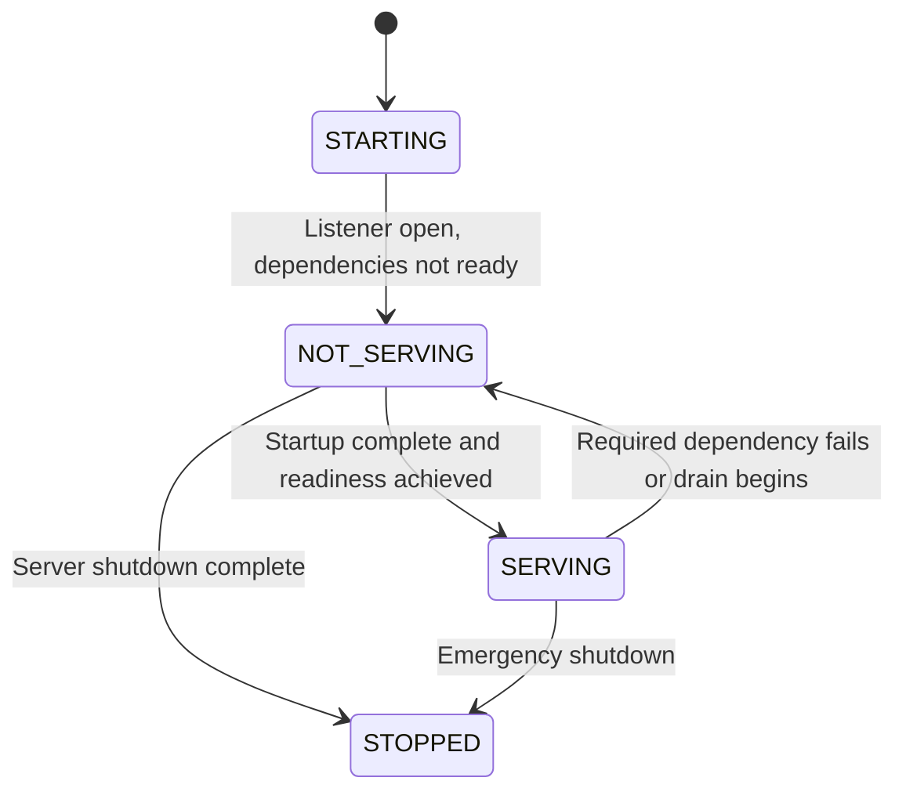

# Configuring Health Service and Reflection

## Lesson Objectives

In **SPRING_GRPC**, a server needs to provide clear signals so clients, load balancers, and deployment platforms know when the service can accept traffic. gRPC defines the Health Checking Protocol with two RPCs: `Check` and `Watch`. In addition, gRPC Server Reflection allows tools such as `grpcurl` to discover services, methods, and Protobuf descriptors without requiring users to supply all `.proto` files beforehand.

This lesson focuses on **configuring the health service and reflection**: registering the health service and updating status across the application lifecycle, distinguishing liveness from readiness, supporting client health checking via `Watch`, enabling reflection in the appropriate scope, integrating both services into the Spring-managed server, and testing with `grpcurl`.

After this lesson, you will be able to:

1. Explain the role of the gRPC Health Checking Protocol and serving statuses.
2. Configure `HealthStatusManager` and register the Health service.
3. Update overall and per-service gRPC statuses during startup, readiness changes, and shutdown.
4. Distinguish liveness, readiness, and dependency health.
5. Understand how client health checking uses `Watch`.
6. Register Server Reflection to discover Protobuf services/methods.
7. Restrict reflection by environment and security policy.
8. Integrate health/reflection with the Spring gRPC server factory and test actual behavior.

> **Scope:** Examples use gRPC Java and Spring gRPC. `HealthStatusManager` and `ProtoReflectionService` belong to the gRPC Java services artifact. How a `BindableService` is added to the server depends on the extension point of the Spring gRPC starter/transport in use; creating a bean does not automatically mean the service is registered on the listener.

## 1. Two operational services with different purposes

The health service and reflection service are both auxiliary gRPC services, but they serve different needs:

| Component | Purpose | Typical consumer |
| --- | --- | --- |
| gRPC Health service | Reports whether a service is `SERVING` or `NOT_SERVING` | Load balancer, gRPC client, orchestrator, probe |
| Server Reflection | Provides the service list and Protobuf descriptors | `grpcurl`, `grpcui`, debugging tools, and dynamic clients |

The health service is a runtime signal about readiness to receive traffic. Reflection is a capability to discover the server's contract. Reflection is not a health check and does not confirm that the service is ready to process requests.

Both are exposed as RPCs on the gRPC server. If the server uses an authentication interceptor, TLS, and network policies, clearly define whether health probes and reflection tools are allowed access under the same policy or under controlled exceptions.

## 2. gRPC Health Checking Protocol

gRPC defines a standard service with package and service name:

```proto
package grpc.health.v1;

service Health {
  rpc Check(HealthCheckRequest) returns (HealthCheckResponse);
  rpc Watch(HealthCheckRequest) returns (stream HealthCheckResponse);
}

message HealthCheckRequest {
  string service = 1;
}

message HealthCheckResponse {
  enum ServingStatus {
    UNKNOWN = 0;
    SERVING = 1;
    NOT_SERVING = 2;
    SERVICE_UNKNOWN = 3;
  }
  ServingStatus status = 1;
}
```

The two RPCs have different semantics:

- **Check:** returns the current status of the requested service. Suitable for request/response probes or one-off checking tools.
- **Watch:** opens a server-streaming RPC. The server sends the current status and continues sending updates whenever the status changes. Clients can keep the stream open to monitor readiness continuously.

The `service` field is the full name of the gRPC service, such as `commerce.v1.InventoryService`. An empty string typically represents the overall status of the server. If you want per-service health, update status using the exact full service name—not the Java class name or Spring bean name.

Statuses:

| Status | Operational meaning |
| --- | --- |
| `UNKNOWN` | Status cannot be determined yet |
| `SERVING` | Service can receive and process traffic |
| `NOT_SERVING` | Service should not currently receive traffic |
| `SERVICE_UNKNOWN` | Server has no status for the queried service per protocol semantics |

Do not set `SERVING` merely because the process opened its port. The service might not have finished startup, might not be connected to required dependencies, or might be draining for shutdown.

## 3. Configuring HealthStatusManager in gRPC Java

gRPC Java provides `HealthStatusManager` in the `grpc-services` artifact. The dependency must use the same version line as the other gRPC Java libraries:

```xml
<dependency>
    <groupId>io.grpc</groupId>
    <artifactId>grpc-services</artifactId>
</dependency>
```

Managing status with `HealthStatusManager`:

```java
import io.grpc.protobuf.services.HealthStatusManager;
import io.grpc.health.v1.HealthCheckResponse.ServingStatus;

HealthStatusManager healthStatusManager =
        new HealthStatusManager();

healthStatusManager.setStatus(
        "",
        ServingStatus.NOT_SERVING);

healthStatusManager.setStatus(
        "commerce.v1.InventoryService",
        ServingStatus.NOT_SERVING);
```

Initializing in the `NOT_SERVING` state avoids the brief window where the listener is open before the service is ready. Once the application completes startup and the readiness policy permits receiving traffic, update the status:

```java
healthStatusManager.setStatus(
        "",
        ServingStatus.SERVING);

healthStatusManager.setStatus(
        "commerce.v1.InventoryService",
        ServingStatus.SERVING);
```

If there are multiple services, update status separately for each service. The empty overall status and per-service statuses should be kept consistent according to your application policy.

### 3.1. Registering the Health service on the server

`HealthStatusManager` provides a `BindableService` via `getHealthService()`. That service must be registered on the actual server serving RPCs:

```java
ServerBuilder<?> builder = obtainSpringManagedServerBuilder();

builder.addService(healthStatusManager.getHealthService());
```

This is a gRPC Java builder operation illustrating registration. In Spring gRPC, the server is usually created and managed by the starter. Place the `addService` call inside the server builder customizer/configurer or factory extension point documented for your exact starter version.

Never create a standalone `Server` in configuration just to register the Health service if Spring already manages the main listener. A secondary server could have a different port, TLS setup, interceptors, service registration, and lifecycle from the real server the load balancer probes.

### 3.2. Registering via Spring lifecycle

You can expose `HealthStatusManager` as a Spring bean so services, lifecycle coordinators, and readiness integrations share a single instance:

```java
@Configuration(proxyBeanMethods = false)
class GrpcHealthConfiguration {

    @Bean
    HealthStatusManager healthStatusManager() {
        HealthStatusManager manager = new HealthStatusManager();
        manager.setStatus("", ServingStatus.NOT_SERVING);
        manager.setStatus(
                "commerce.v1.InventoryService",
                ServingStatus.NOT_SERVING);
        return manager;
    }
}
```

This bean only creates and manages the status manager. You must register `getHealthService()` on the Spring-managed gRPC server using your version's extension point. Do not assume every starter automatically discovers a `HealthStatusManager` bean or adds the service on its own.

## 4. Updating health status across the application lifecycle

A basic lifecycle:



A coordinator should be the single place that aggregates readiness conditions and updates health status. Example:

```java
public final class GrpcReadinessCoordinator {

    private final HealthStatusManager health;

    public GrpcReadinessCoordinator(HealthStatusManager health) {
        this.health = health;
    }

    public void markReady() {
        health.setStatus("", ServingStatus.SERVING);
        health.setStatus(
                "commerce.v1.InventoryService",
                ServingStatus.SERVING);
    }

    public void markNotReady() {
        health.setStatus("", ServingStatus.NOT_SERVING);
        health.setStatus(
                "commerce.v1.InventoryService",
                ServingStatus.NOT_SERVING);
    }
}
```

This class illustrates coordination logic; call `markReady` after startup and mandatory readiness conditions are satisfied. Call `markNotReady` before stopping incoming traffic or starting a drain.

If services have independent dependencies, an optional dependency failure should not necessarily mark every gRPC service `NOT_SERVING`. Define which dependencies are mandatory for each service and avoid cascading health check failures during short-lived downstream incidents.

### 4.1. Liveness is different from readiness

- **Liveness:** whether the process is alive and not deadlocked to the point of needing a restart.
- **Readiness:** whether the instance can accept new traffic.
- **Startup:** whether the application has finished initialization.

The gRPC Health service primarily provides a serving signal for clients/load balancers. Do not turn every temporary dependency error into a liveness failure that causes the orchestrator to restart instances en masse and amplify an outage.

If Spring Boot Actuator also provides readiness/liveness state, synchronize readiness state with `HealthStatusManager` via a clear adapter. Avoid two independent status sources making conflicting updates. One readiness coordinator should aggregate state and emit the same decision to both Spring availability and gRPC health.

## 5. Check and Watch in operations

### 5.1. Check for unary probes

`Check` suits tools that query status at a point in time. Example:

```bash
grpcurl -plaintext \
  -d '{"service":"commerce.v1.InventoryService"}' \
  localhost:9090 \
  grpc.health.v1.Health/Check
```

If the endpoint uses TLS, remove `-plaintext` and configure the right CA/hostname. Never disable certificate verification to make a probe pass.

A periodic probe calling `Check` creates an RPC per check. Set a short timeout and an appropriate interval, and avoid polling too aggressively so probes do not become secondary load.

### 5.2. Watch for client health checking

`Watch` keeps a stream open and pushes updates when status changes. This is the foundation for gRPC client-side health checking when supported by the client library and service config.

A service config can declare the service to watch:

```json
{
  "healthCheckConfig": {
    "serviceName": "commerce.v1.InventoryService"
  }
}
```

When health checking is enabled and supported by the transport/client implementation, the client opens a `Watch` call to the health service. The client routes RPCs to a backend only when its reported status is `SERVING`; when it receives `NOT_SERVING`, the client can stop sending new calls to that backend according to its implementation.

Not every language/runtime or client version enables health checking by default. Verify support, how service config is supplied, and behavior when `Watch` terminates. Health checking does not replace retries, load balancing, or deadlines; it supplies an additional readiness signal to the client.

### 5.3. Watch and status transitions

When readiness transitions from `SERVING` to `NOT_SERVING`, open `Watch` streams should receive the update. Clients can then remove the backend from selection for new calls. In-flight RPCs still must be handled according to graceful shutdown/cancellation policies; `NOT_SERVING` does not automatically cancel in-flight RPCs.

When the service returns to `SERVING`, `Watch` clients can receive the update and allow the backend to be selected again. Test status transitions on an existing connection rather than calling `Check` in isolation.

## 6. Configuring Server Reflection

Server Reflection is a standard gRPC service that lets clients query the server for the services and Protobuf descriptors it supports. In gRPC Java, the standard implementation is `ProtoReflectionService` in `grpc-services`.

Registering the reflection service:

```java
import io.grpc.protobuf.services.ProtoReflectionService;

builder.addService(ProtoReflectionService.newInstance());
```

Like the Health service, reflection must be added to the exact Spring-managed server builder. Registering a bean or instantiating `ProtoReflectionService` is not enough if the service is not bound to the listening server.

Reflection provides information such as:

- Full service names.
- Lists of methods and request/response message types.
- Protobuf file descriptors and dependency descriptors.
- Message, enum, and service definitions needed to build dynamic clients.

Reflection does not execute methods by itself and does not replace business service authorization. It only tells the client the contract; the caller still must be authorized to invoke each RPC.

### 6.1. Discovering with grpcurl

List services:

```bash
grpcurl -plaintext localhost:9090 list
```

Inspect methods of a service:

```bash
grpcurl -plaintext localhost:9090 \
  describe commerce.v1.InventoryService
```

Inspect a message type:

```bash
grpcurl -plaintext localhost:9090 \
  describe commerce.v1.GetStockRequest
```

Call a method using JSON mapped by `grpcurl` to a Protobuf message:

```bash
grpcurl -plaintext \
  -d '{"sku":"SKU-100"}' \
  localhost:9090 \
  commerce.v1.InventoryService/GetStock
```

Examples using `-plaintext` are only for local non-TLS test servers. For TLS environments, use the right CA, valid hostname, and appropriate SNI/authority. Never use certificate-verification-skipping flags in production.

### 6.2. Calling gRPC without reflection

Reflection is a discovery convenience, not a requirement for gRPC to work. When reflection is disabled, clients can still invoke services using:

- Client code generated from `.proto` files.
- A descriptor set built alongside the application.
- `.proto` files and dependency imports supplied to tools like `grpcurl`.

Example using a descriptor set:

```bash
grpcurl -protoset api-descriptors.protoset \
  -d '{"sku":"SKU-100"}' \
  grpc.example.com:443 \
  commerce.v1.InventoryService/GetStock
```

Descriptor sets should be versioned together with the API contract to avoid using stale schemas after a service changes.

## 7. Securing reflection and health endpoints

Reflection can expose internal service names, message structures, methods, and unreleased APIs. Even though it returns no business data, schema details can help outsiders map the attack surface.

Deployment choices:

| Environment | Health service | Reflection |
| --- | --- | --- |
| Local development | Enabled for checking | Enabled for convenience |
| Integration/staging | Enabled and tested like production | Enabled with controls |
| Internal production | Enabled for authorized probes/clients | Enabled only if operationally needed and access-controlled |
| Public internet | Exposed only as designed for health/probes | Usually disabled or strictly restricted |

If reflection is enabled in production:

- Allow access only from approved networks/operator identities.
- Apply appropriate authentication/authorization if supported by transport and client tooling.
- Check whether global interceptors block reflection.
- Do not assume an internal port is automatically safe if network boundaries are uncontrolled.
- Monitor reflection access and rate-limit if needed.
- Consider disabling reflection in production and using descriptor sets for operational tooling.

The health endpoint must also be designed carefully. If health requires no credentials so load balancers can probe it, restrict access via network policy and return only minimal status. Never include database hosts, secrets, or stack traces in health responses.

### 7.1. Interceptors and auxiliary services

If an authentication interceptor applies server-wide, health probes and reflection calls can also pass through that interceptor. This may align with security policy, but will break probes if probes carry no credentials.

Clarify:

- To what extent health probes are exempt from authentication, if at all.
- Whether reflection requires operator authentication.
- That business methods always require proper authentication/authorization.
- That auxiliary services cannot be used as a bypass to access business data.

If exceptions are needed, base them on exact full method names and an explicit policy; never bypass authentication for an entire package or all RPCs.

## 8. Integrating health/reflection into Spring gRPC

Spring gRPC manages server lifecycle and service registration. To register auxiliary services:

1. Create `HealthStatusManager` as a shared bean.
2. Create `ProtoReflectionService` when the environment allows reflection.
3. Use the builder customizer/configurer or factory extension point for your exact starter version.
4. Add the health service and reflection service to the same server builder binding your `@GrpcService` beans.
5. Ensure interceptors, TLS, metrics, and graceful shutdown apply with the right scopes.
6. Update `HealthStatusManager` from the readiness/lifecycle coordinator.
7. Verify by connecting to the exact port/listener used by clients and probes.

A helper showing the gRPC Java registration part:

```java
void registerOperationalServices(
        ServerBuilder<?> builder,
        HealthStatusManager health,
        boolean reflectionEnabled) {

    builder.addService(health.getHealthService());

    if (reflectionEnabled) {
        builder.addService(ProtoReflectionService.newInstance());
    }
}
```

This is a plain gRPC Java helper, not a fixed Spring API name. Place it inside the callback/customizer exposed by your Spring gRPC version. Never create a second server, replace existing service registration, or assume an HTTP servlet server's TLS configuration automatically applies to a native gRPC listener.

## 9. Shutdown and traffic draining

Before the server stops:

1. Set overall and per-service readiness to `NOT_SERVING`.
2. Allow load balancers/client health checkers to receive a `Watch` update or the next `Check`.
3. Stop accepting new traffic via the server's graceful shutdown mechanism.
4. Wait for in-flight RPCs within the grace period.
5. Close worker pools and downstream resources in order.
6. Terminate the server once draining finishes or timeout expires.

If you stop the process without updating `NOT_SERVING` first, probes may keep treating the instance as healthy until connections fail. If `NOT_SERVING` is updated too late, load balancers may keep sending new requests while the server is already draining.

Do not treat health status as a socket-closing mechanism. The health service emits a signal; server lifecycle still must perform actual graceful shutdown.

## 10. Testing health service and reflection

An integration test should verify that the services are genuinely registered on the Spring-managed server, not merely that beans exist.

| Case | How to test | Expected result |
| --- | --- | --- |
| Startup not ready | Call `Check` for empty service and specific service | `NOT_SERVING` |
| Startup complete | Call `Check` again | `SERVING` |
| Specific service unready | `Check` full service name | That service is `NOT_SERVING` |
| `Watch` open before status change | Open `Watch` then update status | Receives status update |
| Shutdown begins | Update readiness then call `Check`/`Watch` | `NOT_SERVING` |
| Reflection enabled | `grpcurl list`/`describe` | Shows services and descriptors |
| Reflection disabled | `grpcurl list` | Reflection unavailable; typed RPC client still works |
| TLS enabled | `grpcurl` with right CA and hostname | Health/reflection accessible per policy |
| Auth interceptor enabled | Probe/operator without credentials | Behaves per policy without accidentally blocking valid probes |
| Unknown service | `Check`/`Watch` unregistered name | Behavior matches health implementation semantics |

Use in-process tests for status logic and interceptors where appropriate; still include at least one integration test over a real transport to verify TLS, ALPN, proxy, and server builder wiring.

### 10.1. Testing Watch

`Watch` is a long-lived stream, so tests must manage subscriptions and timeouts:

- Open `Watch` for a service.
- Verify the initial status.
- Update status to `NOT_SERVING`.
- Wait for a new response within a bounded timeout.
- Update back to `SERVING` and verify the next event.
- Cancel the stream and verify resources are released.

Do not use fixed sleeps to assume an event has arrived; use latches/observers with bounded timeouts.

## 11. Common errors and solutions

| Symptom | Cause | Solution |
| --- | --- | --- |
| `HealthStatusManager` bean exists, but `Check` returns `UNIMPLEMENTED` | Health service not registered on the server | Add `getHealthService()` to the right server builder |
| `Check` always returns `NOT_SERVING` | Readiness coordinator did not update status or wrong service name | Check lifecycle events and full service name |
| Overall health is `SERVING`, but specific service is not `SERVING` | Only empty status was updated | Update status per service according to policy |
| `Watch` receives no updates | Client called `Check` instead of `Watch` or stream closed | Check method, stream lifecycle, and implementation |
| Client health checking does not drop backend | `healthCheckConfig` not configured or client lacks support | Check service config and client library |
| `grpcurl list` does not work | Reflection unregistered or blocked by interceptor/network policy | Check `ProtoReflectionService` and access rules |
| Reflection works locally, fails in staging | Different TLS/auth/proxy policies across environments | Check CA, SNI, credentials, ALPN, and routing |
| Reflection exposes internal schemas | Enabled publicly without access controls | Disable or restrict via network/auth policy |
| Probes fail after enabling auth interceptor | Probes lack credentials | Design explicit permissions for health probes |
| Health returns `SERVING` even when mandatory dependency fails | Status out of sync with readiness policy | Use a coordinator that aggregates readiness |
| Abrupt shutdown causes errors on new requests | Failed to switch to `NOT_SERVING` and drain | Update status before graceful shutdown |
| `Check` passes, but RPCs fail | Health only reflects readiness, not every method working | Run smoke RPCs and check dependencies/service registration |

## 12. Practice exercises

1. Add the `grpc-services` dependency matching the gRPC Java runtime version.
2. Create a `HealthStatusManager` bean and initialize overall/service status to `NOT_SERVING`.
3. Register `getHealthService()` on the Spring gRPC-managed server builder.
4. Once readiness is achieved, update overall and service-specific status to `SERVING`.
5. Use `grpcurl` to invoke `Health/Check` for the empty service and full service name.
6. Open `Health/Watch`, change status, and verify the client receives updates.
7. Register `ProtoReflectionService` in the development/staging profile.
8. Use `grpcurl list`, `describe`, and invoke a method using reflection.
9. Disable reflection in the production profile or restrict access via a chosen policy; verify typed clients can still invoke RPCs.
10. Test startup `NOT_SERVING`, readiness `SERVING`, dependency failure, shutdown `NOT_SERVING`, and TLS/auth behavior.
11. Write an operational runbook explaining how to check health, discover descriptors when allowed, and operate when reflection is disabled.

### Self-check questions

- How do Health `Check` and `Watch` differ?
- Which name must the `service` string in `HealthCheckRequest` use?
- Why should startup begin in `NOT_SERVING`?
- How does liveness differ from readiness?
- Where must `HealthStatusManager` be registered so `Check` does not return `UNIMPLEMENTED`?
- How does client-side health checking use `Watch`?
- What information does reflection provide, and what does it not provide?
- Why is reflection unnecessary for typed gRPC clients to operate?
- What risks arise when enabling reflection on a public endpoint?
- How can an authentication interceptor affect health probes?
- Why must status transition to `NOT_SERVING` before graceful shutdown?
- How can you test `Watch` without relying on fixed sleeps?

## References

- [gRPC — Health Checking](https://grpc.io/docs/guides/health-checking/): health protocol and client health checking.
- [gRPC — Server Reflection](https://grpc.io/docs/guides/reflection/): service discovery and Protobuf descriptors.
- [gRPC Java — HealthStatusManager](https://grpc.github.io/grpc-java/javadoc/io/grpc/protobuf/services/HealthStatusManager.html): updating status and retrieving the Health service.
- [gRPC Java — ProtoReflectionService](https://grpc.github.io/grpc-java/javadoc/io/grpc/protobuf/services/ProtoReflectionService.html): registering the reflection service.
- [gRPC Java — ServerBuilder](https://grpc.github.io/grpc-java/javadoc/io/grpc/ServerBuilder.html): adding services to the server.
- [grpcurl](https://github.com/fullstorydev/grpcurl): CLI for discovering services, descriptors, and invoking gRPC methods.
- [Spring Boot — Actuator Endpoints](https://docs.spring.io/spring-boot/reference/actuator/endpoints.html): health endpoints and operating Spring applications.
- [Spring Boot — Application Availability](https://docs.spring.io/spring-boot/reference/features/spring-application.html): readiness/liveness state in the Spring Boot lifecycle.

**Expected outcome:** Learners can configure the gRPC Health service and Server Reflection on a Spring-managed server, update readiness across startup/dependency/shutdown, understand `Check`/`Watch` and client health checking, use `grpcurl` to inspect Protobuf contracts, and restrict reflection and health access per environment security policies.
