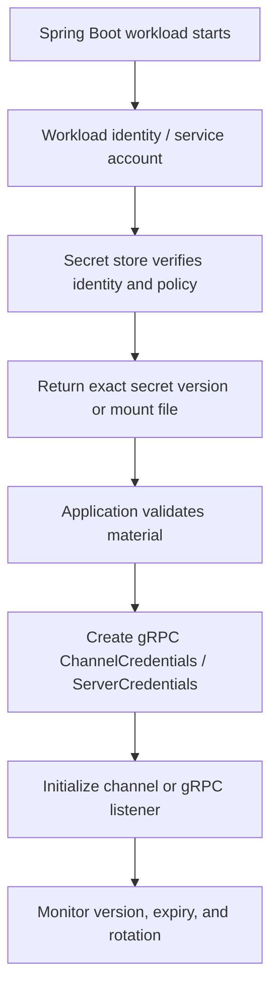
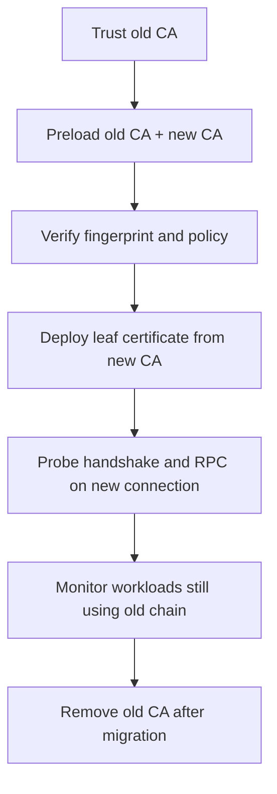

# Secrets and Certificates from a Secret Store

## Lesson Objectives

In **SPRING_GRPC**, clients and servers typically need private keys, certificate chains, CA trust bundles, tokens, or passwords to establish connections and authenticate peers. These values vary by environment, have their own lifecycles, and must be protected from source control, images, logs, and unauthorized users. Putting a secret into the right secret store is only the first step; the application also must authenticate its identity to read the secret, load the right material into gRPC credentials, validate certificates, and handle rotation.

This lesson focuses on **secrets and certificates from a secret store**: distinguishing configuration from secrets and trust material, using workload identity with least privilege, referencing secrets by name/version, loading material via file mounts or a provider, configuring TLS/mTLS for gRPC clients and servers, integrating with the Spring lifecycle, and rotating credentials without unplanned connection disruptions.

After this lesson, you will be able to:

1. Distinguish secrets, public certificates, private keys, and CA trust anchors.
2. Design secret-read permissions using workload identity and least privilege.
3. Keep secret references in configuration and fetch secret values from a runtime provider.
4. Load PEM chains, private keys, and trust bundles for gRPC clients/servers.
5. Integrate a secret provider with Spring configuration and lifecycle.
6. Verify chain, SAN, EKU, validity, and certificate/private key pairs.
7. Execute rotation with versioning, overlap, channel replacement, and rollback.
8. Test missing secrets, wrong permissions, invalid certificates, and rotation.

> **Scope:** Examples use Spring Boot, gRPC Java, and TLS credentials APIs. The secret store may be Vault, a cloud secret manager, a Kubernetes secret volume, or an internal system. The `SecretMaterialProvider` interface in this lesson is an application-defined abstraction, not a built-in Spring API. How `ServerCredentials` is passed into the native gRPC listener must follow the extension point of your Spring gRPC starter/transport.

## 1. Distinguishing configuration, secrets, and trust material

Not every piece of TLS-related data is a secret, but all of it requires integrity and access control management.

| Data type | Examples | Characteristics and management |
| --- | --- | --- |
| Configuration | gRPC target, port, deadline, secret identifier | Can be committed if it does not reveal sensitive details |
| Secret | Bearer token, keystore password, database password | Confidential; obtained from a secret store or workload identity |
| Private key | Server/client private key PEM or key handle | High-value secret; restrict reads and audit |
| Leaf certificate | Server/client certificate | Generally public, but must protect integrity and verify identity |
| Intermediate/root CA | Chain and trust anchor | Generally not secret; must verify source and fingerprint |
| Trust bundle | CA certificates trusted by client/server | Not necessarily secret, but changes can expand the trust boundary |

A public certificate does not require the same secrecy as a private key, but a spoofed certificate or tampered trust bundle can cause a client to trust the wrong peer. Therefore, verifying fingerprints and distribution sources is mandatory before installing a new CA.

Never commit private keys, tokens, or passwords into repositories, Docker images, public Helm values, sample configs, or tickets. Never treat Base64 as an encryption mechanism; Base64 only changes data encoding.

## 2. Architecture for fetching secrets at runtime

The application should know **which secret to fetch**, while read permissions and actual values are granted by the runtime environment. A typical flow:



Principles:

- Use workload identity, a service account, or the platform's short-lived authentication mechanism.
- Avoid storing static secret-store credentials in `application.yml` or environment variables.
- Grant read access only to the exact secret paths/versions the workload needs.
- Separate client workload identities from server workload identities if their permissions differ.
- Enable audit logging in the secret store to track which workload read which secret, when, and which version.
- Do not download entire secret collections into the application when only a few materials are needed.
- When the secret store is unreachable, handle it via an explicit policy; never silently fall back to default credentials or plaintext.

The secret store should provide encryption at rest, versioning, access policies, and auditing as supported by the platform. With Kubernetes Secrets, configure RBAC, restrict `get`/`list` permissions, protect nodes, and enable encryption at rest for the backing store if required by your platform. Just because an object is called a `Secret` does not make it automatically secure in every cluster.

## 3. Storing references in Spring configuration

Application configuration should hold secret names, versions, or mount paths—not private key/token contents.

Example `application.yml`:

```yaml
app:
  grpc:
    security:
      server:
        certificate-secret: secret/grpc/inventory/server-chain
        private-key-secret: secret/grpc/inventory/server-key
        client-ca-secret: secret/grpc/inventory/client-ca
      inventory-client:
        target: dns:///inventory.internal:443
        trust-bundle-secret: secret/grpc/inventory/server-ca
        client-certificate-secret: secret/grpc/inventory/client-chain
        client-private-key-secret: secret/grpc/inventory/client-key
```

The secret names above are illustrative identifiers. They are not mandatory Vault, Kubernetes, or cloud provider paths. Path/version conventions must be agreed upon with the operations team and secret store policy.

Bind references into typed configuration:

```java
@ConfigurationProperties(prefix = "app.grpc.security")
@Validated
public record GrpcSecurityProperties(
        @Valid Server server,
        @Valid InventoryClient inventoryClient) {

    public record Server(
            @NotBlank String certificateSecret,
            @NotBlank String privateKeySecret,
            @NotBlank String clientCaSecret) {}

    public record InventoryClient(
            @NotBlank String target,
            @NotBlank String trustBundleSecret,
            String clientCertificateSecret,
            String clientPrivateKeySecret) {}
}
```

Register properties with `@ConfigurationPropertiesScan` or `@EnableConfigurationProperties`. Add validation based on TLS/mTLS mode: if the client requires mTLS, both client certificate and private key references must be present; if the server requires mTLS, the client CA trust bundle must be present. Do not allow half of a credential pair to pass startup only to fail on the first RPC.

The `app.grpc.security` prefix is an application-defined namespace. It does not configure gRPC servers/channels automatically until code reads the properties and builds credentials.

## 4. Ways to supply secrets to the application

There are two common patterns: secrets mounted as files, and the application calling a secret provider API.

### 4.1. Mounted files

The platform can mount certificates, keys, and trust bundles onto the filesystem with restricted read permissions. Configuration stores only paths:

```yaml
app:
  grpc:
    security:
      server:
        certificate-file: /var/run/grpc-secrets/server-chain.pem
        private-key-file: /var/run/grpc-secrets/server-key.pem
        client-ca-file: /var/run/grpc-secrets/client-ca.pem
```

Advantages:

- The application uses familiar `InputStream`/`Path` APIs.
- No need to put PEM contents into `Environment` or configuration logs.
- A secret agent/operator can manage mounts and versions.
- File permissions and fingerprints can be checked before creating the TLS context.

Restrict file permissions to the process's user/group, do not mount secrets into containers that do not need them, and never copy keys into image layers or unprotected temporary directories. If the provider updates files atomically, the application still must know whether the current TLS context supports reloading.

### 4.2. Spring Boot config tree

Spring Boot supports importing a directory tree of configuration where filenames map to property keys. Example:

```yaml
spring:
  config:
    import: "configtree:/run/secrets/"
```

This suits short text configuration values mounted as files, such as passwords or tokens that the application genuinely needs to bind. Avoid putting large PEM private keys into configuration objects or binding logs. For certificate/key material, keep separate files and bind only paths/references.

Do not add the `optional:` prefix for secrets mandatory in production if a missing secret should fail startup. If a secret is optional depending on profile, express that condition explicitly and validate per profile.

### 4.3. Secret provider API

If the workload needs to fetch secrets directly from Vault or a cloud secret manager, wrap the specific SDK behind a small interface:

```java
public interface SecretMaterialProvider {
    InputStream open(String secretId, String version)
            throws IOException;
}
```

This interface is application-defined. The implementation authenticates via workload identity, calls the provider, fetches the exact version, and returns a stream to the caller. Do not create a singleton provider with permission to read all secrets when the service only needs a few paths.

A helper reading material can use try-with-resources:

```java
try (InputStream certificate =
         secretProvider.open(certificateSecret, version);
     InputStream privateKey =
         secretProvider.open(privateKeySecret, version)) {

    // Create credentials from both streams within initialization scope.
}
```

Never log stream contents or turn provider exceptions into messages containing sensitive secret identifiers if those identifiers are also considered confidential. Log normalized error codes, workload identity, operation, and correlation ID.

## 5. Loading TLS credentials for the gRPC client

Client TLS needs trust roots to verify the server. With mTLS, the client also presents a client certificate and private key.

Example reading PEMs from mounted files:

```java
ChannelCredentials credentials;

try (InputStream serverRoots =
         Files.newInputStream(Path.of(serverCaPath))) {

    credentials = TlsChannelCredentials.newBuilder()
            .trustManager(serverRoots)
            .build();
}

ManagedChannel channel =
        Grpc.newChannelBuilder(target, credentials).build();
```

If the client needs mTLS, add the certificate chain and private key:

```java
ChannelCredentials credentials;

try (InputStream serverRoots =
         Files.newInputStream(Path.of(serverCaPath));
     InputStream clientChain =
         Files.newInputStream(Path.of(clientCertificatePath));
     InputStream clientKey =
         Files.newInputStream(Path.of(clientPrivateKeyPath))) {

    credentials = TlsChannelCredentials.newBuilder()
            .trustManager(serverRoots)
            .keyManager(clientChain, clientKey)
            .build();
}
```

The client trust manager verifies the server chain; the key manager supplies the client identity when the server requires mTLS. Hostname verification must remain enabled. The target DNS name must match the server certificate's SAN; a valid trust chain does not replace hostname verification.

Ensure the certificate chain includes the necessary leaf and intermediates, the key matches the leaf certificate, EKU is appropriate, and validity has not expired. Never use a trust-all manager or disable hostname checks to work around configuration errors.

## 6. Loading TLS credentials for the gRPC server

The server needs a certificate chain and private key. With mTLS, the server also needs a CA trust bundle to verify client certificates.

Example creating `ServerCredentials`:

```java
ServerCredentials serverCredentials;

try (InputStream serverChain =
         Files.newInputStream(Path.of(serverCertificatePath));
     InputStream serverKey =
         Files.newInputStream(Path.of(serverPrivateKeyPath));
     InputStream clientCa =
         Files.newInputStream(Path.of(clientCaPath))) {

    serverCredentials = TlsServerCredentials.newBuilder()
            .keyManager(serverChain, serverKey)
            .trustManager(clientCa)
            .clientAuth(TlsServerCredentials.ClientAuth.REQUIRE)
            .build();
}
```

In a one-way TLS configuration, the server presents its certificate/key and does not require a client certificate. In mTLS, `clientAuth` `REQUIRE` demands that the client send a certificate verified by the server trust manager.

This shows credential creation in gRPC Java. The Spring gRPC starter usually manages server and listener creation. Pass `ServerCredentials` into the server factory/builder via the extension point published by your starter/transport version; do not create a second `Server`, and do not assume servlet server properties apply to the native gRPC listener.

If the server certificate and private key do not match, the server may fail to start or handshakes will fail. Verify the key pair before shifting traffic.

## 7. Verifying certificates and private keys

Before loading material, verify these attributes:

| Attribute | What to check |
| --- | --- |
| Subject Alternative Name | DNS/IP SAN matches the target hostname |
| Extended Key Usage | Server has `serverAuth`; client has `clientAuth` when policy requires |
| Key Usage | Digital signature/key encipherment matches key type and TLS version |
| Validity | `notBefore`/`notAfter` valid against runtime clock |
| Chain | Leaf connects to intermediates and an approved trust anchor |
| Key pair | Public key in certificate matches private key |
| Algorithm/size | Complies with organization cryptography policy |
| Issuer/fingerprint | Exact approved CA and version |

You can inspect a public certificate with OpenSSL:

```bash
openssl x509 -in server-chain.pem -noout \
  -subject -issuer -serial -dates \
  -fingerprint -sha256 \
  -ext subjectAltName -ext extendedKeyUsage
```

Compare the public key digests of the certificate and private key without printing the private key:

```bash
openssl x509 -in server-chain.pem -pubkey -noout \
  | openssl pkey -pubin -outform DER \
  | openssl dgst -sha256

openssl pkey -in server-key.pem -pubout -outform DER \
  | openssl dgst -sha256
```

Both digests must match. Run these commands in a protected environment; never pass private keys over command lines, tickets, or chat. If the private key resides in an HSM/KMS and cannot be exported, verify via the key handle/provider mechanism supported; do not assume every gRPC transport accepts a key handle directly.

## 8. Integrating secret providers with the Spring lifecycle

Secrets must be fetched before creating channel/server credentials, and resources must be closed according to lifecycle.

A clean design:

- `GrpcSecurityProperties` holds targets and secret references.
- `SecretMaterialProvider` reads secrets using workload identity.
- `TlsCredentialFactory` validates and builds `ChannelCredentials`/`ServerCredentials`.
- Spring channel factory builds `ManagedChannel` and closes it when the context stops.
- Spring gRPC's server factory uses the built server credentials.
- Rotation coordinator tracks versions and coordinates credential replacement.

Example factory structure for a client:

```java
@Bean(destroyMethod = "shutdown")
ManagedChannel inventoryChannel(
        GrpcSecurityProperties properties,
        TlsCredentialFactory credentialFactory) throws IOException {

    ChannelCredentials credentials =
            credentialFactory.forInventoryClient(
                    properties.inventoryClient());

    return Grpc.newChannelBuilder(
            properties.inventoryClient().target(),
            credentials)
            .build();
}
```

`TlsCredentialFactory` is an application component. It calls `SecretMaterialProvider` or reads mounted files, then creates credentials. Never let service methods query the secret store on every RPC; that increases latency, widens permissions, and turns secret provider failures into hard-to-control business errors.

If the secret provider is unavailable or a certificate is invalid, the workload should fail startup or keep readiness out of `SERVING`. Never silently fall back to plaintext or a default CA.

## 9. Rotation and versioning

Secret stores should keep versions so applications and operations know exactly which credential is in use. Never blindly overwrite the same version without auditing/rollback.

### 9.1. Rotating a leaf certificate under the same CA

If a server leaf certificate is reissued by a CA already trusted by clients:

1. Issue the new certificate with proper SAN/EKU/validity.
2. Verify the certificate and private key pair.
3. Publish the new version to the secret store.
4. Load the new credentials into new server instances or via a supported reload mechanism.
5. Open a new connection and verify the certificate presented by the endpoint.
6. Shift traffic, drain old instances, and retire old keys/certificates per retention policy.

Client trust bundles usually do not need changes if the chain still leads to the currently trusted CA.

### 9.2. Rotating a CA with overlap

When changing CAs, there must be a period where clients/servers trust both the old and new CAs:



For server CA rotation, the client trust bundle must include the new CA before the server switches leaf certificates. For client CA rotation in mTLS, the server trust bundle must trust the new CA before clients switch certificates. Do not remove the old CA while valid workloads still use the old chain, except during an emergency compromise requiring immediate revocation.

### 9.3. A new secret version does not automatically update TLS contexts

A channel/server usually retains the credentials or TLS context constructed at initialization time. Having a new version in the secret store or an updated file mount does not guarantee running connections reload the new material automatically.

- **Client:** create a new `ManagedChannel` with the new credentials, verify connectivity, route new RPCs to the new channel, drain the old channel, and shut it down.
- **Server:** use a reload mechanism if explicitly supported by the transport/factory; otherwise, deploy new server instances or perform a rolling restart.
- **Proxy:** check proxy reload semantics and verify certificates over a new connection.
- **Rollback:** keep the old version for the allowed window unless the old key was compromised and must be revoked.

Do not use an existing TLS connection to conclude rotation succeeded; a fresh handshake is required.

## 10. Access control, auditing, and secret protection

Secret policies should enforce least privilege:

- Each workload has its own identity or tightly scoped identity group.
- Clients only read trust roots and client identities needed for the downstreams they call.
- Servers only read server keys/certificates and client CA bundles needed to serve their listeners.
- CI only receives test secrets; never grant read access to production secrets.
- Operators access secrets through audited workflows with approved time limits.
- Revoke identities or read permissions when a workload is decommissioned.

Secret store audit logs should capture identity, secret path, version, timestamp, and access outcome. Applications should log only non-sensitive metadata such as normalized secret version IDs, issuer/serial/fingerprint when investigating. Never log secret values, PEM private keys, tokens, or passwords.

Do not expose secrets through Actuator `env`/`configprops` endpoints, heap dumps, exception messages, or startup banners. Restrict access to heap dumps and thread dumps because objects can hold credentials in memory.

## 11. Common errors and solutions

| Symptom | Cause | Solution |
| --- | --- | --- |
| Startup reports access denied fetching secret | Wrong workload identity or policy | Check service account, IAM/ACL, and exact secret path |
| Secret version not found | Wrong reference or version retired | Check identifier/version and rollout manifest |
| TLS builder reports PEM error | Secret has wrong format or encoding | Verify PEM headers, newlines, chain, and key type |
| Server fails to start | Certificate/key mismatch or unreadable key | Compare public key digests, file permissions, and secret version |
| Client reports unknown CA | Wrong trust bundle or missing new CA | Verify fingerprint, chain, and preload CA |
| Hostname mismatch | SAN missing target DNS | Reissue certificate with right SAN; keep hostname verification |
| mTLS handshake fails | Client cert wrong CA/EKU/expiry or server trust bundle missing CA | Check client chain and server client-CA trust |
| Secret updated, but channel uses old certificate | Channel holds previously loaded credentials | Create a new channel or use a supported reload mechanism |
| File mount updated, but server presents old cert | TLS context not reloaded | Rolling restart or transport-level reload |
| App runs plaintext when key is missing | Unsafe fallback configured | Fail startup/readiness; remove fallback |
| Private key appears in logs | Logged exceptions/config objects or dumps | Redact, restrict dumps, and audit permissions |
| CA rotation causes outage | Switched leaf before preloading new trust | Perform overlap properly on client/server sides |

## 12. Testing secrets and certificates

Never use production secrets in unit tests, integration tests, or CI. Use fake providers and separately generated certificate fixtures.

Key tests:

1. **Provider success:** workload identity has permission to read the exact secret version; credentials build successfully.
2. **Access denied:** provider denies access; application does not transition readiness to `SERVING`.
3. **Missing secret:** required key/CA missing; startup fails fast.
4. **Malformed PEM:** invalid certificate/key format; error message is safe and contains no secret contents.
5. **Key mismatch:** certificate and private key do not match; credential creation or handshake fails.
6. **Expired certificate:** client/server rejects expired chain.
7. **Wrong SAN/EKU:** hostname or certificate purpose verification fails.
8. **mTLS:** valid client is accepted; client certificate with wrong CA/expired is rejected.
9. **Rotation:** new channel uses new version; old channel drains and closes cleanly.
10. **No secret leakage:** logs, test reports, and exceptions contain no private keys, tokens, or passwords.
11. **Rollback:** restore old version when new version fails, unless the old credential was revoked due to compromise.

For real TLS transport tests, use a random port and a dedicated test CA. Verify the server certificate over a fresh connection, check SANs, and invoke a generated stub. A unit test that only verifies a credentials bean was created does not prove TLS handshakes and RPCs actually work.

## 13. Practice exercises

1. Create secret references in application configuration for server chain, server key, client CA, and downstream trust bundle.
2. Write `GrpcSecurityProperties` with validation so mTLS requires complete certificate/key/trust references.
3. Create the `SecretMaterialProvider` abstraction; write a fake implementation for tests and an adapter for a secret store/mounted files.
4. Use workload identity with read permission limited to required secrets; verify access denied when using another identity.
5. Build `ChannelCredentials` for client TLS and mTLS from trust bundles/client identities.
6. Build `ServerCredentials` for server TLS and mTLS; wire into your version's Spring-managed server factory.
7. Verify SAN, EKU, validity, chain, and public key digests before transitioning readiness to `SERVING`.
8. Rotate a leaf certificate under the same CA; verify existing client trust continues working.
9. Rotate a CA with overlap; test both server CA rotation and client CA rotation in mTLS.
10. Create a new channel from a new secret version, shift traffic, drain the old channel, and verify shutdown.
11. Test missing secret, provider access denied, malformed PEM, and zero secret leakage in logs.
12. Write a runbook documenting owner, secret paths/versions, overlap period, rollback, and emergency revocation criteria.

### Self-check questions

- How does a private key differ from a public certificate and a trust anchor?
- Why is a trust bundle not necessarily a secret, yet still needs integrity protection?
- How does workload identity help avoid static secret-store credentials?
- Why should `application.yml` hold secret references instead of secret values?
- When should you use mounted files vs. a secret provider API?
- Why should you avoid putting PEM private keys into property objects or logs?
- Whose certificate does the client trust manager vs. the server trust manager verify?
- In mTLS, what material does the server need to verify clients?
- Why does updating a secret version not guarantee channels/servers reload automatically?
- When rotating a server CA vs. a client CA, which side must preload the new trust bundle?
- What checks must pass before transitioning readiness to `SERVING`?
- When an old key is compromised, why might normal overlap have to be skipped?

## References

- [Spring Boot — Externalized Configuration](https://docs.spring.io/spring-boot/reference/features/external-config.html): property sources, config data, and external configuration.
- [Spring Boot — Config Trees](https://docs.spring.io/spring-boot/reference/features/external-config.html#features.external-config.files.configtree): binding file mounts into properties.
- [gRPC Java — TlsChannelCredentials](https://grpc.github.io/grpc-java/javadoc/io/grpc/TlsChannelCredentials.html): trust roots and client key material.
- [gRPC Java — TlsServerCredentials](https://grpc.github.io/grpc-java/javadoc/io/grpc/TlsServerCredentials.html): server certificate, private key, and client authentication.
- [gRPC Java — ChannelCredentials](https://grpc.github.io/grpc-java/javadoc/io/grpc/ChannelCredentials.html): credentials for channels.
- [gRPC Java — ServerCredentials](https://grpc.github.io/grpc-java/javadoc/io/grpc/ServerCredentials.html): credentials for servers.
- [Java — X509Certificate](https://docs.oracle.com/en/java/javase/17/docs/api/java.base/java/security/cert/X509Certificate.html): validity, SAN, and certificate metadata.
- [Java — KeyStore](https://docs.oracle.com/en/java/javase/17/docs/api/java.base/java/security/KeyStore.html): managing key and certificate entries.
- [RFC 5280 — Internet X.509 PKI Certificate and CRL Profile](https://www.rfc-editor.org/rfc/rfc5280): certificate path, validity, and trust anchors.
- [Kubernetes — Secrets](https://kubernetes.io/docs/concepts/configuration/secret/): secret distribution, volume mounts, and access control.

**Expected outcome:** Learners can retrieve secrets and certificates using workload identity from a secret store, build gRPC TLS/mTLS credentials for clients/servers, verify chains and identities, integrate with the Spring lifecycle, rotate versions with overlap, and test permission errors, certificate errors, and reloading without leaking secrets.
