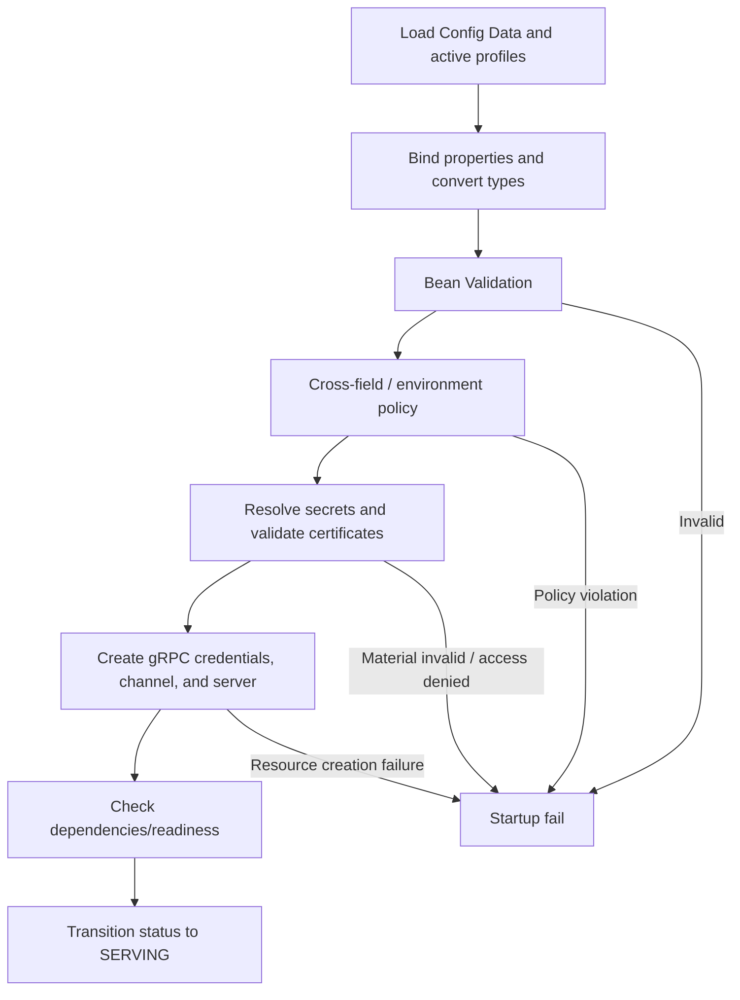

# Validating Configuration on Context Startup

## Lesson Objectives

In **SPRING_GRPC**, misconfiguration can cause the application to connect to the wrong downstream, open a listener without TLS, load an invalid certificate, use an infinite deadline, or start with an unbounded executor. If errors only surface when the first request arrives, the instance may already be placed into rotation by the load balancer and cause user-facing failures.

This lesson focuses on **validating configuration on context startup**: understanding when Spring Boot loads and merges property sources, binding typed configuration, using Jakarta Bean Validation for basic and cross-field constraints, enforcing profile-based policies, verifying secret/certificate material before creating gRPC resources, and keeping readiness at `NOT_SERVING` until mandatory conditions pass.

After this lesson, you will be able to:

1. Distinguish syntax errors, binding errors, validation errors, and runtime errors during gRPC initialization.
2. Organize Spring Boot configuration and verify effective values after overrides.
3. Use `@ConfigurationProperties`, `@Validated`, and Jakarta Bean Validation.
4. Write cross-field validation for targets, deadlines, TLS/mTLS, and executors.
5. Enforce dedicated policies for the production profile and fail fast on unsafe configuration.
6. Verify secret references, file mounts, certificate chains, SANs, EKUs, and key pairs.
7. Ensure channels/servers are never built from unvalidated configuration.
8. Test context startup, profiles, missing secrets, invalid certificates, and readiness.

> **Scope:** Examples use Spring Boot, Jakarta Bean Validation, and gRPC Java. The `app.grpc.*` namespace consists of custom application-defined properties used for illustration, not default properties of every Spring gRPC starter. Registering credentials on the native gRPC server must go through the factory/customizer published by your starter version.

## 1. Why validate immediately on context startup?

Spring Boot can initialize many components before the application receives traffic: configuration properties, client channels, server factories, executors, interceptors, and service beans. If configuration is not checked early, mistakes may only appear on the first RPC call.

Examples:

- A malformed target prevents the channel from connecting.
- A zero or negative deadline causes calls to fail immediately.
- TLS is enabled, but the trust bundle is missing.
- mTLS requires a client certificate, but no key pair is present.
- The server private key does not match the certificate.
- Production accidentally uses plaintext or exposes reflection publicly.
- An unbounded queue/executor exhausts process resources.
- The secret store denies the workload identity, yet the application still marks readiness as `SERVING`.

A startup pipeline should have clear stages:



The goal is to catch errors before the instance receives traffic. Not every check can be expressed purely with annotations; layer validations according to the data and resources involved.

## 2. Layers of configuration validation

| Layer | Examples | Suitable mechanism |
| --- | --- | --- |
| Binding/type conversion | Non-numeric port, malformed `Duration` | Spring Boot Binder |
| Required fields | Missing target or deadline | `@NotBlank`, `@NotNull` |
| Range/format | Port outside 1–65535, negative pool size | `@Min`, `@Max`, `@Positive` |
| Cross-field | TLS enabled without a trust bundle | `@AssertTrue` or class-level constraint |
| Environment policy | Production cannot use plaintext | Startup policy validator |
| External material | CA file missing, secret store access denied | Secret/material provider |
| Certificate semantics | Wrong SAN, expired certificate, key mismatch | X.509/TLS material verifier |
| Runtime connectivity | Handshake, ALPN, or downstream not working | Integration probe/health check |

Binding validation and certificate validation solve different problems. A `Path` can be non-null while the file does not exist; a PEM file can parse while the SAN does not match the target; a certificate can be valid while the server never loaded it into the actual listener.

## 3. Configuration sources and effective values

Spring Boot merges configuration from multiple property sources. Common sources:

- `application.yml` and `application-{profile}.yml`.
- Environment variables.
- Java system properties.
- Command-line arguments.
- External config or mounted config trees.
- Test overrides and dynamic properties.

The final value is the result of precedence, not necessarily what appears in the YAML file. For example, `application-prod.yml` may set TLS, while an environment variable can override `security-mode` if binding allows it.

Activate a profile at runtime:

```bash
SPRING_PROFILES_ACTIVE=production
```

Or:

```bash
java -jar inventory-grpc.jar --spring.profiles.active=production
```

Verify the actual active profiles and bound values. Never dump the entire `Environment` or properties objects to logs because they may hold secrets/internal references. Build an allowlisted startup summary containing fields such as profile, normalized target, TLS mode, deadline, port, pool limits, and reflection policy.

## 4. Binding configuration with @ConfigurationProperties

Do not scatter `Environment.getProperty` calls across services or factories. Group related configuration into a typed object so Spring binds and validates it centrally.

Example configuration:

```yaml
app:
  grpc:
    inventory-client:
      target: dns:///inventory.internal:443
      deadline: 2s
      security-mode: TLS
      trust-bundle: /var/run/grpc-secrets/server-ca.pem
    server:
      port: 9090
      tls-enabled: true
      certificate-chain: /var/run/grpc-secrets/server-chain.pem
      private-key: /var/run/grpc-secrets/server-key.pem
      require-client-auth: true
      client-ca: /var/run/grpc-secrets/client-ca.pem
    executor:
      core-threads: 8
      max-threads: 32
      queue-capacity: 100
    operations:
      reflection-enabled: false
```

These paths are example runtime mounts. Never commit private keys or certificate material to the repository. Configuration holds only paths/references; the provider supplies files or secrets.

Example properties record:

```java
@ConfigurationProperties(
        prefix = "app.grpc",
        ignoreUnknownFields = false)
@Validated
public record GrpcRuntimeProperties(
        @Valid @NotNull InventoryClient inventoryClient,
        @Valid @NotNull Server server,
        @Valid @NotNull Executor executor,
        @Valid @NotNull Operations operations) {

    public enum SecurityMode {
        TLS, PLAINTEXT
    }

    public record InventoryClient(
            @NotBlank String target,
            @NotNull Duration deadline,
            @NotNull SecurityMode securityMode,
            Path trustBundle) {

        @AssertTrue(message = "deadline must be greater than 0")
        public boolean isDeadlinePositive() {
            return deadline != null
                    && !deadline.isNegative()
                    && !deadline.isZero();
        }

        @AssertTrue(message = "TLS client requires trust bundle")
        public boolean isTrustBundleConfigured() {
            return securityMode != SecurityMode.TLS
                    || trustBundle != null;
        }
    }

    public record Server(
            @Min(1) @Max(65535) int port,
            boolean tlsEnabled,
            Path certificateChain,
            Path privateKey,
            boolean requireClientAuth,
            Path clientCa) {

        @AssertTrue(message = "TLS server requires certificate and private key")
        public boolean isServerKeyPairConfigured() {
            return !tlsEnabled
                    || (certificateChain != null && privateKey != null);
        }

        @AssertTrue(message = "mTLS requires TLS and client CA")
        public boolean isClientCaConfigured() {
            return !requireClientAuth
                    || (tlsEnabled && clientCa != null);
        }
    }

    public record Executor(
            @Min(1) int coreThreads,
            @Min(1) int maxThreads,
            @Min(0) int queueCapacity) {

        @AssertTrue(message = "maxThreads must be >= coreThreads")
        public boolean isThreadRangeValid() {
            return maxThreads >= coreThreads;
        }
    }

    public record Operations(boolean reflectionEnabled) {}
}
```

Registering properties:

```java
@SpringBootApplication
@ConfigurationPropertiesScan
public class InventoryGrpcApplication {
    public static void main(String[] args) {
        SpringApplication.run(
                InventoryGrpcApplication.class, args);
    }
}
```

Include the corresponding validation dependency, typically `spring-boot-starter-validation`. `@Validated` enables validation during binding; `@Valid` on record components cascades validation into nested objects. `ignoreUnknownFields=false` catches typos in the `app.grpc` namespace instead of silently ignoring unknown fields.

Boolean methods annotated with `@AssertTrue` check relationships across multiple fields. For more complex policies, use a custom class-level constraint and `ConstraintValidator` so errors report a clear property path.

## 5. Validating deadlines, targets, and executors

### 5.1. Deadlines must be finite and positive

Null, zero, or negative deadlines are invalid. Set an upper bound aligned with your system's SLA—for instance, an internal RPC must not exceed an agreed maximum. You can add a custom constraint for `Duration` or check it inside a policy validator.

Never use an excessively long deadline to mask downstream errors. Deadlines must fit the overall latency budget and the remaining time of any parent request.

### 5.2. Targets must be validated against security mode

A gRPC target can be a DNS target, resolver URI, or authority depending on the channel builder. Validate format against the target types allowed by your application; do not rely on an overly simple regex and assume every URI is valid.

Example policies:

- Production allows only DNS targets belonging to approved internal domains.
- Local may allow `localhost`/loopback.
- Test may use in-process names or dedicated test targets.
- `PLAINTEXT` is permitted only in `local`/`test` profiles by policy.
- `TLS` must have valid trust material and keep hostname verification enabled.

If a target contains a username/password or query token, reject the configuration and do not log the raw target. Never fall back to plaintext when TLS credential creation fails.

### 5.3. Executors must be bounded

Verify:

- `coreThreads >= 1`.
- `maxThreads >= coreThreads`.
- `queueCapacity >= 0` and within operational bounds.
- Queue wait does not exceed the deadline's latency budget.
- Pool size aligns with downstream connection pools and capacity.
- Rejection policy has clear semantics.

Startup validation only checks static configuration. Pool saturation and downstream latency must be monitored once the application is running.

## 6. Profile-based policy checks

Bean Validation does not know every operational policy. For example, `securityMode=PLAINTEXT` may be valid locally but forbidden in production. You can create a startup policy guard:

```java
@Component
@Lazy(false)
public final class GrpcStartupPolicy {

    public GrpcStartupPolicy(
            GrpcRuntimeProperties properties,
            Environment environment) {

        boolean production = Arrays.asList(
                environment.getActiveProfiles())
                .contains("production");

        if (production
                && properties.inventoryClient().securityMode()
                        != GrpcRuntimeProperties.SecurityMode.TLS) {
            throw new IllegalStateException(
                    "Production requires TLS for gRPC client");
        }

        if (production && !properties.server().tlsEnabled()) {
            throw new IllegalStateException(
                    "Production requires TLS for gRPC server");
        }

        if (production && properties.operations().reflectionEnabled()) {
            throw new IllegalStateException(
                    "Reflection must be disabled under production policy");
        }
    }
}
```

This example expresses an application policy, not a universal rule for every system. If production requires internal reflection, replace that condition with an appropriate access-control policy. `@Lazy(false)` ensures the guard initializes even when global lazy initialization is enabled.

Ensure that factories creating channels, credentials, and servers depend on the guard or share the same validated configuration path. That way resources cannot be created before policy checks run. For servers managed by the Spring gRPC starter, wire the guard into your version's builder customizer/factory integration rather than building a separate listener.

A profile is not a security boundary. Environment variables or command-line arguments can still override values; the policy must inspect the effective values after binding.

## 7. Validating secret and certificate material

A non-null `Path` does not prove the file is mounted or readable by the process. Before creating credentials, verify:

1. The file exists and is a regular file.
2. The process has read permissions.
3. The PEM/keystore parses cleanly.
4. The certificate is valid against the runtime clock.
5. On the client side, the SAN matches the target hostname.
6. EKU/key usage matches `serverAuth`/`clientAuth`.
7. The chain connects to an approved trust anchor.
8. The private key matches the leaf certificate.
9. For mTLS, the client CA trust bundle and client identity exist on their respective sides.
10. The secret version matches the active rollout.

Example path check:

```java
static void requireReadableFile(Path path, String propertyName) {
    if (path == null
            || !Files.isRegularFile(path)
            || !Files.isReadable(path)) {
        throw new IllegalStateException(
                "Required material is unavailable: " + propertyName);
    }
}
```

The message names only the logical property—never print secret values or PEM contents. If the path contains sensitive internal names, omit the full path from production logs as well.

You can call `X509Certificate.checkValidity()` to check expiration after parsing a certificate. Check SAN/EKU and chains according to the certificate's role; server and client certificates have different purposes. Successfully constructing TLS credentials does not guarantee handshakes will succeed; an integration probe against the actual target and trust material is still necessary.

### 7.1. Checking certificates outside the application

You can use OpenSSL in a protected operational environment:

```bash
openssl x509 -in server-chain.pem -noout \
  -subject -issuer -dates -fingerprint -sha256 \
  -ext subjectAltName -ext extendedKeyUsage
```

Verify the chain and hostname:

```bash
openssl verify -purpose sslserver \
  -CAfile root-ca.pem \
  -untrusted intermediate-ca.pem \
  -verify_hostname grpc.example.com \
  server-chain.pem
```

Compare public key digests of the certificate and private key without printing the private key:

```bash
openssl x509 -in server-chain.pem -pubkey -noout \
  | openssl pkey -pubin -outform DER \
  | openssl dgst -sha256

openssl pkey -in server-key.pem -pubout -outform DER \
  | openssl dgst -sha256
```

Both digests must match. Never copy private keys into logs, tickets, or chat; never pass secrets in command-line arguments if shell history or process inspection could expose them.

## 8. Creating gRPC resources only after validation passes

Once properties and material are valid, the factory builds `ChannelCredentials` or `ServerCredentials`.

Example client TLS credentials from a mounted trust bundle:

```java
ChannelCredentials channelCredentials(Path trustBundle)
        throws IOException {

    try (InputStream roots =
                 Files.newInputStream(trustBundle)) {
        return TlsChannelCredentials.newBuilder()
                .trustManager(roots)
                .build();
    }
}
```

Example server credentials:

```java
ServerCredentials serverCredentials(
        Path certificateChain,
        Path privateKey) throws IOException {

    try (InputStream chain =
                 Files.newInputStream(certificateChain);
         InputStream key =
                 Files.newInputStream(privateKey)) {
        return TlsServerCredentials.newBuilder()
                .keyManager(chain, key)
                .build();
    }
}
```

If mTLS is enabled, add `trustManager(clientCa)` and `clientAuth(REQUIRE)` per policy. For client mTLS, add `keyManager(clientChain, clientKey)` to `TlsChannelCredentials`.

These are gRPC Java credential APIs. The Spring gRPC starter usually manages `ManagedChannel` and native server lifecycles; credentials must be wired into the channel/server factory or builder extension point published by your exact starter version. Never assume servlet container SSL configuration applies automatically to a native gRPC listener.

Do not create channels/servers from default configuration and swap credentials after receiving the first request. Resources should be built from validated properties and verified secret versions.

## 9. Fail-fast and readiness

There are two distinct outcomes:

- **Startup fail:** mandatory configuration or material is invalid; the process cannot serve safely.
- **Started but `NOT_SERVING`:** the process can start, but dependencies/readiness are not yet satisfied; the instance does not receive traffic yet.

Errors that should normally fail startup:

- Missing mandatory target/deadline.
- Production enabling plaintext in violation of policy.
- TLS/mTLS missing key, certificate, or trust bundle.
- Secret store denying workload identity.
- Expired certificate, wrong SAN/EKU, or key mismatch.
- Executor configured with invalid bounds.
- Server/channel unable to initialize due to invalid credentials/configuration.

Dependencies that can recover after startup may keep the instance `NOT_SERVING` until readiness is achieved, depending on architecture. Do not turn every temporary dependency failure into a crash loop; choose policies based on criticality and recoverability.

The health service should initialize as `NOT_SERVING`. Transition to `SERVING` only after:

1. Configuration binding and validation complete.
2. Secret/certificate material is valid.
3. gRPC listeners/channels are created with the right security mode.
4. Mandatory dependencies are ready.
5. The readiness coordinator confirms the service can accept traffic.

Never use liveness to report every downstream outage; doing so can cause the orchestrator to restart instances en masse and amplify an incident.

## 10. Safe startup summary

A startup summary helps operations confirm which configuration the application loaded without leaking secrets.

Safe to record:

- Active profiles.
- Service name and listener port.
- Normalized downstream target.
- TLS mode and mTLS enabled/disabled.
- Deadline.
- Executor core/max/queue limits.
- Health/reflection policy.
- Approved non-sensitive secret version identifier.
- Certificate issuer/serial or fingerprint when needed for auditing.

Never record:

- Private keys, bearer tokens, passwords, or secret values.
- PEM contents.
- Entire `Environment` or properties objects.
- Raw request metadata.
- Full secret paths if paths themselves are considered sensitive.

Create a dedicated summary DTO with allowlisted fields; never call `toString()` on properties objects holding sensitive credentials/paths. Apply redaction to exception messages and startup failure logs as well.

## 11. Testing configuration on context startup

Tests should verify both binding and behavior when Spring builds resources.

| Test case | Setup | Expected result |
| --- | --- | --- |
| Missing target | Omit `inventory-client.target` | Context fails with clear property path |
| Zero deadline | `deadline: 0s` | Bean Validation fails |
| TLS missing trust bundle | `security-mode: TLS`, `trust-bundle` null | Cross-field validation fails |
| Server TLS missing key | `tls-enabled: true`, `private-key` missing | Context fails before listener accepts traffic |
| mTLS missing client CA | `require-client-auth: true`, `client-ca` missing | Validation fails |
| Pool max less than core | `max-threads < core-threads` | Validation fails |
| Production plaintext | Active `production`, mode `PLAINTEXT` | Startup policy guard fails |
| Production reflection | Reflection enabled against policy | Startup policy guard fails |
| Secret access denied | Fake provider returns access denied | No credentials created, not `SERVING` |
| Unreadable file | Mounted path has wrong permissions | Startup fails with redacted message |
| Expired cert / wrong SAN | Use broken test fixture | Material verifier/handshake fails |
| Key mismatch | Certificate and private key from different pairs | Credential validation or TLS integration fails |
| Property typo | Add unknown key under `app.grpc` | Binding fails when `ignoreUnknownFields=false` |
| Environment override | Override deadline/target | Summary and resources use effective values |
| Valid configuration | Complete configuration | Context starts and readiness passes per policy |

### 11.1. ApplicationContextRunner

`ApplicationContextRunner` is useful for testing binding and validation without starting the entire server:

```java
new ApplicationContextRunner()
        .withUserConfiguration(TestPropertiesConfiguration.class)
        .withPropertyValues(
                "app.grpc.inventory-client.target=dns:///localhost:9090",
                "app.grpc.inventory-client.deadline=2s",
                "app.grpc.inventory-client.security-mode=TLS",
                "app.grpc.inventory-client.trust-bundle=/tmp/test-ca.pem")
        .run(context -> {
            assertThat(context).hasNotFailed();
            assertThat(context)
                    .hasSingleBean(GrpcRuntimeProperties.class);
        });
```

This example only illustrates the pattern; supply the other required record properties and file fixtures in your test configuration. Negative tests change one value to verify context startup fails and assert the root cause/property path.

### 11.2. Integration tests with gRPC transport

Once unit/context tests pass, run integration tests over a real transport:

- Start the Spring gRPC server with TLS fixtures.
- Create a client channel using the right CA and hostname.
- Verify the handshake and ALPN `h2`.
- Call a generated stub and verify the RPC succeeds.
- Test wrong CA, hostname mismatch, and expired certificate.
- Verify server readiness remains `NOT_SERVING` when material is invalid.
- Close the context and verify channel/server shutdown.

A test that merely asserts a properties bean exists does not prove the listener is using the right TLS credentials.

## 12. Common errors and solutions

| Symptom | Cause | Solution |
| --- | --- | --- |
| App starts even when required property is missing | Properties not bound/validated or nested object lacks `@Valid` | Use `@ConfigurationProperties`, `@Validated`, and `@Valid` |
| Property typo silently ignored | Unknown fields allowed | Consider `ignoreUnknownFields=false` for custom namespaces |
| Validation does not run | Missing validation starter or `@Validated` omitted | Add Jakarta validation dependency and annotation |
| TLS enabled, but client does not trust server | Only checked non-null path, not file/CA | Check readable file, chain, and handshake |
| Production uses plaintext | Policy lived only in YAML and got overridden | Validate active profiles and effective values |
| Channel created before policy guard runs | Resource factory does not depend on validated guard/config | Inject guard into factory/customizer and ensure eager validation |
| Valid certificate, but wrong hostname | Checked chain only, skipped SAN | Verify hostname against actual target |
| Secret store access denied, yet app is `SERVING` | Startup/readiness independent of material resolution | Fail startup or keep `NOT_SERVING` |
| Error appears only on first request | Credentials/resources created too lazily | Create and validate resources before readiness |
| Startup summary leaks secrets | Logged entire properties/`Environment` | Use allowlisted DTO and redaction |
| Health `SERVING` before TLS is ready | Readiness updated too early | Report `SERVING` only after credentials/listeners/dependencies pass |
| Context tests pass, but transport fails | Tests did not open a real gRPC listener | Add TLS/HTTP2 integration tests |

## 13. Practice exercises

1. Create `GrpcRuntimeProperties` with target, deadline, client TLS, server TLS/mTLS, executor, and reflection settings.
2. Add `@Validated`, `@Valid`, and constraints for required fields, port, deadline, and thread range.
3. Write cross-field validation so TLS requires trust bundle/certificate/key and mTLS requires client CA.
4. Write a startup policy guard forbidding plaintext and reflection under production policy.
5. Create a material verifier checking mounted files, certificate validity, SAN, EKU, chain, and key pairs.
6. Use a fake `SecretMaterialProvider` to test success, missing secret, and access denied.
7. Ensure credential/channel/server factories depend on validated configuration.
8. Keep health status `NOT_SERVING` until mandatory material and listeners/dependencies are ready.
9. Write `ApplicationContextRunner` tests for invalid properties and valid configuration.
10. Write integration tests over TLS/HTTP2 to verify handshake and generated stubs.
11. Build a startup summary containing only allowlisted fields; verify logs contain no tokens/PEMs/passwords.
12. Rehearse a production startup failure caused by an expired certificate and write a remediation runbook.

### Self-check questions

- How do binding, Bean Validation, cross-field policy, and runtime material validation differ?
- Why is `@ConfigurationProperties` preferable to scattered `Environment.getProperty` calls?
- What role does `@Valid` play for nested records?
- When should you use `@AssertTrue` vs. a class-level `ConstraintValidator`?
- Why does a non-null `Path` not prove a certificate is ready?
- How do you prevent production from using `PLAINTEXT` even when an environment variable overrides YAML?
- Why must channel/server factories depend on the startup policy guard?
- Which errors should fail startup vs. keep status `NOT_SERVING`?
- Why does a valid certificate chain not guarantee the hostname is right?
- Why should you never log entire properties or `Environment`?
- What can `ApplicationContextRunner` verify, and what can it not prove?
- What must be verified over a real transport before readiness transitions to `SERVING`?

## References

- [Spring Boot — Configuration Properties Validation](https://docs.spring.io/spring-boot/reference/features/external-config.html#features.external-config.typesafe-configuration-properties.validation): binding and validating typed configuration.
- [Spring Boot — Externalized Configuration](https://docs.spring.io/spring-boot/reference/features/external-config.html): property source precedence and Config Data.
- [Spring Boot — Profiles](https://docs.spring.io/spring-boot/reference/features/profiles.html): profile-specific configuration and active profiles.
- [Jakarta Bean Validation](https://jakarta.ee/specifications/bean-validation/): constraints, validation groups, and custom validators.
- [Spring Boot — Testing](https://docs.spring.io/spring-boot/reference/testing/index.html): `ApplicationContextRunner` and application tests.
- [gRPC Java — TlsChannelCredentials](https://grpc.github.io/grpc-java/javadoc/io/grpc/TlsChannelCredentials.html): client trust roots and key material.
- [gRPC Java — TlsServerCredentials](https://grpc.github.io/grpc-java/javadoc/io/grpc/TlsServerCredentials.html): server certificate, private key, and mTLS.
- [Java — X509Certificate](https://docs.oracle.com/en/java/javase/17/docs/api/java.base/java/security/cert/X509Certificate.html): validity, SAN, and certificate metadata.
- [RFC 5280 — Internet X.509 PKI Certificate and CRL Profile](https://www.rfc-editor.org/rfc/rfc5280): certificate path validation and trust anchors.

**Expected outcome:** Learners can validate Spring gRPC configuration on context startup, catch binding/validation/policy/secret/certificate errors before serving traffic, build channels and listeners from verified material, keep readiness at `NOT_SERVING` when mandatory conditions are unmet, and test both configuration and real TLS transport behavior.
